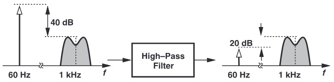

# 예제 15.2 — 전원에서 유입된 60 Hz 간섭 억제

## 조건
- 증폭하려는 신호는 $1\ \mathrm{kHz}$ 부근에 있다. 기판과 배선에 유입된 전원의 $60\ \mathrm{Hz}$ 성분은 이 신호보다 $40\ \mathrm{dB}$ 높다.
- 출력에서 원하는 신호가 간섭자보다 $20\ \mathrm{dB}$ 이상 높아야 한다.

## 구할 것
- 이 조건에 맞는 필터와 필요한 저지대역 감쇠를 정한다.

## 회로 — 없음 (신호와 간섭자의 전력 레벨을 비교하는 문제)

## 답 (검증용)
- 고역통과 필터가 $60\ \mathrm{Hz}$에서 최소 $60\ \mathrm{dB}$ 감쇠를 제공해야 한다.
- Fig 15.5에서 가로축은 $f$이다. High-Pass Filter 왼쪽에는 $1\ \mathrm{kHz}$ 신호보다 $40\ \mathrm{dB}$ 높은 $60\ \mathrm{Hz}$ 선이 있고, 오른쪽에서는 이 선이 신호보다 $20\ \mathrm{dB}$ 낮다.

