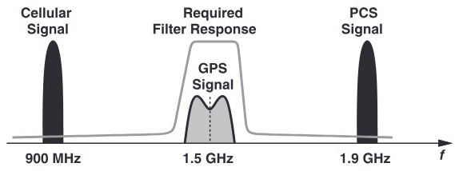

# 예제 15.3 — GPS 수신기의 간섭원과 필터 선택

## 조건
- GPS 수신기의 동작 주파수는 약 $1.5\ \mathrm{GHz}$이다.

## 구할 것
- GPS 수신을 방해하는 간섭원을 찾고, 그 간섭을 억제할 필터 유형을 정한다.

## 회로 — 없음 (주파수 대역에 따른 필터 선택)

## 답 (검증용)
- $900\ \mathrm{MHz}$ 셀룰러 대역과 $1.9\ \mathrm{GHz}$ PCS 대역의 휴대전화가 주요 간섭원이다. 가운데 GPS 대역을 통과시키는 대역통과 필터가 필요하다.
- Fig 15.7의 가로축 $f$를 따라 셀룰러, GPS, PCS 신호가 차례로 있다. 요구되는 필터 응답은 $1.5\ \mathrm{GHz}$ 부근에서 높고 양옆의 간섭 대역에서 낮다.

