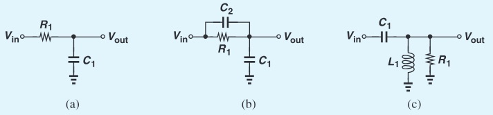
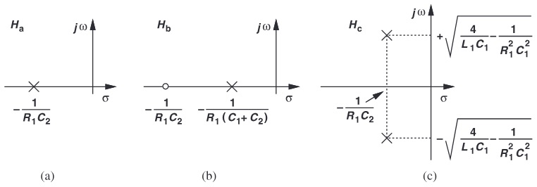

# 예제 15.4 — 세 수동 필터의 극점과 영점

## 조건
- Fig 15.12(a)는 직렬 $R_1$과 접지로 연결한 $C_1$의 RC 필터이다. (b)는 $R_1$에 $C_2$를 병렬로 연결한다.
- (c)는 입력에 $C_1$을 직렬로 놓고 출력에서 접지로 $L_1$과 $R_1$을 병렬 연결한다.

## 구할 것
- (a), (b), (c) 각각의 극점과 영점을 복소평면에 그린다.

## 회로 — Fig 15.12(a)
```spice
R1  Vin   Vout  {R_1}
C1  Vout  0     {C_1}
```
- 단자: Vin = 입력 (개방 원) / Vout = 출력 (개방 원)
- 표시: 노드 라벨 V_in, V_out / 소자 라벨 R_1 (저항 위), C_1 (커패시터 오른쪽) / 부호 없음 / 화살표 없음 / 수치·면적 라벨 없음
- 배치: 왼쪽 입력에서 가로 저항을 거쳐 오른쪽 출력으로 향한다. 저항 오른쪽의 출력선 분기(점)에서 아래로 커패시터와 접지가 이어진다. 교차: 없음

## 회로 — Fig 15.12(b)
```spice
R1  Vin   Vout  {R_1}
C2  Vin   Vout  {C_2}
C1  Vout  0     {C_1}
```
- 단자: Vin = 입력 (개방 원) / Vout = 출력 (개방 원)
- 표시: 노드 라벨 V_in, V_out / 소자 라벨 R_1 (저항 아래), C_2 (위쪽 가로 커패시터 위), C_1 (오른쪽 세로 커패시터 옆) / 부호 없음 / 화살표 없음 / 수치·면적 라벨 없음
- 배치: 입력과 출력 사이의 가로 저항 양끝에서 위로 올라간 선을 C_2가 잇는다. 출력 쪽에서 아래로 C_1과 접지가 이어진다. 저항 왼쪽은 입력·저항·위쪽 선의 분기(점), 오른쪽은 저항·출력·위쪽 선·아래쪽 선의 분기(점)이다. 교차: 없음

## 회로 — Fig 15.12(c)
```spice
C1  Vin   Vout  {C_1}
L1  Vout  0     {L_1}
R1  Vout  0     {R_1}
```
- 단자: Vin = 입력 (개방 원) / Vout = 출력 (개방 원)
- 표시: 노드 라벨 V_in, V_out / 소자 라벨 C_1 (가로 커패시터 위), L_1 (인덕터 왼쪽), R_1 (저항 오른쪽) / 부호 없음 / 화살표 없음 / 수치·면적 라벨 없음
- 배치: 입력에서 오른쪽으로 C_1을 지나 출력까지 가로선이 이어진다. 그 선에서 왼쪽 L_1 가지(점), 오른쪽 R_1 가지(점)가 차례로 아래로 갈라져 각각 접지된다. 교차: 없음



## 답 (검증용)
- (a) 실수 극점 $-1/(R_1C_1)$만 있다. (b) 실수축 왼쪽부터 영점 $-1/(R_1C_2)$, 극점 $-1/[R_1(C_1+C_2)]$가 있다.
- (c) 식 (15.6)은 $H_c(s)=L_1C_1R_1s^2/(R_1L_1C_1s^2+L_1s+R_1)$이다. 풀이 본문에는 0 주파수에서 영점 하나가 있고 판별식 $L^2-4R_1^2L_1C_1$의 부호에 따라 두 극점이 실수 또는 복소수가 된다고 인쇄돼 있다.
- Fig 15.13에서 가로축은 $\sigma$, 세로축은 $j\omega$이다. (a)의 × 좌표는 $-1/(R_1C_2)$로 인쇄되어 있다. (b)에는 위의 실수 영점(○)과 극점(×)이 표시돼 있다. (c)는 켤레 극점(×)을 그렸으며 실수 좌표는 $-1/(R_1C_2)$, 허수 좌표는 $\pm\sqrt{4/(L_1C_1)-1/(R_1^2C_1^2)}$로 인쇄돼 있다. 원점의 영점 기호는 보이지 않는다.
- 그림 (a), (c)의 좌표는 문맥과 맞지 않음(오식으로 보임). (a)는 식 (15.2)의 $C_1$에 해당한다. (c)는 식 (15.6)에 따르면 원점에 2중 영점이 있고 극점은 $-1/(2R_1C_1)\pm\tfrac12\sqrt{1/(R_1^2C_1^2)-4/(L_1C_1)}$이다. 판별식의 첫 항 $L^2$는 회로의 $L_1^2$에 해당한다. (원문에 없음)


> 참고: Fig 15.13은 교재 819쪽(PDF 9)에 있다.
