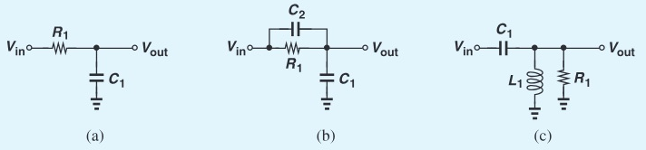
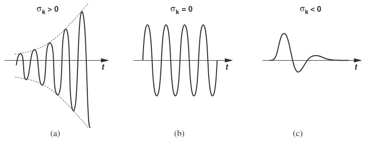

# 예제 15.5 — 수동 필터 극점이 놓이는 반평면

## 조건
- Fig 15.12의 대상 회로는 RC 저역통과 회로 (a), 저항과 병렬로 커패시터를 추가한 회로 (b), 직렬 커패시터에 병렬 RL 부하를 연결한 회로 (c)이다.

## 구할 것
- 세 회로의 극점이 복소평면의 좌반면에 놓이는 이유를 설명한다.

## 회로 — Fig 15.12(a)
```spice
R1  Vin   Vout  {R_1}
C1  Vout  0     {C_1}
```
- 단자: Vin = 입력 (개방 원) / Vout = 출력 (개방 원)
- 표시: 노드 라벨 V_in, V_out / 소자 라벨 R_1 (저항 위), C_1 (커패시터 오른쪽) / 부호 없음 / 화살표 없음 / 수치·면적 라벨 없음
- 배치: 왼쪽 입력에서 가로 저항을 거쳐 오른쪽 출력으로 향한다. 저항 오른쪽의 출력선 분기(점)에서 아래로 커패시터와 접지가 이어진다. 교차: 없음

## 회로 — Fig 15.12(b)
```spice
R1  Vin   Vout  {R_1}
C2  Vin   Vout  {C_2}
C1  Vout  0     {C_1}
```
- 단자: Vin = 입력 (개방 원) / Vout = 출력 (개방 원)
- 표시: 노드 라벨 V_in, V_out / 소자 라벨 R_1 (저항 아래), C_2 (위쪽 가로 커패시터 위), C_1 (오른쪽 세로 커패시터 옆) / 부호 없음 / 화살표 없음 / 수치·면적 라벨 없음
- 배치: 입력과 출력 사이의 가로 저항 양끝에서 위로 올라간 선을 C_2가 잇는다. 출력 쪽에서 아래로 C_1과 접지가 이어진다. 저항 왼쪽은 입력·저항·위쪽 선의 분기(점), 오른쪽은 저항·출력·위쪽 선·아래쪽 선의 분기(점)이다. 교차: 없음

## 회로 — Fig 15.12(c)
```spice
C1  Vin   Vout  {C_1}
L1  Vout  0     {L_1}
R1  Vout  0     {R_1}
```
- 단자: Vin = 입력 (개방 원) / Vout = 출력 (개방 원)
- 표시: 노드 라벨 V_in, V_out / 소자 라벨 C_1 (가로 커패시터 위), L_1 (인덕터 왼쪽), R_1 (저항 오른쪽) / 부호 없음 / 화살표 없음 / 수치·면적 라벨 없음
- 배치: 입력에서 오른쪽으로 C_1을 지나 출력까지 가로선이 이어진다. 그 선에서 왼쪽 L_1 가지(점), 오른쪽 R_1 가지(점)가 차례로 아래로 갈라져 각각 접지된다. 교차: 없음


> 참고: Fig 15.12는 교재 818쪽(PDF 8)에 있다.

## 답 (검증용)
- 극점 $p_k=\sigma_k+j\omega_k$에 대응하는 임펄스 응답 성분은 $e^{p_kt}=e^{\sigma_kt}e^{j\omega_kt}$이다. 안정한 회로에서는 이 성분이 감쇠해야 하므로 $\sigma_k<0$이다.
- Fig 15.14의 세 그래프는 모두 가로축이 시간 $t$이다. (a) $\sigma_k>0$에서는 점선 포락선 사이에서 진동의 진폭이 커지고, (b) $\sigma_k=0$에서는 일정한 진폭으로 진동한다. (c) $\sigma_k<0$에서는 진폭이 줄어들어 시간축에 가까워진다.


