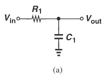

# 예제 15.6 — 저항의 작은 변화에 따른 코너 주파수 오차

## 조건
- Fig 15.10(a)의 저역통과 필터에서 저항 $R_1$이 $\Delta R_1$만큼 작게 변한다.
- 코너 각주파수는 $\omega_0=1/(R_1C_1)$이다.

## 구할 것
- 저항 변화로 인한 코너 주파수의 오차를 구한다.

## 회로 — Fig 15.10(a)
```spice
R1  Vin   Vout  {R_1}
C1  Vout  0     {C_1}
```
- 단자: Vin = 입력 (개방 원) / Vout = 출력 (개방 원)
- 표시: 노드 라벨 V_in, V_out / 소자 라벨 R_1 (저항 위), C_1 (커패시터 오른쪽) / 부호 없음 / 화살표 없음 / 수치·면적 라벨 없음
- 배치: 왼쪽 입력에서 가로 저항을 거쳐 오른쪽 출력으로 향한다. 저항 오른쪽의 출력선 분기(점)에서 아래로 커패시터와 접지가 이어진다. 교차: 없음


> 참고: Fig 15.10(a)는 교재 817쪽(PDF 7)에 있다.

## 답 (검증용)
- 작은 변화에서 $\Delta\omega_0\simeq-\Delta R_1/(R_1^2C_1)$, 따라서 $\Delta\omega_0/\omega_0\simeq-\Delta R_1/R_1$이다. $R_1$이 $5\%$ 증가하면 코너 주파수는 약 $5\%$ 감소한다.
