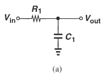

# 예제 15.7 — 커패시턴스에 대한 RC 코너 주파수의 감도

## 조건
- Fig 15.10(a)의 저역통과 필터에서 커패시턴스 $C_1$의 변화를 고려한다.
- 코너 각주파수는 $\omega_0=1/(R_1C_1)$이다. (본문 식, 원문에 없음)
- 식 (15.11)의 감도 정의는 $S_C^P=(dP/P)/(dC/C)$이다. (본문 식, 원문에 없음)

## 구할 것
- $C_1$에 대한 $\omega_0$의 감도를 구한다.

## 상속·참조
- Fig 15.10(a)의 코너 각주파수는 $\omega_0=1/(R_1C_1)$이며 식 (15.11)은 파라미터의 상대 변화를 소자의 상대 변화로 나눈다.

## 회로 — Fig 15.10(a)
```spice
R1  Vin   Vout  {R_1}
C1  Vout  0     {C_1}
```
- 단자: Vin = 입력 (개방 원) / Vout = 출력 (개방 원)
- 표시: 노드 라벨 V_in, V_out / 소자 라벨 R_1 (저항 위), C_1 (커패시터 오른쪽) / 부호 없음 / 화살표 없음 / 수치·면적 라벨 없음
- 배치: 왼쪽 입력에서 가로 저항을 거쳐 오른쪽 출력으로 향한다. 저항 오른쪽의 출력선 분기(점)에서 아래로 커패시터와 접지가 이어진다. 교차: 없음


> 참고: Fig 15.10(a)는 교재 817쪽(PDF 7)에 있다.

## 답 (검증용)
- $d\omega_0/\omega_0=-dC_1/C_1$이므로 $S_{C_1}^{\omega_0}=-1$이다.
