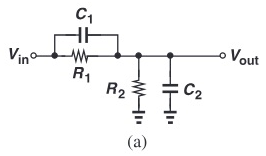
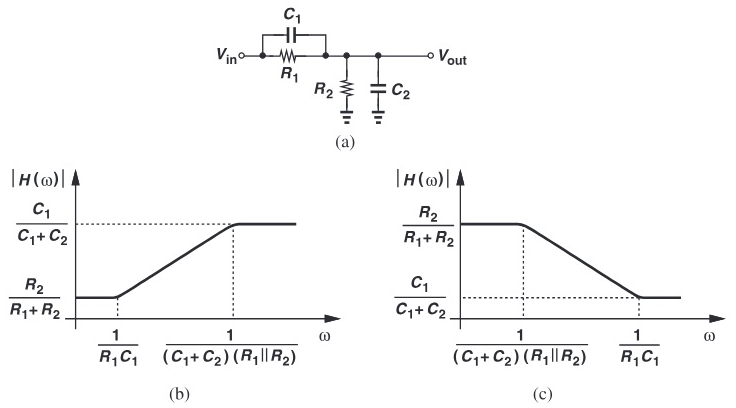

# 예제 15.8 — 두 병렬 RC 가지로 만든 전압 분배기의 응답

## 조건
- Fig 15.17(a)에서 입력과 출력 사이, 출력과 접지 사이에 각각 병렬 RC 가지가 있다.

## 구할 것
- 이 회로의 주파수 응답을 구한다.

## 회로 — Fig 15.17(a)
```spice
R1  Vin   Vout  {R_1}
C1  Vin   Vout  {C_1}
R2  Vout  0     {R_2}
C2  Vout  0     {C_2}
```
- 단자: Vin = 입력 (개방 원) / Vout = 출력 (개방 원)
- 표시: 노드 라벨 V_in, V_out / 소자 라벨 R_1, C_1, R_2, C_2 / 부호 없음 / 화살표 없음 / 수치·면적 라벨 없음
- 배치: 왼쪽 입력에서 오른쪽 출력으로 가는 가로선에 R_1이 있다. 양끝 분기(각각 점)에서 위쪽 C_1로 선을 올린다. R_1 오른쪽 가로선에서 왼쪽 R_2와 오른쪽 C_2가 각각 아래로 갈라져(각각 점) 따로 접지된다. 교차: 없음


> 참고: Fig 15.17(a)는 교재 823쪽(PDF 13)에 있다.

## 답 (검증용)
- $H(s)=\dfrac{R_2(1+R_1C_1s)}{R_1R_2(C_1+C_2)s+R_1+R_2}$. 영점과 극점의 각주파수는 $\omega_z=1/(R_1C_1)$, $\omega_p=1/[(C_1+C_2)(R_1\parallel R_2)]$이다.
- Fig 15.17(b), (c)의 가로축은 $\omega$, 세로축은 $|H(\omega)|$이다. 저주파 레벨 $R_2/(R_1+R_2)$에서 고주파 레벨 $C_1/(C_1+C_2)$로 변한다. (b) $R_2C_2<R_1C_1$이면 $\omega_z$부터 $\omega_p$까지 상승하고, (c) 반대 부등식이면 $\omega_p$부터 $\omega_z$까지 하강한다.


> 참고: Fig 15.17(b), (c)는 교재 823쪽(PDF 13)에 있다.
