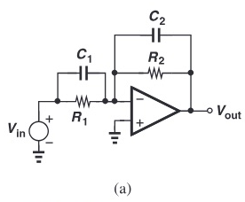
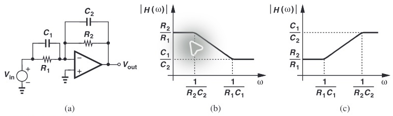

# 예제 15.9 — 능동 RC 필터의 전달 함수와 양 끝 주파수 이득

## 조건
- Fig 15.18(a)는 수동 필터 Fig 15.17(a)에 대응하는 연산증폭기 회로이다. 입력과 되먹임에 각각 병렬 RC 임피던스가 있다.
- 문제는 연산증폭기의 이득을 가정하라고만 적고 값이나 크기를 명시하지 않는다.
- 인쇄 풀이에서는 개방루프 이득이 충분히 큰 이상적 연산증폭기의 반전 연결을 사용한다. (원문에 없음)

## 구할 것
- 회로의 응답을 계산한다.

## 상속·참조
- Fig 15.17(a)는 두 병렬 RC 가지를 직렬 연결해 아래 가지의 전압을 읽는 수동 분배기이다. 이 예제에서는 Fig 15.18(a)의 입력과 되먹임 임피던스로 바뀐다.

## 회로 — Fig 15.18(a)
```spice
VIN  Vin  0     {V_in}
R1   Vin  n1    {R_1}
C1   Vin  n1    {C_1}
R2   n1   Vout  {R_2}
C2   n1   Vout  {C_2}
XA   0    n1    Vout  opamp
```
- 단자: Vout = 출력 (개방 원) / Vin = 접지 기준 입력 전압원의 양단 전압
- 표시: 노드 라벨 V_out / 소자 라벨 V_in, R_1, C_1, R_2, C_2, XA (라벨 없음) / 부호 전압원 오른쪽 위 +, 아래 −, 연산증폭기 왼쪽 위 −, 아래 + / 화살표 없음 / 수치·면적 라벨 없음
- 배치: 왼쪽 접지 전압원 위에서 가로 R_1을 거쳐 반전 입력으로 간다. R_1 양끝 분기(각각 점)에서 위쪽 C_1로 연결한다. 그 오른쪽 반전 입력선의 분기(점)에서 위로 올라가 R_2 왼쪽 끝(점)을 거쳐 C_2로 이어진다. R_2는 가운데, C_2는 그 위에서 가로로 되먹임된다. 오른쪽 공통선은 R_2 오른쪽 끝(점)과 연산증폭기 출력선(점)을 연결한다. 비반전 입력은 왼쪽 접지에 연결된다. 교차: 없음


> 참고: Fig 15.18(a)는 교재 824쪽(PDF 14)에 있다.

## 답 (검증용)
- $H(s)=-\dfrac{R_2}{R_1}\dfrac{1+R_1C_1s}{1+R_2C_2s}$이므로 저주파 이득은 $-R_2/R_1$, 고주파 이득은 $-C_1/C_2$이다.
- Fig 15.18(b), (c)는 가로축 $\omega$, 세로축 $|H(\omega)|$이다. (b) $R_1C_1<R_2C_2$에서는 $1/(R_2C_2)$와 $1/(R_1C_1)$ 사이에서 하강한다. (c)는 $1/(R_1C_1)$부터 $1/(R_2C_2)$까지 상승하고 평탄해진다. 풀이 본문은 (c)의 조건을 $R_1C_1>R_2C_3$로 인쇄한다.
- $C_3$ 표기는 문맥과 맞지 않음(오식으로 보임). 회로와 식 (15.22)에 따르면 (c)는 $R_1C_1>R_2C_2$이다. (원문에 없음)


> 참고: Fig 15.18(b), (c)는 교재 824쪽(PDF 14)에 있다.
