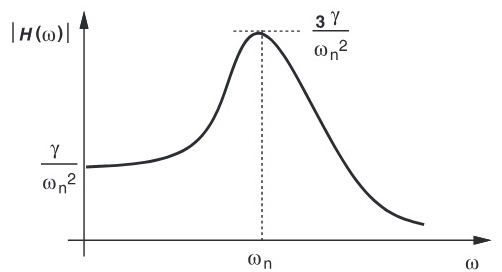

# 예제 15.10 — Q가 3인 2차 저역통과 필터의 피크

## 조건
- 2차 저역통과 필터의 $Q$는 3이다.
- 이 절의 영점 없는 저역통과 전달 함수는 $H(s)=\gamma/[s^2+(\omega_n/Q)s+\omega_n^2]$이다. (본문 식, 원문에 없음)

## 구할 것
- 주파수 응답의 피크 크기와 그 주파수를 예측한다.

## 상속·참조
- 식 (15.25)는 위 전달 함수에 $s=j\omega$를 대입한 크기의 제곱이다. DC 이득은 $\gamma/\omega_n^2$이다.

## 회로 — 없음 (전달 함수 문제, 그래프는 풀이에 있음)

## 답 (검증용)
- $2Q^2=18$이므로 통과대역에 대한 피크 크기 $Q/\sqrt{1-1/(4Q^2)}\approx3$, 피크 주파수 $\omega_n\sqrt{1-1/(2Q^2)}\approx\omega_n$이다.
- Fig 15.21은 가로축 $\omega$, 세로축 $|H(\omega)|$이다. 저주파에서 $\gamma/\omega_n^2$로 출발한 곡선이 $\omega_n$ 부근에서 약 $3\gamma/\omega_n^2$에 이른 뒤 고주파에서 감소한다.

