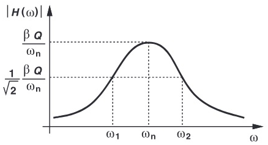

# 예제 15.12 — 2차 대역통과 응답의 반전력 대역폭

## 조건
- 2차 대역통과 필터의 응답은 식 (15.28)로 주어진다.
- 식 (15.28)은 $H(s)=\beta s/[s^2+(\omega_n/Q)s+\omega_n^2]$이다. (본문 식, 원문에 없음)

## 구할 것
- 이 응답의 $-3\ \mathrm{dB}$ 대역폭을 구한다.

## 상속·참조
- 식 (15.28)의 응답은 $\omega_n$에서 피크 $\beta Q/\omega_n$에 도달한다. 양쪽 반전력 주파수 $\omega_1,\omega_2$에서 크기는 피크의 $1/\sqrt{2}$이다.

## 회로 — 없음 (전달 함수 문제, 응답 그래프는 풀이에 있음)

## 답 (검증용)
- 식 (15.30)은 $\omega_{1,2}=\omega_0[\sqrt{1+1/(4Q^2)}\pm1/(2Q)]$로 인쇄되어 있다. 대역폭 $\omega_2-\omega_1=\omega_0/Q$, 정규화 대역폭은 $1/Q$이다.
- Fig 15.24의 가로축은 $\omega$, 세로축은 $|H(\omega)|$이다. $\omega_n$에서 피크 $\beta Q/\omega_n$, 양쪽 $\omega_1,\omega_2$에서 그 $1/\sqrt2$배이다. 식 (15.30)과 대역폭 문장의 $\omega_0$는 식 (15.28)과 그림의 $\omega_n$에 해당한다. (기호 대응은 원문에 없음)

