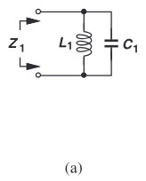

# 예제 15.13 — 병렬 LC 탱크의 저주파와 고주파 임피던스

## 조건
- 대상은 병렬 LC 탱크이다.
- 본문 Fig 15.25(a)의 $L_1$과 $C_1$은 같은 두 단자 사이에 병렬 연결되어 있다. (원문에 없음)

## 구할 것
- $\omega=0$과 $\omega=\infty$에서 탱크 임피던스가 0으로 가는 이유를 직관적으로 설명한다.

## 상속·참조
- Fig 15.25(a)의 두 개방 단자에서 병렬 조합의 임피던스를 본다.

## 회로 — Fig 15.25(a)
```spice
L1  out1  out2  {L_1}
C1  out1  out2  {C_1}
```
- 단자: out1, out2 = 각각 위·아래 임피던스 측정 단자 (개방 원)
- 표시: 노드 라벨 없음 / 소자 라벨 L_1, C_1 / 부호 없음 / 화살표 "Z_1": 두 측정선 왼쪽에서 각 선 옆으로 오른쪽을 가리키는 한 쌍, 도선 옆 별도 화살표 (위쪽은 L자를 위아래 반전, 아래쪽은 L자) / 수치·면적 라벨 없음
- 배치: 왼쪽 위·아래의 개방 원에서 오른쪽으로 평행한 선이 뻗는다. L_1이 중간에 세로로 연결되며 위·아래 분기에 각각 점이 있다. C_1은 오른쪽 끝에서 두 선을 세로로 잇는다. 교차: 없음


> 참고: Fig 15.25(a)는 교재 829쪽(PDF 19)에 있다.

## 답 (검증용)
- $\omega=0$에서 인덕터가 단락되고, $\omega\to\infty$에서는 커패시터가 단락에 가까워진다. 각각의 경우 두 단자 사이에 단락 경로가 생긴다.
