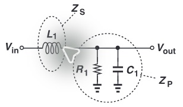

# 예제 15.14 — 수동 RLC 저역통과 필터의 1보다 큰 전압 이득

## 조건
- Fig 15.29의 전달 함수가 식 (15.47)로 주어진다.
- 식 (15.47)은 $H(s)=V_{out}/V_{in}=R_1/(R_1C_1L_1s^2+L_1s+R_1)$이다. (본문 식, 원문에 없음)

## 구할 것
- 이 전달 함수가 어떻게 1보다 큰 전압 이득을 낼 수 있는지 설명한다.

## 상속·참조
- 입력과 출력 사이의 $L_1$과 접지로 연결된 $R_1\parallel C_1$이 전압 분배기를 이룬다. 식 (15.47)에서 DC 이득은 1이다.

## 회로 — Fig 15.29
```spice
L1  Vin   Vout  {L_1}
R1  Vout  0     {R_1}
C1  Vout  0     {C_1}
```
- 단자: Vin = 입력 (개방 원) / Vout = 출력 (개방 원)
- 표시: 노드 라벨 V_in, V_out / 소자 라벨 L_1, R_1, C_1, 점선 테두리의 임피던스 Z_S 및 Z_P / 부호 없음 / 화살표 없음 / 수치·면적 라벨 없음
- 배치: 입력에서 오른쪽으로 가로 L_1을 거쳐 출력에 닿는다. L_1 오른쪽 선에서 왼쪽 R_1과 오른쪽 C_1이 각각 아래로 갈라져(각각 점) 따로 접지된다. 점선 타원이 L_1을 Z_S로, 두 접지 가지를 Z_P로 묶는다. 교차: 없음


> 참고: 원본 스캔의 마우스 포인터가 L_1 오른쪽 도선에 겹쳐 있다.

## 답 (검증용)
- $Q>1/\sqrt2$이면 $\omega=\omega_a$에서 분모 크기가 국소 최솟값에 이르므로 전압 이득이 1을 넘는다. 이때 $\omega_a^2=1/(L_1C_1)-1/(2R_1^2C_1^2)$이다. 등가 조건은 $2R_1^2C_1/L_1>1$이다.
- 풀이의 마지막 문장은 $R_1$이 감소하면 피크가 증가한다고 인쇄되어 있다.
- 이 증감 방향은 문맥과 맞지 않음(오식으로 보임). $Q=R_1\sqrt{C_1/L_1}$이므로 다른 소자값이 같으면 $R_1$이 증가할수록 피크가 커진다. (원문에 없음)
