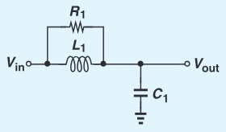
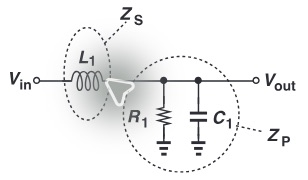

# 예제 15.15 — 두 RLC 저역통과 회로의 고주파 감쇠 비교

## 조건
- Fig 15.30은 입력과 출력 사이에 병렬 RL, 출력과 접지 사이에 커패시터를 둔다. 비교할 Fig 15.29는 직렬 L 다음에 접지로 병렬 RC를 둔다.

## 구할 것
- Fig 15.30이 Fig 15.29보다 덜 유용한 이유를 설명한다.

## 회로 — Fig 15.30
```spice
R1  Vin   Vout  {R_1}
L1  Vin   Vout  {L_1}
C1  Vout  0     {C_1}
```
- 단자: Vin = 입력 (개방 원) / Vout = 출력 (개방 원)
- 표시: 노드 라벨 V_in, V_out / 소자 라벨 R_1, L_1, C_1 / 부호 없음 / 화살표 없음 / 수치·면적 라벨 없음
- 배치: 입력에서 출력으로 가는 가로선에 L_1이 있고 그 양끝 분기(각각 점)에서 위로 R_1이 병렬 연결된다. 그 오른쪽 출력선에서 C_1이 아래로 갈라져(점) 접지된다. 교차: 없음



## 회로 — Fig 15.29
```spice
L1  Vin   Vout  {L_1}
R1  Vout  0     {R_1}
C1  Vout  0     {C_1}
```
- 단자: Vin = 입력 (개방 원) / Vout = 출력 (개방 원)
- 표시: 노드 라벨 V_in, V_out / 소자 라벨 L_1, R_1, C_1, 점선 테두리의 임피던스 Z_S 및 Z_P / 부호 없음 / 화살표 없음 / 수치·면적 라벨 없음
- 배치: 입력에서 오른쪽으로 가로 L_1을 거쳐 출력에 닿는다. L_1 오른쪽 선에서 왼쪽 R_1과 오른쪽 C_1이 각각 아래로 갈라져(각각 점) 따로 접지된다. 점선 타원이 L_1을 Z_S로, 두 접지 가지를 Z_P로 묶는다. 교차: 없음


> 참고: Fig 15.29은 교재 832쪽(PDF 22)에 있다.

## 답 (검증용)
- 고주파에서 Fig 15.30의 $L_1$ 임피던스가 커지면 병렬 가지에는 $R_1$만 남아 사실상 1차 RC 응답이 된다. Fig 15.29는 2차 롤오프를 유지하므로 고주파 감쇠가 더 가파르다.
