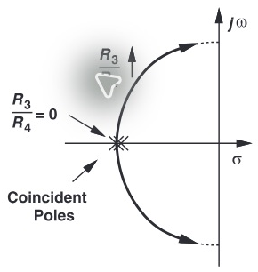

# 예제 15.17 — 소자값이 각각 같은 SK 필터의 복소 극점

## 조건
- Fig 15.34의 일반적인 SK 회로에서 $R_1=R_2$, $C_1=C_2$로 둔다.
- 식 (15.66)의 전달 함수는 $\dfrac{V_{out}}{V_{in}}=\dfrac{K}{R_1R_2C_1C_2s^2+[(R_1+R_2)C_2-(K-1)R_1C_1]s+1}$, $K=1+R_3/R_4$이다. (본문 식, 원문에 없음)

## 구할 것
- 이 필터가 복소 극점을 갖는지 판별한다.

## 상속·참조
- Fig 15.34에서 비반전 증폭기의 되먹임 저항비는 $R_3/R_4$이다.

## 회로 — Fig 15.34
```spice
VIN  Vin  0     {V_in}
R1   Vin  Y     {R_1}
R2   Y    X     {R_2}
C1   Y    Vout  {C_1}
C2   X    0     {C_2}
R3   Vout n1    {R_3}
R4   n1   0     {R_4}
XA   X    n1    Vout  opamp
```
- 단자: Vout = 출력 (개방 원) / Vin = 접지 기준 전압원 전압
- 표시: 노드 라벨 Y, X, V_out / 소자 라벨 V_in, R_1, R_2, R_3, R_4, C_1, C_2, XA (라벨 없음) / 부호 입력 전압원 위 +, 아래 −, 연산증폭기 왼쪽 위 +, 아래 − / 화살표 없음 / 수치·면적 라벨 없음
- 배치: 왼쪽 전압원 위에서 가로 R_1, Y, R_2, X, 비반전 입력이 차례로 이어진다. Y(점)에서 위로 올라간 가지에 피드백 C_1이 있고, X(점)에서는 아래로 C_2를 거쳐 접지된다. 출력의 접속점(점)에 위쪽 C_1 선과 아래쪽 R_3 선이 닿는다. 아래쪽 반전 입력의 분기(점)는 오른쪽의 가로 R_3과 아래쪽 접지 R_4를 잇는다. 교차: 없음


> 참고: Fig 15.34은 교재 836쪽(PDF 26)에 있다.

## 답 (검증용)
- $1/Q=2-R_3/R_4$이므로 저항비가 0이면 $Q=1/2$이고 실수 극점 두 개가 일치한다. 풀이는 비가 0보다 크면 복소 극점이 된다고 설명하며 비를 2에 접근시키는 구간을 다룬다.
- Fig 15.35는 가로축 $\sigma$, 세로축 $j\omega$이다. 음의 실수축의 중근에서 화살표 두 개가 위아래로 갈라져 허수축 쪽으로 향한다. 안정한 복소 극점을 나타내는 그림의 구간은 $0<R_3/R_4<2$이다. (구간의 명시는 원문에 없음)


> 참고: Fig 15.35는 교재 838쪽(PDF 28)에 있다.
