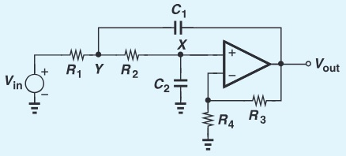

# 예제 15.18 — 같은 저항·커패시터를 쓴 SK 필터의 Q 감도

## 조건
- $R_1=R_2=R$, $C_1=C_2=C$를 선택한다.
- 본문 Fig 15.34에서 $K=1+R_3/R_4$이며 식 (15.74)는 $\dfrac1Q=\sqrt{\dfrac{R_1C_2}{R_2C_1}}+\sqrt{\dfrac{R_2C_2}{R_1C_1}}-(K-1)\sqrt{\dfrac{R_1C_1}{R_2C_2}}$이다. (본문 식, 원문에 없음)

## 구할 것
- $R_1$, $R_2$, $C_1$, $C_2$, $K$ 각각에 대한 $Q$의 감도를 구한다.

## 상속·참조
- 본문 Fig 15.34에서 $K=1+R_3/R_4$이고 $\omega_n=1/\sqrt{R_1R_2C_1C_2}$이다. 식 (15.74)는 $\dfrac1Q=\sqrt{\dfrac{R_1C_2}{R_2C_1}}+\sqrt{\dfrac{R_2C_2}{R_1C_1}}-(K-1)\sqrt{\dfrac{R_1C_1}{R_2C_2}}$이다.
- 한 성분의 감도는 다른 성분을 고정한 $S_x^Q=(x/Q)(\partial Q/\partial x)$이며 각 편미분을 구한 뒤 같은 소자값을 대입한다.

## 회로 — Fig 15.34
```spice
VIN  Vin  0     {V_in}
R1   Vin  Y     {R_1}
R2   Y    X     {R_2}
C1   Y    Vout  {C_1}
C2   X    0     {C_2}
R3   Vout n1    {R_3}
R4   n1   0     {R_4}
XA   X    n1    Vout  opamp
```
- 단자: Vout = 출력 (개방 원) / Vin = 접지 기준 전압원 전압
- 표시: 노드 라벨 Y, X, V_out / 소자 라벨 V_in, R_1, R_2, R_3, R_4, C_1, C_2, XA (라벨 없음) / 부호 입력 전압원 위 +, 아래 −, 연산증폭기 왼쪽 위 +, 아래 − / 화살표 없음 / 수치·면적 라벨 없음
- 배치: 왼쪽 전압원 위에서 가로 R_1, Y, R_2, X, 비반전 입력이 차례로 이어진다. Y(점)에서 위로 올라간 가지에 피드백 C_1이 있고, X(점)에서는 아래로 C_2를 거쳐 접지된다. 출력의 접속점(점)에 위쪽 C_1 선과 아래쪽 R_3 선이 닿는다. 아래쪽 반전 입력의 분기(점)는 오른쪽의 가로 R_3과 아래쪽 접지 R_4를 잇는다. 교차: 없음


> 참고: Fig 15.34은 교재 836쪽(PDF 26)에 있다.

## 답 (검증용)
- $Q=1/(3-K)$, $S_{R_1}^Q=-S_{R_2}^Q=-1/2+1/(3-K)$, $S_{C_1}^Q=-S_{C_2}^Q=-1/2+2/(3-K)$, $S_K^Q=K/(3-K)$이다.
- $K=1$이면 두 저항 감도는 0이고 두 커패시터와 $K$의 감도 크기는 모두 $1/2$이다.
