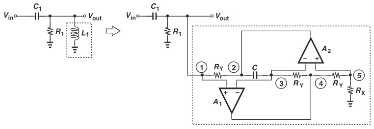

# 예제 15.22 — 흉내낸 인덕터의 내부 노드 4를 출력에 사용

## 조건
- Fig 15.42에서 수동 고역통과 필터의 접지 인덕터를 두 연산증폭기와 RC 소자로 대체했다. 기존 출력은 노드 1이다.

## 구할 것
- 노드 4에서도 필터 출력을 얻을 수 있음을 증명한다.

## 회로 — Fig 15.42
```spice
C1  Vin   Vout  {C_1}
R1  Vout  0     {R_1}
L1  Vout  0     {L_1}
```
- 단자: Vin = 입력 (개방 원) / Vout = 출력 (개방 원)
- 표시: 노드 라벨 V_in, V_out / 소자 라벨 C_1, R_1, L_1 / 부호 없음 / 화살표 없음 / 수치·면적 라벨 없음
- 배치: 왼쪽 V_in에서 C_1을 지나 출력으로 간다. 출력 가로선에서 R_1과 L_1이 각각 아래로 갈라져(각각 점) 접지되고, 점선 사각형이 L_1과 그 접지를 감싼다. 오른쪽 굵은 ⇒는 인덕터를 능동 회로로 대체함을 표시한다. 교차: 없음

## 회로 — Fig 15.42(eq)
```spice
C1  Vin   Vout  {C_1}
R1  Vout  0     {R_1}
RY1 Vout  2     {R_Y}
C2  2     3     {C}  ; 인쇄 라벨 C
RY2 3     4     {R_Y}
RY3 4     5     {R_Y}
RX  5     0     {R_X}
XA1 Vout  3     4     opamp
XA2 5     3     2     opamp
* Vout = 그림의 노드 1
```
- 단자: Vin = 입력 (개방 원) / Vout = 출력 (개방 원)
- 표시: 노드 라벨 V_in, V_out, 동그라미 속 1–5 / 소자 라벨 C_1, R_1, R_Y 세 곳, C, R_X, A_1, A_2 / 부호 A_1 왼쪽 +, 오른쪽 −, A_2 왼쪽 −, 오른쪽 + / 화살표 없음 / 수치·면적 라벨 없음
- 배치: 입력의 직렬 C_1 오른쪽에서 접지 저항 R_1(점), 변환기로 내려가는 선(점), 출력 원이 차례로 이어진다. 점선 사각형 안에서 1–2–3–4–5 사이를 저항, 커패시터, 저항, 저항이 잇고 5에서 접지 저항이 내려간다. 1·3에서 아래쪽 A_1의 입력으로, 그 출력에서 4로, 3·5에서 위쪽 A_2의 입력으로, 그 출력에서 2로 연결된다. 다섯 번호 노드 모두 접속점(점)이다. 교차: 없음



## 답 (검증용)
- $V_{out}=V_1=V_3=V_5$이며 $V_4=(1+R_Y/R_X)V_{out}$이다. 따라서 노드 4는 같은 주파수 응답을 상수배한 출력을 제공한다.
- 풀이 마지막에는 $A_1$이 구동하는 포트가 노드 1보다 “낮은 출력 전압”을 나타낸다고 인쇄돼 있다. 이 문구는 문맥과 맞지 않음(오식으로 보임). 식 (15.129)는 전압이 커짐을 나타내고, 연산증폭기 출력으로 직접 구동하는 포트의 장점은 낮은 출력 임피던스이다. (원문에 없음)
