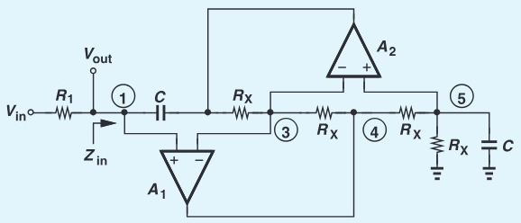
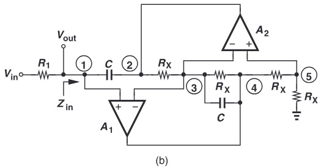

# 예제 15.23 — 슈퍼 커패시터 회로에서 병렬 커패시터의 위치 비교

## 조건
- Fig 15.44의 저역통과 필터 대신 Fig 15.45의 일반 임피던스 변환기 구성을 사용한다. Fig 15.44(b)에서는 두 번째 커패시터가 3–4 사이 저항과 병렬이며 Fig 15.45에서는 5와 접지 사이 저항과 병렬이다.

## 구할 것
- Fig 15.45 쪽의 회로가 덜 유용한 이유를 설명한다.

## 상속·참조
- Fig 15.44(b)에서 노드 4는 기존 출력의 상수배를 제공한다. 식 (15.135)의 기존 응답은 $1/(R_1R_XC^2s^2+R_1Cs+1)$이다.
- 노드 4는 연산증폭기가 직접 구동하므로 출력 임피던스가 낮다. (원문에 없음)

## 회로 — Fig 15.45
```spice
R1   Vin   Vout  {R_1}
CI   Vout  n1    {C}
RX2  n1    3     {R_X}
RX3  3     4     {R_X}
RX4  4     5     {R_X}
RX5  5     0     {R_X}
CP   5     0     {C}
XA1  Vout  3     4  opamp
XA2  5     3     n1  opamp
* Vout = 노드 1
```
- 단자: Vin = 입력 (개방 원) / Vout = 출력 (개방 원)
- 표시: 노드 라벨 V_in, V_out, 동그라미 속 1, 3, 4, 5 (A_2 출력의 접속점에는 2가 인쇄되지 않음) / 소자 라벨 R_1, C 두 곳, R_X 네 곳, A_1, A_2 / 부호 A_1의 위쪽 입력은 왼쪽 +, 오른쪽 −, A_2의 아래쪽 입력은 왼쪽 −, 오른쪽 + / 화살표 "Z_in": 노드 1에서 오른쪽으로 변환기를 바라보며 도선 옆 별도 화살표 (┌ 꺾임) / 수치·면적 라벨 없음
- 배치: 입력에서 R_1을 지나 V_out 원으로 선이 위로 갈라지고(점), 계속 오른쪽으로 노드 1의 접속점, C, R_X 세 개를 거쳐 노드 5에 닿는다. 5에서 네 번째 R_X가 접지된다. 아래쪽 A_1은 1·3에서 입력을 받고 4로 되돌아간다. 위쪽 A_2는 3·5에서 입력을 받고 2로 되돌아간다. 다섯 번호 위치 모두 접속점(점)이다. 5 오른쪽의 커패시터 C는 네 번째 R_X와 병렬로 접지된다. 교차: 없음



## 회로 — Fig 15.44(b)
```spice
R1   Vin   Vout  {R_1}
CI   Vout  2     {C}
RX2  2     3     {R_X}
RX3  3     4     {R_X}
RX4  4     5     {R_X}
RX5  5     0     {R_X}
CP   3     4     {C}
XA1  Vout  3     4  opamp
XA2  5     3     2  opamp
* Vout = 노드 1
```
- 단자: Vin = 입력 (개방 원) / Vout = 출력 (개방 원)
- 표시: 노드 라벨 V_in, V_out, 동그라미 속 1–5 / 소자 라벨 R_1, C 두 곳, R_X 네 곳, A_1, A_2 / 부호 A_1의 위쪽 입력은 왼쪽 +, 오른쪽 −, A_2의 아래쪽 입력은 왼쪽 −, 오른쪽 + / 화살표 "Z_in": 노드 1에서 오른쪽으로 변환기를 바라보며 도선 옆 별도 화살표 (┌ 꺾임) / 수치·면적 라벨 없음
- 배치: 입력에서 R_1을 지나 V_out 원으로 선이 위로 갈라지고(점), 계속 오른쪽으로 노드 1의 접속점, C, R_X 세 개를 거쳐 노드 5에 닿는다. 5에서 네 번째 R_X가 접지된다. 아래쪽 A_1은 1·3에서 입력을 받고 4로 되돌아간다. 위쪽 A_2는 3·5에서 입력을 받고 2로 되돌아간다. 다섯 번호 위치 모두 접속점(점)이다. 3–4 사이 저항 아래에 C가 병렬이다. C로 내려가는 왼쪽 분기 및 4 아래에서 C와 A_1 출력 귀환선이 만나는 곳은 각각 점이다. 교차: 없음


> 참고: Fig 15.44은 교재 850쪽(PDF 40)에 있다.

## 답 (검증용)
- 노드 1의 응답은 식 (15.135)와 같지만 $V_4=V_{out}(2+R_XCs)$이다. 이 비는 주파수에 따라 변한다. 같은 응답을 얻으려면 상대적으로 출력 임피던스가 높은 노드 1에서 측정해야 한다.
