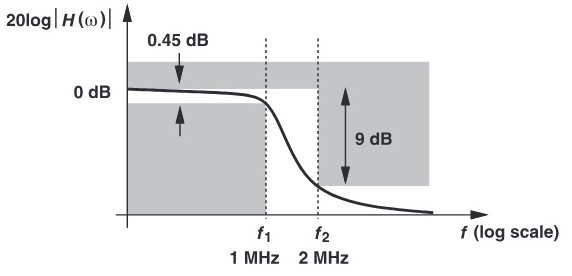

# 예제 15.24 — 두 주파수 사양을 만족하는 버터워스 차수

## 조건
- 저역통과 필터의 사양은 $f<f_1=1\ \mathrm{MHz}$에서 통과대역 평탄도 $0.45\ \mathrm{dB}$, $f_2=2\ \mathrm{MHz}$에서 저지대역 감쇠 $9\ \mathrm{dB}$이다.

## 구할 것
- 사양을 만족하는 버터워스 필터의 최소 차수를 정한다.

## 회로 — 없음 (버터워스 필터 사양 문제, 템플릿 그림은 풀이에 있음)

## 답 (검증용)
- 최소 $n=3$, $\omega_0\simeq2\pi(1.45\ \mathrm{MHz})$이다. 식 (15.144)는 반올림된 크기 0.95와 0.355를 사용해 $(f_2/f_1)^{2n}=64.2$로 적었다. 원래 dB 사양에서 필요한 비는 $(10^{9/10}-1)/(10^{0.45/10}-1)\simeq63.598$이고 $2^6=64$이므로 3차로 충족한다. (정확한 dB 비의 검산은 원문에 없음)
- Fig 15.48은 가로축이 로그 주파수 $f$, 세로축은 $20\log|H(\omega)|$이다. $f_1=1\ \mathrm{MHz}$ 앞의 $0\ \mathrm{dB}$ 기준 허용 범위는 $0.45\ \mathrm{dB}$, $f_2=2\ \mathrm{MHz}$부터는 최소 $9\ \mathrm{dB}$ 감쇠이며 음영이 금지 영역을 나타낸다.

