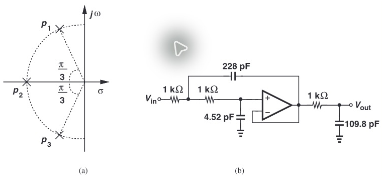

# 예제 15.25 — 3차 버터워스 응답의 SK 단 및 RC 단 설계

## 조건
- 예제 15.24에서 얻은 버터워스 응답을 살렌과 키(SK) 구조로 구현한다.
- 예제 15.24의 사양은 $f<f_1=1\ \mathrm{MHz}$에서 통과대역 평탄도 $0.45\ \mathrm{dB}$, $f_2=2\ \mathrm{MHz}$에서 저지대역 감쇠 $9\ \mathrm{dB}$이며 설계 결과는 $n=3$, $\omega_0=2\pi(1.45\ \mathrm{MHz})$이다. (원문에 없음)

## 구할 것
- 이 응답을 구현하는 필터 회로를 설계한다 (정할 값 예: SK 단과 추가 RC 단의 저항·커패시터). (괄호 안은 원문에 없음)

## 상속·참조
- 예제 15.24의 $n=3$, $\omega_0=2\pi(1.45\ \mathrm{MHz})$에서 좌반면의 극점은 실수 극점 하나와 켤레 극점 한 쌍이다.

## 회로 — 없음 (설계 문제, 그림은 풀이에 있음)

## 답 (검증용)
- Fig 15.50(a)의 $\sigma,j\omega$ 평면에서 실수 극점 $p_2=-\omega_0$를 RC 단으로, 음의 실수축에서 위아래로 $\pi/3$씩 떨어진 $p_1,p_3$를 $Q=1$인 SK 단으로 구현한다. 본문의 예는 $R_1=R_2=R_3=1\ \mathrm{k}\Omega$, $C_2=54.9\ \mathrm{pF}$, $C_1=4C_2$, $C_3=109.8\ \mathrm{pF}$이다.
- 식 (15.157)은 $Q=1/[2\cos(2\pi/3)]=1$로 인쇄돼 있다. Fig 15.50(b)의 SK 커패시터에는 $228\ \mathrm{pF}$와 $4.52\ \mathrm{pF}$가 적혀 있다.
- 두 표기는 문맥과 맞지 않음(오식으로 보임). 식 (15.155)의 분모에 따르면 $Q=-1/[2\cos(2\pi/3)]=1$이고, 풀이 본문의 선택은 $C_1\simeq219.6\ \mathrm{pF}$, $C_2=54.9\ \mathrm{pF}$이다. 아래 정답 회로는 그림의 인쇄값을 유지했다. (원문에 없음)

### 정답 회로 — Fig 15.50(b)
```spice
R1  Vin  n1   1k
R2  n1   n2   1k
C1  n1   n3   228p
C2  n2   0    4.52p
XA  n2   n3   n3   opamp
R3  n3   Vout 1k
C3  Vout 0    109.8p
```
- 단자: Vin = 입력 (개방 원) / Vout = 출력 (개방 원)
- 표시: 노드 라벨 V_in, V_out / 소자 라벨 저항·커패시터·연산증폭기에 이름 없음 / 부호 각 증폭기 위 +, 아래 − / 화살표 없음 / 수치·면적 라벨 1 kΩ 세 가로 저항, 위 귀환 228 pF, 첫 단 접지 4.52 pF, 맨 오른쪽 접지 109.8 pF
- 배치: 첫 단은 왼쪽 입력에서 가로 저항 두 개를 지나 비반전 입력에 닿는다. 두 저항 중간(점)에서 위의 228 pF를 통해 증폭기 출력(점)에 귀환한다. 둘째 저항 오른쪽(점)에서 4.52 pF를 통해 접지된다. 반전 입력은 아래쪽 경로로 출력에 직접 연결한다. 첫 단 출력에서 세 번째 저항을 지나 최종 출력선 분기(점)에 이르고, 이 점 아래 109.8 pF는 접지된다. 교차: 없음


> 참고: Fig 15.50은 교재 856쪽(PDF 46)에 있다.
