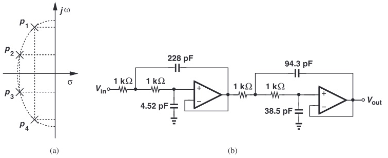

# 예제 15.28 — 두 SK 단으로 만드는 4차 체비셰프 저역통과 필터

## 조건
- 두 개의 SK 단을 사용해 예제 15.27의 요구를 충족해야 한다.
- 예제 15.27의 사양은 $5\ \mathrm{MHz}$ 통과대역의 리플은 $1\ \mathrm{dB}$, $10\ \mathrm{MHz}$에서 필요한 감쇠는 $30\ \mathrm{dB}$이며 계산 결과는 $n=4$, $\omega_0=2\pi(5\ \mathrm{MHz})$, $\epsilon=0.509$이다. (원문에 없음)

## 구할 것
- 두 단의 회로를 설계한다 (정할 값 예: 각 단의 저항과 커패시터). (괄호 안은 원문에 없음)

## 상속·참조
- 예제 15.27에서 정한 차수는 4이다. 켤레 극점을 두 쌍으로 묶어 각각 2차 SK 단으로 실현한다.

## 회로 — 없음 (설계 문제, 그림은 풀이에 있음)

## 답 (검증용)
- Fig 15.53(a)의 $\sigma,j\omega$ 평면에서 $p_{1,4}/\omega_0=-0.140\pm j0.983$, $p_{2,3}/\omega_0=-0.337\pm j0.407$이다. 첫 쌍은 $f_{n1}=4.965\ \mathrm{MHz}$, $Q_1=3.55$이고, 둘째 쌍은 $f_{n2}=2.64\ \mathrm{MHz}$, $Q_2=0.783$이다.
- 각 단에서 저항 두 개를 $1\ \mathrm{k}\Omega$로 둔다. 첫 단의 귀환·접지 커패시터는 각각 $228,\ 4.52\ \mathrm{pF}$, 둘째 단은 $94.3,\ 38.5\ \mathrm{pF}$이다. 본문은 첫 단의 작은 접지 커패시터를 개별 소자로 구현할 때 저항을 1/5로 줄이는 방안도 언급한다.

### 정답 회로 — Fig 15.53(b)
```spice
R1  Vin  n1   1k
R2  n1   n2   1k
C1  n1   n3   228p
C2  n2   0    4.52p
XA  n2   n3   n3   opamp
R3  n3   n4   1k
R4  n4   n5   1k
C3  n4   Vout 94.3p
C4  n5   0    38.5p
XB  n5   Vout Vout opamp
```
- 단자: Vin = 입력 (개방 원) / Vout = 출력 (개방 원)
- 표시: 노드 라벨 V_in, V_out / 소자 라벨 저항·커패시터·연산증폭기에 이름 없음 / 부호 각 증폭기 위 +, 아래 − / 화살표 없음 / 수치·면적 라벨 1 kΩ 네 가로 저항, 첫 단 귀환 228 pF와 접지 4.52 pF, 둘째 단 귀환 94.3 pF와 접지 38.5 pF
- 배치: 첫 단은 왼쪽 입력에서 가로 저항 두 개를 지나 비반전 입력에 닿는다. 두 저항 중간(점)에서 위의 228 pF를 통해 증폭기 출력(점)에 귀환한다. 둘째 저항 오른쪽(점)에서 4.52 pF를 통해 접지된다. 반전 입력은 아래쪽 경로로 출력에 직접 연결한다. 둘째 단에서도 두 가로 저항 중간(점)에서 위쪽 94.3 pF가 둘째 출력(점)에 이어진다. 비반전 입력선의 분기(점)에서 38.5 pF가 접지되고 반전 입력은 출력으로 되돌아간다. 둘째 출력 오른쪽 끝이 V_out이다. 교차: 없음


> 참고: Fig 15.53은 교재 861쪽(PDF 51)에 있다.
