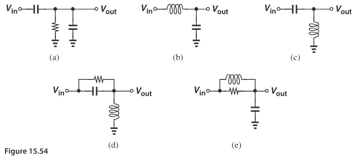

# 장말문제 15.1 — 다섯 수동 회로의 필터 유형

## 조건
- Fig 15.54(a)–(e) 다섯 수동 회로에서 왼쪽 단자의 입력 전압과 오른쪽 단자의 출력 전압을 사용한다.

## 구할 것
- 각 회로의 응답을 저역통과, 고역통과, 대역통과 중에서 고른다.

## 회로 — Fig 15.54(a)
```spice
C1 Vin Vout
R1 Vout 0
C2 Vout 0
```
- 단자: Vin = 입력 (개방 원) / Vout = 출력 (개방 원)
- 표시: 노드 라벨 V_in, V_out / 소자 라벨 C1, R1, C2 (수동 소자 라벨 없음) / 부호 없음 / 화살표 없음 / 수치·면적 라벨 없음
- 배치: 왼쪽 입력과 오른쪽 출력이 같은 높이에 있다. 가운데 직렬 커패시터 뒤의 출력선에서 왼쪽 저항(점)과 오른쪽 커패시터(점)가 각각 아래로 접지된다. 교차: 없음

## 회로 — Fig 15.54(b)
```spice
L1 Vin Vout
C1 Vout 0
```
- 단자: Vin = 입력 (개방 원) / Vout = 출력 (개방 원)
- 표시: 노드 라벨 V_in, V_out / 소자 라벨 L1, C1 (수동 소자 라벨 없음) / 부호 없음 / 화살표 없음 / 수치·면적 라벨 없음
- 배치: 왼쪽 입력과 오른쪽 출력이 같은 높이에 있다. 가로 인덕터 오른쪽에서 출력으로 가는 선이 아래로 갈라져(점) 커패시터를 통해 접지된다. 교차: 없음

## 회로 — Fig 15.54(c)
```spice
C1 Vin Vout
L1 Vout 0
```
- 단자: Vin = 입력 (개방 원) / Vout = 출력 (개방 원)
- 표시: 노드 라벨 V_in, V_out / 소자 라벨 C1, L1 (수동 소자 라벨 없음) / 부호 없음 / 화살표 없음 / 수치·면적 라벨 없음
- 배치: 왼쪽 입력과 오른쪽 출력이 같은 높이에 있다. 가로 커패시터 오른쪽 출력선에서 아래로 갈라져(점) 인덕터를 통해 접지된다. 교차: 없음

## 회로 — Fig 15.54(d)
```spice
C1 Vin Vout
R1 Vin Vout
L1 Vout 0
```
- 단자: Vin = 입력 (개방 원) / Vout = 출력 (개방 원)
- 표시: 노드 라벨 V_in, V_out / 소자 라벨 C1, R1, L1 (수동 소자 라벨 없음) / 부호 없음 / 화살표 없음 / 수치·면적 라벨 없음
- 배치: 왼쪽 입력과 오른쪽 출력이 같은 높이에 있다. 가로 커패시터 위에 저항이 병렬이다. 커패시터 왼쪽 분기(점)에서 위로 올라간 선은 저항을 지나 오른쪽 분기(점)로 내려온다. 오른쪽 분기 아래 인덕터는 접지된다. 교차: 없음

## 회로 — Fig 15.54(e)
```spice
R1 Vin Vout
L1 Vin Vout
C1 Vout 0
```
- 단자: Vin = 입력 (개방 원) / Vout = 출력 (개방 원)
- 표시: 노드 라벨 V_in, V_out / 소자 라벨 R1, L1, C1 (수동 소자 라벨 없음) / 부호 없음 / 화살표 없음 / 수치·면적 라벨 없음
- 배치: 왼쪽 입력과 오른쪽 출력이 같은 높이에 있다. 가로 저항 위에 인덕터가 병렬이다. 저항 왼쪽 분기(점)에서 위로 올라간 선은 인덕터를 지나 오른쪽 분기(점)로 내려온다. 오른쪽 분기 아래의 커패시터는 접지된다. 교차: 없음


