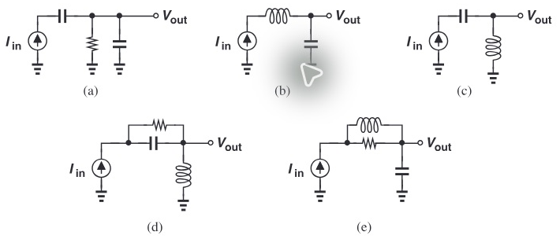

# 장말문제 15.4 — 전류 입력 수동 필터들의 트랜스임피던스

## 조건
- Fig 15.55(a)–(e)의 회로에 전류 $I_{in}$을 입력하고 전압 $V_{out}$을 측정한다.

## 구할 것
- 각 회로의 $V_{out}/I_{in}$을 구하고 극점과 영점을 결정한다.

## 회로 — Fig 15.55(a)
```spice
IIN 0 n1 {I_in}
C1 n1 Vout
R1 Vout 0
C2 Vout 0
```
- 단자: Vout = 출력 (개방 원)
- 표시: 노드 라벨 V_out / 소자 라벨 I_in (전류원), C1, R1, C2 (수동 소자 라벨 없음) / 부호 없음 / 화살표 없음 / 수치·면적 라벨 없음
- 배치: 왼쪽 접지 전류원의 화살표가 위쪽을 향하고 상단에서 오른쪽으로 선이 꺾인다. 가운데 직렬 커패시터 뒤의 출력선에서 왼쪽 저항(점)과 오른쪽 커패시터(점)가 각각 아래로 접지된다. 교차: 없음

## 회로 — Fig 15.55(b)
```spice
IIN 0 n1 {I_in}
L1 n1 Vout
C1 Vout 0
```
- 단자: Vout = 출력 (개방 원)
- 표시: 노드 라벨 V_out / 소자 라벨 I_in (전류원), L1, C1 (수동 소자 라벨 없음) / 부호 없음 / 화살표 없음 / 수치·면적 라벨 없음
- 배치: 왼쪽 접지 전류원의 화살표가 위쪽을 향하고 상단에서 오른쪽으로 선이 꺾인다. 가로 인덕터 오른쪽에서 출력으로 가는 선이 아래로 갈라져(점) 커패시터를 통해 접지된다. 교차: 없음

## 회로 — Fig 15.55(c)
```spice
IIN 0 n1 {I_in}
C1 n1 Vout
L1 Vout 0
```
- 단자: Vout = 출력 (개방 원)
- 표시: 노드 라벨 V_out / 소자 라벨 I_in (전류원), C1, L1 (수동 소자 라벨 없음) / 부호 없음 / 화살표 없음 / 수치·면적 라벨 없음
- 배치: 왼쪽 접지 전류원의 화살표가 위쪽을 향하고 상단에서 오른쪽으로 선이 꺾인다. 가로 커패시터 오른쪽 출력선에서 아래로 갈라져(점) 인덕터를 통해 접지된다. 교차: 없음

## 회로 — Fig 15.55(d)
```spice
IIN 0 n1 {I_in}
C1 n1 Vout
R1 n1 Vout
L1 Vout 0
```
- 단자: Vout = 출력 (개방 원)
- 표시: 노드 라벨 V_out / 소자 라벨 I_in (전류원), C1, R1, L1 (수동 소자 라벨 없음) / 부호 없음 / 화살표 없음 / 수치·면적 라벨 없음
- 배치: 왼쪽 접지 전류원의 화살표가 위쪽을 향하고 상단에서 오른쪽으로 선이 꺾인다. 가로 커패시터 위에 저항이 병렬이다. 커패시터 왼쪽 분기(점)에서 위로 올라간 선은 저항을 지나 오른쪽 분기(점)로 내려온다. 오른쪽 분기 아래 인덕터는 접지된다. 교차: 없음

## 회로 — Fig 15.55(e)
```spice
IIN 0 n1 {I_in}
R1 n1 Vout
L1 n1 Vout
C1 Vout 0
```
- 단자: Vout = 출력 (개방 원)
- 표시: 노드 라벨 V_out / 소자 라벨 I_in (전류원), R1, L1, C1 (수동 소자 라벨 없음) / 부호 없음 / 화살표 없음 / 수치·면적 라벨 없음
- 배치: 왼쪽 접지 전류원의 화살표가 위쪽을 향하고 상단에서 오른쪽으로 선이 꺾인다. 가로 저항 위에 인덕터가 병렬이다. 저항 왼쪽 분기(점)에서 위로 올라간 선은 인덕터를 지나 오른쪽 분기(점)로 내려온다. 오른쪽 분기 아래의 커패시터는 접지된다. 교차: 없음


> 참고: Fig 15.55는 교재 864쪽(PDF 54)에 있다. (b)의 접지 커패시터 아래 기호에 원본 스캔의 마우스 포인터가 겹쳐 있다.
