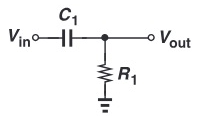

# 장말문제 15.5 — RC 고역통과 필터의 극점·영점 감도

## 조건
- Fig 15.56의 고역통과 필터는 입력에 직렬 $C_1$, 출력에 접지 저항 $R_1$을 갖는다.

## 구할 것
- $R_1$과 $C_1$ 각각에 대한 극점 주파수 및 영점 주파수의 감도를 구한다.

## 회로 — Fig 15.56
```spice
C1  Vin   Vout  {C_1}
R1  Vout  0     {R_1}
```
- 단자: Vin = 입력 (개방 원) / Vout = 출력 (개방 원)
- 표시: 노드 라벨 V_in, V_out / 소자 라벨 C_1 (위), R_1 (오른쪽) / 부호 없음 / 화살표 없음 / 수치·면적 라벨 없음
- 배치: 가로 C_1 오른쪽의 출력선 분기(점)에서 아래로 R_1을 거쳐 접지된다. 교차: 없음


> 참고: Fig 15.56은 교재 864쪽(PDF 54)에 있다.
