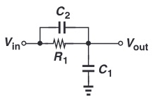

# 장말문제 15.6 — 병렬 RC 입력 가지의 극점·영점 감도

## 조건
- Fig 15.57의 필터에서 $R_1$과 $C_2$는 입력과 출력 사이에 병렬로 놓이고 $C_1$은 출력에서 접지로 연결된다.

## 구할 것
- $C_1$, $C_2$, $R_1$ 각각에 대한 극점 주파수와 영점 주파수의 감도를 계산한다.

## 회로 — Fig 15.57
```spice
R1  Vin   Vout  {R_1}
C2  Vin   Vout  {C_2}
C1  Vout  0     {C_1}
```
- 단자: Vin = 입력 (개방 원) / Vout = 출력 (개방 원)
- 표시: 노드 라벨 V_in, V_out / 소자 라벨 R_1 (아래), C_2 (위), C_1 (오른쪽) / 부호 없음 / 화살표 없음 / 수치·면적 라벨 없음
- 배치: 가로 R_1 양쪽 분기(각 점)에서 위로 올라간 선이 C_2를 잇는다. 저항 오른쪽 분기에서 출력은 오른쪽으로, C_1은 아래로 이어져 접지된다. 교차: 없음


