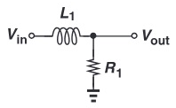

# 장말문제 15.7 — RL 필터의 인덕턴스 최대 허용오차

## 조건
- Fig 15.58에서 목표 극점 감도는 $5\%$로 제시된다.
- $R_1$의 변동률은 $3\%$이다.

## 구할 것
- $L_1$에 허용되는 최대 공차를 구한다.

## 회로 — Fig 15.58
```spice
L1  Vin   Vout  {L_1}
R1  Vout  0     {R_1}
```
- 단자: Vin = 입력 (개방 원) / Vout = 출력 (개방 원)
- 표시: 노드 라벨 V_in, V_out / 소자 라벨 L_1 (위), R_1 (오른쪽) / 부호 없음 / 화살표 없음 / 수치·면적 라벨 없음
- 배치: 왼쪽 입력에서 가로 L_1을 지나 오른쪽 출력으로 가며 출력선 분기(점)에서 아래로 R_1을 거쳐 접지된다. 교차: 없음


