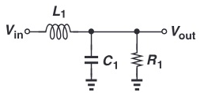

# 장말문제 15.8 — 두 실수 극점을 갖는 RLC 저역통과 필터

## 조건
- Fig 15.59의 저역통과 필터는 두 실수 극점을 갖도록 설계한다.

## 구할 것
- (a) 전달 함수를 유도한다.
- (b) 극점을 계산하고 두 극점이 실수가 되는 조건을 구한다.
- (c) $R_1$, $C_1$, $L_1$ 각각에 대한 극점 감도를 계산한다.

## 회로 — Fig 15.59
```spice
L1  Vin   Vout  {L_1}
C1  Vout  0     {C_1}
R1  Vout  0     {R_1}
```
- 단자: Vin = 입력 (개방 원) / Vout = 출력 (개방 원)
- 표시: 노드 라벨 V_in, V_out / 소자 라벨 L_1 (위), C_1, R_1 (각 가지 오른쪽) / 부호 없음 / 화살표 없음 / 수치·면적 라벨 없음
- 배치: 왼쪽 입력에서 가로 L_1을 지나 출력으로 가는 선에 왼쪽 C_1, 오른쪽 R_1 순서로 아래 접지 가지가 달린다. 위쪽 각 분기에 점이 있다. 교차: 없음


