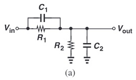
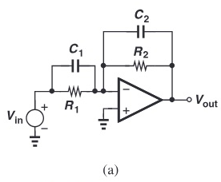

# 장말문제 15.9 — 극점과 영점이 일치할 때의 두 전달 함수

## 조건
- Fig 15.17(a)의 수동 필터와 Fig 15.18(a)의 능동 필터 각각에서 극점과 영점이 일치한다.

## 구할 것
- 이때 두 회로의 전달 함수가 각각 어떻게 변하는지 설명한다.

## 회로 — Fig 15.17(a)
```spice
R1  Vin   Vout  {R_1}
C1  Vin   Vout  {C_1}
R2  Vout  0     {R_2}
C2  Vout  0     {C_2}
```
- 단자: Vin = 입력 (개방 원) / Vout = 출력 (개방 원)
- 표시: 노드 라벨 V_in, V_out / 소자 라벨 R_1, C_1, R_2, C_2 / 부호 없음 / 화살표 없음 / 수치·면적 라벨 없음
- 배치: 왼쪽 입력에서 오른쪽 출력으로 가는 가로선에 R_1이 있다. 양끝 분기(각각 점)에서 위쪽 C_1로 선을 올린다. R_1 오른쪽 가로선에서 왼쪽 R_2와 오른쪽 C_2가 각각 아래로 갈라져(각각 점) 따로 접지된다. 교차: 없음


> 참고: Fig 15.17(a)는 교재 823쪽(PDF 13)에 있다.

## 회로 — Fig 15.18(a)
```spice
VIN  Vin  0     {V_in}
R1   Vin  n1    {R_1}
C1   Vin  n1    {C_1}
R2   n1   Vout  {R_2}
C2   n1   Vout  {C_2}
XA   0    n1    Vout  opamp
```
- 단자: Vout = 출력 (개방 원) / Vin = 접지 기준 입력 전압원의 양단 전압
- 표시: 노드 라벨 V_out / 소자 라벨 V_in, R_1, C_1, R_2, C_2, XA (라벨 없음) / 부호 전압원 오른쪽 위 +, 아래 −, 연산증폭기 왼쪽 위 −, 아래 + / 화살표 없음 / 수치·면적 라벨 없음
- 배치: 왼쪽 접지 전압원 위에서 가로 R_1을 거쳐 반전 입력으로 간다. R_1 양끝 분기(각각 점)에서 위쪽 C_1로 연결한다. 그 오른쪽 반전 입력선의 분기(점)에서 위로 올라가 R_2 왼쪽 끝(점)을 거쳐 C_2로 이어진다. R_2는 가운데, C_2는 그 위에서 가로로 되먹임된다. 오른쪽 공통선은 R_2 오른쪽 끝(점)과 연산증폭기 출력선(점)을 연결한다. 비반전 입력은 왼쪽 접지에 연결된다. 교차: 없음


> 참고: Fig 15.18(a)는 교재 824쪽(PDF 14)에 있다.
