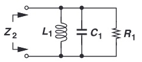

# 장말문제 15.14 — 병렬 RLC 탱크에서 저항 변화에 따른 극점의 위치

## 조건
- Fig 15.26의 병렬 RLC 탱크에서 $L_1$, $C_1$은 일정하다.
- $R_1$을 매우 작은 값부터 매우 큰 값까지 변화시킨다.

## 구할 것
- 회로 극점들의 위치를 복소평면에 그린다.

## 회로 — Fig 15.26
```spice
L1  out1  out2  {L_1}
C1  out1  out2  {C_1}
R1  out1  out2  {R_1}
```
- 단자: out1, out2 = 각각 위, 아래 임피던스 측정 단자 (개방 원)
- 표시: 노드 라벨 없음 / 소자 라벨 L_1, C_1, R_1 / 부호 없음 / 화살표 "Z_2": 두 측정 단자 옆에서 오른쪽을 향하는 화살표 한 쌍, 도선 옆 별도 화살표 (위는 ┌ 꺾임, 아래는 L자) / 수치·면적 라벨 없음
- 배치: 왼쪽 위·아래 개방 원에서 오른쪽으로 나란히 도선이 뻗고, 왼쪽부터 L_1, C_1, R_1이 두 선 사이에 세로로 병렬 연결된다. L_1 및 C_1의 위·아래 분기 네 곳에 점이 있고, 맨 오른쪽 저항 양끝은 모서리이다. 두 단자 모두 접지와 분리돼 있다. 교차: 없음


> 참고: Fig 15.26은 교재 830쪽(PDF 20)에 있다. 문제 조건은 교재 865쪽(PDF 55) 첫 두 줄까지 이어진다.
