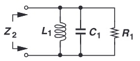

# 장말문제 15.15 — 병렬 RLC 탱크에서 커패시턴스 변화에 따른 극점 궤적

## 조건
- 문제 15.14의 병렬 RLC 탱크에서 이번에는 $R_1,L_1$을 고정한다.
- $C_1$을 매우 작은 값부터 매우 큰 값까지 바꾼다.

## 구할 것
- 두 극점의 위치가 어떻게 바뀌는지 복소평면에 그린다.

## 상속·참조
- 문제 15.14에서는 $L_1,C_1$을 고정하고 $R_1$을 변화시키며 극점 궤적을 그렸다. 여기서는 동일한 두 단자의 병렬 탱크에서 변화시키는 소자만 $C_1$으로 바꾼다.

## 회로 — Fig 15.26
```spice
L1  out1  out2  {L_1}
C1  out1  out2  {C_1}
R1  out1  out2  {R_1}
```
- 단자: out1, out2 = 각각 위, 아래 임피던스 측정 단자 (개방 원)
- 표시: 노드 라벨 없음 / 소자 라벨 L_1, C_1, R_1 / 부호 없음 / 화살표 "Z_2": 두 측정 단자 옆에서 오른쪽을 향하는 화살표 한 쌍, 도선 옆 별도 화살표 (위는 ┌ 꺾임, 아래는 L자) / 수치·면적 라벨 없음
- 배치: 왼쪽 위·아래 개방 원에서 오른쪽으로 나란히 도선이 뻗고, 왼쪽부터 L_1, C_1, R_1이 두 선 사이에 세로로 병렬 연결된다. L_1 및 C_1의 위·아래 분기 네 곳에 점이 있고, 맨 오른쪽 저항 양끝은 모서리이다. 두 단자 모두 접지와 분리돼 있다. 교차: 없음


> 참고: Fig 15.26은 교재 830쪽(PDF 20)에 있다.
