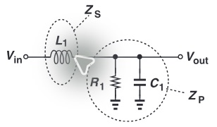

# 장말문제 15.16 — 1 dB 피킹을 보이는 수동 저역통과 필터의 조건

## 조건
- Fig 15.29 저역통과 회로에 대해 통과대역 기준 $1\ \mathrm{dB}$($10\%$) 피킹을 요구한다.
- 식 (15.25)에 관한 본문의 관찰을 이용한다.
- 식 (15.25)는 $|H(j\omega)|^2=\gamma^2/[(\omega_n^2-\omega^2)^2+(\omega_n\omega/Q)^2]$이며 $Q>1/\sqrt2$이면 통과대역에 대한 피크 비는 $Q/\sqrt{1-1/(4Q^2)}$이다. (본문 식, 원문에 없음)

## 구할 것
- 이 피킹을 얻기 위해 회로가 만족할 조건을 정한다.

## 상속·참조
- Fig 15.29의 $Q=R_1\sqrt{C_1/L_1}$이다. 식 (15.25)는 주파수에 따른 크기의 제곱이므로 피킹의 크기 배율은 진폭 기준으로 비교한다.

## 회로 — Fig 15.29
```spice
L1  Vin   Vout  {L_1}
R1  Vout  0     {R_1}
C1  Vout  0     {C_1}
```
- 단자: Vin = 입력 (개방 원) / Vout = 출력 (개방 원)
- 표시: 노드 라벨 V_in, V_out / 소자 라벨 L_1, R_1, C_1, 점선 테두리의 임피던스 Z_S 및 Z_P / 부호 없음 / 화살표 없음 / 수치·면적 라벨 없음
- 배치: 입력에서 오른쪽으로 가로 L_1을 거쳐 출력에 닿는다. L_1 오른쪽 선에서 왼쪽 R_1과 오른쪽 C_1이 각각 아래로 갈라져(각각 점) 따로 접지된다. 점선 타원이 L_1을 Z_S로, 두 접지 가지를 Z_P로 묶는다. 교차: 없음


> 참고: Fig 15.29은 교재 832쪽(PDF 22)에 있다. 원본 스캔의 포인터가 L_1 오른쪽에 겹쳐 있다.
