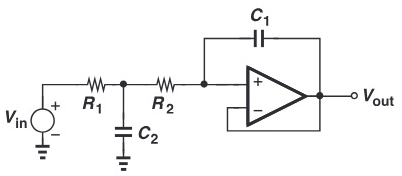

# 장말문제 15.18 — 커패시터 위치가 달라진 SK 회로의 전달 함수

## 조건
- 학생이 Fig 15.60처럼 SK 필터를 잘못 구성했다.

## 구할 것
- 전달 함수를 구하고 이 회로가 유용하지 않은 이유를 설명한다.

## 회로 — Fig 15.60
```spice
VIN Vin 0 {V_in}
R1 Vin n1 {R_1}
R2 n1 n2 {R_2}
C1 n2 Vout {C_1}
C2 n1 0 {C_2}
XA n2 Vout Vout opamp
```
- 단자: Vout = 출력 (개방 원) / Vin = 접지 기준 입력 전압원의 전압
- 표시: 노드 라벨 V_out / 소자 라벨 V_in, R_1, R_2, C_1, C_2, XA (라벨 없음) / 부호 입력 전압원은 위 +, 아래 −, 연산증폭기는 왼쪽 위 +, 아래 − / 화살표 없음 / 수치·면적 라벨 없음
- 배치: 왼쪽 접지 전압원 위에 가로 R_1, R_2가 차례로 이어진다. 두 저항 사이의 분기(점)에서 아래로 C_2가 접지된다. R_2 오른쪽 분기(점)는 비반전 입력과 위쪽 귀환 C_1로 이어진다. 출력의 분기(점)에 C_1의 오른쪽 선, 연산증폭기 출력, 출력 원, 반전 입력의 아래쪽 직접 귀환선이 모인다. 교차: 없음


