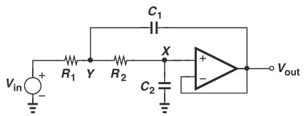

# 장말문제 15.20 — 단위 이득 SK 필터에서 1 dB 피킹을 얻는 소자 관계

## 조건
- $K=1$인 살렌과 키 필터에서 $1\ \mathrm{dB}$의 피킹을 요구한다.

## 구할 것
- 소자값 사이에 필요한 관계를 구한다.

## 상속·참조
- Fig 15.33은 연산증폭기를 단위 이득 버퍼로 연결한 저역통과 SK 회로다.

## 회로 — Fig 15.33
```spice
VIN  Vin  0     {V_in}
R1   Vin  Y     {R_1}
R2   Y    X     {R_2}
C1   Y    Vout  {C_1}
C2   X    0     {C_2}
XA   X    Vout  Vout opamp
```
- 단자: Vout = 출력 (개방 원) / Vin = 접지 기준 입력 전압원의 전압
- 표시: 노드 라벨 Y, X, V_out / 소자 라벨 V_in, R_1, R_2, C_1, C_2, XA (라벨 없음) / 부호 입력 전압원은 위 +, 아래 −, 연산증폭기는 왼쪽 위 +, 아래 − / 화살표 없음 / 수치·면적 라벨 없음
- 배치: 왼쪽 접지 전압원 위에서 가로 R_1, Y(점), R_2, X(점), 비반전 입력 순으로 이어진다. Y에서 위로 C_1을 거쳐 출력으로 돌아가고, X에서 아래로 C_2가 접지된다. 반전 입력은 아래쪽 선을 따라 출력 접속점(점)으로 바로 되돌아간다. 교차: 없음


> 참고: Fig 15.33은 교재 835쪽(PDF 25)에 있다.
