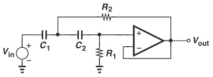

# 장말문제 15.22 — 고역통과 SK 필터의 전달 함수와 극점 파라미터

## 조건
- Fig 15.61은 고역통과 SK 필터이다.

## 구할 것
- 전달 함수를 유도하고 $Q$와 $\omega_n$을 구한다.

## 회로 — Fig 15.61
```spice
VIN Vin 0 {V_in}
C1 Vin n1 {C_1}
C2 n1 n2 {C_2}
R1 n2 0 {R_1}
R2 n1 Vout {R_2}
XA n2 Vout Vout opamp
```
- 단자: Vout = 출력 (개방 원) / Vin = 접지 기준 입력 전압원의 전압
- 표시: 노드 라벨 V_out / 소자 라벨 V_in, C_1, C_2, R_1, R_2, XA (라벨 없음) / 부호 입력 전압원은 위 +, 아래 −, 연산증폭기는 왼쪽 위 +, 아래 − / 화살표 없음 / 수치·면적 라벨 없음
- 배치: 왼쪽 접지 전압원 위에서 가로 C_1, C_2를 차례로 지나 비반전 입력에 닿는다. 두 커패시터 중간 분기(점)에서 위로 R_2를 거쳐 출력 분기(점)에 귀환한다. C_2 오른쪽의 비반전 입력 분기(점) 아래에는 R_1과 접지가 있다. 반전 입력은 아래로 돌아 출력에 직접 연결한다. 교차: 없음


