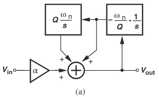

# 장말문제 15.24 — 적분기를 미분기로 대체한 바이쿼드 블록도

## 조건
- 식 (15.95)의 전달 함수를 적분기 대신 미분기로 구현한다.
- 식 (15.95)는 $V_{out}/V_{in}=\alpha s^2/[s^2+(\omega_n/Q)s+\omega_n^2]$이다. (본문 식, 원문에 없음)
- 주파수 영역의 $s$는 시간 영역의 미분 $d/dt$에 대응한다.
- 고주파에서 잡음이 증폭되므로 이 구현은 덜 쓰인다. (원문의 메모)

## 구할 것
- Fig 15.36(a)를 참고해, 미분기만 사용하여 식 (15.95)의 전달 함수를 구현하는 블록도를 구성한다.

## 상속·참조
- 참고 블록도 Fig 15.36(a)는 출력의 한 번 적분과 두 번 적분을 입력의 $\alpha$배와 합하는 원래 회로이다. 식 (15.95)는 고역통과 응답을 나타낸다.

## 회로 — Fig 15.36(a)
```spice
XA Vin  n1   gain "α" tri
XB Vout n2   gain "−(ω_n/Q)(1/s)"
XC n2   n3   gain "Qω_n/s"
XS n1 n2 n3 Vout sum  ; n1 +, n2 +, n3 +
```
- 단자: Vin = 입력 (개방 원) / Vout = 출력 (개방 원)
- 표시: 노드 라벨 V_in, V_out / 소자 라벨 α, −(ω_n/Q)(1/s), Qω_n/s, ⊕ / 부호 합산기 입력 3개 모두 +, 오른쪽 위 블록 계수 − / 화살표 입력 블록 → 합산기, 출력 → 오른쪽 위 블록, 오른쪽 위 블록 → 왼쪽 위 블록 및 합산기, 왼쪽 위 블록 → 합산기 (모두 라벨 없음): 각 신호의 전달 방향, 도선 위 / 수치·면적 라벨 없음
- 배치: 아래 주경로는 왼쪽 입력, 삼각형 이득 α, 합산 원, 오른쪽 출력 순서다. 출력선 분기(점)에서 위로 오른쪽 사각형에 들어가 왼쪽으로 나온다. 그 선의 분기(점)에서 왼쪽 사각형과 아래쪽 합산기 입력으로 나뉜다. 왼쪽 사각형 출력도 아래 합산기로 들어간다. 교차: 없음


> 참고: Fig 15.36은 교재 842쪽(PDF 32)에 있다.
