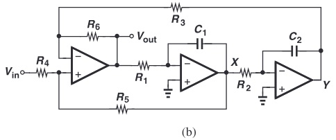

# 장말문제 15.25 — 제한된 소자값으로 KHN 대역통과 필터 설계

## 조건
- Fig 15.36(b)의 KHN 바이쿼드에서 대역통과 응답의 목표는 $Q=2$, $\omega_n=2\pi(2\ \mathrm{MHz})$이다.
- $R_6=R_3$, $R_1=R_2$, $C_1=C_2$를 가정한다.
- 모든 커패시터는 $10\ \mathrm{pF}<C<1\ \mathrm{nF}$, 모든 저항은 $1\ \mathrm{k}\Omega<R<50\ \mathrm{k}\Omega$ 범위에 있어야 한다.

## 구할 것
- 사양과 제한을 만족하는 저항 및 커패시터 값을 결정한다.

## 상속·참조
- KHN의 대역통과 출력은 첫 적분기의 출력 $X$이다. 회로의 합산 관계는 식 (15.100)의 $V_{out}=[(V_{in}R_5+V_XR_4)/(R_4+R_5)](1+R_6/R_3)-V_YR_6/R_3$이다.
- 식 (15.101)의 $1/s$ 항과 식 (15.103)은 문맥과 맞지 않음(오식으로 보임). 식 (15.100)에서는 $V_X$ 항에도 $1+R_6/R_3$이 곱해지므로 회로의 $\omega_n/Q$에는 인쇄된 식 (15.103)의 우변에 이 인수가 추가된다. (원문에 없음)

## 회로 — Fig 15.36(b)
```spice
R4 Vin n1 {R_4}
R5 X n1 {R_5}
R3 Y n2 {R_3}
R6 Vout n2 {R_6}
XA n1 n2 Vout opamp
R1 Vout n3 {R_1}
C1 X n3 {C_1}
XB 0 n3 X opamp
R2 X n4 {R_2}
C2 Y n4 {C_2}
XC 0 n4 Y opamp
```
- 단자: Vin = 입력 (개방 원) / Vout = 출력 (개방 원)
- 표시: 노드 라벨 V_in, V_out, X, Y / 소자 라벨 R_1–R_6, C_1, C_2, XA, XB, XC (증폭기 라벨 없음) / 부호 세 연산증폭기의 왼쪽 위 −, 아래 + / 화살표 없음 / 수치·면적 라벨 없음
- 배치: 왼쪽 합산 증폭기의 비반전 입력 분기(점)에는 입력의 R_4와 아래쪽으로 X에서 돌아오는 R_5가 연결된다. 반전 입력 쪽(점)에는 옆 R_6 및 맨 위 Y에서 돌아오는 R_3이 닿는다. R_6 오른쪽 V_out 원의 분기(점)와 그 아래 합산기 출력 분기(점)를 세로선이 잇는다. 가운데와 오른쪽 적분기는 비반전 입력이 접지이며, 각 반전 입력의 분기(점)에는 가로 R_1·R_2와 위쪽 되먹임 C_1·C_2가 연결된다. X 출력 분기(점)에는 C_1, R_2, R_5 선이 닿고 Y 위쪽 분기(점)는 C_2와 R_3으로 이어진다. 교차: 없음


> 참고: Fig 15.36은 교재 842쪽(PDF 32)에 있다.
