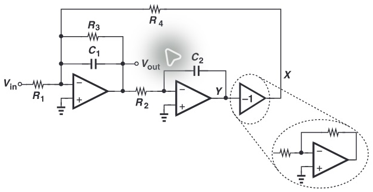

# 장말문제 15.30 — 토우–토마스 저항·커패시터값에 대한 감도

## 조건
- Fig 15.37의 토우–토마스 필터에서 각 저항과 커패시터의 값을 변화시킨다.

## 구할 것
- 저항값과 커패시터값에 대한 필터의 감도를 구한다.

## 상속·참조
- 원문은 감도를 구할 출력 파라미터를 따로 열거하지 않는다. 예제 15.20에서 다룬 필터 파라미터에는 $\omega_n=1/\sqrt{R_2R_4C_1C_2}$, $1/Q=\sqrt{R_2R_4C_2/C_1}/R_3$가 있다. (원문에 없음)

## 회로 — Fig 15.37
```spice
R1  Vin   n1    {R_1}
R3  n1    Vout  {R_3}
C1  n1    Vout  {C_1}
XA  0     n1    Vout  opamp
R2  Vout  n2    {R_2}
C2  n2    Y     {C_2}
XB  0     n2    Y     opamp
XG  Y     X     gain "-1" tri
R4  X     n1    {R_4}
* 오른쪽 점선 확대도: XG를 대체하는 반전기 (주회로와 중복해 연결하지 않음)
* Y — 무라벨 입력 저항 — n3, n3 — 무라벨 귀환 저항 — X, XC 0 n3 X opamp
```
- 단자: Vin = 입력 (개방 원) / Vout = 출력 (개방 원)
- 표시: 노드 라벨 V_in, V_out, Y, X / 소자 라벨 R_1, R_2, R_3, R_4, C_1, C_2, −1, 연산증폭기 3개와 확대도의 저항 2개 (라벨 없음) / 부호 주회로의 두 연산증폭기와 확대도의 연산증폭기 모두 왼쪽 위 −, 아래 + / 화살표 없음 / 수치·면적 라벨 없음
- 배치: 왼쪽 R_1에서 첫 반전 입력으로 이어진다. 이 노드 왼쪽 세로선에는 위로 C_1, R_3, 맨 위 R_4가 차례로 연결된다(입력, C_1, R_3 분기에 각각 점). R_3과 C_1 오른쪽 세로 공통선에 Vout 원과 첫 증폭기 출력이 연결된다(각 점). 오른쪽 R_2 다음의 반전 입력 분기(점)에서 상단 C_2가 출력 Y(점)에 귀환하고, 그 뒤 −1 블록이 X를 구동한다. X에서 위로 올라가 R_4를 통해 왼쪽으로 돌아온다. 두 비반전 입력은 접지된다. 점선 확대도의 입력 저항과 위쪽 귀환 저항은 반전 입력(점)에서 만나고 비반전 입력은 접지된다. 교차: 없음


> 참고: Fig 15.37은 교재 844쪽(PDF 34)에 있다.
