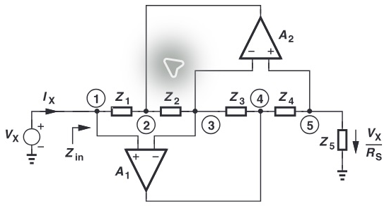

# 장말문제 15.37 — GIC로 등가 커패시턴스를 크게 만드는 소자 선택

## 조건
- Fig 15.39에서 원문이 “큰 용량성 임피던스”라고 표현한 동작을 얻는다. 원문은 이 조건을 커패시터값에 큰 수를 곱하는 것으로 설명한다.

## 구할 것
- 입력에서 보이는 등가 커패시턴스가 실제 커패시터값의 큰 배수가 되도록 소자를 선택한다.

## 상속·참조
- Fig 15.39에서는 두 연산증폭기의 동작으로 $V_1=V_3=V_5=V_X$이다. 그림의 $Z_5$ 가지에는 $V_X/R_S$가 인쇄되어 있으나 본문에서는 이 전류를 $V_X/Z_5$로 적는다.
- 식 (15.125)는 $Z_{in}=Z_1Z_3Z_5/(Z_2Z_4)$이다. 같은 주파수에서 커패시턴스 증가와 임피던스 크기 증가는 서로 반대로 움직이므로, 소자 선택 기준은 원문이 풀어 쓴 커패시턴스 배수이다. (해석은 원문에 없음)

## 회로 — Fig 15.39
```spice
VX  1  0  {V_X}
XZ1 1  2  box "Z_1"
XZ2 2  3  box "Z_2"
XZ3 3  4  box "Z_3"
XZ4 4  5  box "Z_4"
XZ5 5  0  box "Z_5"
XA1 1  3  4  opamp
XA2 5  3  2  opamp
```
- 단자: 개방 단자 없음 / VX = 접지 기준 시험 전압원
- 표시: 노드 라벨 동그라미 속 1, 2, 3, 4, 5 / 소자 라벨 V_X, A_1, A_2, Z_1–Z_5 / 부호 V_X 위 +, 아래 −, 아래쪽 A_1의 입력은 왼쪽 +, 오른쪽 −, 위쪽 A_2는 왼쪽 −, 오른쪽 + / 화살표 "I_X": 왼쪽 전압원에서 1로 오른쪽, 도선 위; "Z_in": 노드 1에서 본 입력 임피던스, 오른쪽, 도선 옆 별도 화살표 (L자를 위아래 반전); "V_X/R_S": 오른쪽 Z_5 옆에서 아래로, 도선 옆 별도 화살표 (직선) / 수치·면적 라벨 없음
- 배치: 가운데 1–2–3–4–5 사이에 사각형 Z_1부터 Z_4가 차례로 놓인다. 맨 오른쪽 Z_5는 아래로 접지된다. 아래쪽 A_1은 아래를 향하고 1과 3에서 아래로 내린 선을 입력으로 받아 4로 되돌아간다. 위쪽 A_2는 위를 향하고 3과 5에서 올린 선을 입력으로 받아 2로 되돌아간다. 1, 2, 3, 4, 5의 분기에는 모두 점이 있다. 교차: 없음


> 참고: Fig 15.39은 교재 846쪽(PDF 36)에 있다.
