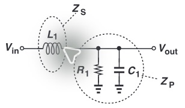

# 장말문제 15.52 — 100 MHz 부근 대역폭의 수동 RLC 필터

## 조건
- Fig 15.29의 수동 필터에서 $-3\ \mathrm{dB}$ 대역폭은 약 $100\ \mathrm{MHz}$이고 피킹은 $1\ \mathrm{dB}$여야 한다.
- 인덕턴스는 $100\ \mathrm{nH}$ 미만이다.

## 구할 것
- 요구를 만족하는 필터를 설계한다 (정할 값 예: $L_1,C_1,R_1$). (괄호 안은 원문에 없음)

## 회로 — Fig 15.29
```spice
L1  Vin   Vout  {L_1}
R1  Vout  0     {R_1}
C1  Vout  0     {C_1}
```
- 단자: Vin = 입력 (개방 원) / Vout = 출력 (개방 원)
- 표시: 노드 라벨 V_in, V_out / 소자 라벨 L_1, R_1, C_1, 점선 테두리의 임피던스 Z_S 및 Z_P / 부호 없음 / 화살표 없음 / 수치·면적 라벨 없음
- 배치: 입력에서 오른쪽으로 가로 L_1을 거쳐 출력에 닿는다. L_1 오른쪽 선에서 왼쪽 R_1과 오른쪽 C_1이 각각 아래로 갈라져(각각 점) 따로 접지된다. 점선 타원이 L_1을 Z_S로, 두 접지 가지를 Z_P로 묶는다. 교차: 없음


> 참고: Fig 15.29은 교재 832쪽(PDF 22)에 있다. 원본 스캔의 포인터가 L_1 오른쪽에 겹쳐 있다. 문제 사양은 교재 867쪽(PDF 57) 첫 두 줄까지 이어진다.
