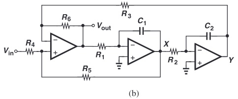

# 장말문제 15.55 — 10 MHz 피크와 두 저지 주파수를 갖는 KHN 대역통과 설계

## 조건
- Fig 15.36(b)의 KHN 대역통과 응답 사양은 $10\ \mathrm{MHz}$에서 피크 이득 1, $3\ \mathrm{MHz}$와 $33\ \mathrm{MHz}$에서 각각 $13\ \mathrm{dB}$ 감쇠이다.
- $R_3=R_6$을 가정한다.

## 구할 것
- 사양을 충족하는 대역통과 바이쿼드를 설계한다 (정할 값 예: 적분기의 RC값과 합산기의 저항비). (괄호 안은 원문에 없음)

## 상속·참조
- Fig 15.36(b)의 첫 적분기 출력 $X$가 대역통과 응답을 제공한다.
- 표준 2차 대역통과 응답에서 양쪽 감쇠가 정확히 같으면 두 주파수의 곱이 피크 주파수의 제곱이다. 인쇄된 수치로는 $3\times33=99$와 $10^2=100$이 달라 세 주파수를 모두 정확값으로 읽으면 조건이 양립하지 않는다. (원문에 없음)

## 회로 — Fig 15.36(b)
```spice
R4 Vin n1 {R_4}
R5 X n1 {R_5}
R3 Y n2 {R_3}
R6 Vout n2 {R_6}
XA n1 n2 Vout opamp
R1 Vout n3 {R_1}
C1 X n3 {C_1}
XB 0 n3 X opamp
R2 X n4 {R_2}
C2 Y n4 {C_2}
XC 0 n4 Y opamp
```
- 단자: Vin = 입력 (개방 원) / Vout = 출력 (개방 원)
- 표시: 노드 라벨 V_in, V_out, X, Y / 소자 라벨 R_1–R_6, C_1, C_2, XA, XB, XC (증폭기 라벨 없음) / 부호 세 연산증폭기의 왼쪽 위 −, 아래 + / 화살표 없음 / 수치·면적 라벨 없음
- 배치: 왼쪽 합산 증폭기의 비반전 입력 분기(점)에는 입력의 R_4와 아래쪽으로 X에서 돌아오는 R_5가 연결된다. 반전 입력 쪽(점)에는 옆 R_6 및 맨 위 Y에서 돌아오는 R_3이 닿는다. R_6 오른쪽 V_out 원의 분기(점)와 그 아래 합산기 출력 분기(점)를 세로선이 잇는다. 가운데와 오른쪽 적분기는 비반전 입력이 접지이며, 각 반전 입력의 분기(점)에는 가로 R_1·R_2와 위쪽 되먹임 C_1·C_2가 연결된다. X 출력 분기(점)에는 C_1, R_2, R_5 선이 닿고 Y 위쪽 분기(점)는 C_2와 R_3으로 이어진다. 교차: 없음


> 참고: Fig 15.36은 교재 842쪽(PDF 32)에 있다.
