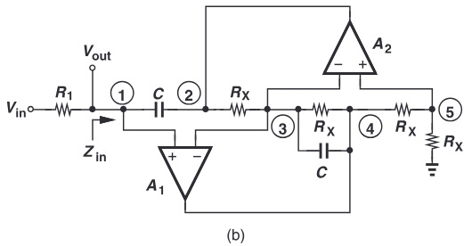

# 장말문제 15.59 — 슈퍼 커패시터형 능동 저역통과 설계

## 조건
- Fig 15.44(b)의 저역통과 필터에서 $-3\ \mathrm{dB}$ 대역폭은 $16.4\ \mathrm{MHz}$이다.
- $20\ \mathrm{MHz}$에서 감쇠 $6\ \mathrm{dB}$, $8\ \mathrm{MHz}$에서 피킹 $0.5\ \mathrm{dB}$를 가정한다.

## 구할 것
- 지정된 응답에 맞게 저역통과 필터를 설계한다 (정할 값 예: 입력 저항과 변환기 RC값). (괄호 안은 원문에 없음)

## 회로 — Fig 15.44(b)
```spice
R1   Vin   Vout  {R_1}
CI   Vout  2     {C}
RX2  2     3     {R_X}
RX3  3     4     {R_X}
RX4  4     5     {R_X}
RX5  5     0     {R_X}
CP   3     4     {C}
XA1  Vout  3     4  opamp
XA2  5     3     2  opamp
* Vout = 노드 1
```
- 단자: Vin = 입력 (개방 원) / Vout = 출력 (개방 원)
- 표시: 노드 라벨 V_in, V_out, 동그라미 속 1–5 / 소자 라벨 R_1, C 두 곳, R_X 네 곳, A_1, A_2 / 부호 A_1의 위쪽 입력은 왼쪽 +, 오른쪽 −, A_2의 아래쪽 입력은 왼쪽 −, 오른쪽 + / 화살표 "Z_in": 노드 1에서 오른쪽으로 변환기를 바라보며 도선 옆 별도 화살표 (┌ 꺾임) / 수치·면적 라벨 없음
- 배치: 입력에서 R_1을 지나 V_out 원으로 선이 위로 갈라지고(점), 계속 오른쪽으로 노드 1의 접속점, C, R_X 세 개를 거쳐 노드 5에 닿는다. 5에서 네 번째 R_X가 접지된다. 아래쪽 A_1은 1·3에서 입력을 받고 4로 되돌아간다. 위쪽 A_2는 3·5에서 입력을 받고 2로 되돌아간다. 다섯 번호 위치 모두 접속점(점)이다. 3–4 사이 저항 아래에 C가 병렬이다. C로 내려가는 왼쪽 분기 및 4 아래에서 C와 A_1 출력 귀환선이 만나는 곳은 각각 점이다. 교차: 없음


> 참고: Fig 15.44은 교재 850쪽(PDF 40)에 있다.
