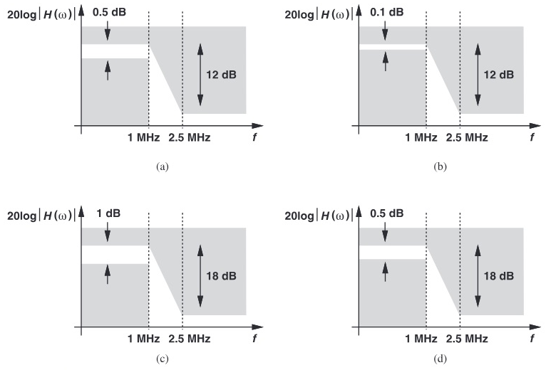

# 장말문제 15.60 — 네 템플릿에 맞는 버터워스·체비셰프 전달 함수

## 조건
- Fig 15.62(a)–(d)의 네 주파수 응답 템플릿을 사용한다.
- 네 템플릿 모두 통과대역 끝은 $1\ \mathrm{MHz}$, 저지대역 시작은 $2.5\ \mathrm{MHz}$이다.
- 각 패널의 (통과대역 허용 변동, 최소 저지대역 감쇠)는 (a) $(0.5,12)\ \mathrm{dB}$, (b) $(0.1,12)\ \mathrm{dB}$, (c) $(1,18)\ \mathrm{dB}$, (d) $(0.5,18)\ \mathrm{dB}$이다.

## 구할 것
- 각 템플릿에 대해 버터워스 전달 함수 하나와 체비셰프 전달 함수 하나를 각각 구한다.

## 상속·참조
- Fig 15.62(a)–(d)는 가로축 $f$, 세로축 $20\log|H(\omega)|$의 2×2 템플릿이다. 각 그래프에서 수직 점선 두 개는 $1\ \mathrm{MHz}$와 $2.5\ \mathrm{MHz}$이다. 첫 점선 앞의 흰 통과대역 폭과 두 번째 점선 너머에서 필요한 감쇠량을 각각 화살표로 표시한다. 회색 부분은 허용되지 않는 응답 영역이다. 세로축에 $0\ \mathrm{dB}$ 눈금은 인쇄되지 않았다.

## 회로 — 없음 (주파수 응답 템플릿 문제)
