# 전자회로2 첫 수업과 MOSFET 복습 — 5살도 이해하는 정리노트

권익진 교수님 전자회로2 · 0902 수업 (Lec1–2, Razavi 1·6장)

> `정리노트_0902_MOSFET_Review.html`를 마크다운으로 옮겼어요. 그림은 `figures_0902/` 폴더의 SVG, 위젯은 대표 설정의 정적 그림으로 바꿨어요. 수식은 `$…$` / `$$…$$`라서 GitHub, Obsidian, Typora에서 보여요.

**목차**

- [1. 전자회로2는 어떤 과목일까](#s0)
  - [성적과 과제 규칙](#s0-rules)
  - [왜 전자회로를 배울까](#s0-why)
  - [식을 외우지 말고 이해하기](#s0-philosophy)
  - [이번 학기 진도](#s0-roadmap)
- [2. 반도체 회로는 어디에 쓰일까](#s1)
  - [트랜지스터에서 IC까지](#s1-history)
  - [디지털 회로와 아날로그 회로](#s1-analog-digital)
  - [회로설계 직무](#s1-jobs)
  - [스마트폰·자동차·AI 속 아날로그](#s1-apps)
- [3. MOSFET 다시 보기](#s2)
  - [전자회로1 복습 지도](#s2-review-map)
  - [MOSFET의 구조와 단자](#s2-structure)
  - [게이트 전압과 채널](#s2-channel)
  - [작은 V_DS: 저항이 되는 triode 영역](#s2-triode)
  - [큰 V_DS: 전류원이 되는 saturation 영역](#s2-saturation)
- [4. 요약 · 예고](#s3)
  - [한 장 요약](#s3-cheatsheet)
  - [다음 시간 예고](#s3-next)
  - [함께 보면 좋은 자료](#s3-links)

## 1. 전자회로2는 어떤 과목일까

### 성적과 과제 규칙

*0902 수업 · L01 s2–s4*

**쉽게 말하면**

점수는 두 번의 시험, 직접 회로를 설계하는 숙제, 출석으로 정해지고, 수업 중에 질문을 하면 점수를 더 받아요.

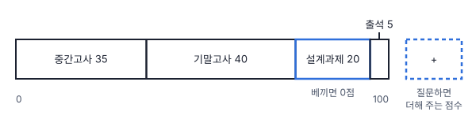

*숙제를 베끼면 보여 준 사람도 본 사람도 모두 0점이에요.*

**정확히 말하면**

성적평가기준(L01 s2)은 이래요. 중간·기말 비율은 녹음이 시작되기 전에 설명해서 슬라이드 값만 적어요.

| 항목 | 비율 | 규칙 |
|---|---|---|
| 중간고사 | 35% | 녹음 전에 설명(슬라이드 기준) |
| 기말고사 | 40% | 녹음 전에 설명(슬라이드 기준) |
| 설계과제 | 20% | Copy는 모두 0점 처리. 보여 준 사람과 본 사람 모두 0점이에요. 서로 논의하고 도움을 받는 것은 괜찮아요. |
| 출석 | 5% | 수업 중에 무작위로 확인해요. 부를 때 응답하지 않으면 결석이에요. 수업이 끝난 뒤 출석을 인정해 달라는 요청은 받지 않아요. 부정 출석은 최저학점이에요. 전자출석은 따로 확인하지 않아요(나중에 일괄 업데이트). |
| 가산점 | + | 질의응답 참여도에 따라 줘요. 성적 그레이드가 바뀔 만큼의 점수예요. |

설계과제에서 SPICE를 써 본 적이 없는 학생에게는 가이드를 주고, 조교가 도와줘요.

그 밖의 강의 안내(L01 s3–s4)예요.

- 담당교수 권익진, 원천관 314-1호, 집적회로시스템(ICAS) 연구실이에요. 연구분야는 아날로그 회로 가운데 무선통신용 RFIC와 전력관리용 PMIC(Power Management IC)예요.
- 상담은 이메일이나 포털로 미리 약속해요. 조교 정보는 아주Bb에 올려요.
- 강의노트는 수업 전에 아주Bb에 올려요. 수업은 강의노트로 진행해요.
- 교재는 Razavi, *Fundamentals of Microelectronics*예요. 번역본이든 원서든 상관없어요. 수업 시간에 꼭 가져올 필요는 없지만, 예제가 많으니 시험 준비에도 참고하라고 권하셨어요.
- 질문은 수업 중 언제든 해도 돼요.

**교수님 말씀**

회로 설계는 정답이 하나로 정해진 문제가 아니에요. 그래서 여러 사람이 설계하면 결과가 서로 달라야 하고, 결과가 비슷하면 copy를 의심할 수밖에 없다고 하셨어요.

> "100명이 설계하면 100명이 다 일반적으로 다르게 나와야 되거든요." (0902 00:44)

과제의 취지는 회사에서 실무를 할 때 필요한 설계 능력을 스스로 쌓아 보는 거예요.

가산점을 두는 이유는 질문을 권하기 위해서예요. 수동적으로 듣기만 하면 이해한 것 같아도 지나고 나면 모르게 되고, 질문하면서 이해도가 높아진다고 하셨어요.

> "좋은 질문, 나쁜 질문 없습니다." (0902 02:49)

**꼭 기억해요**

> "카피는 모두 0점 처리를 하도록 하겠습니다." (0902 00:09)

> "수업 끝나고 와서 출석 인정해 달라고 하는 거는 허용하지 않는다" (0902 03:34)

**페이지 요약**

설계과제는 Copy는 모두 0점이고, 출석은 수업 중에만 인정하며, 질문하면 가산점을 받아요.

*용어*

- **설계과제** — 20%. 보여 준 사람과 본 사람 모두 0점 처리
- **출석** — 5%. 수업 중 무작위 확인, 수업 뒤 인정 불가
- **가산점** — 질의응답 참여도에 따라 더해 주는 점수

---

### 왜 전자회로를 배울까

*0902 수업 · L01 s4*

**쉽게 말하면**

요즘 컴퓨터나 휴대폰으로 돈을 가장 많이 버는 곳은 겉 상자를 만드는 회사가 아니라 속에 든 부품을 만드는 회사예요.

그 부품이 어떻게 움직이는지 아는 힘이 우리 과의 무기예요.

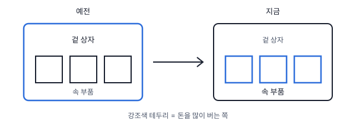

*돈을 많이 버는 쪽이 예전엔 겉 상자였고, 지금은 속 부품이에요.*

**정확히 말하면**

전자회로1은 반은 소자, 반은 회로였어요. 전자회로2는 본격적인 회로 과목이에요.

회로를 해석하는 데 필요한 것은 소자의 물리(device physics)가 아니라 소자의 전기적 특성이에요. 곧 각 노드 사이의 전압과 전류의 관계, 다시 말해 등가 모델(equivalent model)이에요. 소자를 잘 알면 설계에 도움은 돼요.

전자회로가 필수 과목인 이유(L01 s4 "Why 전자회로?")는 세 가지예요.

1. 반도체의 기본 동작 원리와 전자회로 이론은 반도체 회로 설계에 필요한 기초 역량이에요.
2. 반도체 설계와 검증에 쓰는 회로 개발 도구를 다루는 역량이 돼요.
3. 하드웨어(hardware) 블록의 특성을 이해하고, 시스템에 필요한 회로 구성 요소를 최적화해 설계·구현하는 역량이 돼요.

반도체 일을 하지 않더라도 이 과목이 필요해요. 전자공학의 강점은 하드웨어를 기반으로 한 소프트웨어이고, 소프트웨어만 하면 그 강점 하나를 버리는 셈이에요. 직접 설계하지 않더라도 하드웨어 블록의 특성을 이해하려면 회로와 기본 부품을 알아야 해요.

부가가치(added value)는 완제품에서 그 안의 부품으로 옮겨 갔어요.

- PC: 조립하는 회사보다 그 안에 들어가는 프로세서(processor)와 메모리를 만드는 회사가 더 많이 벌어요.
- 스마트폰: 노키아처럼 완제품을 만드는 것이 큰 산업이었지만, 지금은 애플·삼성도 그 안의 칩이 강점이에요.
- 자동차: 차체보다 안에 들어가는 전자 부품과 반도체가 중요해졌어요.

우리나라에는 모바일, 자동차, 반도체처럼 하드웨어 중심 회사가 많아요. 현대자동차처럼 반도체 회사가 아닌 곳도 회로를 직접 설계하고 제조는 파운드리(foundry)에 맡겨요.

회로 설계 직무는 전자공학과 학생만 뽑아요. 소자·공정 쪽은 물리, 화학, 화공, 재료 전공도 가요.

**교수님 말씀**

PC로 돈을 버는 회사를 묻자 한 학생이 "레노버?"라고 답했어요. 교수님은 그 안의 부품을 만드는 회사가 번다고 정리하셨어요.

> "거기 안에 들어가는 프로세서, 메모리 만드는 업체가 법니다." (0902 12:58)

> "그 안에 들어가는 부품을 만드는 게 굉장히 큰 강점이에요." (0902 13:19)

**꼭 기억해요**

> "등가 모델 좀 알아야지 회로를 해석할 수 있는 거죠." (0902 07:59)

> "하드웨어의 기본적인 회로를 이해하는 게 굉장히 중요하다" (0902 10:46)

**페이지 요약**

회로 해석에는 소자 물리보다 전기적 특성, 곧 등가 모델이 필요하고, 하드웨어를 아는 것이 전자공학의 강점이에요.

*용어*

- **등가 모델(equivalent model)** — 노드 사이 전압과 전류의 관계로 소자를 나타낸 모델
- **전기적 특성** — 각 노드의 전압과 전류의 관계
- **부가가치(added value)** — 완제품에서 프로세서·메모리 같은 부품으로 옮겨 갔어요

---

### 식을 외우지 말고 이해하기

*0902 수업 · L01 s5*

**쉽게 말하면**

자전거 타는 법을 한 번 몸으로 익히면 오래 쉬어도 금방 다시 타듯, 원리를 이해해 두면 잊어도 금방 돌아와요.

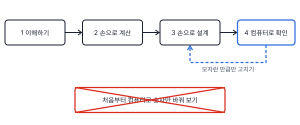

*먼저 이해하고 손으로 풀어 본 뒤, 컴퓨터는 맞았는지 확인할 때만 써요.*

**정확히 말하면**

이번 학기의 컨셉은 L01 s5의 한 줄이에요: Understand the circuit before using the computer to simulate a circuit!

식만 외우면 회로가 조금만 바뀌어도 식이 바뀌어요. 회로는 수백만 가지가 나올 수 있어서 다 외울 수 없고, 이해 없이 외운 식은 잊어버리면 아무것도 남지 않아요.

권장하는 설계 순서예요.

1. 회로를 이해해요.
2. 손으로 계산해요.
3. 손으로 설계해요.
4. 시뮬레이션 툴로 검증해요.

SPICE나 Cadence는 설계해 주는 도구가 아니라 계산기예요. node equation으로 전압과 전류를 계산해 줄 뿐이라서, 회로도를 제대로 그리지 않으면 엉뚱한 결과가 나와요.

파라미터를 바꿔 가며 원하는 값이 나올 때까지 돌리는 것을 튜닝(tuning)이라고 해요. 튜닝은 위험하고 남는 것이 없어요. 실무 파라미터는 수백 개가 넘고, 그런 반복은 AI가 더 잘해요.

설계는 구조를 고르는 데서 시작해요. 증폭기에는 common-source, common-gate, source follower 같은 여러 구조가 있어요. 각 구조의 장단점을 알고 내 사양에 맞는 구조를 판단해야 해요.

예: common-source(CS) 증폭기의 전압 이득은 $A_v = -g_m R_D$예요(L02 s16–s17). 이 식이 설계 방향을 바로 알려 줘요.

1. 이득 크기:

   $$
   |A_v| = g_m R_D
   $$
2. "이득 100"이 목표면 곱이 100인 조합을 골라요:

   $$
   g_m = 10,\ R_D = 10
   $$

   또는

   $$
   g_m = 1,\ R_D = 100
   $$
3. 시뮬레이션해 보니 이득이 10% 적게 나왔어요.
4. $|A_v|$는 $g_m$과 $R_D$에 비례하니, $g_m$이나 $R_D$를 10%쯤 키우면 돼요.

식을 모르면 이득이 왜 모자란지 모른 채 다시 돌리게 돼요. 식을 배우는 이유는 외우기 위해서가 아니에요. "이득을 높이려면 무엇을 키워야 하나", "bandwidth를 높이려면 무엇을 바꿔야 하나"를 알려 주는 설계의 연결 고리(link)이기 때문이에요.

그래서 목표는 회로를 이해하고, 개념을 이해하고, 식이 어떻게 나오는지 이해하고, 식이 나타내는 의미를 파악하는 거예요.

(수업에서는 부하저항을 $R_L$이라고 부르셨지만, 슬라이드 L02 s16–s17의 표기 $R_D$로 통일해요.)

**교수님 말씀**

자전거 비유를 드셨어요. 한참 안 타면 기억이 잘 안 나도 다시 타면 금방 타요. 개념을 이해해 두면 나중에 관련 업무로 책을 다시 볼 때 "아, 이건 이런 개념이었지" 하고 바로 돌아와요.

이 과목을 듣지 않은 사람, 예를 들어 화학과 출신 회로 설계자는 아무리 봐도 모른다고 하셨어요. 그 차이가 이해의 힘이에요.

> "시험에서 나오는 회로의 개수가 제한돼 있기 때문에 … 회사에 가서 일할 때 과연 도움이 될까요?" (0902 16:39)

설계 과제가 나오면 바로 컴퓨터 앞에 가서 파라미터를 바꿔 가며 돌리지 않느냐는 물음에 학생들이 수긍했어요. 그런 튜닝은 여러분보다 AI가 훨씬 더 잘한다고 하셨어요.

**꼭 기억해요**

> "그거는 계산기예요, 사실은." (0902 20:32)

> "그냥 검증의 도구로 simulation tool을 사용해야 된다." (0902 23:34)

> "식은 여러분들이 외우, 외울 필요가 없습니다." (0902 23:40)

> "식을 외우는 게 중요한 게 아니라 그 의미를 파악하는 게 중요하다" (0902 24:35)

**페이지 요약**

회로를 이해하고 손으로 설계한 뒤 시뮬레이터는 검증에만 쓰고, 식은 설계 방향을 찾는 데 써요.

*핵심 식*

- common-source 전압 이득

  $$
  A_v = -g_m R_D
  $$
- 이득 크기

  $$
  |A_v| = g_m R_D
  $$

*용어*

- **계산기** — SPICE·Cadence는 node equation으로 전압·전류를 계산할 뿐 설계해 주지 않아요
- **튜닝(tuning)** — 이유를 모른 채 파라미터를 바꿔 가며 돌리는 것. 위험하고 남는 것이 없어요

---

### 이번 학기 진도

*0902 수업 · L01 s6*

**쉽게 말하면**

이번 학기는 신호를 키우는 간단한 회로에서 출발해, 더 튼튼한 회로, 빠른 신호, 신호 거르기까지 차례로 배워요.

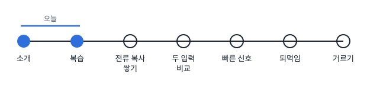

*색칠된 두 점이 오늘 한 곳이고, 테두리만 있는 점이 앞으로 갈 곳이에요.*

**정확히 말하면**

진도는 강의계획서대로 가요(L01 s6).

| 순서 | 주제 | 다루는 이유 |
|---|---|---|
| 1 | Introduction | 과목 소개 |
| 2 | Review | 전자회로1에서 필요한 것만 복습 |
| 3 | Cascode Stage and Current Mirror | 전자회로1은 간단한 single-stage 증폭기가 중심이었어요. 바이어스 전압·전류를 공급하는 current mirror와, single-stage를 넘어선 cascode를 배워요. |
| 4 | Differential Amplifiers | 차동 증폭기 |
| 5 | Frequency Response | 예전에는 음성만 처리하면 됐지만, 지금은 넓은 bandwidth에서 고주파 특성을 알아야 해요. 이것이 frequency response예요. |
| 6 | Feedback | 정확도를 높이는 feedback |
| 7 | Analog Filters | 신호를 걸러 주는 filter |

이것으로 아날로그 회로의 기본 블록을 다 다루지는 못해요. 신호를 만드는 회로, 기준 전압·전류를 만드는 회로, 지금까지 블랙박스로 쓰던 op-amp 자체의 설계는 선택과목 "아날로그 집적회로"에서 넓히면 돼요.

**교수님 말씀**

신호 주파수가 높아졌기 때문에 넓은 bandwidth에서의 주파수 특성을 이해해야 한다고 하셨어요.

> "옛날에는 음성만 처리하면 됐었잖아요." (0902 25:13)

> "아날로그 집적회로 같은 과목을 통해서 … 이해의 폭을 넓히면 되겠습니다." (0902 26:12)

**페이지 요약**

single-stage 증폭기에서 출발해 current mirror, cascode, 차동 증폭기, frequency response, feedback, filter 순서로 가요.

*용어*

- **current mirror** — 바이어스 전압·전류를 공급하는 회로
- **frequency response** — 넓은 bandwidth에서의 고주파 특성
- **feedback** — 정확도를 높이는 방법

---

## 2. 반도체 회로는 어디에 쓰일까

### 트랜지스터에서 IC까지

*0902 수업 · L01 s7–s9*

**쉽게 말하면**

크고 잘 깨지는 유리관 부품이 작은 스위치로 바뀌었고, 그 스위치를 판 하나에 점점 더 많이 모으면서 지금의 전자기기가 생겼어요.

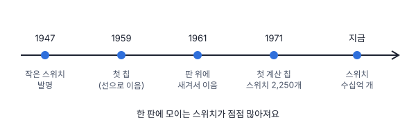

*스위치를 한 판에 많이 모을수록 기기는 작아지고 전기도 덜 써요.*

**정확히 말하면**

회로는 트랜지스터(transistor)로 만들어요. 그래서 전자회로의 역사는 트랜지스터의 개발에서 시작해요(L01 s7).

| 연도 | 사건 | 의미 |
|---|---|---|
| 1947 | Bell Labs에서 트랜지스터 발명 | 전화 교환기에서 스위치로 쓰던 진공관(vacuum tube)을 대체했어요. 진공관은 부피가 크고 잘 깨졌어요. |
| 1959 | Texas Instruments(TI)의 Jack Kilby가 첫 IC(integrated circuit, 집적회로)를 만듦 | 트랜지스터와 수동 소자(R, C)를 한 기판에 모았어요. 배선은 반도체 공정이 아니라 금선(gold wire)으로 이었어요. 기능 검증 수준이었어요. |
| 1961 | 첫 planar IC | 반도체 공정으로 기판 위에 트랜지스터, R, C를 만들고 연결까지 했어요. 오늘날 IC와 같은 방식이에요. |
| 1971 | Intel 4004 | 세계 최초의 마이크로프로세서(microprocessor)예요. 트랜지스터 2,250개를 12 mm² 면적에 넣었어요. |

- 트랜지스터 이전에는 전자 소자로 진공관을 썼어요. 초기 컴퓨터 ENIAC도 진공관으로 만들었어요.
- 1947년의 첫 트랜지스터는 지금 트랜지스터와 모양이 달라요. 동작을 검증하기 위한 형태였어요. 이 연구에서 BJT(Bipolar Junction Transistor) 개념이 완성됐어요.
- 트랜지스터 발명은 노벨 물리학상을 받았어요(1956). 전자공학에서 노벨상을 받은 몇 안 되는 업적이에요.
- planar IC는 Fairchild의 Robert Noyce가 고안했어요. 바탕이 된 planar 공정은 같은 회사의 Jean Hoerni가 개발했어요. Noyce는 뒤에 Intel을 공동 창업했어요.
- IC 발명도 2000년 노벨 물리학상을 받았어요. 수상자는 Jack Kilby예요. Robert Noyce는 1990년에 세상을 떠나 받지 못했어요.

무어의 법칙(Moore's law)에 따라 칩 하나에 들어가는 트랜지스터 수는 계속 늘었어요. 지금은 칩 하나에 수십억 개가 들어가고, 시스템 하나가 칩 하나에 들어가요.

부품을 따로따로 연결하는 discrete component 방식은 부피가 크고 전력 소모가 많아요. 그래서 지금 회로 설계는 곧 반도체 설계, 곧 반도체 IC 설계예요. 전자 시스템을 설계하는 것과 반도체를 설계하는 것이 거의 같은 개념이 됐어요.

**교수님 말씀**

Bell Labs의 벨이 누구냐고 물으셨고, 학생이 "전화기 만든 사람"이라고 답했어요. 그래서 전화기에 필요한 교환기의 스위치를 바꾸려고 트랜지스터를 만들었다고 이으셨어요.

지금 칩에 트랜지스터가 몇 개 들어가냐는 질문에 학생이 "몇 억?"이라고 답했고, 교수님은 수십억 개라고 정리하셨어요.

예전 TV는 discrete 부품으로 채워져 있었지만, 지금은 뜯어 보면 반도체 몇 개밖에 없다고 하셨어요.

> "회로 설계라고 하는 거는 사실 반도체 설계라고 이해하시면 되겠습니다." (0902 32:48)

**꼭 기억해요**

회로의 출발점은 트랜지스터예요.

> "가장 중요한 것 중의 하나가 트랜지스터죠, 트랜지스터." (0902 26:58)

IC의 등장도 트랜지스터만큼 중요한 사건이에요.

> "트랜지스터의 개발과 마찬가지로 굉장히 중요한 거고" (0902 31:12)

**페이지 요약**

진공관을 대신한 트랜지스터가 IC로 모이면서, 지금 회로 설계는 곧 반도체 설계가 됐어요.

*용어*

- **진공관(vacuum tube)** — 트랜지스터 이전의 스위치 소자. 부피가 크고 잘 깨져요
- **planar IC** — 반도체 공정으로 소자와 연결까지 기판 위에 만든 IC(1961)
- **Intel 4004** — 트랜지스터 2,250개로 만든 세계 최초의 마이크로프로세서(1971)

---

### 디지털 회로와 아날로그 회로

*0902 수업 · L01 s10*

**쉽게 말하면**

칩 속에는 켜짐과 꺼짐 두 가지로만 계산하는 부분과, 끊김 없이 변하는 작은 신호를 다루는 부분이 함께 들어 있어요.

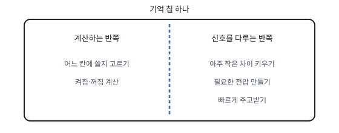

*기억을 담는 칩도 반은 계산하는 부분, 반은 신호를 다루는 부분이에요.*

**정확히 말하면**

집적회로(IC)는 크게 디지털 회로(digital circuit)와 아날로그 회로(analog circuit)로 나뉘어요. 아날로그 쪽 과목은 전자회로와 아날로그 집적회로이고, 디지털 쪽 기본 과목은 논리회로예요.

메모리는 디지털일까요, 아날로그일까요? 답은 "반반"이에요. 메모리 안에 두 종류의 회로가 모두 들어 있어요.

- 디지털 부분: decoder(주소에 따라 어느 셀에 쓸지 고름), logic(게이트 로직)
- 아날로그 부분:

  - sense amp: 셀에 저장된 전하가 만드는 아주 작은 전압 차를 증폭해서 1인지 0인지 판단해요.
  - BGR(bandgap reference)과 LDO(low dropout regulator): 필요한 전압을 만들어요.
  - CP(charge pump): 전압을 더 높여 줘요.
  - high-speed I/O: 속도가 높아지면서 필요해진 고속 입출력 회로예요.

메모리처럼 대부분의 시스템에는 아날로그 회로와 디지털 회로가 모두 들어가 있어요. 슬라이드 s10은 두 쪽을 이렇게 나눠요.

| 구분 | 예 |
|---|---|
| 디지털 회로 | 메모리의 decoder·logic, AP(application processor), modem(변조·복조 칩), AI용 CPU/GPU/NPU(Neural Processing Unit), 제품별 특화 digital IP |
| 아날로그 회로 | 메모리의 sense amp·BGR·LDO·CP·high-speed I/O, image/touch/bio 센서, 자동차 레이더 센서, PMIC, DDI, RFIC, AI·5G·IoT·자동차용 analog IP |

- 레이더 센서(radar sensor): 원래 군용·항공기 위치 정보에 쓰던 기술이 자동차로 내려왔어요. 전자기파를 쏘고 반사되어 돌아오는 시간으로 거리를 재요.
- PMIC(Power Management IC): 배터리로 움직이는 기기를 오래 쓰려면 전력 관리가 필요해요. 자동차에서는 배터리 관리 IC, 곧 BMS(battery management system)라고도 불러요. 효율이 떨어지면 손실이 열이 되어 기기가 뜨거워지고, AI 때문에 이 문제가 더 심각해졌어요.
- DDI(Display Driver IC): 디스플레이 뒤에서 픽셀을 구동하는 IC예요. 출력단이 버퍼 앰프 형태라서 이것도 앰프로 볼 수 있어요.
- RFIC(Radio Frequency IC): 무선 통신용 아날로그 회로예요.

아날로그 회로는 자동차에 특히 많이 쓰여요. 자동차 반도체의 약 70%가 아날로그이고, 메모리·디지털·파운드리를 합친 나머지가 약 30%예요.

응용이 달라도 증폭기의 개념은 같아요. 메모리에 쓰면 sense amp, 자동차에 쓰면 자동차용 앰프가 돼요. 응용에 따라 달라지는 것은 요구 사양(spec)이고, 사양이 달라지면 설계도 달라져요.

**교수님 말씀**

메모리가 아날로그냐 디지털이냐고 물으시고 바로 답하셨어요.

> "반반이죠, 반반." (0902 34:16)

전자회로를 들으면 눈에 보이지 않는 회로를 붙잡고 헤매는 것 같지만, 이 회로들이 실제 제품마다 빌딩 블록으로 들어가 있다고 하셨어요(0902 39:21).

**꼭 기억해요**

같은 증폭기라도 쓰는 곳에 따라 사양이 바뀌고, 그에 맞춰 설계가 바뀌어요.

> "요구 사양이 달라지면 설계도 조금 달라져야 되겠죠" (0902 39:49)

배터리 기기에서는 전력 관리가 핵심이에요.

> "전력 관리가 굉장히 중요하죠." (0902 37:40)

**페이지 요약**

메모리를 포함한 대부분의 시스템에는 디지털과 아날로그 회로가 함께 들어 있고, 응용에 따라 사양(spec)이 달라져요.

*용어*

- **sense amp** — 메모리 셀의 아주 작은 전압 차를 증폭해 1과 0을 판단하는 회로
- **PMIC(Power Management IC)** — 배터리 기기의 전력을 관리하는 아날로그 IC
- **사양(spec)** — 응용이 요구하는 성능 조건. 달라지면 설계도 달라져요

---

### 회로설계 직무

*0902 수업 · L01 s11–s12*

**쉽게 말하면**

칩 하나를 만들 때는 회로를 그려 계산하는 사람, 글로 동작을 적는 사람, 실제 모양을 그리는 사람, 잘 되는지 확인하는 사람이 일을 나눠요.

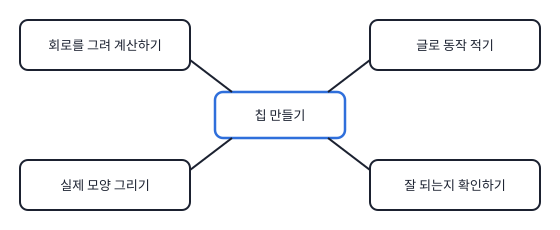

*빠르게 움직이는 칩은 글로 적는 쪽 사람도 신호를 다루는 지식이 있어야 만들 수 있어요.*

**정확히 말하면**

회로설계 직무는 메모리(DRAM, Flash, controller)와 시스템 반도체(AP, modem, sensor, PMIC, DDI, security, RFIC 등)를 개발하려고 아날로그·디지털 회로를 설계하고 검증하는 일이에요(L01 s11). 메모리를 뺀 반도체를 시스템 반도체라고 불러요.

- 아날로그 회로설계(s11)

  - 메모리와 시스템 반도체 제품에 맞는 아날로그 IP를 개발해 제품에 적용해요. 아날로그 IP는 기본 단위 블록이에요.
  - ADC, amplifier, regulator, DC-DC, antenna 같은 저전력·초고속 아날로그 회로를 설계해요.
  - 고속 신호 전송을 위한 I/O 회로, physical layer, SI/PI(signal/power integrity)를 연구 개발해요.
- 디지털 회로설계(s12): 제품별 특화 digital IP(CPU, GPU, 5G modem), AI 전용 NPU, 모바일·자동차 SoC, 기능 구현과 평가를 위한 FPGA 설계, system architecture(BW, power, scenario) 최적화
- 회로 검증 및 최적화: 설계 과정의 회로 검증, 불량 분석, 최적화 방안 연구
- layout 설계 및 설계 검증 방법론 개발: 설계된 회로를 반도체로 만들려면 물리적인 패턴으로 그려야 해요. 이 패턴이 layout이에요. 설계를 검증하는 방법론과 SPICE 같은 전문 소프트웨어를 개발하는 일도 여기에 속해요.

같은 회로 설계라도 아날로그와 디지털은 설계 방법이 달라요.

| 구분 | 설계 방법 |
|---|---|
| 아날로그 설계 | 회로의 schematic을 그리고 전압과 전류를 계산해요. |
| 디지털 설계 | 주로 Verilog로 코딩하고, back-end에서 튜닝해요. |

디지털 신호는 1과 0으로 구분되고, 아날로그 신호는 연속(continuous) 신호예요. 그런데 고속이 되면 디지털 신호도 1과 0으로 딱 나뉘지 않고 아날로그 신호처럼 보여요. 그래서 GHz 대역으로 동작하는 CPU, GPU, HBM 같은 고속 회로는 아날로그 회로처럼 해석해야 해요. 디지털 설계자도 아날로그를 알아야 하는 이유예요.

전자회로2는 아날로그 회로 설계의 기초에 해당해요.

**교수님 말씀**

디지털과 아날로그의 차이를 물으셨고, 학생이 "디지털은 1과 0으로 구분되고, 아날로그는 continuous 신호"라고 답했어요(0902 41:13). 교수님은 고속에서는 이 구분이 흐려진다고 이으셨어요.

두 분야의 설계 방법 차이는 직접 답하셨어요.

> "같은 회로 설계라도 아날로그 회로 설계랑 디지털 회로 설계는 좀 차이가 있어요." (0902 43:05)

반도체 회사의 회로설계 부서에 회로 설계만 있는 것이 아니라, 검증·최적화·layout·방법론을 맡는 사람도 있다고 하셨어요.

**꼭 기억해요**

디지털 설계를 하더라도 고속에서는 아날로그 해석이 필요해요.

> "디지털 회로 설계라 해도 아날로그를 몰라선 안 되는" (0902 44:27)

> "요즘은 고속이 굉장히 중요하죠." (0902 44:44)

**페이지 요약**

아날로그 설계는 schematic을 그려 계산하고, 디지털 설계는 Verilog로 코딩하지만, 고속에서는 디지털도 아날로그처럼 해석해야 해요.

*용어*

- **아날로그 IP** — 메모리·시스템 반도체에 들어가는 아날로그 기본 단위 블록(ADC, amplifier, regulator 등)
- **layout** — 설계된 회로를 반도체로 만들기 위한 물리적 패턴
- **Verilog** — 디지털 회로 설계에 쓰는 코딩 언어

---

### 스마트폰·자동차·AI 속 아날로그

*0902 수업 · L01 s13–s17*

**쉽게 말하면**

계산하는 부분이 뇌라면, 신호를 다루는 회로는 바깥 세상과 만나는 눈·귀·입·손이에요.

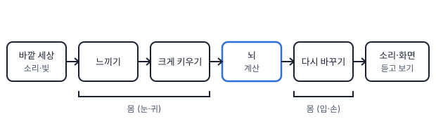

*작은 신호는 먼저 크게 키워야 뇌가 헷갈리지 않고 읽을 수 있어요.*

**정확히 말하면**

**스마트폰(L01 s13–s14).** 전자회로의 가장 대표적인 응용이에요.

- 아날로그 부분: RFIC(셀룰러, Wi-Fi, Bluetooth, GPS 통신용 칩), 센서(자이로스코프, 가속도계, 조도 센서, 근접 센서, 터치스크린), PMIC, 오디오 앰프
- 디지털 부분: AP(application processor), modem
- 메인 칩 구성도(s14): 디지털·메모리(녹색) 5개(AP, DRAM, NAND flash, NOR flash, baseband 칩), 아날로그(적색) 15개(파워, 오디오, 비디오, 디스플레이, 터치 IC, RF IC, 나침반, 자이로스코프, 가속도계 등). 교수님은 대체로 아날로그 반, 디지털 반쯤이라고 보셨어요.

**아날로그 회로가 없어지지 않는 이유.**

1. 예전에는 연산도 아날로그로 했어요. op-amp(operational amplifier, 연산 증폭기)라는 이름은 적분, 미분, 덧셈, 뺄셈을 아날로그로 하던 데서 나왔어요.
2. 지금 연산은 아날로그로 하면 비효율적이라 디지털 신호처리로 넘어갔어요. 아날로그에서 사라진 것은 계산 기능이에요.
3. 그런데 우리가 듣고, 보고, 말하는 현실 세계의 신호는 아날로그예요.
4. 그래서 센싱해서 처리하고, 디지털로 계산한 뒤, 다시 아날로그로 바꿔야 우리가 듣고 볼 수 있어요.
5. 센싱 기능은 오히려 늘고 있어요. 스마트폰은 이제 숨 쉬는 것까지 센싱해요.

**자동차(s15).** 자율주행에는 레이더 센서와 통신이 필요해요. 자동차 부품은 더 이상 기계 부품이 아니라 전자 부품이라서 반도체가 많이 필요해요. 반도체, 자동차, 모바일처럼 우리나라 핵심 산업이 모두 하드웨어 기반이라서 이 개념들이 중요해요.

**기술 발전 동향(s16).**

- IoT(사물인터넷): 모든 사물에 센싱, 통신, 컴퓨팅을 넣어요. 환경 데이터를 모으고 처리하려면 아날로그 반도체가 필요해서 반도체 수요가 폭증해요.
- 자동차: 전기차의 배터리 관리 시스템(BMS), 자율주행차의 센서와 데이터 처리 시스템에서 아날로그 반도체가 중요해져요.
- 5G 및 통신: 고주파 신호 처리용 아날로그 반도체 수요가 늘어요.

**AI 반도체(s17).**

- 메모리도 중요해요.
- 데이터 수집 및 전처리: 아날로그 반도체가 센서 신호를 증폭하고 잡음을 제거해 고품질 데이터를 줘요. physical AI로 가면 여러 센서의 신호를 처리하는 회로가 많이 필요해요.
- 전력 관리: AI 반도체는 고성능이라 전력을 많이 써요. PMIC로 전력을 효율적으로 분배해야 해요.
- edge computing: 지금은 서버에 접속해 AI 처리를 하지만, 간단한 처리는 각 단말기에서 직접 하는 쪽으로 가고 있어요. 제한된 전력과 공간에서 동작해야 하므로 저전력 고성능 아날로그 반도체가 필요해요.

**RF 회로는 어디에 속하나(질의응답).** RF 회로도 아날로그 회로예요. 무선으로 기지국과 신호를 주고받는 무선통신용 아날로그 회로예요. 여러 기능이 함께 필요해요.

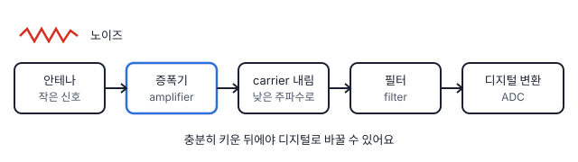

*RF 수신 경로. 기지국에서 온 작은 신호를 키우고, carrier를 내리고, 원하는 신호만 걸러서 디지털로 바꿔요.*

1. 기지국이 멀어서 받는 신호가 매우 작고 노이즈가 섞여 있어요. 그래서 신호를 키우는 증폭기(amplifier)가 필요해요.
2. 보낼 때는 신호를 높은 carrier 주파수에 변조(modulation)해 실어 보내요.
3. 받을 때는 carrier 주파수를 낮은 주파수로 떨어뜨려요.
4. 여러 사용자의 수많은 신호 가운데 원하는 신호만 걸러야 하므로 필터(filter)가 필요해요.
5. 신호를 충분히 키운 뒤에 아날로그 신호를 디지털로 바꿔 처리해요.
6. 작은 신호는 노이즈 때문에 바로 디지털로 바꿀 수 없어요. 센서도 같은 이유로 처음부터 디지털로 센싱할 수 없어요.

여기에 쓰이는 증폭기가 어떤 회로 블록인지는 [디지털 회로와 아날로그 회로](#s1-analog-digital)에서 정리했어요.

**교수님 말씀**

디지털은 계산하는 뇌이고, 아날로그 회로는 손, 귀, 눈, 입처럼 뇌를 뺀 나머지 몸 전체라고 비유하셨어요.

> "디지털은 두뇌에 해당되는 거예요." (0902 47:23)

op-amp가 뭐냐고 물으셨고, 학생들이 연산 증폭기라고 답했어요(0902 48:08). 이름 그대로 예전에는 연산을 아날로그로 했다는 뜻이라고 이으셨어요.

RF 질문에는 큰 분야를 짧게 답했다고 덧붙이셨어요(0902 55:51).

**꼭 기억해요**

작은 신호는 먼저 증폭해야 디지털로 바꿀 수 있어요.

> "신호가 작을 때는 … 디지털로 바꿀 수가 없어요. 노이즈 때문에." (0902 55:33)

반도체와 AI에서 메모리의 중요성도 강조하셨어요.

> "향후에 계속 반도체가 중요하다." (0902 51:47)

> "사실 메모리도 굉장히 중요하거든요." (0902 52:05)

**페이지 요약**

디지털이 뇌라면 아날로그는 센서로 세상을 느끼고 신호를 키우는 몸이고, 작은 신호는 노이즈 때문에 먼저 키워야 디지털로 바꿀 수 있어요.

*용어*

- **op-amp(operational amplifier, 연산 증폭기)** — 예전에 적분·미분·덧셈·뺄셈을 아날로그로 하던 증폭기
- **edge computing** — 서버 대신 단말기가 간단한 AI 처리를 직접 하는 방식. 저전력이 필요해요
- **carrier 주파수** — 신호를 변조해 실어 보내는 높은 주파수. 받을 때 낮은 주파수로 내려요

---

## 3. MOSFET 다시 보기

### 전자회로1 복습 지도

*0902 수업 · L02 s1–s2*

**쉽게 말하면**

새 층을 올리기 전에, 전에 다진 바닥이 튼튼한지 네 군데를 짚어 봐요.

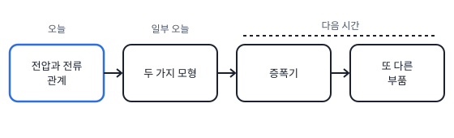

*오늘은 첫 칸과 둘째 칸의 일부를 봤고, 나머지는 다음 시간에 이어서 봐요.*

**정확히 말하면**

전자회로2를 따라가려면 전자회로1에서 아래 네 가지를 알고 있어야 해요 (L02 s2).

1. MOSFET의 I/V 특성: 소자의 물리가 아니라 회로 설계에 쓰는 전압과 전류의 관계예요.
2. MOS 등가 회로 모델: large-signal model과 small-signal model. 둘의 차이를 구분할 수 있어야 해요.
3. CMOS 증폭기의 동작 원리.
4. BJT의 I/V 특성과 등가 모델.

이번 수업에서는 1번을 다뤘어요. 2번은 saturation 영역의 MOSFET을 전류원으로 보는 개념까지만 말로 짚었어요. 나머지(small-signal model, CMOS 증폭기, BJT)는 다음 시간에 이어서 복습해요.

- [MOSFET의 구조와 단자](#s2-structure)
- [게이트 전압과 채널](#s2-channel)
- [작은 V_DS: 저항이 되는 triode 영역](#s2-triode)
- [큰 V_DS: 전류원이 되는 saturation 영역](#s2-saturation)

**교수님 말씀**

전자회로1을 다시 다 다룰 수는 없으니, 이 수업에 필요한 핵심만 짧게 짚고 넘어간다고 하셨어요. 리뷰를 듣다가 개념이 헷갈리면 스스로 복습하라고 당부하셨어요.

> "놓치게 되면 그 다음은 사실은 어렵죠. 따라오기가 어렵죠." (0902 56:43)

트랜지스터로 회로를 설계하려면 물리적 동작보다 전압과 전류의 관계를 알아야 하고, 그 관계를 표현한 것이 등가 회로 모델이라고 하셨어요 (0902 57:13–57:34).

**꼭 기억해요**

> "라지 시그널 모델과 스몰 시그널 모델이 있어요. 이 둘의 차이를 명확하게 … 이해를 하고 있어야 돼요." (0902 57:34)

> "최소한 요거는 알아야지 … 회로 설계를 하는데 기본적인 백그라운드가 되겠죠." (0902 57:59)

**페이지 요약**

전자회로2를 따라가려면 I/V 특성, 두 등가 모델, CMOS 증폭기, BJT를 알고 있어야 해요.

*용어*

- **I/V 특성** — 회로 설계에 쓰는 소자의 전압과 전류 관계
- **large-signal model / small-signal model** — MOS 등가 회로 모델 두 가지. 차이를 구분해야 해요
- **CMOS 증폭기** — 트랜지스터로 만든 증폭기. 다음 시간에 복습해요

---

### MOSFET의 구조와 단자

*0902 수업 · L02 s3*

**쉽게 말하면**

가운데 문 하나를 사이에 두고 똑같이 생긴 방 두 개가 마주 보고 있어요.

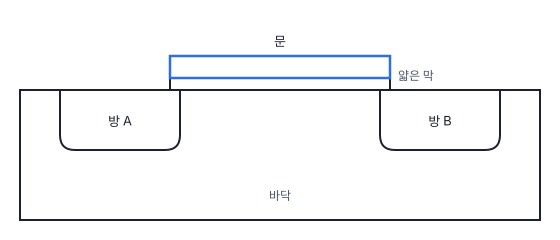

*두 방이 똑같아서 어느 쪽을 들어오는 방으로 정해도 돼요.*

**정확히 말하면**

MOS는 층 구조의 이름이에요: Metal(게이트 전극), Oxide(절연체 산화막), Semiconductor(기판). NMOS는 p형 기판(p-substrate)에 n+ 영역 두 개를 만든 구조예요 (L02 s3).

두 n+ 영역은 대칭이에요. 그래서 어느 쪽이든 소스가 될 수 있고, 어느 쪽이든 드레인이 될 수 있어요.

| 단자 | 이름의 뜻 | NMOS에서 |
|---|---|---|
| 게이트(gate, G) | 채널을 열어 주는 문 | 전압을 걸어 채널을 만들어요 |
| 소스(source, S) | 캐리어를 공급하는 곳 | 전자가 여기서 나와요 |
| 드레인(drain, D) | 캐리어가 빠져나가는 곳 | 전자가 여기로 나가요 |
| body(substrate, B) | 기판 단자 | 보통 ground나 소스에 연결해요. PMOS는 보통 $V_{DD}$에 연결해요 |

회로 심볼은 G, S, D의 3단자로 기억하면 돼요. body를 넷째 단자로 따로 그리기도 해요.

전자는 소스에서 드레인으로 가요. 전류는 전자와 반대 방향이라서 드레인에서 소스로 흘러요.

**교수님 말씀**

소스와 드레인의 뜻을 물으셨고, 학생들이 "공급하는 거", "빠져나가는 거"라고 답했어요. 교수님은 게이트를 "문"에 비유하며, 전류가 흘러갈 수 있도록 채널을 열어 주는 역할이라고 정리하셨어요 (0902 59:31–60:22).

body는 소스에 묶여 있는 경우가 대부분이고, NMOS에서는 ground에 연결돼 있다고 하셨어요 (0902 59:09).

**꼭 기억해요**

> "물리적인 동작이 중요한 게 아니고요." (0902 58:18)

구조는 대칭이라는 것과 단자 이름만 기억하고, 회로 설계에 필요한 전압과 전류의 관계에 집중해요.

**페이지 요약**

MOSFET은 Metal–Oxide–Semiconductor 구조이고, 두 n+ 영역이 대칭이라 어느 쪽이든 소스나 드레인이 될 수 있어요.

*용어*

- **소스(source)** — 캐리어를 공급하는 곳
- **드레인(drain)** — 캐리어가 빠져나가는 곳. 전류는 드레인에서 소스로 흘러요
- **body(substrate)** — 넷째 단자. 보통 ground나 소스에 연결해요

---

### 게이트 전압과 채널

*0902 수업 · L02 s4*

**쉽게 말하면**

문 위에서 세게 끌어당기면 작은 알갱이들이 문 아래로 모여 두 방을 잇는 길이 생겨요.

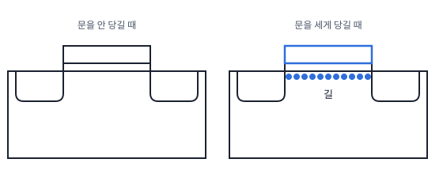

*길이 생긴 뒤에 양쪽을 서로 다르게 밀어 줘야 비로소 흐르기 시작해요.*

**정확히 말하면**

1. NMOS 게이트에 양의 전압을 걸어요.
2. p형 기판의 전자(음전하)가 산화막 계면 근처로 끌려와 모여요.
3. 게이트 전압이 충분히 높으면 계면에 free electron이 생기면서 소스와 드레인을 잇는 채널이 형성돼요.
4. p형이던 기판 표면이 전자가 많은 n형처럼 극성이 뒤집히므로, 이 채널을 inversion layer라고 불러요.

채널이 생기기 시작하는 게이트 전압을 문턱 전압(threshold voltage) $V_{TH}$라고 해요. $V_{GS}$가 $V_{TH}$보다 높아야 채널이 생겨요.

채널이 생겼다고 바로 전류가 흐르지는 않아요. 채널 양단, 곧 드레인과 소스 사이에 전압 차가 있어야 전자가 움직여요.

**교수님 말씀**

"반도체"라는 이름을 이렇게 풀어 주셨어요. 채널이 생기면 도체, 채널이 없으면 부도체이니 반은 도체이고 반은 부도체라는 뜻이에요.

> "채널이 생기면은 도체가 되는 거고, 채널이 없으면 부도체가 되는 거니까" (0902 61:06)

inversion이라는 말이 어렵다면 그냥 "전자가 흘러갈 수 있는 채널이 형성된다"로 보면 된다고 하셨어요 (0902 62:01).

**페이지 요약**

게이트에 충분한 양의 전압을 걸면 계면에 전자가 모여 채널이 생기고, 그 문턱이 $V_{TH}$예요.

*용어*

- **채널(inversion layer)** — 게이트 아래 계면에 전자가 모여 생긴 전류 통로
- **문턱 전압(threshold voltage) $V_{TH}$** — 채널이 생기기 시작하는 게이트 전압

---

### 작은 V_DS: 저항이 되는 triode 영역

*0902 수업 · L02 s5*

**쉽게 말하면**

살짝 밀면 미는 만큼 비례해서 흐르고, 문을 넓게 열수록 더 잘 흘러요.

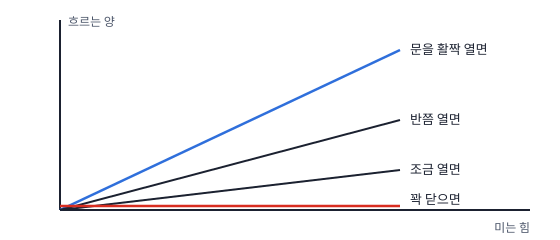

*문을 끝까지 열면 켜진 스위치, 꽉 닫으면 꺼진 스위치가 돼요.*

**정확히 말하면**

1. 게이트에 양의 전압을 걸어 채널을 만들어요.
2. 소스를 ground에 두고 드레인 전압을 올려 $V_{DS}$를 키워요.
3. 전자는 높은 전압 쪽(드레인)으로 움직이므로, 전류 $I_D$는 드레인에서 소스로 흘러요.
4. $V_{GS}$를 키우면 채널에 전자가 더 많이 모여서 같은 $V_{DS}$에서 $I_D$가 커져요.
5. $V_{DS}$가 작을 때 $I_D$는 $V_{DS}$에 선형으로 비례해요. 트랜지스터가 저항처럼 동작해요.

이 동작 영역을 triode region 또는 linear region이라고 해요. "linear"는 $I_D$와 $V_{DS}$의 관계가 직선이라는 뜻이에요. 이때 저항값은 (L02 s5)

$$
R_{on} = \frac{1}{\mu_n C_{ox}\frac{W}{L}(V_{GS}-V_{TH})}
$$

이고, $I_D$–$V_{DS}$ 직선의 기울기가 $1/R_{on}$이에요.

$$
I_D \approx \frac{V_{DS}}{R_{on}}
$$

$V_{GS}-V_{TH}$가 커지면 기울기가 커지고 $R_{on}$은 작아져요. 곧 $R_{on}$은 $V_{GS}-V_{TH}$에 반비례해요.

이 성질로 MOSFET을 전자 스위치로 써요.

- 게이트에 가장 높은 전압 $V_{DD}$를 걸면 $R_{on}$이 작아져요(스위치 on).
- 게이트에 0을 걸면 채널이 없어 저항이 무한대에 가까워요. 스위치 off예요.

게이트에 1이나 0을 넣어 스위치를 켜고 끄는 것이 디지털 로직의 원리예요. 아날로그 증폭기에서는 트랜지스터를 스위치로 쓰는 경우가 많지 않아요.

**교수님 말씀**

게이트 전압을 키우면 왜 전류가 커지는지 물으셨어요. 채널에 전자가 더 많이 모이고, 전류는 단위 시간당 흐르는 전하량이니 더 많은 전류가 흐른다고 정리하셨어요 (0902 63:15–63:45).

$V_{TH}$가 무엇이냐는 질문에는 "threshold 전압"이라는 답이 나왔어요 (0902 64:50).

> "게이트 전압에다 1 또는 0을 가하면 … 스위치가 온 됐다가 오프 됐다. 이게 이제 로직의 원리" (0902 66:35)

**꼭 기억해요**

> "식은 중요한 건 아닌데 어쨌든 이제 이게 저항처럼 동작을 해." (0902 64:39)

식을 외우기보다, 작은 $V_{DS}$에서 MOSFET이 $V_{GS}$로 값이 바뀌는 저항이라는 것을 기억해요.

**페이지 요약**

$V_{DS}$가 작으면 $I_D$가 $V_{DS}$에 비례해서 MOSFET이 저항처럼 동작하고, 이 성질로 스위치를 만들어요.

*핵심 식*

- triode 저항

  $$
  R_{on} = \frac{1}{\mu_n C_{ox}\frac{W}{L}(V_{GS}-V_{TH})}
  $$
- 작은 V_DS의 전류

  $$
  I_D \approx \frac{V_{DS}}{R_{on}}
  $$

*용어*

- **triode region(linear region)** — 작은 $V_{DS}$에서 $I_D$가 $V_{DS}$에 비례하는 영역
- **스위치(switch)** — 게이트 $V_{DD}$면 on, 0이면 off

---

### 큰 V_DS: 전류원이 되는 saturation 영역

*0902 수업 · L02 s6–s8*

**쉽게 말하면**

세게 밀면 어느 순간부터 흐르는 양이 더 늘지 않고 그대로 머물러요.

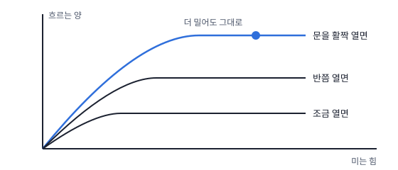

*머무는 양은 문을 얼마나 열었는지로만 정해지고, 이 성질 덕분에 작은 떨림을 크게 키울 수 있어요.*

**정확히 말하면**

$V_{DS}$를 충분히 키우면 $I_D$가 더 이상 늘지 않고 일정해져요. 이 영역이 saturation region(포화 영역)이고, 그 앞은 triode region이에요 (L02 s6).

경계는 $V_{DS} = V_{GS}-V_{TH}$예요. $V_{GS} \gt V_{TH}$에서

- $V_{DS} \lt V_{GS}-V_{TH}$: triode region
- $V_{DS} \ge V_{GS}-V_{TH}$: saturation region (경계점은 어느 쪽에 넣어도 돼요)

L02 s7의 판별식 "$V_G - V_D \le V_{TH}$이면 saturation"도 같은 조건이에요.

$$
V_G - V_D = (V_G - V_S) - (V_D - V_S) = V_{GS} - V_{DS} \le V_{TH}
$$

saturation 영역의 전류는 (L02 s6)

$$
I_D = \frac{1}{2}\mu_n C_{ox}\frac{W}{L}(V_{GS}-V_{TH})^2
$$

수업에서는 이동도 $\mu_n$, 산화막 커패시턴스 $C_{ox}$, 크기 $W/L$을 상수 $k$로 묶어 $I_D = k(V_{GS}-V_{TH})^2$로 줄여 쓰셨어요. 수업에서 줄여 쓴 $k$는 $k=\tfrac12\mu_n C_{ox}\tfrac{W}{L}$이에요.

| 영역 | $I_D$와 $V_{DS}$ | 트랜지스터는 |
|---|---|---|
| triode region | $V_{DS}$에 비례해 늘어요 | 저항 |
| saturation region | $V_{DS}$와 무관하게 일정해요 | 전류원(current source) |

saturation 전류는 트랜지스터 양단 전압 $V_{DS}$와 무관하고 $V_{GS}$로 정해져요. 그래서 정확히는 voltage-controlled current source(전압제어 전류원)예요. voltage-dependent current source라고 불러도 돼요. L02 s8 위쪽 그림이 이 large-signal 모델이에요.

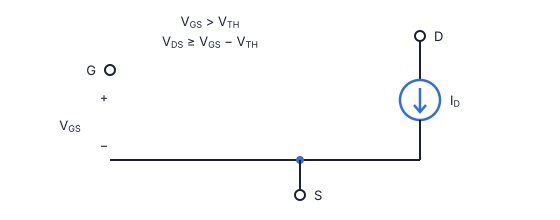

*G와 S 사이의 전압이 D에서 S로 흐르는 전류원의 값을 정해요 (L02 s8).*

증폭기에서는 이 saturation 영역을 써요. 저항은 저항 소자로 만들면 되지만 전류원은 다른 소자로 만들기 어려워서 트랜지스터로 전류원을 만들어요. 트랜지스터가 전류원으로 동작하기 때문에 증폭이 돼요.

#### 직접 해 보기: 동작점을 옮기며 triode와 saturation 보기 *(정적 스냅샷 — 직접 조작은 HTML 버전)*

$V_{GS}$와 $V_{DS}$를 움직이면 $I_D$–$V_{DS}$ 곡선, 경계 $V_{DS}=V_{GS}-V_{TH}$, 지금 동작점이 바뀌어요. $V_{TH}=0.5\,\text{V}$, $\mu_n C_{ox}\frac{W}{L}=2\,\text{mA/V}^2$로 고정했어요. saturation 구간은 $I_D = \frac{1}{2}\mu_n C_{ox}\frac{W}{L}(V_{GS}-V_{TH})^2$로 평평하게 그렸어요. triode 구간은 곡선 모양만 참고로 그렸어요(수업에서 다루지 않은 식). $V_{GS} \le V_{TH}$이면 $I_D=0$이에요.

지금 상태: **triode 영역, ID = 0.400 mA (VGS − VTH = 0.70 V, VDS = 0.40 V)**

범례: 지금 $V_{GS}$의 $I_D$–$V_{DS}$ 곡선 · 경계 $V_{DS}=V_{GS}-V_{TH}$ · 여러 $V_{GS}$의 경계점을 이은 선 · 지금 동작점

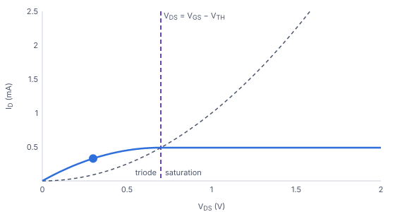

*설정 1: triode*

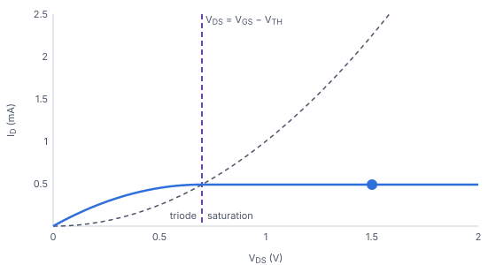

*설정 2: saturation*

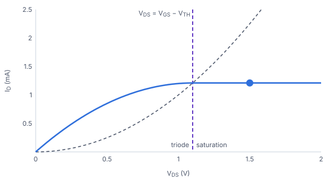

*설정 3: saturation*

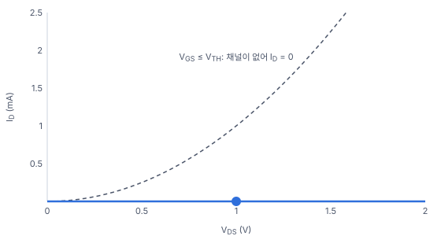

*설정 4: off*

| 설정 | $V_{GS}$ (V) | $V_{DS}$ (V) | $V_{GS}-V_{TH}$ (V) | 영역 | $I_D$ (mA) |
|---|---|---|---|---|---|
| 1 | 1.2 | 0.3 | 0.70 | triode | 0.330 |
| 2 | 1.2 | 1.5 | 0.70 | saturation | 0.490 |
| 3 | 1.6 | 1.5 | 1.10 | saturation | 1.210 |
| 4 | 0.4 | 1.0 | −0.10 (off) | off | 0.000 |

**교수님 말씀**

triode에서 트랜지스터가 무엇처럼 동작하냐는 질문에 "저항", saturation에서는 "전류원"이라는 답이 나왔어요 (0902 68:52–69:16).

드레인과 소스 사이 전압에 영향을 받아 비례하면 저항이고, 영향이 없어 항상 일정하면 전류원이라고 구분하셨어요 (0902 70:46–70:55).

> "저항은 저항으로 만들 수 있잖아요. … 근데 커런트 소스는 우리가 알고 있는 다른 소자가 많지 않죠." (0902 69:37–69:46)

전류원이라고 부를 때 앞에 설명을 붙이면 "볼티지 컨트롤드 커런트 소스"이고, 그 전압은 게이트–소스 전압이라고 하셨어요 (0902 71:04–71:13).

**꼭 기억해요**

> "실제로 우리가 앰프나 이런 회로 동작을 할 때에는 요 영역을 사용하는 거죠." (0902 69:26)

> "트랜지스터를 커런트 소스로 쓰는 게 가장 기본적인 동작이에요." (0902 69:31)

> "이 커런트 소스로 동작하기 때문에 증폭이 되는 거예요, 증폭이." (0902 69:54)

> "이 정도는 여러분들이 새추레이션 영역에서 요런 전류 식으로 나타난다." (0902 68:36)

> "앰프로 동작하는 원리는 이 커런트 소스로 동작하기 때문에" (0902 71:24)

**페이지 요약**

$V_{DS}$가 $V_{GS}-V_{TH}$ 이상이면 전류가 $V_{GS}$로만 정해지는 전류원이 되고, 그래서 증폭이 돼요.

*핵심 식*

- saturation 전류

  $$
  I_D = \frac{1}{2}\mu_n C_{ox}\frac{W}{L}(V_{GS}-V_{TH})^2
  $$
- saturation 조건

  $$
  V_{DS} \ge V_{GS}-V_{TH}
  $$

*용어*

- **saturation region(포화 영역)** — $I_D$가 $V_{DS}$와 무관하게 일정한 영역
- **voltage-controlled current source** — $V_{GS}$가 값을 정하는 전류원. 증폭의 바탕이에요

---

## 4. 요약 · 예고

### 한 장 요약

*0902 수업 · L01 s5, L02 s3–8*

0902 수업에서 다룬 핵심만 모았어요. 행마다 자세한 설명이 있는 토픽으로 이어져요.

| 무엇 | 식 · 결론 | 토픽 |
|---|---|---|
| 수업 철학 | 이해 → 손 계산 → 손 설계 → 시뮬레이터로 검증. 시뮬레이터는 설계 도구가 아니라 검증에 쓰는 계산기예요. | [식을 외우지 말고 이해하기](#s0-philosophy) |
| MOSFET 단자 | 게이트(G), 소스(S), 드레인(D) 3단자에 body를 넷째 단자로 그리기도 해요. 소스와 드레인은 대칭이고, 전류는 드레인에서 소스로 흘러요. | [MOSFET의 구조와 단자](#s2-structure) |
| 채널이 생기는 전압 | $V_{GS}$가 문턱 전압 $V_{TH}$를 넘으면 채널이 생겨요. | [게이트 전압과 채널](#s2-channel) |
| triode 영역 (작은 $V_{DS}$) | $R_{on} = \frac{1}{\mu_n C_{ox}\frac{W}{L}(V_{GS}-V_{TH})}$. 저항처럼 동작해요. 게이트에 $V_{DD}$를 걸면 on, 0을 걸면 off인 스위치예요. | [작은 V_DS: 저항이 되는 triode 영역](#s2-triode) |
| saturation 영역 (큰 $V_{DS}$) | $I_D = \frac{1}{2}\mu_n C_{ox}\frac{W}{L}(V_{GS}-V_{TH})^2$. 조건은 $V_{DS} \ge V_{GS}-V_{TH}$예요. | [큰 V_DS: 전류원이 되는 saturation 영역](#s2-saturation) |
| 증폭의 원리 | saturation에서 $I_D$는 $V_{GS}$로 정해지는 전류원(voltage-controlled current source)이에요. 전류원으로 동작해서 증폭이 돼요. | [큰 V_DS: 전류원이 되는 saturation 영역](#s2-saturation) |

---

### 다음 시간 예고

*0902 수업 · L02 s9–28*

교수님이 복습의 나머지를 다음 시간에 이어서 정리한다고 했어요(0902 71:38). 아래 슬라이드는 이번 수업에서 시작하지 않았어요.

- small-signal vs large-signal 동작(Small/Large-signal operations, s9)
- MOS 소신호 모델과 $g_m$(MOS Small-Signal Model, s10)
- 채널길이변조(Channel-Length Modulation, s11)
- PMOS 식과 PMOS 소신호 모델(PMOS Equations, Small-Signal Model of PMOS, s12–13)
- DC 해석과 소신호 해석(DC and Small-Signal Analysis, s14–15)
- CS 증폭기(Common-Source Topology, Small-signal model of CS stage, Inclusion of CLM, s16–18)
- BJT: 구조, 대신호 모델, 특성, 트랜스컨덕턴스, 소신호 모델, Early Effect, PNP 모델(s19–28)

---

### 함께 보면 좋은 자료

*0902 수업*

이번 범위에는 workbook 문제가 없어요.

- [0923 복습팩 정리노트 (Differential Amplifiers)](../0923/정리노트_0923_Differential_Amplifiers.html)

---

출처: 권익진 교수님 강의자료(Lec1, Lec2) · 수업 녹음 전사(0902) · B. Razavi, *Fundamentals of Microelectronics* (Wiley) 1·6장.
