# MOSFET 소신호 모델과 CS 증폭기 — 5살도 이해하는 정리노트

권익진 교수님 전자회로2 · 0904 수업 (Lec2, Razavi 4·6·7장)

> `정리노트_0904_MOS_Small_Signal_Model.html`를 마크다운으로 옮겼어요. 그림은 `figures_0904/` 폴더의 SVG, 위젯은 대표 설정의 정적 그림으로 바꿨어요. 수식은 `$…$` / `$$…$$`라서 GitHub, Obsidian, Typora에서 보여요.

**목차**

- [들어가며: 왜 이런 회로를 쓸까](#why)
  - [왜 이런 회로를 쓸까](#why-circuit)
- [1. 대신호 모델과 소신호 모델](#s0)
  - [대신호 모델: 트랜지스터는 전류원](#s0-large-signal)
  - [소신호: 바이어스 위의 작은 흔들림](#s0-small-signal)
- [2. 소신호 파라미터 g_m과 r_O](#s1)
  - [트랜스컨덕턴스 g_m](#s1-gm)
  - [채널 길이 변조와 출력저항 r_O](#s1-ro)
- [3. PMOS](#s2)
  - [PMOS 식: 절댓값으로 통일](#s2-pmos-eq)
  - [PMOS 소신호 모델은 NMOS와 같다](#s2-pmos-model)
- [4. CS 증폭기 해석](#s3)
  - [DC 해석과 소신호 해석](#s3-dc-ac)
  - [CS 증폭기를 말로 따라가기](#s3-cs-intuition)
  - [CS 증폭기 이득 A_v = -g_m R_D](#s3-cs-gain)
  - [r_O를 넣으면: intrinsic gain](#s3-intrinsic)
- [5. BJT 첫 만남](#s4)
  - [BJT의 구조와 동작 조건](#s4-bjt-intro)
- [6. 요약 · 예고](#s5)
  - [한 장 요약](#s5-cheatsheet)
  - [다음 시간 예고](#s5-next)
  - [함께 보면 좋은 자료](#s5-links)

## 들어가며: 왜 이런 회로를 쓸까

### 왜 이런 회로를 쓸까

*0904 수업 · L02 s10*

**쉽게 말하면**

구불구불한 산길 전체를 한 번에 계산하긴 어렵지만, 지금 서 있는 자리 바로 근처만 곧은 길로 보면 계산이 쉬워져요.

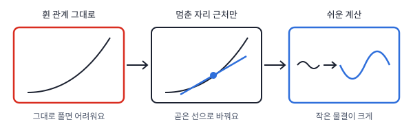

*휜 관계를 멈춘 자리 근처에서만 곧은 선으로 바꾸면, 작은 흔들림이 얼마나 커지는지 쉽게 셀 수 있어요.*

**정확히 말하면**

**1. 풀고 싶은 문제**

증폭기에서 알고 싶은 것은 입력이 조금 변할 때 출력이 얼마나 변하느냐예요. 전압 이득 $A_v$와 입출력 임피던스(impedance)가 모두 이런 변화량의 관계예요([DC 해석과 소신호 해석](#s3-dc-ac)).

그런데 포화 영역 MOSFET의 전압·전류 관계는 제곱이라 비선형(nonlinear)이에요([대신호 모델: 트랜지스터는 전류원](#s0-large-signal)). BJT는 지수 함수라서 더 휘어 있어요.

$$
I_D=\frac{1}{2}k(V_{GS}-V_{TH})^2
$$

**2. 단순한 해법과 그 한계**

가장 직접적인 방법은 이 대신호 식을 회로에 그대로 넣어 출력을 구하는 거예요. 크기와 상관없이 맞는 일반적인 식이라 틀리지는 않아요([대신호 모델: 트랜지스터는 전류원](#s0-large-signal)).

하지만 제곱식이나 지수식을 그대로 풀면 계산이 복잡하고 비효율적이에요. 회로에 소자가 늘수록 비선형 방정식이 얽혀서 손으로 풀기 어려워져요([DC 해석과 소신호 해석](#s3-dc-ac)).

**3. 핵심 아이디어**

DC 바이어스로 동작점(operating point)을 먼저 고정하고, 그 근처의 작은 변화량만 보면 곡선을 접선으로 선형 근사할 수 있어요([소신호: 바이어스 위의 작은 흔들림](#s0-small-signal)). 이 변화량의 관계만 나타낸 것이 소신호 모델(small-signal model)이에요.

$$
g_m = \frac{\partial I_D}{\partial V_{GS}}
$$

접선의 기울기가 트랜스컨덕턴스 $g_m$이고, 소신호 모델은 $i_d = g_m v_{gs}$ 한 줄이 돼요([트랜스컨덕턴스 g_m](#s1-gm)). 채널 길이 변조까지 넣으면 D–S 사이에 출력저항 $r_O$를 병렬로 더해요([채널 길이 변조와 출력저항 r_O](#s1-ro)).

이 도구로 CS 증폭기를 풀면 해석은 선형 회로의 KCL 한 줄로 끝나요([CS 증폭기를 말로 따라가기](#s3-cs-intuition), [CS 증폭기 이득 A_v = -g_m R_D](#s3-cs-gain)).

$$
A_v = -g_m R_D
$$

같은 도구가 다른 소자에도 그대로 이어져요.

- PMOS: 절댓값을 씌우면 전류식이 NMOS와 같아지고, $V_{DD}$를 AC 접지로 두면 소신호 모델도 NMOS와 같아요([PMOS 식: 절댓값으로 통일](#s2-pmos-eq), [PMOS 소신호 모델은 NMOS와 같다](#s2-pmos-model)).
- BJT: 전류가 $V_{BE}$의 지수 함수지만, 동작점에서 접선의 기울기를 구해 선형으로 나타내는 원리는 같아요([BJT의 구조와 동작 조건](#s4-bjt-intro)). BJT의 등가 모델은 다음 시간에 다뤄요.

**4. 대가와 쓰이는 곳**

- 근사는 신호가 작을 때만 맞아요. 수업 기준은 바이어스의 약 10% 이내, 슬라이드 기준은 드레인 전류 변화 10%가 상한이에요([소신호: 바이어스 위의 작은 흔들림](#s0-small-signal)).
- $g_m$, $r_O$는 고정값이 아니라 동작점에서 정해져요. 그래서 해석을 두 번 해야 해요. 먼저 대신호 모델로 DC 해석을 하고, 그다음 소신호 해석을 해요([DC 해석과 소신호 해석](#s3-dc-ac)).
- 선형 모델은 소자의 한계도 그대로 보여 줘요. $r_O$가 $R_D$와 병렬로 붙어서 CS 이득은 intrinsic gain $g_m r_O$를 넘지 못해요([r_O를 넣으면: intrinsic gain](#s3-intrinsic)).
- 이후 배우는 증폭기의 전압 이득과 입출력 임피던스는 모두 이 소신호 해석으로 구해요.

**교수님 말씀**

대신호 모델이 일반적인 관계인데 왜 소신호 모델을 따로 보느냐고 물으신 뒤, 선형 근사로 답을 정리하셨어요(0904 10:58).

> "리니어한 관계로 표현하면 훨씬 더 해석이 간단해지죠." (0904 12:58)

제곱식이나 지수식으로 이득을 직접 구하는 길도 있지만 권하지 않으셨어요.

> "익스포넨셜 함수로 구할 수도 있어요. 근데 복잡하죠." (0904 43:35)

BJT도 같은 원리라고 미리 짚으셨어요.

> "BJT도 원래는 전압과 전류의 관계가 익스포넨셜 함수죠." (0904 18:36)

CS 증폭기를 말로 따라간 뒤에는 같은 회로를 소신호 모델로 다시 푸셨어요.

> "스몰 시그널 모델을 이용하면 훨씬 더 쉽게 볼 수 있죠." (0904 53:13)

> "사실 둘에 별개의 게 아닙니다." (0904 63:05)

소신호 파라미터는 결국 대신호의 바이어스 전압·전류에서 정해진다는 뜻이에요.

**보충 · 수업에서 유도하진 않았어요**

선형 근사가 주는 이점은 계산이 짧아지는 것만이 아니에요. 회로가 선형이 되면 중첩의 원리(superposition), 테브난 등가(Thevenin equivalent) 같은 선형 회로 도구를 그대로 쓸 수 있어요. 여러 단을 이어 붙인 증폭기도 단마다 나눠 풀고 결과를 곱하거나 더하면 돼요.

**페이지 요약**

비선형인 트랜지스터를 동작점 근처에서 선형으로 근사한 것이 소신호 모델이고, 이걸로 증폭기 이득을 쉽게 구해요.

*핵심 식*

- 트랜스컨덕턴스

  $$
  g_m = \frac{\partial I_D}{\partial V_{GS}}
  $$
- CS 이득

  $$
  A_v = -g_m R_D
  $$

*용어*

- **소신호 모델(small-signal model)** — 동작점 근처 변화량의 관계만 나타낸 선형 모델
- **동작점(operating point)** — DC 바이어스로 정해지며 $g_m$, $r_O$를 결정
- **비선형(nonlinear)** — MOSFET은 제곱, BJT는 지수 관계

---

## 1. 대신호 모델과 소신호 모델

### 대신호 모델: 트랜지스터는 전류원

*0904 수업 · L02 s8*

**쉽게 말하면**

손잡이를 한 번 맞춰 두면 물을 늘 같은 양만큼 흘려보내는 수도꼭지를 떠올려 봐요.

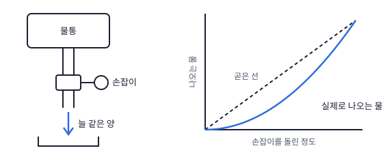

*손잡이를 조금 더 돌리면 물은 돌린 것보다 훨씬 많이 늘어나서, 곧은 선이 아니라 휘어진 선이 돼요.*

**정확히 말하면**

전류원(current source)은 저항·커패시터 같은 수동 소자로는 만들 수 없어요. 그래서 트랜지스터로 만들어요. 트랜지스터를 쓰는 가장 기본적인 목적이 전류원으로 동작시키는 것이에요. 스위치(저항)로 쓰는 경우도 있지만 일부이고, 대부분은 포화(saturation) 영역에서 써요.

트랜지스터의 전압·전류 관계를 등가 모델로 나타내는 방법은 두 가지예요.

- 대신호 모델(large-signal model): 신호 진폭이 크든 작든 상관없이 적용되는 일반적인 모델이에요.
- 소신호 모델(small-signal model): 신호가 작을 때만 성립하는 모델이에요([소신호: 바이어스 위의 작은 흔들림](#s0-small-signal)).

포화 영역 조건은 두 가지예요(자세한 영역 구분은 지난 수업의 [큰 V_DS: 전류원이 되는 saturation 영역](../../0902/정리노트_0902_MOSFET_Review.html#s2-saturation)).

- 채널이 생겨 전류가 흐르려면 $V_{GS} \gt V_{TH}$예요.
- 포화 영역이려면 $V_{DS} \ge V_{GS}-V_{TH}$예요. 등호가 들어가도 상관없어요.

포화 영역의 대신호 모델은 이렇게 생겼어요.

- 게이트와 소스 사이에는 산화막(절연체)이 있어 전류가 흐르지 않아요. G–S는 개방이에요.
- 드레인과 소스 사이에는 양단 전압과 무관한 전류가 흘러요. 그래서 D–S를 전류원으로 그려요.

$$
I_D = \frac{1}{2}\mu_n C_{ox}\frac{W}{L}(V_{GS}-V_{TH})^2
$$

$\mu_n C_{ox}\frac{W}{L}$은 상수라서 수업에서는 $k \equiv \mu_n C_{ox}\frac{W}{L}$로 줄여 $I_D=\frac{1}{2}k(V_{GS}-V_{TH})^2$로 썼어요. 전류가 전압의 제곱을 따르므로 이 관계는 비선형(nonlinear)이에요.

대신호 모델은 세 가지 경우에 써요.

- 동작 영역(포화/트라이오드)을 정할 때
- 바이어스점(bias point)을 정할 때
- 진폭이 큰 신호를 포함해 일반적인 관계를 나타낼 때

포화 영역의 MOSFET은 전류원이라서 회로 안의 전류원으로 그대로 쓸 수 있어요. 슬라이드의 두 가지 구현은 이래요.

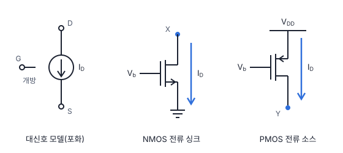

*왼쪽: 포화 영역 대신호 모델. 가운데: 노드 X에서 접지로 전류를 빼내는 NMOS. 오른쪽: VDD에서 노드 Y로 전류를 넣는 PMOS.*

- NMOS 전류 싱크(current sink): 소스를 접지에 두어 가장 낮은 전압으로 만들고, 게이트에 $V_b$를 걸어요. $V_{GS}=V_b$이므로 아래 식의 전류가 흘러요. $V_b$가 일정하면 $I_D$도 일정해서, 어떤 노드 X에서 접지로 일정한 바이어스 전류를 흘려요.

$$
I_D=\frac{1}{2}k(V_b-V_{TH})^2
$$

- PMOS 전류 소스(current source): 가장 높은 전압인 $V_{DD}$에서 어떤 노드 Y로 전류를 공급할 때 써요. PMOS는 소스가 가장 높은 전압이어야 하므로 소스를 $V_{DD}$에 붙이고, 게이트에 $V_b$를 걸어요.
- 슬라이드 문장으로는 NMOS는 한 점에서 접지로 전류를 끌어내리고(sinks current), PMOS는 $V_{DD}$에서 한 점으로 전류를 보내요(sources current).
- 기호 구분: NMOS는 소스의 화살표가 채널에서 밖으로 나가고, PMOS는 소스에서 채널 쪽으로 들어와요. 게이트에 동그라미를 그려 PMOS를 나타내는 책도 있는데, 이 교재는 화살표로 구분해요.

등가 모델은 결국 트랜지스터 각 단자의 전압과 전류 관계를 나타낸 것이에요. 이 관계를 알아야 트랜지스터가 들어간 회로를 해석할 수 있어요.

**교수님 말씀**

> "커런트 소스는 … 다른 수동 소자로 만들 수 없잖아요. 트랜지스터로 만드는데" (0904 00:00)

스위치로 쓰는 경우는 "아주 일부"이고, "대부분은 새츄레이션 영역에서 동작"시킨다고 하셨어요(0904 00:06).

PMOS 기호에 대해서는, 책에 따라 게이트에 동그라미를 그리기도 하지만 "둘 다 같은 내용"이고 이 책은 화살표로 구분한다고 하셨어요(0904 04:30).

> "물리적인 의미는 몰라도 돼요." (0904 62:35)

대신 등가 모델과 전압·전류 관계를 모르면 트랜지스터를 그려 놓아도 어떻게 해석할지 막막하다고 덧붙이셨어요.

**꼭 기억해요**

> "그걸 잘 구별해야 됩니다." (0904 02:18)

일반적인 전압·전류 관계는 비선형인 대신호 모델이고, 증폭기를 선형 관계로 해석할 때 쓰는 것은 신호가 작을 때만 성립하는 소신호 모델이에요. 둘을 섞어 쓰지 않아요.

> "특히나 중요한 게 전류원의 역할을 한다는 거" (0904 62:54)

MOSFET 부분을 마무리하며, 포화 영역의 트랜지스터가 전류원이라는 점을 기억하라고 하셨어요.

**페이지 요약**

포화 영역의 MOSFET은 게이트 전압으로 크기가 정해지는 전류원이고, 그 관계는 비선형이에요.

*핵심 식*

- 포화 영역 드레인 전류

  $$
  I_D = \frac{1}{2}\mu_n C_{ox}\frac{W}{L}
  $$

  $$
  \times(V_{GS}-V_{TH})^2
  $$
- NMOS 전류 싱크

  $$
  I_D=\frac{1}{2}k(V_b-V_{TH})^2
  $$

*용어*

- **대신호 모델(large-signal model)** — 신호 크기와 상관없이 적용되는 일반 모델
- **전류 싱크(current sink)** — 한 노드에서 접지로 일정한 전류를 빼내는 NMOS
- **전류 소스(current source)** — $V_{DD}$에서 한 노드로 일정한 전류를 넣는 PMOS

---

### 소신호: 바이어스 위의 작은 흔들림

*0904 수업 · L02 s9*

**쉽게 말하면**

크게 휜 언덕길도 발밑 한두 걸음만 보면 곧은 비탈처럼 보여요.

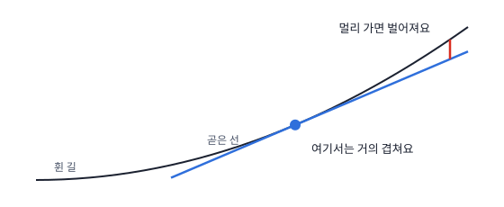

*가까운 곳에서는 곧은 선이 휜 길과 거의 겹치고, 멀리 갈수록 둘이 벌어져요.*

**정확히 말하면**

증폭기로 쓸 때는 게이트–소스에 DC 바이어스 전압 $V_{GS0}$를 먼저 걸어요. 그러면 일정한 바이어스 전류 $I_{D0}$가 흘러요.

$$
I_{D0}=\frac{1}{2}k(V_{GS0}-V_{TH})^2
$$

여기에 주기적인 신호(전압 변화) $\Delta V$를 더하면 전류도 $\Delta I_D$만큼 변해요. 실제 입력과 전류에는 DC 값과 변화량이 함께 들어 있어요.

$$
V_{GS}=V_{GS0}+\Delta V
$$

$$
I_D=I_{D0}+\Delta I_D
$$

- $V_{GS0}$, $I_{D0}$를 바이어스(DC) 값이라 하고, 이 점 $(V_{GS0}, I_{D0})$가 바이어스점(bias point, 동작점)이에요.
- $\Delta V$, $\Delta I_D$를 변화량이라고 해요. 이 변화량 범위에서 접선 근사가 충분히 정확하면 소신호(small signal) 모델을 써요.
- 슬라이드 정의: 소신호는 소자의 바이어스점을 거의 흔들지 않는(perturbs negligibly) 신호예요.

허용 입력은 회로와 요구 정확도에 따라 달라요. 수업의 경험칙(rule of thumb)과 슬라이드의 기준은 이렇게 구분해요.

- 수업에서는 DC 바이어스의 약 10%를 경험칙으로 들었어요. 이를 모든 회로의 판정식으로 쓰지는 않고, 이 MOSFET에서는 게이트 변화량을 오버드라이브 전압과 비교해 접선 근사 오차를 확인해요.
- 슬라이드: 드레인 전류가 10% 변하는 정도를 상한(upper bound)으로 적어 두었어요.

바이어스는 트랜지스터가 포화 영역(전류원)에서 동작하도록 동작점을 잡는 역할이에요. 동작점이 정해진 뒤 증폭기에서 관심 있는 것은 DC와 DC의 관계가 아니라, 입력이 이만큼 변할 때 출력이 얼마나 변하느냐예요. $\Delta I_D$는 출력의 저항과 곱해져 출력 전압의 변화가 돼요.

소신호 모델(small-signal model)은 이 변화량 사이의 관계만 나타낸 모델이에요.

- 소신호 모델에서는 DC 바이어스를 모두 0으로 봐요.
- DC 전압과 DC 전류의 관계는 대신호 관계로, 변화량의 관계는 소신호 관계로 나타내요.
- 대신호 모델은 $V_{GS}$와 $I_D$의 관계이고, 소신호 모델은 $\Delta V_{GS}$와 $\Delta I_D$의 관계예요.

대신호 모델이 일반적인 관계인데 왜 소신호 모델을 따로 쓸까요?

1. 포화 영역의 $I_D$–$V_{GS}$는 제곱 관계라서 비선형이에요.
2. 신호가 작아 바이어스점이 바뀌지 않으면, 바이어스점 근처의 곡선을 직선으로 선형(linear) 근사할 수 있어요.
3. 선형 관계로 나타내면 해석이 훨씬 간단해져요.
4. 단, 이 근사는 신호가 작을 때만 맞아요. 신호가 커지면 직선과 곡선의 오차가 커져요.

그 직선이 바이어스점에서 그은 접선이고, 접선의 기울기가 트랜스컨덕턴스 $g_m$이에요([트랜스컨덕턴스 g_m](#s1-gm)).

#### 직접 해 보기: 흔들림이 커지면 접선은 얼마나 틀릴까 *(정적 스냅샷 — 직접 조작은 HTML 버전)*

입력 흔들림 $\Delta V$를 오버드라이브 $V_{GS0}-V_{TH}$의 몇 %로 할지 움직이면, 제곱 곡선과 바이어스점 접선 위의 두 점($V_{GS0}\pm\Delta V$)이 벌어지는 정도와 접선 근사의 전류 오차가 보여요.

여기서 %는 $V_{GS}$가 아니라 오버드라이브 $V_{GS0}-V_{TH}$ 대비예요. 슬라이드 상한(전류 10%)은 $\Delta V$가 오버드라이브의 약 5%일 때예요.

**ΔV = 오버드라이브의 10 %: 곡선의 전류 변화 +21.0 % / −19.0 %, 접선의 전류 변화 ±20.0 %, 접선 근사 오차 4.8 % / 5.3 % (오차 5% 정도, 전류 변화는 슬라이드 상한의 약 2.1배)**

범례: 제곱 곡선 $I_D$ · 바이어스점 접선(기울기 $g_m$) · 곡선 위의 점 · 접선 위의 점 · 세로 점선: $V_{GS0}\pm\Delta V$

오차는 (곡선의 전류 변화 − 접선의 전류 변화) ÷ 곡선의 전류 변화예요. $\Delta V$가 오버드라이브의 5%이면 드레인 전류가 약 10% 변해서 슬라이드의 상한과 비슷하고, 오차는 3% 이하예요. 10%이면 오차는 5% 정도지만 전류 변화는 약 21%로 슬라이드 상한의 두 배쯤이에요. 20% 안팎부터는 $-\Delta V$ 쪽 오차가 두 자릿수(20%에서 11.1%)가 돼요.

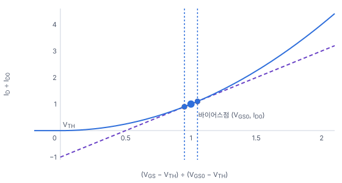

*대표 설정 1: ΔV = 오버드라이브의 5%*

*대표 설정 2: ΔV = 오버드라이브의 10%*

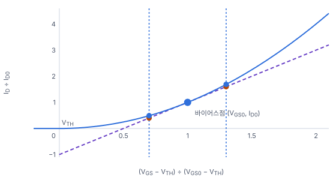

*대표 설정 3: ΔV = 오버드라이브의 30%*

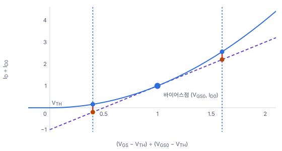

*대표 설정 4: ΔV = 오버드라이브의 60%*

| ΔV (오버드라이브 대비) | 곡선의 전류 변화 (+ΔV / −ΔV) | 접선의 전류 변화 | 접선 근사 오차 (+ΔV / −ΔV) | 판단 |
|---|---|---|---|---|
| 5% | +10.3% / −9.8% | ±10.0% | 2.4% / 2.6% | 전류 변화가 슬라이드 상한(10%) 안이라 선형 근사가 잘 맞아요 |
| 10% | +21.0% / −19.0% | ±20.0% | 4.8% / 5.3% | 오차 5% 정도, 전류 변화는 슬라이드 상한의 약 2.1배 |
| 30% | +69.0% / −51.0% | ±60.0% | 13.0% / 17.6% | 오차가 두 자릿수라 선형 근사가 흔들려요 |
| 60% | +156.0% / −84.0% | ±120.0% | 23.1% / 42.9% | 선형 근사로 보기 어려워요 |

소신호 모델과 대신호 모델은 별개가 아니에요. 소신호 파라미터는 결국 바이어스점, 즉 대신호의 전압·전류 값에서 정해져요.

**교수님 말씀**

"충분히 작다"의 기준은 따로 없지만 대략 10% 이내면 소신호로 가정할 수 있다고 하셨어요.

> "1볼트 바이어스가 걸렸을 때 100밀리볼트 이하로 움직인다 하면" (0904 07:25)

이 예를 모든 바이어스에서 성립하는 상한으로 쓰지 않아요. 같은 MOSFET도 오버드라이브 전압에 따라 게이트 변화량의 허용 범위가 달라져요.

수업 중에 "대신호 모델이 일반적인 관계인데 왜 소신호 모델을 따로 보느냐"고 물으셨어요(0904 10:58). 한 학생의 답에 "아주 잘 얘기했는데요"라고 받으신 뒤, 답을 선형 근사로 정리하셨어요.

> "리니어한 관계로 표현하면 훨씬 더 해석이 간단해지죠." (0904 12:58)

MOSFET 부분을 마치며 두 모델의 관계를 한 번 더 짚으셨어요.

> "사실 둘에 별개의 게 아닙니다." (0904 63:05)

**페이지 요약**

바이어스점 위의 작은 변화량만 보면 비선형 곡선을 직선으로 근사할 수 있고, 그 변화량의 관계가 소신호 모델이에요.

*핵심 식*

- 입력 = 바이어스 + 변화량

  $$
  V_{GS}=V_{GS0}+\Delta V
  $$
- 전류 = 바이어스 + 변화량

  $$
  I_D=I_{D0}+\Delta I_D
  $$

*용어*

- **소신호 모델(small-signal model)** — 변화량 사이의 관계만 나타낸 모델, DC 바이어스는 0으로 봐요
- **바이어스점(bias point)** — DC 값 $(V_{GS0}, I_{D0})$으로 정해지는 동작점
- **선형 근사** — 바이어스점 근처의 곡선을 접선으로 바꿔 보는 것. 허용 입력은 근사 오차로 확인해요

---

## 2. 소신호 파라미터 g_m과 r_O

### 트랜스컨덕턴스 g_m

*0904 수업 · L02 s10*

**쉽게 말하면**

게이트 전압의 작은 변화에 $g_m$을 곱하면 드레인 전류가 얼마나 변하는지 구할 수 있어요.

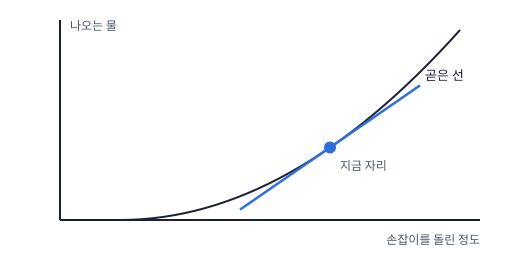

*전압 변화 × gm = 전류 변화이며, DC 전류 전체를 구하는 식은 아니에요.*

**정확히 말하면**

**작은 예시.** 포화 영역의 같은 동작점 근처에서 채널 길이 변조를 무시해요. $g_m=2\,\mathrm{mS}$이면 $v_{gs}=1\,\mathrm{mV}$에 $i_d=g_mv_{gs}=2\,\mathrm{\mu A}$가 돼요. 입력 변화가 $2\,\mathrm{mV}$이면 전류 변화는 약 $4\,\mathrm{\mu A}$예요.

대신호 모델은 $V_{GS}$와 $I_D$의 관계를 나타내요. 소신호 모델은 그 변화량, 곧 $\Delta V_{GS}$와 $\Delta I_D$의 관계를 나타내요.

$V_{GS}$가 변할 때 $I_D$가 얼마나 변하는지를 트랜스컨덕턴스(transconductance)라고 해요. $\Delta V_{GS}\to 0$으로 보내면 미분이 돼요.

$$
g_m = \frac{\partial I_D}{\partial V_{GS}}
$$

컨덕턴스는 원래 같은 두 단자 사이의 전압 변화와 전류 변화의 관계예요. $g_m$은 $V_{DS}$–$I_D$가 아니라 입력 쪽 $V_{GS}$와 출력 쪽 $I_D$를 잇는 관계라서 "trans"가 붙어요.

트랜지스터의 출력은 전류예요. 그래서 전압 증폭기를 만들려면 출력에 저항 같은 부하(load)를 달아 전압으로 바꿔야 해요. 트랜지스터 하나와 저항 하나로 된 것이 가장 간단한 증폭기예요.

포화 영역 전류식에서 세 가지 표현을 얻어요.

1. 포화 영역 전류: $I_D = \frac{1}{2}k(V_{GS}-V_{TH})^2$, $k = \mu_n C_{ox}\frac{W}{L}$
2. $V_{GS}$로 미분해요($\frac{1}{2}\cdot 2 = 1$): $g_m = k(V_{GS}-V_{TH})$

   $$
   g_m = \mu_n C_{ox}\frac{W}{L}(V_{GS}-V_{TH})
   $$

   (수업 중 미분 결과에 2를 남겼다가 곧바로 정정)
3. 전류식에서 $V_{GS}-V_{TH} = \sqrt{2I_D/k}$
4. 2단계에 대입: $g_m = k\sqrt{2I_D/k} = \sqrt{2kI_D}$

   $$
   g_m = \sqrt{2\mu_n C_{ox}\frac{W}{L} I_D}
   $$
5. 전류식에서 $k = \frac{2I_D}{(V_{GS}-V_{TH})^2}$
6. 2단계의 $k$에 대입:

   $$
   g_m = \frac{2 I_D}{V_{GS}-V_{TH}}
   $$

세 식은 모두 같은 식에서 나왔어요. 읽는 법은 이래요.

- $g_m$은 오버드라이브 전압(overdrive voltage) $V_{GS}-V_{TH}$에 선형으로 비례하고, $I_D$에는 $\sqrt{I_D}$로 비례해요. 오버드라이브 전압이나 전류가 커질수록 $g_m$도 커져요.
- 그래프로 보면 $I_D$–$V_{GS}$ 포물선 위 바이어스점 $(V_{GS0}, I_{D0})$에서 그은 접선의 기울기가 $g_m$이에요. 바이어스점이 오른쪽(큰 $V_{GS}$)일수록 접선이 가팔라요.
- 접선은 신호가 작을 때만 곡선과 잘 맞고, 신호가 커질수록 오차가 커져요. 그래서 소신호에서만 타당한 모델이에요.
- $g_m$은 고정값이 아니라 동작점(operating point)에 의존해요. 동작점이 먼저 정해지고, 동작점이 변하지 않는 범위에서만 $g_m$이 유효해요.
- 보통 앞의 두 식을 가장 많이 써요. 오버드라이브 전압이 주어지면 $\mu_n C_{ox}\frac{W}{L}(V_{GS}-V_{TH})$를, 전류가 주어지면(더 흔한 경우) $\sqrt{2\mu_n C_{ox}\frac{W}{L} I_D}$를 써요.

가장 간단한 MOSFET 소신호 모델은 식 하나예요. $\Delta I_D$를 소문자 $i_d$로, $\Delta V_{GS}$를 소문자 $v_{gs}$로 써요.

$$
i_d = g_m v_{gs}
$$

소문자는 소신호(변화량)이고, 대문자는 바이어스점의 대신호 값이에요. 바이어스점의 전압·전류 관계는 대신호 모델로, 증폭기의 변화량 관계는 소신호 모델로 나타내요.

**교수님 말씀**

미분을 수학적으로 보면, 어떤 다차 함수든 동작점에서 선형 관계식으로 나타내는 일이라고 설명하셨어요.

> "임의의 다차 함수를 미분한다는 거는 … 리니어한 관계식으로 표현한다는 거죠" (0904 18:08)

MOSFET은 제곱 관계이고, 뒤에 배울 BJT는 exponential 관계예요. 그래도 접선의 기울기를 구해 선형으로 나타내는 원리는 같다고 하셨어요(0904 18:36).

전류를 더 많이 쓸수록 같은 전압 변화에 대한 전류 변화가 더 커진다고 짚으셨어요(0904 21:46).

**꼭 기억해요**

> "트랜스컨덕턴스가 가장 중요한 스몰 시그널 파라미터가 되는데" (0904 23:58)

> "gm이 클수록 앰프 이득이 증가하죠" (0904 24:18)

> "가장 간단한 스몰 시그널 모델을 표현하라. … 델타 ID는 gm VGS." (0904 24:27)

> "둘을 헷갈려 쓰면 안 돼요." (0904 25:17) 대문자(대신호)와 소문자(소신호) 표기를 구별하라는 말이에요.

**페이지 요약**

$g_m$은 작은 전압 변화에 곱해 전류 변화를 구하는 계수이고, 같은 동작점 근처에서 $i_d=g_mv_{gs}$예요.

*핵심 식*

- 정의

  $$
  g_m = \frac{\partial I_D}{\partial V_{GS}}
  $$
- 전류로 쓴 꼴

  $$
  g_m = \sqrt{2\mu_n C_{ox}\frac{W}{L} I_D}
  $$
- 소신호 모델

  $$
  i_d = g_m v_{gs}
  $$

*용어*

- **트랜스컨덕턴스(transconductance)** — 입력 $V_{GS}$ 변화에 대한 출력 $I_D$ 변화의 비
- **동작점(operating point)** — $g_m$을 정하는 DC 바이어스점

---

### 채널 길이 변조와 출력저항 r_O

*0904 수업 · L02 s11*

**쉽게 말하면**

좋은 수도꼭지라면 뒤에서 미는 압력이 바뀌어도 같은 양만 나와야 하는데, 진짜 수도꼭지는 압력이 세지면 물이 조금 더 나와요.

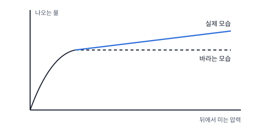

*올라가는 기울기가 작을수록 좋은 부품이에요.*

**정확히 말하면**

이상적인 전류원은 양단 전압이 변해도 전류가 일정해요. 실제 MOSFET은 포화 영역에서 $V_{DS}$가 커지면 $I_D$가 조금 증가해서, 비이상적인 전류원이에요.

이 증가는 채널 길이 변조(channel-length modulation) 때문이에요. 그 정도를 채널 길이 변조 계수 $\lambda$로 나타내요.

$$
I_D = \frac{1}{2}\mu_n C_{ox}\frac{W}{L}(V_{GS}-V_{TH})^2(1+\lambda V_{DS})
$$

등가 저항은 $\Delta V/\Delta I$예요.

- 이상적인 전류원은 $\Delta V$가 생겨도 $\Delta I = 0$이라 등가 저항이 $\infty$예요.
- 이상적인 전압원은 $\Delta V = 0$이라 등가 저항이 $0$이에요.
- 실제 트랜지스터는 $V_{DS}$에 따라 전류가 변하므로 저항이 유한해요.

이 유한한 저항을 소신호 모델에 넣은 것이 출력저항(output resistance) $r_O$예요. $V_{DS}$로 미분해서 구해요.

1. $I_D = \frac{1}{2}\mu_n C_{ox}\frac{W}{L}(V_{GS}-V_{TH})^2(1+\lambda V_{DS})$
2. $\frac{\partial I_D}{\partial V_{DS}} = \frac{1}{2}\mu_n C_{ox}\frac{W}{L}(V_{GS}-V_{TH})^2\cdot\lambda$
3. 괄호 앞부분을 포화 전류 $I_D$로 두면 $\frac{\partial I_D}{\partial V_{DS}} \approx \lambda I_D$
4. 역수를 취해요:

   $$
   r_O = \frac{1}{\lambda I_D}
   $$

- $r_O$는 바이어스 전류 $I_D$에 반비례해요. 전류가 클수록 $I_D$–$V_{DS}$ 곡선의 기울기가 커지고 저항은 작아져요.
- $\lambda$는 상수지만, $r_O$는 $g_m$처럼 바이어스점의 함수예요.
- 채널 길이 변조를 무시하면 $\partial I_D/\partial V_{DS} = 0$이라 $r_O = \infty$로 둬요.

소신호 등가회로는 이래요. G–S는 개방이고 그 양단 전압이 $v_{gs}$예요. D에서 S로 전류원 $g_m v_{gs}$가 흐르고, D–S 사이에 $r_O$가 병렬로 붙어요.

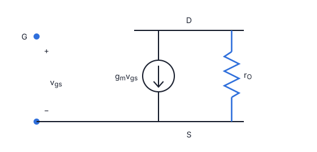

*G–S는 개방이고, D–S 사이에 전류원 $g_m v_{gs}$와 $r_O$가 병렬이에요.*

바이어스 전류를 구할 때는 보통 $(1+\lambda V_{DS})$를 무시해요. $\lambda$가 대략 0.1이라 $V_{DS}$가 1 V쯤 차이 나야 전류 오차가 약 10%라서예요.

반면 $r_O$는 넣느냐 마느냐가 무한대와 유한값의 차이예요. 무시하면 이득이 무한대로 나올 수도 있어서, 소신호 해석에서는 보통 $r_O$를 넣어요.

**교수님 말씀**

수업 중에 "전류원의 등가 저항은 얼마냐"고 물으셨어요. 전류원은 전압이 변해도 전류가 변하지 않으니 무한대이고, 전압원은 0이라고 정리하셨어요.

> "전류원의 등가 저항은 무한대에요. 반대로 전압원은 등가 저항이?" (0904 28:07)

전류가 조금 변한다고 저항으로 보지는 않아요. 변화량이 작아 거의 일정하니 전류원으로 두고, 이상적이지 않은 전류원이라고 부른다고 하셨어요(0904 26:33).

바이어스 전류에서는 채널 길이 변조를 무시해도 되지만, $r_O$는 다른 얘기라고 구별하셨어요.

> "무한대와 유한한 것의 차이는 굉장히 크기 때문에" (0904 31:48)

**꼭 기억해요**

> "스몰 시그널 모델을 그리시오 하면 이렇게 그리면 돼요." (0904 33:49) 전류원 $g_m v_{gs}$와 병렬 $r_O$를 그리면 돼요.

> "ro는 고려하지 않으면 무한대 저항인데" (0904 32:44) 그래서 $r_O$는 일반적으로 고려해요.

**페이지 요약**

채널 길이 변조로 $I_D$가 $V_{DS}$에 따라 조금 늘어나고, 이를 D–S 사이의 병렬 저항 $r_O$로 모델링해요.

*핵심 식*

- 채널 길이 변조

  $$
  I_D = \frac{1}{2}\mu_n C_{ox}\frac{W}{L}(V_{GS}-V_{TH})^2
  $$

  $$
  \times(1+\lambda V_{DS})
  $$
- 출력저항

  $$
  r_O = \frac{1}{\lambda I_D}
  $$

*용어*

- **채널 길이 변조(channel-length modulation)** — 포화 영역에서 $V_{DS}$가 커지면 $I_D$가 조금 늘어나는 효과, 계수 $\lambda$
- **출력저항(output resistance)** — D–S 사이 병렬 저항 $r_O$, 무시하면 $\infty$

---

## 3. PMOS

### PMOS 식: 절댓값으로 통일

*0904 수업 · L02 s12*

**쉽게 말하면**

반대 모양 부품은 전기가 흐르는 방향도, 숫자의 더하기·빼기 표시도 모두 거꾸로예요.

*빼기 표시를 떼고 크기만 보면 두 부품을 규칙 하나로 계산해요.*

**정확히 말하면**

PMOS는 소스·드레인이 p+로 도핑돼 있어요. 그래서 전하를 나르는 것이 전자가 아니라 정공(hole)이에요.

- 정공을 공급하는 쪽이 소스(source), 정공이 빠져나가는 쪽이 드레인(drain)이에요.
- 채널에 정공이 모여야 하므로 게이트에 소스보다 낮은 전압을 걸어요. 곧 $V_{GS}\lt 0$이고, 문턱전압도 $V_{TH}\lt 0$이에요.
- 정공이 드레인으로 빠져나가려면 드레인 전압이 소스보다 낮아야 해요. 곧 $V_{DS}\lt 0$이에요.
- 전류 방향은 정공이 움직이는 방향과 같아요. 그래서 전류는 소스에서 드레인으로 흘러요.
- 소스가 높은 전압, 드레인이 낮은 전압이에요. 그래서 PMOS의 소스는 보통 $V_{DD}$ 쪽에 연결해요.

| 구분 | NMOS | PMOS |
|---|---|---|
| 소스·드레인 도핑 | n+ | p+ |
| 채널을 만드는 전하 | 전자 | 정공 |
| $V_{GS}$, $V_{TH}$ | 양수 | 음수 |
| $V_{DS}$ | 양수 | 음수 |
| 전류 방향 | 드레인에서 소스로 | 소스에서 드레인으로 |

슬라이드의 포화 영역 전류식은 부호를 그대로 살린 형태예요.

$$
I_{D,sat}=-\frac{1}{2}\mu_p C_{ox}\frac{W}{L}(V_{GS}-V_{TH})^2(1-\lambda V_{DS})
$$

부호를 따지면 포화 조건도 $V_{GS}\lt V_{TH}$(둘 다 음수), $V_{DS}\lt V_{GS}-V_{TH}$로 부등호 방향이 NMOS와 반대가 돼요. 이렇게 쓰면 헷갈리니, 모든 전압과 전류에 절댓값을 씌워요.

$$
|I_D| = \frac{1}{2}\mu_p C_{ox}\frac{W}{L}(|V_{GS}|-|V_{TH}|)^2(1+\lambda |V_{DS}|)
$$

포화 조건도 절댓값으로 쓰면 NMOS와 같은 모양이에요.

$$
|V_{GS}|\gt|V_{TH}|,\quad |V_{DS}|\ge|V_{GS}|-|V_{TH}|
$$

절댓값 식이 부호 식과 같은지는 PMOS의 부호를 넣어 한 줄씩 확인할 수 있어요.

1. $V_{GS}=-|V_{GS}|$, $V_{TH}=-|V_{TH}|$이므로 $V_{GS}-V_{TH}=-(|V_{GS}|-|V_{TH}|)$예요.
2. 제곱하면 부호가 사라져요: $(V_{GS}-V_{TH})^2=(|V_{GS}|-|V_{TH}|)^2$
3. $V_{DS}=-|V_{DS}|$이므로 $1-\lambda V_{DS}=1+\lambda|V_{DS}|$예요.
4. 남은 앞의 음수 부호는 전류가 드레인으로 들어가지 않고 나온다는 뜻이에요. 크기만 쓰면 $|I_D|$ 식이 돼요.

결국 NMOS 식에 절댓값을 씌운 식 하나를 NMOS와 PMOS에 모두 쓸 수 있어요. PMOS에서는 $\mu_n$ 대신 정공 이동도 $\mu_p$를 넣어요.

심볼에서는 소스가 위(높은 전압), 드레인이 아래(낮은 전압)에 오고, 전류는 소스에서 드레인으로 흐른다고 보면 돼요.

**교수님 말씀**

수업에서 "정공이 모이려면 게이트 전압을 어떻게 걸어야 하느냐"고 물으셨고, 한 학생이 "0보다 작은"이라고 답했어요. 교수님은 극성이 NMOS와 모두 반대가 된다고 정리하셨어요(0904 34:53).

부호를 살린 식을 따로 외워도 되지만, 부호가 들어가면 헷갈리니 절댓값으로 통일하라고 하셨어요.

> "제일 효율적인 방법, 제일 쉬운 방법은 절댓값을 다 씌우는 겁니다." (0904 36:10)

> "nMOS의 식에서 절댓값 씌워서 그 식을 그대로 pMOS에도 적용을 한다" (0904 38:12)

**꼭 기억해요**

> "절댓값을 씌워서 씌운 식으로 여러분들이 기억하면 되겠습니다." (0904 36:51)

> "그냥 절댓값을 다 씌운다고 생각하면 돼요." (0904 38:10)

**페이지 요약**

PMOS는 정공이 전류를 나르고 부호가 NMOS와 모두 반대라서, 절댓값을 씌운 식 하나로 기억해요.

*핵심 식*

- PMOS 포화 전류

  $$
  |I_D| = \frac{1}{2}\mu_p C_{ox}\frac{W}{L}
  $$

  $$
  \times(|V_{GS}|-|V_{TH}|)^2
  $$

  $$
  \times(1+\lambda |V_{DS}|)
  $$
- 포화 조건

  $$
  |V_{GS}|\gt|V_{TH}|,
  $$

  $$
  |V_{DS}|\ge|V_{GS}|-|V_{TH}|
  $$

*용어*

- **정공(hole)** — PMOS에서 전류를 나르는 전하. 소스가 공급하고 드레인으로 빠져나가요
- **전류 방향** — PMOS는 소스에서 드레인으로 흘러요. 소스는 보통 $V_{DD}$ 쪽이에요

---

### PMOS 소신호 모델은 NMOS와 같다

*0904 수업 · L02 s13*

**쉽게 말하면**

반대 모양 부품도 위아래를 뒤집어 보면 늘 쓰던 부품과 똑같은 그림이 돼요.

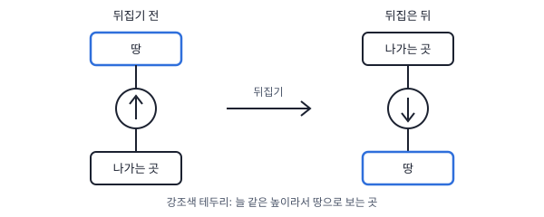

*늘 같은 높이로 전기를 대 주는 곳은 흔들림이 없어서 땅과 똑같이 봐요.*

**정확히 말하면**

PMOS는 보통 소스가 $V_{DD}$에, 드레인이 더 낮은 전압 쪽에 연결돼요. 소신호 등가회로를 그릴 때 먼저 $V_{DD}$를 처리해요.

- $V_{DD}$는 DC 전압이라 일정해요. 그래서 변화량이 0이에요.
- 변화량의 관계에서 0은 접지예요. 그래서 소신호 모델에서 $V_{DD}$는 AC 접지(AC ground)예요.

PMOS 소신호 등가회로는 이렇게 그려요.

1. 게이트–소스: 게이트로 전류가 흐르지 않으니 개방이에요. 양단 전압이 $v_{gs}$예요.
2. 드레인–소스: 드레인에서 소스 방향으로 전류원 $g_m v_{gs}$를 둬요. 곧 $i_d = g_m v_{gs}$예요.
3. 채널 길이 변조를 고려하면 드레인–소스 사이에 $r_O$를 전류원과 병렬로 넣어요([채널 길이 변조와 출력저항 r_O](#s1-ro)).
4. 소스는 AC 접지인 $V_{DD}$에 붙어 있어요. 그림을 위아래로 뒤집으면 소스가 아래(접지)로 와요.
5. 뒤집은 모양은 NMOS 소신호 등가회로와 똑같아요.

*전류원 $g_m v_{gs}$는 게이트(+)와 소스(−) 사이 전압 $v_{gs}$로 제어돼요. 위아래로 뒤집으면 소스가 접지로 가서 NMOS 등가회로와 같아져요.*

결론적으로 PMOS 소신호 모델은 NMOS 소신호 모델과 같아요. $v_{gs}$의 부호에 따라 전류 방향이 달라질 수는 있지만 등가 모델 자체는 같아요.

**교수님 말씀**

소스 쪽 $V_{DD}$가 AC로는 어떻게 되느냐고 물으셨어요. 학생들이 "그라운드", "DC는 무시하니까"라고 답하자, 왜 그라운드인지 다시 물으셨어요(0904 39:05).

"무시한다"는 말만으로는 개방으로 둘지 접지로 둘지 정할 수 없다는 점을 짚으셨어요. DC 전압은 일정해서 변화량이 0이고, 변화량의 관계에서 0은 접지라는 게 답이에요.

> "변화량의 관계로 표현할 때는 0이에요, 0. 0은 뭐야? 그라운드." (0904 39:43)

> "결론적으로 얘기하면 PMOS의 스몰 시그널 모델은 NMOS와 동일하다." (0904 40:43)

**페이지 요약**

PMOS 소신호 등가회로는 소스의 $V_{DD}$를 AC 접지로 두고 위아래를 뒤집으면 NMOS와 같아요.

*핵심 식*

- 드레인 소신호 전류

  $$
  i_d = g_m v_{gs}
  $$

*용어*

- **AC 접지(AC ground)** — DC 전압원은 변화량이 0이라서 소신호 모델에서 접지로 둬요
- **소신호 등가회로** — G–S 개방, D에서 S로 $g_m v_{gs}$, D–S에 $r_O$ 병렬

---

## 4. CS 증폭기 해석

### DC 해석과 소신호 해석

*0904 수업 · L02 s14–s15*

**쉽게 말하면**

회로는 두 번 나눠서 봐요. 먼저 가만히 있을 때 자리를 잡고, 그다음 살짝 흔들릴 때만 따로 봐요.

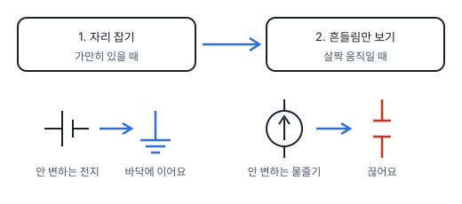

*흔들림만 볼 때는 안 변하는 것을 바닥에 잇거나 끊어서 치워요.*

**정확히 말하면**

회로 해석은 두 단계로 나눠요.

- **DC 해석**: 대신호 모델(large-signal model)로 트랜지스터가 포화 영역(saturation)에 있는지 트라이오드 영역(triode)에 있는지 정해요. 그 바이어스점, 즉 오퍼레이팅 포인트(operating point)에서 소신호 파라미터($g_m$, $r_O$, …)를 구해요.
- **소신호 해석**: 작은 신호에 대한 회로의 응답을 봐요. 전압 이득(voltage gain)과 입출력 임피던스(impedance)를 구하는 단계예요.

오퍼레이팅 포인트가 소신호 파라미터를 정해요. 두 파라미터 모두 바이어스 전류나 전압의 함수예요($k=\mu_nC_{ox}\frac{W}{L}$).

$$
g_m=\sqrt{2kI_D}=k(V_{GS}-V_{TH})
$$

$$
r_O=\frac{1}{\lambda I_D}
$$

그래서 $g_m$을 바꾸고 싶으면 오퍼레이팅 포인트를 바꿔야 해요. 식의 유도는 [트랜스컨덕턴스 g_m](#s1-gm), [채널 길이 변조와 출력저항 r_O](#s1-ro)에 있어요.

소신호 해석은 $v_{gs}$와 $i_d$의 관계, 즉 변화량끼리의 관계를 다뤄요.

- 이득은 입력 전압이 변할 때 출력 전압이 얼마나 변하는지예요. 정의 자체가 소신호 관계라서 "소신호 이득"이라고 따로 붙이지 않아도 돼요.
- 임피던스는 전압 변화와 전류 변화의 비예요.
- 제곱 식(MOSFET)이나 exponential 식(BJT)을 그대로 써서 이득을 구할 수도 있어요. 하지만 복잡하고 비효율적이에요.
- 대신호 모델은 신호 크기와 상관없이 맞는 일반 모델이에요. 소신호 모델은 신호가 작을 때, 변화량의 관계에만 맞아요.

소신호 해석에서는 일정한 소스(constant source)를 0으로 둬요. 변화량이 0이기 때문이에요.

| 소스 | 소신호에서 변화량 | 처리 |
|---|---|---|
| DC 전압원($V_{DD}$ 등) | 전압 변화 0 | 단락(short). 접지와 같아서 AC 접지(AC ground)라고 불러요. |
| DC 전류원 | 전류 변화 0 | 개방(open). 소신호 전류가 흐르면 안 되니 끊어요. |
| 신호원(변화량이 있는 소스) | 있음 | 그대로 둬요. 단락이나 개방으로 바꾸면 안 돼요. |

**교수님 말씀**

바이어스 전압과 전류가 소신호 파라미터를 결정한다는 점이 DC 바이어스 포인트가 중요한 이유라고 하셨어요.

> "바이어스 전압이나 전류가 스몰 시그널 파라미터를 결정하게 됩니다." (0904 41:28)

이득 앞에 "스몰 시그널"을 붙이지 않아도 되는 이유를 짚으셨어요.

> "게인이라고 하는 정의가 일단 스몰 시그널 관계에서 나온 거기 때문에" (0904 42:49)

DC 전류원을 왜 끊는지는 질문으로 풀어 주셨어요. 전류 변화량이 0이면 소신호 전류가 흐르지 않아야 하니 끊어야 한다는 거예요.

> "전류가 흐르지 않게 하려면 어떻게 해야 되죠? 전류원을 그라운드에 연결시키면 안 되죠." (0904 45:05)

**꼭 기억해요**

> "우리가 gm을 바꾸고 싶으면 오퍼레이팅 포인트를 바꿔야 돼요." (0904 42:09)

소신호 해석에서 DC 전압원은 단락(AC 접지), DC 전류원은 개방이에요. 신호원은 그대로 둬요 (0904 45:54–46:23).

**페이지 요약**

DC 해석으로 오퍼레이팅 포인트를 정하고, 소신호 해석은 변화량끼리의 관계만 봐요.

*핵심 식*

- 트랜스컨덕턴스

  $$
  g_m=\sqrt{2kI_D}=k(V_{GS}-V_{TH})
  $$
- 출력저항

  $$
  r_O=\frac{1}{\lambda I_D}
  $$

*용어*

- **AC 접지(AC ground)** — 소신호에서 DC 전압원을 단락한 것
- **개방(open)** — 소신호에서 DC 전류원을 끊은 것
- **오퍼레이팅 포인트(operating point)** — 소신호 파라미터를 정하는 바이어스점

---

### CS 증폭기를 말로 따라가기

*0904 수업 · L02 s16*

**쉽게 말하면**

입력을 살짝 밀어 올리면 출력은 거꾸로 크게 내려가요. 시소처럼 한쪽이 오르면 다른 쪽이 내려가요.

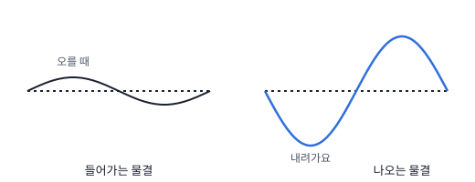

*작은 물결이 들어가서 뒤집힌 큰 물결로 나와요.*

**정확히 말하면**

트랜지스터의 출력은 전류예요. 전압으로 출력을 얻으려면 부하 저항 $R_D$를 달아요.

증폭하려면 바이어스 전류가 흘러야 해요. 증폭은 에너지가 더해지는 일이라 전원($V_{DD}$)에서 전류를 받아야 하기 때문이에요.

트랜지스터는 전류원(current source)으로, 즉 포화 영역에서 동작해야 해요. 조건은 $V_{GS} \gt V_{TH}$, $V_{DS} \ge V_{GS}-V_{TH}$예요.

소스가 접지에 붙어 있어서 이 구조를 common-source(CS, 공통 소스) 증폭기라고 불러요.

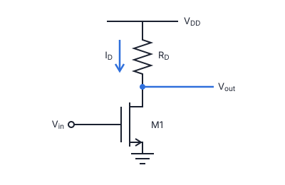

*CS 증폭기: 소스는 접지, 입력은 게이트, 출력은 드레인과 $R_D$ 사이 노드예요.*

입력을 조금 올렸을 때를 한 단계씩 따라가요.

1. $V_{in}$이 $\Delta V$만큼 오르면 $V_{GS}$도 $\Delta V$만큼 올라요.
2. 드레인 전류는 $g_m$에 비례해서 늘어요: $\Delta I_D = g_m \Delta V$
3. $R_D$의 전압 강하(IR drop)가 그만큼 커져요: $g_m \Delta V R_D$
4. $V_{DD}$는 일정하므로 출력은 그만큼 떨어져요: $\Delta V_{out} = -g_m \Delta V R_D$
5. 이득은 $A_v = \dfrac{\Delta V_{out}}{\Delta V} = -g_m R_D$예요.

음의 부호는 **위상 반전**을 뜻해요. 주기 신호로 보면 입력이 올라갈 때 출력은 내려가서, 위상이 반대가 돼요.

무조건 증폭되지는 않아요. $\lvert g_m R_D \rvert \gt 1$일 때만 출력 변화가 입력 변화보다 커요. 1보다 작으면 출력 변화가 오히려 작아져요.

**교수님 말씀**

바이어스 전류가 필요한 이유를 에너지 보존으로 설명하셨어요.

> "증폭을 한다는 말은 에너지가 더해진다는 건데" (0904 47:30)

트랜지스터를 저항으로도, 전류원으로도 쓸 수 있는데 증폭기에서는 무엇으로 써야 하는지 물으셨어요. 답은 전류원, 즉 포화 영역이에요 (0904 47:39–48:05).

이득의 크기가 1보다 작을 수도 있다는 점을 짚으셨어요.

> "무조건 증폭이 되는 게 아니라 오히려 감소할 수도 있어요." (0904 52:41)

이 따라가기는 소신호 모델 없이 정성적으로 본 것이고, 소신호 모델을 쓰면 더 쉽게 볼 수 있다고 하셨어요. 이어지는 해석은 [CS 증폭기 이득 A_v = -g_m R_D](#s3-cs-gain)에 있어요.

**페이지 요약**

입력이 오르면 전류가 늘고 $R_D$ 강하가 커져서, 출력은 거꾸로 내려가요.

*핵심 식*

- 전류 변화

  $$
  \Delta I_D = g_m \Delta V
  $$
- 출력 변화

  $$
  \Delta V_{out} = -g_m \Delta V R_D
  $$

*용어*

- **common-source(CS)** — 소스가 접지에 붙은 증폭기 구조
- **위상 반전** — 입력이 오를 때 출력이 내려가는 것(이득의 음의 부호)

---

### CS 증폭기 이득 A_v = -g_m R_D

*0904 수업 · L02 s17*

**쉽게 말하면**

입력 전압의 작은 변화를 $g_mR_D$배 한 만큼 출력이 반대 방향으로 움직여요.

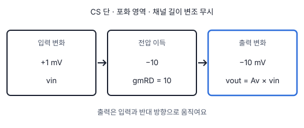

*소자가 포화 영역에 머물도록 출력 전압 여유도 남겨야 해요.*

**정확히 말하면**

**작은 예시.** 포화 영역의 동작점 근처에서 채널 길이 변조를 무시해요. $g_m=2\,\mathrm{mS}$, $R_D=5\,\mathrm{k\Omega}$이면 $A_v=-g_mR_D=-10$이에요. 입력이 $1\,\mathrm{mV}$ 오르면 출력은 약 $10\,\mathrm{mV}$ 내려가고, 입력이 $2\,\mathrm{mV}$ 내려가면 출력은 약 $20\,\mathrm{mV}$ 올라가요.

같은 회로를 소신호 모델로 풀어요. 정성적인 흐름은 [CS 증폭기를 말로 따라가기](#s3-cs-intuition)에 있어요.

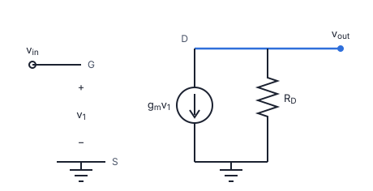

*소신호 등가회로: $V_{DD}$가 AC 접지가 되어 $R_D$는 출력 노드와 접지 사이에 걸려요.*

1. 등가회로: 게이트–소스는 개방이고 $v_1 = v_{gs} = v_{in}$이에요. 드레인에서 소스(접지)로 전류원 $g_m v_1$이 흘러요.
2. $V_{DD}$는 AC 접지라서 $R_D$는 출력 노드와 접지 사이에 있어요.
3. 출력 노드 KCL(나가는 전류의 합 = 0): $g_m v_1 + \dfrac{v_{out}}{R_D} = 0$
4. $v_{out} = -g_m v_1 R_D$ ($R_D$에는 접지에서 출력 노드 쪽으로 $g_m v_1$이 흘러요)
5. $A_v = \dfrac{v_{out}}{v_{in}}$이므로

$$
A_v = -g_m R_D
$$

소문자는 소신호, 즉 변화량이에요. $v_{gs}$는 $\Delta V_{GS}$, $i_d$는 $\Delta I_D$를 뜻해요.

$g_m$은 바이어스점에서 정해져요. 전류로 쓰면 다음과 같아요.

$$
g_m=\sqrt{2\mu_nC_{ox}\frac{W}{L}I_D}
$$

**설계 예.** 이득 100이 필요하고 $R_D = 100\ \Omega$이면 $g_m = 1\ \text{S}$가 돼야 해요. $\mu_nC_{ox}$는 공정 상수라서, 설계 변수 $W/L$과 $I_D$로 $g_m$을 맞춰요. (숫자를 쉽게 하려고 든 예예요. 실제로는 이렇게 큰 $g_m$을 만들기 어려워요.)

이득을 높이려면 $W/L$, $I_D$, $R_D$를 키워요. 하지만 $R_D$에 걸리는 전압은 $V_{DD}$로 제한돼요.

1. $V_{DD} = 1\ \text{V}$, $I_D = 1\ \text{mA}$, $R_D = 1\ \text{k}\Omega$라고 해요.
2. $I_D R_D = 1\ \text{V}$
3. $V_{DS} = V_{DD} - I_D R_D = 0$이 되어 포화 영역을 벗어나요.
4. $V_{DS}$를 지키려면 $I_D$를 줄여야 하고, 그러면 $g_m$이 줄어요.

그래서 $R_D$를 무조건 키우는 건 답이 아니에요. 보통은 $g_m$과 $R_D$를 함께 키우되, $g_m$을 키워서 이득을 올려요. (수업에서는 저항값 없이 "IR 드롭이 1 V"라고 설명했어요.)

**교수님 말씀**

$-g_m R_D$는 풀지 않고도 외워서 나오지만, 중요한 건 $g_m$이 무엇으로 정해지는지라고 하셨어요. 답은 바이어스점이에요 (0904 55:28–55:46).

식을 모르고 시뮬레이터 앞에서 값을 이것저것 넣어 맞추는 방식을 경계하셨어요.

> "시뮬레이터에 앉아서 박아 가면서 … 그거는 굉장히 리스키한 엔지니어링 패스" (0904 56:50)

식은 주어진 이득 사양을 맞추려면 무엇을 설계해야 하는지 알려 줘요 (0904 56:38).

**꼭 기억해요**

> "우리가 이 식을 배우는 거는 이 식을 외우기 위한 목적이 아니에요." (0904 56:31)

> "RD를 무조건 크게 하는 거는 답이 아니다" (0904 58:10)

**페이지 요약**

포화 영역의 소신호에서 $A_v=-g_mR_D$이고, 입력 변화에 이득을 곱하면 출력 변화가 돼요.

*핵심 식*

- CS 이득

  $$
  A_v = -g_m R_D
  $$
- 트랜스컨덕턴스

  $$
  g_m=\sqrt{2\mu_nC_{ox}\frac{W}{L}I_D}
  $$

*용어*

- **설계 변수** — $W/L$, $I_D$, $R_D$로 이득을 맞춰요
- **AC 접지(AC ground)** — $V_{DD}$는 소신호에서 접지가 돼요

---

### r_O를 넣으면: intrinsic gain

*0904 수업 · L02 s18*

**쉽게 말하면**

받는 통을 아무리 키워도 물이 조금씩 새는 틈이 있어요. 그래서 키울 수 있는 크기에 천장이 생겨요.

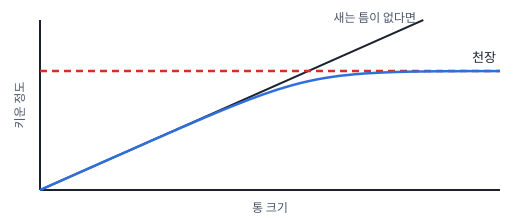

*굵은 선은 계속 오르다가 점선 천장 아래에 붙어요.*

**정확히 말하면**

채널 길이 변조(channel-length modulation)를 넣으면 트랜지스터는 유한한 출력저항 $r_O$를 가진 비이상적인 전류원이 돼요. $r_O$는 [채널 길이 변조와 출력저항 r_O](#s1-ro)에서 나왔어요.

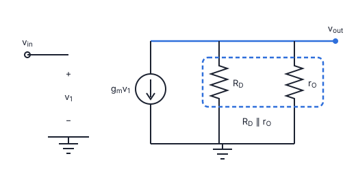

*전류원 $g_m v_1$은 그대로이고, 출력 노드와 접지 사이에 $R_D$와 $r_O$가 병렬로 보여요.*

1. 등가회로: 전류원 $g_m v_1$은 그대로, $r_O$가 $R_D$와 병렬로 붙어요. 둘을 한 덩어리 $R_D \parallel r_O$로 봐요.
2. 출력 노드 KCL: $g_m v_1 + \dfrac{v_{out}}{R_D} + \dfrac{v_{out}}{r_O} = 0$
3. $v_{out} = -g_m v_1 (R_D \parallel r_O)$
4. $v_1 = v_{in}$이므로

$$
A_v = -g_m (R_D \parallel r_O)
$$

출력저항 $R_{out}$은 입력을 0으로 두고 출력 노드에서 들여다본 저항이에요.

1. $v_{in}=0$이면 $v_1=0$
2. $g_m v_1=0$이라 전류원은 개방돼요.
3. 출력 노드와 접지 사이에 $R_D$와 $r_O$만 남아요: $R_{out} = R_D \parallel r_O$

슬라이드에는 $R_{in} = \infty$도 적혀 있어요(게이트로 전류가 들어가지 않아서). 수업에서는 말로 짚지 않았어요.

$R_D \parallel r_O \lt R_D$라서 $R_D$만 있을 때보다 이득이 조금 떨어져요.

**얼마나 떨어질까.** 보통 $r_O$는 수십 kΩ이고 $R_D$는 수백 Ω이에요. 예를 들어 $R_D = 500\ \Omega$, $r_O = 50\ \text{k}\Omega$이면 $R_D \parallel r_O \approx 495\ \Omega$라서 이득이 약 1 % 줄어요. 이때 출력저항도 거의 $R_D$로 정해져요.

**천장.** $R_D$를 이론적으로 무한대로 보내 봐요.

1. $R_D \to \infty$이면 $R_D \parallel r_O \to r_O$
2. $\lvert A_v \rvert \to g_m r_O$

이 값 $g_m r_O$가 **intrinsic gain**이에요. 트랜지스터 하나로 얻을 수 있는 최대 이득이에요. 모든 트랜지스터는 유한한 $r_O$를 가지므로 무한대 이득은 얻을 수 없어요. 예를 들어 $g_m = 5\ \text{mS}$, $r_O = 50\ \text{k}\Omega$이면 $g_m r_O = 250$이에요.

이득을 천장에 대한 비율로 쓰면 $\lvert A_v \rvert = g_m r_O \cdot \dfrac{R_D}{R_D + r_O}$예요. $R_D = r_O$일 때 천장의 절반이 돼요.

#### 직접 해 보기: RD를 키우면 이득은 어디까지 오를까 *(정적 스냅샷 — 직접 조작은 HTML 버전)*

$R_D$를 로그 눈금으로 키우면 굵은 선 $g_m (R_D \parallel r_O)$가 점선 $g_m R_D$를 따라 오르다가 가로 점선 천장 $g_m r_O$에 붙어요. 세로 점선은 $R_D = r_O$ 위치예요. $g_m$과 $r_O$도 바꿔 보세요.

$\lvert A_v \rvert = g_m (R_D \parallel r_O)$: **2.48** · $R_D$만 있을 때 $g_m R_D$: **2.50** · 천장 $g_m r_O$: **250**

$R_D \parallel r_O$: **495 Ω** · $r_O$ 때문에 줄어든 몫: **1.0 %**

**RD가 rO보다 훨씬 작아서 rO 영향이 거의 없어요. 출력저항도 거의 RD예요.**

범례: $R_D$만 있을 때 $g_m R_D$ · $r_O$를 넣은 이득 $g_m (R_D \parallel r_O)$ · 현재 $R_D$에서 실제 이득 · 현재 $R_D$에서 $g_m R_D$

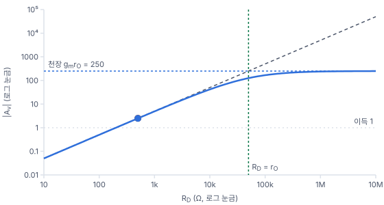

*대표 설정 1: $R_D$ = 500 Ω (수업 예처럼 수백 Ω)*

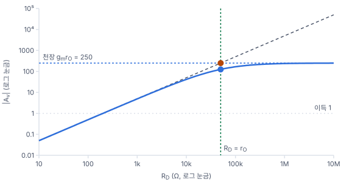

*대표 설정 2: $R_D$ = 50 kΩ (= $r_O$)*

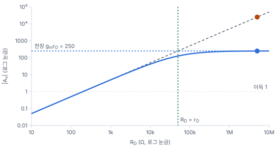

*대표 설정 3: $R_D$ = 5 MΩ ($r_O$의 100배)*

| 설정 | $R_D$ | $R_D \parallel r_O$ | $g_m R_D$ | $\lvert A_v \rvert = g_m (R_D \parallel r_O)$ | $r_O$ 때문에 줄어든 몫 |
|---|---|---|---|---|---|
| 1 | 500 Ω (수업 예처럼 수백 Ω) | 495 Ω | 2.50 | 2.48 | 1.0 % |
| 2 | 50 kΩ (= $r_O$) | 25.0 kΩ | 250 | 125 | 50.0 % |
| 3 | 5 MΩ ($r_O$의 100배) | 49.5 kΩ | 25000 | 248 | 99.0 % |

세 설정 모두 $g_m = 5\ \text{mS}$, $r_O = 50\ \text{k}\Omega$(천장 $g_m r_O = 250$)예요.

**교수님 말씀**

$r_O$가 $R_D$와 병렬로 보이니 한 덩어리로 보면 쉽다고 하셨어요 (0904 59:02–59:30).

실제 값의 크기를 비교해 주셨어요.

> "ro는 보통 대략 수십 k 정도 되거든요." (0904 59:57)

> "ro가 유한한 값을 갖더라도 큰 영향은 없다고 봐도 되겠습니다." (0904 60:18)

$R_D$를 무한대로 달면 이득이 무한대가 될 것 같지만, 트랜지스터의 유한한 저항 때문에 그렇지 않다고 하셨어요.

> "최대 이득은 gm ro보다 커질 수는 없다." (0904 61:21)

> "그래서 무한대의 이득은 얻을 수가 없어요." (0904 62:01)

**페이지 요약**

$r_O$가 $R_D$와 병렬로 붙어서, 이득은 intrinsic gain $g_m r_O$를 넘지 못해요.

*핵심 식*

- CS 이득(r_O 포함)

  $$
  A_v = -g_m (R_D \parallel r_O)
  $$
- 출력저항

  $$
  R_{out} = R_D \parallel r_O
  $$

*용어*

- **intrinsic gain** — $g_m r_O$, 트랜지스터 하나로 얻는 최대 이득

---

## 5. BJT 첫 만남

### BJT의 구조와 동작 조건

*0904 수업 · L02 s19–s21*

**쉽게 말하면**

이 부품은 재료 세 겹을 겹친 샌드위치처럼 생긴 수도꼭지예요.

가운데 손잡이를 조금만 더 돌려도 물이 훨씬 세게 쏟아져요.

*바깥 두 겹은 같은 재료이고, 가운데 한 겹만 다른 재료예요.*

**정확히 말하면**

바이폴라 트랜지스터(bipolar junction transistor, BJT)는 도핑한 실리콘 세 영역을 겹친 샌드위치 구조예요(L02 s20). 바깥 두 영역은 같은 극성으로, 가운데 영역은 반대 극성으로 도핑해요.

그래서 BJT에는 pn 접합(pn junction)이 두 개 있어요. 바깥이 n형이면 npn, 바깥이 p형이면 pnp 트랜지스터예요.

세 단자는 컬렉터(collector, C), 베이스(base, B), 에미터(emitter, E)예요. 가운데 영역이 베이스예요.

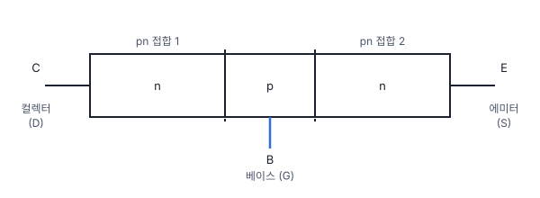

*npn 구조와 단자 이름이에요. 괄호 안은 대응하는 MOSFET 단자예요.*

MOSFET 단자와는 이렇게 대응해요(수업에서 말로 짚은 내용).

| BJT | MOSFET |
|---|---|
| 컬렉터(C) | 드레인(D) |
| 베이스(B) | 게이트(G) |
| 에미터(E) | 소스(S) |

컬렉터 전류는 $V_{BE}$의 지수 함수(exponential)에 비례해요(L02 s21). MOSFET의 $I_D$가 $V_{GS}-V_{TH}$의 제곱에 비례하는 것과 다른 점이에요.

$$
I_C = I_S \exp(V_{BE}/V_T)
$$

여기서 $I_S$는 소자마다 정해지는 상수이고, $V_T$는 열전압(thermal voltage)이에요.

BJT도 아무 전압에서나 전류원(current source)으로 동작하지 않아요. npn이 활성 영역(active region)에서 전류원으로 동작하려면 두 조건을 모두 만족해야 해요.

1. 베이스–에미터 접합은 순방향 바이어스(forward bias): $V_{BE} \gt 0$
2. 베이스–컬렉터 접합은 역방향 바이어스(reverse bias): $V_{BC} \lt 0$

MOSFET이 포화 영역에서만 전류원으로 동작하는 것과 같은 이야기예요. 등가 모델은 다음 시간에 이어서 해요.

**교수님 말씀**

BJT의 물리적 원리는 알면 좋지만, 회로를 해석하는 데 필요한 만큼만 알면 된다고 하셨어요.

> "회로를 해석하는 데 있어서의 물리적 의미를 굳이 깊이 있게 몰라도 된다" (0904 64:13)

전류원 동작에는 조건이 있다는 점을 두 번 반복해서 말씀하셨어요.

> "아무렇게나 동작시키면 커런트 소스로 동작하는 게 아니라" (0904 65:43)

**페이지 요약**

BJT는 세 영역 샌드위치이고, 두 접합 조건을 맞추면 $V_{BE}$의 지수 함수로 전류가 흐르는 전류원이 돼요.

*핵심 식*

- 컬렉터 전류

  $$
  I_C = I_S \exp(V_{BE}/V_T)
  $$
- npn 활성 조건

  $$
  V_{BE} \gt 0
  $$

  $$
  V_{BC} \lt 0
  $$

*용어*

- **컬렉터·베이스·에미터(C, B, E)** — MOSFET의 드레인·게이트·소스에 대응
- **npn / pnp** — 바깥 두 영역의 도핑 극성으로 나눈 두 종류

---

## 6. 요약 · 예고

### 한 장 요약

*0904 수업 · L02 s8–21*

0904 수업의 식과 규칙을 한 표에 모았어요. 오른쪽 칸의 링크를 누르면 그 토픽으로 가요.

| 항목 | 식 · 규칙 | 자세히 |
|---|---|---|
| 대신호 모델 (포화 영역) | $I_D = \tfrac12 \mu_n C_{ox}\tfrac{W}{L}(V_{GS}-V_{TH})^2 = \tfrac12 k (V_{GS}-V_{TH})^2$, $k \equiv \mu_n C_{ox}\tfrac{W}{L}$ 포화 조건: $V_{GS} \gt V_{TH}$, $V_{DS} \ge V_{GS}-V_{TH}$. G–S는 개방, D–S는 전류원이에요. | [대신호 모델](#s0-large-signal) |
| 소신호 정의 | DC 바이어스 위에 얹힌 작은 변화량이에요. 실제 곡선을 접선으로 충분히 정확하게 근사할 수 있는 입력 범위에서 써요. $i_d = g_m v_{gs}$ (소문자는 소신호, 대문자는 바이어스 값) | [소신호 모델](#s0-small-signal) |
| 트랜스컨덕턴스 $g_m$ | $g_m = \dfrac{\partial I_D}{\partial V_{GS}}$ $g_m = \mu_n C_{ox}\tfrac{W}{L}(V_{GS}-V_{TH})$ $g_m = \sqrt{2\mu_n C_{ox}\tfrac{W}{L} I_D}$ $g_m = \dfrac{2I_D}{V_{GS}-V_{TH}}$ $g_m$은 동작점에 따라 정해져요. | [트랜스컨덕턴스](#s1-gm) |
| 출력저항 $r_O$ | $I_D = \tfrac12 \mu_n C_{ox}\tfrac{W}{L}(V_{GS}-V_{TH})^2(1+\lambda V_{DS})$ $r_O = \frac{1}{\lambda I_D}$ ($\lambda = 0$이면 $r_O = \infty$) 소신호 모델에서 D–S 사이에 $g_m v_{gs}$와 병렬로 들어가요. | [채널 길이 변조](#s1-ro) |
| PMOS 식 | $\vert I_D\vert  = \tfrac12 \mu_p C_{ox}\tfrac{W}{L}(\vert V_{GS}\vert -\vert V_{TH}\vert )^2(1+\lambda \vert V_{DS}\vert )$ $V_{GS} \lt 0$, $V_{DS} \lt 0$이고 전류는 소스에서 드레인으로 흘러요. 절댓값으로 쓰면 NMOS 식과 같은 모양이에요. | [PMOS 식](#s2-pmos-eq) |
| PMOS 소신호 모델 | NMOS 소신호 모델과 같아요($g_m v_{gs}$, $r_O$). 소스에 연결된 $V_{DD}$는 AC 접지예요. | [PMOS 소신호 모델](#s2-pmos-model) |
| DC 해석 / 소신호 해석 | DC 해석: 대신호 모델로 동작 영역과 바이어스점을 정하고 $g_m$, $r_O$를 구해요. 소신호 해석: DC 전압원은 단락(AC 접지), DC 전류원은 개방해요. 신호원은 그대로 둬요. | [DC 해석과 소신호 해석](#s3-dc-ac) |
| CS 증폭기 (정성) | $V_{in}$이 오르면 $I_D$가 늘고, $R_D$ 전압 강하가 커져 $V_{out}$이 내려가요. 음의 부호는 위상 반전이에요. | [CS 정성 해석](#s3-cs-intuition) |
| CS 이득 | $A_v = -g_m R_D$ $\vert g_m R_D\vert  \gt 1$일 때만 증폭돼요. $R_D$를 무작정 키우면 $V_{DS}$가 모자라요. | [CS 소신호 해석](#s3-cs-gain) |
| 채널 길이 변조를 넣은 CS | $A_v = -g_m (R_D \parallel r_O)$ $R_{out} = R_D \parallel r_O$ | [intrinsic gain](#s3-intrinsic) |
| intrinsic gain | $g_m r_O$: $R_D \to \infty$일 때의 이득 크기이고, 트랜지스터 하나로 얻는 최대 이득이에요. | [intrinsic gain](#s3-intrinsic) |
| BJT 컬렉터 전류 | $I_C = I_S \exp(V_{BE}/V_T)$ 활성 조건(npn): B–E 순방향 $V_{BE} \gt 0$, B–C 역방향 $V_{BC} \lt 0$. 단자 대응은 C–D, B–G, E–S예요. | [BJT 도입](#s4-bjt-intro) |

---

### 다음 시간 예고

*0904 수업 · L02 s21–28*

0904 수업은 BJT의 $I_C$ 식과 활성 조건까지 짚고 끝났어요. 다음 시간에는 BJT 소신호 모델과 $r_\pi$, Early effect, PNP 모델을 다뤄요.

- L02 s21 BJT 대신호 등가 모델
- L02 s22 BJT 특성 곡선
- L02 s23 BJT $g_m$ 시각화
- L02 s24 BJT $g_m$
- L02 s25 BJT 소신호 모델
- L02 s26 Early effect와 $r_O$
- L02 s27 PNP 대신호 모델
- L02 s28 PNP 소신호 모델

---

### 함께 보면 좋은 자료

*0904 수업*

- [지난 수업 정리노트 (0902): MOSFET 구조, triode, saturation](../../0902/정리노트_0902_MOSFET_Review.html)
- [나중 수업 정리노트 (0923): 차동 증폭기 — 여기서 배운 $g_m$, $r_O$, CS 이득이 계속 쓰여요](../../0923/정리노트_0923_Differential_Amplifiers.html)

이번 범위에는 workbook 문제가 없어요.

---

출처: 권익진 교수님 강의자료(Lec2) · 수업 녹음 전사(0904) · B. Razavi, *Fundamentals of Microelectronics* (Wiley) 4·6·7장.
