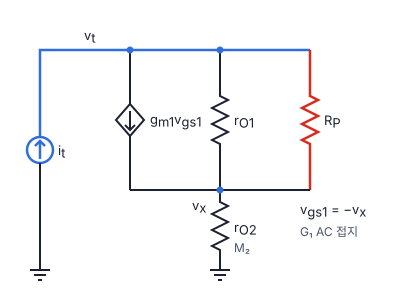

# 전자회로2 복습 0909 문제설명

주어진 조건을 읽고, 첫 줄을 쓰고, 이유를 따라가며 답을 확인해요.

문제의 첫 줄부터 검산까지 설명해요.

**목차**

- [문항별 설명](#problems)
  - [MOS 캐스코드 전류원의 바이어스 설계와 출력 임피던스](#p1)
  - [출력 임피던스 500 kΩ, 전류 0.5 mA인 NMOS 캐스코드 설계](#p2)
  - [W/L = 32일 때 출력 임피던스 (예제 9.5 변형)](#p3)
  - [기생 저항 R_P가 생긴 MOS 캐스코드의 출력 저항](#p4)
  - [출력 임피던스를 절반으로 떨어뜨리는 R_P (예제 9.6 이어서)](#p5)
  - [MOS 캐스코드 전류원에 허용되는 최대 λ](#p6)
  - [PMOS 캐스코드에서 폭을 N배로 늘릴 때의 출력 임피던스](#p7)
  - [저항 부하 MOS 캐스코드의 V_b1 상한과 V_X](#p8)

## 문항별 설명

### MOS 캐스코드 전류원의 바이어스 설계와 출력 임피던스

P9.14 · 장말문제 9.14 · [원 문제 보기](../%EB%B3%B5%EC%8A%B5%EB%AC%B8%EC%A0%9C_0909_Cascode_Stage-%EB%AC%B8%EC%A0%9C.pdf)

#### 주어진 조건

- 회로: Fig 9.50 캐스코드 전류원, 바이어스 전류 $0.5\ \text{mA}$로 설계
- $\mu_n C_{ox} = 100\ \mu\text{A/V}^2$, $V_{TH} = 0.4\ \text{V}$
- $M_1$: $W/L = 30/0.18$, $M_2$: $W/L = 20/0.18$ (그림에 표시)

#### 구할 것

- (a) 채널 길이 변조를 무시할 때 필요한 $V_{b2}$. 그리고 $M_2$가 포화 영역에 머물러야 할 때 $V_{b1}$의 최솟값
- (b) $\lambda = 0.1\ \text{V}^{-1}$일 때 회로의 출력 임피던스

원문 보기

The cascode current source shown in Fig. 9.50 must be designed for a bias current of $0.5\ \text{mA}$. Assume $\mu_n C_{ox} = 100\ \mu\text{A/V}^2$ and $V_{TH} = 0.4\ \text{V}$.

(a) Neglecting channel-length modulation, compute the required value of $V_{b2}$. What is the minimum tolerable value of $V_{b1}$ if $M_2$ must remain in saturation?

(b) Assuming $\lambda = 0.1\ \text{V}^{-1}$, calculate the output impedance of the circuit.

#### 문제를 이렇게 읽어요

아래 $M_2$가 0.5 mA를 정하고 위 $M_1$이 출력까지 전달해요. DC 게이트 전압을 먼저 정하고 같은 동작점에서 출력 저항을 구해요.

#### 이 문제를 봤을 때 떠올릴 개념과 공식

바이어스는 포화 제곱 법칙(saturation square law), 출력 임피던스는 소스 축퇴(source degeneration)로 읽어요. $V_{ov}=V_{GS}-V_{TH}$는 과구동 전압, $g_m=2I_D/V_{ov}$는 전압당 전류 변화, $r_O=1/(\lambda I_D)$는 출력 저항이에요. (a)는 채널 길이 변조를 무시하고 (b)에서만 유한한 $r_O$를 남겨요.

#### 종이에 쓰는 실제 첫 줄

먼저 다음 식을 적어요.

$$
I_D=\frac12\mu_nC_{ox}(W/L)_2(V_{b2}-V_{TH})^2
$$

#### 왜 이렇게 푸는지 함께 따라가요

#### (a) 풀이

$M_2$의 소스는 접지이므로 $V_{GS2}=V_{b2}$예요.

$$
V_{ov2}=\sqrt{\frac{2(0.5\mathrm{mA})}{100\mathrm{\mu A/V^2}(20/0.18)}}=0.300\mathrm V
$$

따라서 $V_{b2}=0.400+0.300=0.700\mathrm V$예요. 위 소자는 같은 전류를 더 넓은 폭으로 흘리므로

$$
V_{ov1}=\sqrt{\frac{2(0.5\mathrm{mA})}{100\mathrm{\mu A/V^2}(30/0.18)}}=0.24495\mathrm V
$$

중간 노드는 $V_X=V_{b1}-(V_{TH}+V_{ov1})$예요. 아래 소자의 포화 조건 $V_X\ge V_{ov2}$에서 $V_{b1,\min}=0.300+0.400+0.24495=0.94495\mathrm V$예요.

#### (b) 풀이

바이어스 전압원은 AC 접지로 보내요. 아래는 $v_{gs2}=0$이라 $r_{O2}$만 남고 위 소자의 축퇴 저항이 돼요.

$$
r_{O1}=r_{O2}=\frac1{0.1(0.5\mathrm{mA})}=20.0\mathrm{k\Omega}
$$

$$
g_{m1}=\frac{1.00\mathrm{mA}}{0.24495\mathrm V}=4.0825\mathrm{mS}
$$

$$
R_{out}=r_{O1}+r_{O2}+g_{m1}r_{O1}r_{O2}=1.673\mathrm{M\Omega}
$$

곱 항만 남기는 교재 근사는 $1.633\mathrm{M\Omega}$예요.

#### 완성 답과 검산

#### (a) 답과 검산

**$V_{b2}=0.700\mathrm V$, $V_{b1,\min}=0.945\mathrm V$예요.** 경계에서 $V_X=0.300\mathrm V=V_{ov2}$여서 아래 소자의 포화 조건을 만족해요.

#### (b) 답과 검산

**교재 근사 $R_{out}\approx1.63\mathrm{M\Omega}$예요.** $g_{m1}r_{O2}=81.65$이고 생략한 40 kΩ은 정확식의 약 2.4%예요. $\mathrm S\cdot\Omega^2=\Omega$로 단위도 맞아요.

#### 이 문제에서 조심할 점

이 그림에서 위가 $M_1$, 아래가 $M_2$예요. 최소 게이트 전압에는 위의 $V_{GS1}$뿐 아니라 아래에 남겨 줄 $V_{ov2}$까지 더해야 해요.

#### 설명을 닫고 규칙을 적용해 봐요

- (a)에서 전류 $0.5\ \mathrm{mA}$와 $M_2$는 그대로 두고 $M_1$만 $W/L=15/0.18$로 줄이면 $V_{b2}$와 $V_{b1,\min}$은 각각 어떻게 되나요? 어느 소자의 과구동 전압이 바뀌는지 먼저 정해 보세요.
- (b)에서 두 소자의 $\lambda$만 $0.05\ \mathrm{V^{-1}}$로 줄이면(전류·형상비 그대로) 곱 항 근사 $R_{out}$은 몇 배, 대략 몇 MΩ인가요?

**페이지 요약**

#### 떠올릴 개념·공식

바이어스는 포화 제곱 법칙(saturation square law), 출력 임피던스는 소스 축퇴(source degeneration)로 읽어요. $V_{ov}=V_{GS}-V_{TH}$는 과구동 전압, $g_m=2I_D/V_{ov}$는 전압당 전류 변화, $r_O=1/(\lambda I_D)$는 출력 저항이에요. (a)는 채널 길이 변조를 무시하고 (b)에서만 유한한 $r_O$를 남겨요.

#### 첫 줄

$I_D=\frac12\mu_nC_{ox}(W/L)_2(V_{b2}-V_{TH})^2$

#### 핵심 판단

이 그림에서 위가 $M_1$, 아래가 $M_2$예요. 최소 게이트 전압에는 위의 $V_{GS1}$뿐 아니라 아래에 남겨 줄 $V_{ov2}$까지 더해야 해요.

#### 검산

**$V_{b2}=0.700\mathrm V$, $V_{b1,\min}=0.945\mathrm V$예요.** 경계에서 $V_X=0.300\mathrm V=V_{ov2}$여서 아래 소자의 포화 조건을 만족해요.

**교재 근사 $R_{out}\approx1.63\mathrm{M\Omega}$예요.** $g_{m1}r_{O2}=81.65$이고 생략한 40 kΩ은 정확식의 약 2.4%예요. $\mathrm S\cdot\Omega^2=\Omega$로 단위도 맞아요.

---

### 출력 임피던스 500 kΩ, 전류 0.5 mA인 NMOS 캐스코드 설계

E9.05 · 예제 9.5 · [원 문제 보기](../%EB%B3%B5%EC%8A%B5%EB%AC%B8%EC%A0%9C_0909_Cascode_Stage-%EB%AC%B8%EC%A0%9C.pdf)

#### 주어진 조건

- 목표: 출력 임피던스 $R_{out} = 500\ \text{k}\Omega$, 전류 $I_D = 0.5\ \text{mA}$
- 단순화를 위해 $M_1$과 $M_2$가 같다고 가정 (같을 필요는 없음)
- $\mu_n C_{ox} = 100\ \mu\text{A}/\text{V}^2$, $\lambda = 0.1\ \text{V}^{-1}$

#### 구할 것

- 트랜지스터의 $W/L$ (설계)

원문 보기

출력 임피던스가 $500\ \text{k}\Omega$이고 전류가 $0.5\ \text{mA}$인 NMOS 캐스코드를 설계하라. 단순화를 위해 그림 9.8에서 $M_1$과 $M_2$가 같다고 가정하라(같을 필요는 없다). $\mu_n C_{ox} = 100\ \mu\text{A}/\text{V}^2$, $\lambda = 0.1\ \text{V}^{-1}$이라고 가정하라.

#### 문제를 이렇게 읽어요

전류와 공정으로 $r_O$는 이미 정해져 있어요. 목표 500 kΩ를 만드는 $g_m$을 정한 뒤 두 소자의 공통 형상비를 찾아요.

교재의 지배항 근사 $R_{out}\approx g_mr_O^2$로는 $W/L=15.625$가 나오지만, 더하기 항까지 남긴 정확 소신호 식으로 500 kΩ를 맞추면 $13.225$예요. 두 설계 기준을 구별해 계산해요.

#### 이 문제를 봤을 때 떠올릴 개념과 공식

동일한 MOS 캐스코드(cascode)라는 단서에서 $R_{out}\approx g_mr_O^2$를 떠올려요. $r_O=1/(\lambda I_D)$는 채널 길이 변조 저항, $g_m=\sqrt{2\mu_nC_{ox}(W/L)I_D}$는 트랜스컨덕턴스예요. $g_mr_O\gg1$일 때 곱 항을 남기며 정확식은 $2r_O+g_mr_O^2$예요.

#### 종이에 쓰는 실제 첫 줄

먼저 다음 식을 적어요.

$$
r_O=\frac1{0.1(0.5\mathrm{mA})}=20\mathrm{k\Omega}
$$

#### 왜 이렇게 푸는지 함께 따라가요

#### 풀이

아래 소자는 게이트와 소스가 AC 접지라 $r_O$가 되고 위 소자는 이것으로 축퇴돼요.

$$
g_m=\frac{500\mathrm{k\Omega}}{(20\mathrm{k\Omega})^2}=1.25\mathrm{mS}
$$

제곱근 식을 제곱해 형상비를 고립시켜요.

$$
\frac WL=\frac{g_m^2}{2\mu_n C_{ox}I_D}=\frac{(1.25\times10^{-3})^2}{2(100\times10^{-6})(0.5\times10^{-3})}=15.625
$$

두 소자를 모두 $W/L\approx15.6$으로 골라요. 정확히 500 kΩ를 맞추려면 $g_m=(500-40)\mathrm{k\Omega}/(20\mathrm{k\Omega})^2=1.15\mathrm{mS}$이므로 정확식 기준 형상비는 13.225예요.

#### 완성 답과 검산

#### 답과 검산

**교재 근사 설계는 두 소자 모두 $W/L=15.6$이에요.** $g_mr_O=25$이고 정확식에서는 540 kΩ이므로 근사 목표보다 8% 높아요. 형상비는 무차원이며 폭 자체가 15.6 μm라는 뜻은 아니에요.

정확식 기준의 $W/L=13.225$를 넣으면 $g_m=1.15$ mS여서 $R_{out}=40+460=500$ kΩ예요. 교재의 15.625를 넣은 540 kΩ와 같은 목표 모델로 혼동하지 않아요.

#### 이 문제에서 조심할 점

500 kΩ를 개별 소자의 $r_O$로 놓지 않아요. 출력저항 사양과 바이어스 전류를 동시에 만족하도록 $g_m$을 역산해요.

$W/L=15.625$를 쓰면서 정확히 500 kΩ라고 단정하면 지배항 근사와 정확식을 섞은 것이에요. 정확히 맞출 값은 13.225이고, 15.625는 정확식에서 540 kΩ예요.

#### 설명을 닫고 규칙을 적용해 봐요

1. 같은 $I_D=0.5\ \mathrm{mA}$, $\lambda=0.1\ \mathrm{V^{-1}}$에서 목표를 $1\ \mathrm{M\Omega}$로 두 배 올리면 지배항 설계의 $g_m$과 $W/L$은 각각 얼마(몇 배)인가요?
2. 목표 $500\ \mathrm{k\Omega}$와 $I_D=0.5\ \mathrm{mA}$는 그대로 두고 $\lambda$만 $0.05\ \mathrm{V^{-1}}$로 바꾸면 지배항 설계의 $W/L$은 얼마인가요? 무엇부터 계산할지 먼저 정해 보세요.

**페이지 요약**

#### 떠올릴 개념·공식

동일한 MOS 캐스코드(cascode)라는 단서에서 $R_{out}\approx g_mr_O^2$를 떠올려요. $r_O=1/(\lambda I_D)$는 채널 길이 변조 저항, $g_m=\sqrt{2\mu_nC_{ox}(W/L)I_D}$는 트랜스컨덕턴스예요. $g_mr_O\gg1$일 때 곱 항을 남기며 정확식은 $2r_O+g_mr_O^2$예요.

#### 첫 줄

$r_O=\frac1{0.1(0.5\mathrm{mA})}=20\mathrm{k\Omega}$

#### 핵심 판단

500 kΩ를 개별 소자의 $r_O$로 놓지 않아요. 출력저항 사양과 바이어스 전류를 동시에 만족하도록 $g_m$을 역산해요.

#### 검산

**교재 근사 설계는 두 소자 모두 $W/L=15.6$이에요.** $g_mr_O=25$이고 정확식에서는 540 kΩ이므로 근사 목표보다 8% 높아요. 형상비는 무차원이며 폭 자체가 15.6 μm라는 뜻은 아니에요.

#### 해석과 모델 범위

500 kΩ 설계: 교재 지배항 $W/L=15.625$; 정확 소신호 식 $13.225$. 전자는 정확식에 넣으면 540 kΩ예요.

---

### W/L = 32일 때 출력 임피던스 (예제 9.5 변형)

X9.05 · 연습문제 9.5 · [원 문제 보기](../%EB%B3%B5%EC%8A%B5%EB%AC%B8%EC%A0%9C_0909_Cascode_Stage-%EB%AC%B8%EC%A0%9C.pdf)

#### 주어진 조건

- 예제 9.5와 같은 NMOS 캐스코드(Fig 9.8)와 조건: $I_D = 0.5\ \text{mA}$, $\mu_n C_{ox} = 100\ \mu\text{A}/\text{V}^2$, $\lambda = 0.1\ \text{V}^{-1}$, $M_1$과 $M_2$가 같음
- 바뀐 점: $W/L = 32$ (두 트랜지스터 모두)

#### 구할 것

- 출력 임피던스 $R_{out}$

원문 보기

$W/L = 32$일 때 출력 임피던스는 얼마인가?

#### 문제를 이렇게 읽어요

형상비가 32로 주어졌으므로 같은 0.5 mA에서 $g_m$을 계산한 다음 출력 저항을 구해요.

#### 이 문제를 봤을 때 떠올릴 개념과 공식

폭만 바뀌고 전류와 $\lambda$가 고정이라는 단서가 중요해요. $g_m$은 $\sqrt{W/L}$에 비례하지만 $r_O=1/(\lambda I_D)$는 그대로예요. $g_mr_O\gg1$이면 소스 축퇴(source degeneration) 근사 $R_{out}\approx g_mr_O^2$를 적용해요.

#### 종이에 쓰는 실제 첫 줄

먼저 다음 식을 적어요.

$$
g_m=\sqrt{2\mu_nC_{ox}(W/L)I_D}
$$

#### 왜 이렇게 푸는지 함께 따라가요

#### 풀이

단위를 A로 맞춰 넣어요.

$$
g_m=\sqrt{2(100\times10^{-6})(32)(0.5\times10^{-3})}=1.78885\mathrm{mS}
$$

$$
r_O=\frac1{0.1(0.5\mathrm{mA})}=20.0\mathrm{k\Omega}
$$

아래는 AC 접지된 게이트와 소스 때문에 저항만 남고, 위는 이 저항으로 축퇴돼요.

$$
R_{out}\approx(1.78885\mathrm{mS})(20\mathrm{k\Omega})^2=715.54\mathrm{k\Omega}
$$

정확식은 두 저항의 합 40 kΩ을 더해 755.54 kΩ이에요.

#### 완성 답과 검산

#### 답과 검산

**$R_{out}\approx716\mathrm{k\Omega}$예요.** $g_mr_O=35.78$이고 예제와 비교하면 $\sqrt{32/15.625}=1.431$배예요. $500\mathrm{k\Omega}\times1.431=715.5\mathrm{k\Omega}$로 직접 계산과 맞아요.

#### 이 문제에서 조심할 점

형상비를 약 두 배로 해도 출력 저항은 두 배가 아니에요. 전류 고정 조건에서는 제곱근으로 증가해요.

#### 설명을 닫고 규칙을 적용해 봐요

1. $I_D=0.5\ \mathrm{mA}$를 고정한 채 $W/L$을 32에서 128로 4배 늘리면 $g_m$과 근사 $R_{out}$은 각각 몇 배, $R_{out}$은 대략 몇 kΩ인가요?
2. $W/L=32$를 유지하고 $I_D$만 $1\ \mathrm{mA}$로 두 배 늘리면 근사 $R_{out}$은 커지나요, 작아지나요? 대략 몇 kΩ인가요?

**페이지 요약**

#### 떠올릴 개념·공식

폭만 바뀌고 전류와 $\lambda$가 고정이라는 단서가 중요해요. $g_m$은 $\sqrt{W/L}$에 비례하지만 $r_O=1/(\lambda I_D)$는 그대로예요. $g_mr_O\gg1$이면 소스 축퇴(source degeneration) 근사 $R_{out}\approx g_mr_O^2$를 적용해요.

#### 첫 줄

$g_m=\sqrt{2\mu_nC_{ox}(W/L)I_D}$

#### 핵심 판단

형상비를 약 두 배로 해도 출력 저항은 두 배가 아니에요. 전류 고정 조건에서는 제곱근으로 증가해요.

#### 검산

**$R_{out}\approx716\mathrm{k\Omega}$예요.** $g_mr_O=35.78$이고 예제와 비교하면 $\sqrt{32/15.625}=1.431$배예요. $500\mathrm{k\Omega}\times1.431=715.5\mathrm{k\Omega}$로 직접 계산과 맞아요.

---

### 기생 저항 R_P가 생긴 MOS 캐스코드의 출력 저항

E9.06 · 예제 9.6 · [원 문제 보기](../%EB%B3%B5%EC%8A%B5%EB%AC%B8%EC%A0%9C_0909_Cascode_Stage-%EB%AC%B8%EC%A0%9C.pdf)

#### 주어진 조건

- 제조 중 큰 기생 저항 $R_P$가 MOS 캐스코드에 생김, 위치는 Fig 9.11 ($M_1$의 드레인과 소스 사이)
- 소자 값은 주어지지 않음 (답은 $g_m$, $r_O$, $R_P$ 기호로)

#### 구할 것

- 출력 저항 $R_{out}$

원문 보기

제조하는 동안 큰 기생 저항 $R_P$가 그림 9.11과 같이 캐스코드에 나타났다. 출력 저항을 결정하라.

#### 문제를 이렇게 읽어요

기생 저항은 출력과 중간 노드 사이에 있어요. 위 소자의 드레인–소스 저항과 먼저 합쳐야 해요.

#### 이 문제를 봤을 때 떠올릴 개념과 공식

같은 두 노드 사이 연결이라는 단서에서 병렬(parallel) 저항 $q=r_{O1}\parallel R_P$를 골라요. $g_{m1}$은 위 소자의 트랜스컨덕턴스, $r_{O2}$는 아래 소자의 출력 저항이에요. 근사는 $g_{m1}q r_{O2}\gg q+r_{O2}$일 때만 적용해요.

#### 종이에 쓰는 실제 첫 줄

바이어스 전압원 $V_{b1}$, $V_{b2}$를 AC 접지로 보내요. 출력 노드 전압을 $v_t$, 중간 노드($M_1$ 소스) 전압을 $v_x$로 정하고, 접지에서 출력으로 들어오는 시험전류를 $i_t$라 두어요. 구할 저항의 정의는 $R_{out}=v_t/i_t$예요.

$M_1$의 게이트는 AC 접지(0)이므로 $v_{gs1}=0-v_x=-v_x$예요. 출력과 중간 노드 사이의 두 저항 $r_{O1}$, $R_P$는 같은 두 노드에 걸리므로 $q=r_{O1}\parallel R_P$로 묶어요. 출력에서 중간 노드로 향하는 전류를 양수로 세요. 저항 가지는 $(v_t-v_x)/q$, 제어 전류원은 $g_{m1}v_{gs1}=-g_{m1}v_x$를 같은 방향으로 흘려요.

*$V_{b1}$, $V_{b2}$를 AC 접지로 보내고 $M_1$은 $g_{m1}v_{gs1}$·$r_{O1}$, $v_{gs2}=0$인 $M_2$는 $r_{O2}$로 바꿨어요. 기생 저항 $R_P$는 $M_1$의 드레인(출력)과 소스($v_x$) 사이에 그대로 남아요.*

출력 노드 KCL은

$$
i_t=\frac{v_t-v_x}{q}-g_{m1}v_x
$$

게이트에는 전류가 흐르지 않고, 중간 노드에 들어온 순전류는 아래 $r_{O2}$로만 빠져나가요. 따라서 $i_t=v_x/r_{O2}$, 즉 $v_x=i_tr_{O2}$예요.

#### 왜 이렇게 푸는지 함께 따라가요

#### 풀이

**작은 예시.** 문제의 주어진 값이 아닌 $g_{m1}=1$ mS, $q=10$ kΩ, $r_{O2}=20$ kΩ를 골라 전류 방향을 확인해요. $i_t=10$ nA를 넣으면 $v_x=0.20$ mV예요. 저항 가지로 210 nA가 내려오고 제어 전류원은 200 nA를 반대 방향으로 보내야 순전류가 10 nA가 돼요. 그러려면 $v_t-v_x=(210\mathrm{nA})(10\mathrm{k\Omega})=2.10$ mV, $v_t=2.30$ mV예요. $R_{out}=2.30\mathrm{mV}/10\mathrm{nA}=230$ kΩ예요.

위 그림 그대로 출력에 시험전류 $i_t$를 넣어요. 아래 소자는 $v_{gs2}=0$이라 $r_{O2}$예요. 게이트 전류가 없으므로

$$
v_x=i_t r_{O2}
$$

위의 $v_{gs1}=-v_x$를 출력 KCL에 넣어요.

$$
i_t=\frac{v_t-i_tr_{O2}}q-g_{m1}i_tr_{O2}
$$

양변에 $q$를 곱하고 $v_t/i_t$를 정리하면

$$
R_{out}=q+r_{O2}+g_{m1}q r_{O2}
$$

지배항 근사는

$$
R_{out}\approx g_{m1}(r_{O1}\parallel R_P)r_{O2}
$$

예요.

#### 완성 답과 검산

#### 답과 검산

**$R_{out}=(1+g_{m1}r_{O2})(r_{O1}\parallel R_P)+r_{O2}$예요.** $R_P\to\infty$이면 원래 식으로 돌아가요. $R_P\to0$이면 정확식은 $r_{O2}$예요. 이때 근사식이 0으로 가는 것은 근사 조건이 깨지기 때문이에요.

#### 이 문제에서 조심할 점

$R_P$를 전체 출력 저항에 병렬로 붙여 $R_{out}\parallel R_P$로 놓으면 틀려요. $R_P$는 $r_{O1}$과 같은 두 노드(출력–$v_x$) 사이에 있으므로 $q=r_{O1}\parallel R_P$만 바뀌고, $r_{O2}$와 $g_{m1}$ 가지는 그대로예요.

#### 설명을 닫고 규칙을 적용해 봐요

1. $g_{m1}=2\ \mathrm{mS}$, $r_{O1}=20\ \mathrm{k\Omega}$, $r_{O2}=40\ \mathrm{k\Omega}$, $R_P=20\ \mathrm{k\Omega}$일 때 정확 출력저항은 얼마이고, $R_P$가 없을 때보다 몇 배인가요? 먼저 $R_P$를 어느 저항과 병렬로 묶을지 정해 보세요.
2. 같은 값에서 $R_P$가 출력–$v_x$ 사이가 아니라 $v_x$와 접지 사이에 생겼다면 $R_P$는 어느 저항과 병렬이 되고 $R_{out}$은 얼마인가요?

**페이지 요약**

#### 떠올릴 개념·공식

같은 두 노드 사이 연결이라는 단서에서 병렬(parallel) 저항 $q=r_{O1}\parallel R_P$를 골라요. $g_{m1}$은 위 소자의 트랜스컨덕턴스, $r_{O2}$는 아래 소자의 출력 저항이에요. 근사는 $g_{m1}q r_{O2}\gg q+r_{O2}$일 때만 적용해요.

#### 첫 줄

$q=r_{O1}\parallel R_P,\qquad i_t=\frac{v_t-v_x}{q}-g_{m1}v_x$

#### 핵심 판단

$R_P$를 전체 출력 저항에 병렬로 붙여 $R_{out}\parallel R_P$로 놓으면 틀려요. $R_P$는 $r_{O1}$과 같은 두 노드(출력–$v_x$) 사이에 있으므로 $q=r_{O1}\parallel R_P$만 바뀌고, $r_{O2}$와 $g_{m1}$ 가지는 그대로예요.

#### 검산

**$R_{out}=(1+g_{m1}r_{O2})(r_{O1}\parallel R_P)+r_{O2}$예요.** $R_P\to\infty$이면 원래 식으로 돌아가요. $R_P\to0$이면 정확식은 $r_{O2}$예요. 이때 근사식이 0으로 가는 것은 근사 조건이 깨지기 때문이에요.

#### 규칙을 적용하는 순서

$i_t$는 출력으로 유입해 아래 $r_{O2}$로 나가요.

$v_x=i_tr_{O2}$, $v_{gs1}=-v_x$를 KCL에 넣은 뒤 $v_t/i_t$를 구해요.

---

### 출력 임피던스를 절반으로 떨어뜨리는 R_P (예제 9.6 이어서)

X9.06 · 연습문제 9.6 · [원 문제 보기](../%EB%B3%B5%EC%8A%B5%EB%AC%B8%EC%A0%9C_0909_Cascode_Stage-%EB%AC%B8%EC%A0%9C.pdf)

#### 주어진 조건

- 예제 9.6의 회로: Fig 9.11, 기생 저항 $R_P$가 $M_1$의 드레인과 소스 사이에 있음
- 비교 기준: $R_P$가 없을 때의 출력 임피던스

#### 구할 것

- 출력 임피던스가 2배로 감소(절반이 됨)하는 $R_P$ 값

원문 보기

출력 임피던스가 2배로 감소하는 $R_P$의 값은 얼마인가?

#### 문제를 이렇게 읽어요

기생 저항이 없던 값과 비교해 전체 출력 저항을 절반으로 만드는 $R_P$를 찾아요.

$R_P=r_{O1}$은 캐스코드의 큰 곱 항을 절반으로 만드는 교재 근사 답이에요. 전체 출력 저항을 정확히 절반으로 만들려면 그대로 남는 $r_{O2}$ 항까지 포함한 다른 $R_P$를 구해야 해요.

#### 이 문제를 봤을 때 떠올릴 개념과 공식

비율 조건은 공통 인수 약분으로 읽어요. $R_P$는 위 $r_{O1}$과 병렬(parallel)이고 $g_{m1}$과 $r_{O2}$는 고정이에요. 지배항 근사에서는 출력 저항 비가 병렬 저항 비와 같지만 정확식의 더하기 항까지 유지하면 값이 달라져요.

두 식은 예제 9.6의 시험전류 KCL에서 나와요. 축퇴 공식 $R_{out}=(1+g_{m1}r_{O2})r_{O1}+r_{O2}$에서 $r_{O1}$ 자리를 $r_{O1}\parallel R_P$로 바꾼 것과 같아요.

$$
R_{out}(R_P)\approx g_{m1}(r_{O1}\parallel R_P)r_{O2}
$$

$$
R_{out}(R_P)=(1+g_{m1}r_{O2})(r_{O1}\parallel R_P)+r_{O2}
$$

#### 종이에 쓰는 실제 첫 줄

근사식의 비를 잡으면 $R_P$와 무관한 $g_{m1}$과 $r_{O2}$가 분자·분모에서 약분돼요.

$$
\frac{R_{out}(R_P)}{R_{out}(\infty)}\approx\frac{g_{m1}(r_{O1}\parallel R_P)r_{O2}}{g_{m1}r_{O1}r_{O2}}=\frac{r_{O1}\parallel R_P}{r_{O1}}
$$

“2배 감소”를 이 비가 1/2이라는 조건으로 적어요.

$$
\frac{R_{out}(R_P)}{R_{out}(\infty)}\approx\frac{r_{O1}\parallel R_P}{r_{O1}}=\frac12
$$

#### 왜 이렇게 푸는지 함께 따라가요

#### 풀이

병렬 저항을 풀어 써요.

$$
\frac{r_{O1}R_P}{r_{O1}+R_P}=\frac{r_{O1}}2
$$

약분하고 교차 곱하면 $2R_P=r_{O1}+R_P$이므로 $R_P=r_{O1}$이에요. 정확식은 $A=1+g_{m1}r_{O2}$, $q=r_{O1}\parallel R_P$로 두어요. 왼쪽은 $R_P$가 있을 때의 정확한 $R_{out}(R_P)=Aq+r_{O2}$, 오른쪽은 $R_P=\infty$($q=r_{O1}$)일 때의 정확한 $R_{out}(\infty)=Ar_{O1}+r_{O2}$의 절반이에요.

$$
Aq+r_{O2}=\frac{Ar_{O1}+r_{O2}}2
$$

를 $q$에 대해 풀어요.

$$
q=\frac{r_{O1}-r_{O2}/A}2
$$

$$
R_P=r_{O1}\frac{r_{O1}-r_{O2}/A}{r_{O1}+r_{O2}/A}
$$

양의 해가 있으려면 $Ar_{O1}>r_{O2}$여야 해요.

#### 완성 답과 검산

#### 답과 검산

**교재 근사에서 $R_P=r_{O1}$이에요.** 직접 넣으면 병렬값이 $r_{O1}/2$라서 곱 항이 절반이에요. 정확식에서는 $r_{O2}$가 그대로 남아 전체는 정확히 절반보다 조금 커요.

극한 확인: $A=1+g_{m1}r_{O2}\to\infty$($g_{m1}r_{O2}\gg1$)이면 $r_{O2}/A\to0$이라 정확한 해 $R_P=r_{O1}\dfrac{r_{O1}-r_{O2}/A}{r_{O1}+r_{O2}/A}\to r_{O1}$로 근사 답을 되찾아요.

#### 이 문제에서 조심할 점

“2배 감소”는 1/2이에요. $R_P=r_{O1}/2$를 넣으면 병렬값은 $r_{O1}/3$이 돼요.

$R_P=r_{O1}$에서 전체 정확 저항까지 절반이라고 말하지 않아요. 아래 $r_{O2}$가 그대로 남으므로 정확한 절반 조건은 풀이의 $Aq+r_{O2}=(Ar_{O1}+r_{O2})/2$예요.

#### 설명을 닫고 규칙을 적용해 봐요

1. 곱 항 지배 근사에서 출력 임피던스를 $R_P$가 없을 때의 $1/3$로 떨어뜨리는 $R_P$는 $r_{O1}$의 몇 배인가요?
2. $g_{m1}=2\ \mathrm{mS}$, $r_{O1}=r_{O2}=20\ \mathrm{k\Omega}$일 때 정확식으로 전체 출력저항을 정확히 절반으로 만드는 $R_P$는 대략 몇 kΩ인가요? 근사 답 $r_{O1}$보다 클까요, 작을까요?

**페이지 요약**

#### 떠올릴 개념·공식

비율 조건은 공통 인수 약분으로 읽어요. $R_P$는 위 $r_{O1}$과 병렬(parallel)이고 $g_{m1}$과 $r_{O2}$는 고정이에요. 지배항 근사에서는 출력 저항 비가 병렬 저항 비와 같지만 정확식의 더하기 항까지 유지하면 값이 달라져요.

#### 첫 줄

$\frac{R_{out}(R_P)}{R_{out}(\infty)}\approx\frac{r_{O1}\parallel R_P}{r_{O1}}=\frac12$

#### 핵심 판단

“2배 감소”는 1/2이에요. $R_P=r_{O1}/2$를 넣으면 병렬값은 $r_{O1}/3$이 돼요.

#### 검산

**교재 근사에서 $R_P=r_{O1}$이에요.** 직접 넣으면 병렬값이 $r_{O1}/2$라서 곱 항이 절반이에요. 정확식에서는 $r_{O2}$가 그대로 남아 전체는 정확히 절반보다 조금 커요.

#### 해석과 모델 범위

$R_P=r_{O1}$은 지배항만 절반인 근사예요. 정확한 전체 절반은 $q=(r_{O1}-r_{O2}/A)/2$, $A=1+g_{m1}r_{O2}$로 정하며 $Ar_{O1}>r_{O2}$가 필요해요.

---

### MOS 캐스코드 전류원에 허용되는 최대 λ

P9.12 · 장말문제 9.12 · [원 문제 보기](../%EB%B3%B5%EC%8A%B5%EB%AC%B8%EC%A0%9C_0909_Cascode_Stage-%EB%AC%B8%EC%A0%9C.pdf)

#### 주어진 조건

- 바이어스 전류 $0.5\ \text{mA}$를 공급하면서 출력 임피던스가 $50\ \text{k}\Omega$ 이상이어야 함
- $\mu_n C_{ox} = 100\ \mu\text{A/V}^2$
- 두 트랜지스터 모두 $W/L = 20/0.18$
- $\lambda$는 두 트랜지스터가 같음

#### 구할 것

- 허용되는 $\lambda$의 최댓값

원문 보기

The MOS cascode of Fig. 9.49 must provide a bias current of $0.5\ \text{mA}$ with an output impedance of at least $50\ \text{k}\Omega$. If $\mu_n C_{ox} = 100\ \mu\text{A/V}^2$ and $W/L = 20/0.18$ for both transistors, compute the maximum tolerable value of $\lambda$.

#### 문제를 이렇게 읽어요

전류와 형상비가 정해져 $g_m$은 고정이고 $\lambda$만 미지수예요. $\lambda$가 커질수록 출력 저항이 작아져 사양의 경계가 최대값을 정해요.

교재의 곱 항 근사에서 나오는 $\lambda\le0.516\ \mathrm{V^{-1}}$는 보수적인 설계 조건이에요. 두 저항의 더하기 항도 남긴 정확 소신호 모델의 최대값은 약 $0.557945\ \mathrm{V^{-1}}$이므로, 무엇을 최대값이라고 부르는지 모델을 함께 밝혀요.

#### 이 문제를 봤을 때 떠올릴 개념과 공식

최소 저항이라는 단서에서 부등식(inequality)을 세워요. $r_O=1/(\lambda I_D)$만 바뀌므로 캐스코드 근사 $g_mr_O^2$를 사용해요. $g_mr_O\gg1$의 크기를 확인하고 정확식 $2r_O+g_mr_O^2$와 구분해야 해요.

#### 종이에 쓰는 실제 첫 줄

먼저 다음 식을 적어요.

$$
g_m=\sqrt{2(100\times10^{-6})(20/0.18)(0.5\times10^{-3})}=3.3333\mathrm{mS}
$$

#### 왜 이렇게 푸는지 함께 따라가요

#### 풀이

지배항 근사에서

$$
\frac{g_m}{\lambda^2I_D^2}\ge50\mathrm{k\Omega}
$$

$$
\lambda\le\sqrt{\frac{3.3333\times10^{-3}}{(50\times10^3)(0.5\times10^{-3})^2}}=0.5164\mathrm{V^{-1}}
$$

정확한 소신호 모델의 최대값은

$$
g_mr_O^2+2r_O=50\mathrm{k\Omega}
$$

의 양의 근으로 구해요.

$$
r_O=\frac{-1+\sqrt{1+g_m(50\mathrm{k\Omega})}}{g_m}\approx3.585\mathrm{k\Omega}
$$

따라서 $\lambda_{\max}=1/(I_Dr_O)\approx0.558\mathrm{V^{-1}}$예요.

#### 완성 답과 검산

#### 답과 검산

**교재 근사 답은 $0.516\mathrm{V^{-1}}$, 정확 소신호 식의 최대값은 약 $0.558\mathrm{V^{-1}}$예요.** 근사값에서 $r_O=3.873\mathrm{k\Omega}$, $g_mr_O=12.91$이고 정확 저항은 $50+7.746=57.75\mathrm{k\Omega}$로 사양을 만족해요.

#### 이 문제에서 조심할 점

보수적인 근사 답 0.516을 오차 없는 최대값이라고 단정하지 않아요. $\lambda$가 커질수록 저항은 줄어드므로 부등호 방향도 확인해요.

#### 설명을 닫고 규칙을 적용해 봐요

1. 전류와 $W/L$은 그대로 두고 출력 임피던스 사양을 $200\ \mathrm{k\Omega}$ 이상으로 4배 올리면 지배항 근사의 $\lambda_{\max}$는 얼마인가요?
2. 사양 $50\ \mathrm{k\Omega}$와 $W/L=20/0.18$은 그대로 두고 바이어스 전류를 $1\ \mathrm{mA}$로 두 배 늘리면 지배항 근사의 $\lambda_{\max}$는 커지나요, 작아지나요? 대략 얼마인가요?

**페이지 요약**

#### 떠올릴 개념·공식

최소 저항이라는 단서에서 부등식(inequality)을 세워요. $r_O=1/(\lambda I_D)$만 바뀌므로 캐스코드 근사 $g_mr_O^2$를 사용해요. $g_mr_O\gg1$의 크기를 확인하고 정확식 $2r_O+g_mr_O^2$와 구분해야 해요.

#### 첫 줄

$$
g_m=\sqrt{2(100\times10^{-6})}
$$

$$
\times\sqrt{(20/0.18)(0.5\times10^{-3})}
$$

$$
=3.3333\mathrm{mS}
$$

#### 핵심 판단

보수적인 근사 답 0.516을 오차 없는 최대값이라고 단정하지 않아요. $\lambda$가 커질수록 저항은 줄어드므로 부등호 방향도 확인해요.

#### 검산

**교재 근사 답은 $0.516\mathrm{V^{-1}}$, 정확 소신호 식의 최대값은 약 $0.558\mathrm{V^{-1}}$예요.** 근사값에서 $r_O=3.873\mathrm{k\Omega}$, $g_mr_O=12.91$이고 정확 저항은 $50+7.746=57.75\mathrm{k\Omega}$로 사양을 만족해요.

---

### PMOS 캐스코드에서 폭을 N배로 늘릴 때의 출력 임피던스

P9.18 · 장말문제 9.18 · [원 문제 보기](../%EB%B3%B5%EC%8A%B5%EB%AC%B8%EC%A0%9C_0909_Cascode_Stage-%EB%AC%B8%EC%A0%9C.pdf)

#### 주어진 조건

- 두 트랜지스터의 폭을 모두 $N$배로 늘림
- 트랜지스터 길이와 바이어스 전류는 그대로
- $\lambda \propto L^{-1}$로 가정
- 문제는 교재 487쪽(PDF p.22)에서 시작해 488쪽(PDF p.23) 윗부분에서 끝남
- 식 (9.23): MOS 캐스코드 $R_{out} \approx g_{m1} r_{O1} r_{O2}$, 출력 쪽 트랜지스터가 $M_1$
- $g_m = \sqrt{2 \mu_p C_{ox} (W/L) |I_D|}$, $r_O = 1/(\lambda |I_D|)$

#### 구할 것

- 식 (9.23)을 이용해 $R_{out}$이 어떻게 되는지 설명

원문 보기

The PMOS cascode of Fig. 9.53 is designed for a given output impedance, $R_{out}$. Using Eq. (9.23), explain what happens if the widths of both transistors are increased by a factor of $N$ while the transistor lengths and bias currents remain unchanged. Assume $\lambda \propto L^{-1}$.

#### 문제를 이렇게 읽어요

PMOS 두 개의 폭만 $N$배 키우되 전류는 그대로 유지해요. 그 조건을 만족하도록 게이트 바이어스도 조정한 뒤 출력 저항 비를 비교해요.

#### 이 문제를 봤을 때 떠올릴 개념과 공식

길이와 전류 고정이라는 단서에서는 스케일링(scaling)을 써요. PMOS는 전류의 절댓값과 양수 $g_m$ 크기로 계산해요. $\lambda\propto L^{-1}$이므로 $\lambda$와 $r_O=1/(\lambda|I_D|)$는 그대로예요. 식 (9.23)은 곱 항 지배 근사예요.

#### 종이에 쓰는 실제 첫 줄

먼저 다음 식을 적어요.

$$
\frac{g_m\prime}{g_m}=\sqrt{\frac{(NW/L)|I_D|}{(W/L)|I_D|}}=\sqrt N
$$

#### 왜 이렇게 푸는지 함께 따라가요

#### 풀이

전류 고정 제곱 법칙에서 폭을 키우면

$$
V_{ov}\prime=V_{ov}/\sqrt N
$$

이에요. 그러므로 $g_m=2|I_D|/V_{ov}$는 $\sqrt N$배예요. 출력 저항 인수 둘은 그대로여서

$$
R_{out}\prime\approx\sqrt N g_{m1}r_{O1}r_{O2}=\sqrt N R_{out}
$$

정확식에서는

$$
R_{out}\prime=r_{O1}+r_{O2}+\sqrt N g_{m1}r_{O1}r_{O2}
$$

이므로 전체 비가 언제나 정확히 $\sqrt N$인 것은 아니에요.

#### 완성 답과 검산

#### 답과 검산

**식 (9.23) 범위에서 출력 임피던스는 $\sqrt N$배예요.** $N=1$이면 그대로, $N=4$이면 곱 항이 두 배예요. $r_O$는 변하지 않으며 작은 $N$에서 $g_mr_O\gg1$이 깨지면 정확식을 써요.

#### 이 문제에서 조심할 점

폭 증가와 함께 전류도 $N$배로 늘리지 않아요. 이 문제의 핵심 조건은 전류가 고정이라는 것이에요.

#### 설명을 닫고 규칙을 적용해 봐요

1. 두 PMOS의 폭을 9배로 늘리고 길이·바이어스 전류를 유지하면 $g_{m1}$과 식 (9.23)의 $R_{out}$은 각각 몇 배인가요?
2. 폭과 바이어스 전류는 그대로 두고 두 소자의 길이 $L$만 2배로 늘리면($\lambda\propto L^{-1}$) $g_{m1}$, $r_O$, 식 (9.23)의 $R_{out}$은 각각 몇 배인가요?

**페이지 요약**

#### 떠올릴 개념·공식

길이와 전류 고정이라는 단서에서는 스케일링(scaling)을 써요. PMOS는 전류의 절댓값과 양수 $g_m$ 크기로 계산해요. $\lambda\propto L^{-1}$이므로 $\lambda$와 $r_O=1/(\lambda|I_D|)$는 그대로예요. 식 (9.23)은 곱 항 지배 근사예요.

#### 첫 줄

$\frac{g_m\prime}{g_m}=\sqrt{\frac{(NW/L)|I_D|}{(W/L)|I_D|}}=\sqrt N$

#### 핵심 판단

폭 증가와 함께 전류도 $N$배로 늘리지 않아요. 이 문제의 핵심 조건은 전류가 고정이라는 것이에요.

#### 검산

**식 (9.23) 범위에서 출력 임피던스는 $\sqrt N$배예요.** $N=1$이면 그대로, $N=4$이면 곱 항이 두 배예요. $r_O$는 변하지 않으며 작은 $N$에서 $g_mr_O\gg1$이 깨지면 정확식을 써요.

---

### 저항 부하 MOS 캐스코드의 V_b1 상한과 V_X

P9.15 · 장말문제 9.15 · [원 문제 보기](../%EB%B3%B5%EC%8A%B5%EB%AC%B8%EC%A0%9C_0909_Cascode_Stage-%EB%AC%B8%EC%A0%9C.pdf)

#### 주어진 조건

- $V_{DD} = 1.8\ \text{V}$
- $(W/L)_1 = 20/0.18$, $(W/L)_2 = 40/0.18$
- $\mu_n C_{ox} = 100\ \mu\text{A/V}^2$, $V_{TH} = 0.4\ \text{V}$
- (a)에서: 바이어스 전류 $1\ \text{mA}$, $R_D = 500\ \Omega$

#### 구할 것

- (a) 바이어스 전류 $1\ \text{mA}$, $R_D = 500\ \Omega$일 때 허용되는 $V_{b1}$의 최댓값
- (b) (a)에서 고른 $V_{b1}$일 때 $V_X$ 값

원문 보기

Consider the circuit shown in Fig. 9.51, where $V_{DD} = 1.8\ \text{V}$, $(W/L)_1 = 20/0.18$, and $(W/L)_2 = 40/0.18$. Assume $\mu_n C_{ox} = 100\ \mu\text{A/V}^2$ and $V_{TH} = 0.4\ \text{V}$.

(a) If we require a bias current of $1\ \text{mA}$ and $R_D = 500\ \Omega$, what is the highest allowable value of $V_{b1}$?

(b) With such a value chosen for $V_{b1}$, what is the value of $V_X$?

#### 문제를 이렇게 읽어요

저항 부하에 흐르는 1 mA가 출력 DC 전압을 정해요. 위 소자가 포화 경계에 도달할 때의 최대 게이트 전압을 찾고 중간 노드 전압을 계산해요.

#### 이 문제를 봤을 때 떠올릴 개념과 공식

최고 바이어스라는 단서에서 포화 조건(saturation condition) $V_D\ge V_G-V_{TH}$를 떠올려요. 이는 $V_{DS}\ge V_{GS}-V_{TH}$에서 소스 전압을 약분한 식이에요. $V_X$는 중간 노드이고 $V_{ov1}$은 위 소자의 과구동 전압이에요. DC는 채널 길이 변조 없는 제곱 법칙으로 계산해요.

#### 종이에 쓰는 실제 첫 줄

먼저 다음 식을 적어요.

$$
V_1=V_{DD}-I_DR_D=1.8-(1\mathrm{mA})(500\Omega)=1.30\mathrm V
$$

#### 왜 이렇게 푸는지 함께 따라가요

#### (a) 풀이

위 소자의 포화 조건은

$$
V_1-V_X\ge V_{b1}-V_X-V_{TH}
$$

양쪽의 $V_X$가 지워져

$$
V_{b1}\le V_1+V_{TH}=1.30+0.40=1.70\mathrm V
$$

예요. 이 경계는 형상비 없이도 정할 수 있어요.

#### (b) 풀이

위 소자의 형상비로 전류에 필요한 과구동 전압을 구해요.

$$
V_{ov1}=\sqrt{\frac{2(1\mathrm{mA})}{100\mathrm{\mu A/V^2}(20/0.18)}}=0.42426\mathrm V
$$

$$
V_{GS1}=0.82426\mathrm V
$$

$$
V_X=1.70-0.82426=0.87574\mathrm V
$$

아래 소자의 과구동 전압은

$$
V_{ov2}=\sqrt{\frac{2(1\mathrm{mA})}{100\mathrm{\mu A/V^2}(40/0.18)}}=0.300\mathrm V
$$

이므로 아래도 포화예요.

#### 완성 답과 검산

#### (a) 답과 검산

**$V_{b1,\max}=1.70\mathrm V$예요.** 경계에서 $V_{DS1}=1.30-V_X=0.42426\mathrm V=V_{ov1}$예요.

#### (b) 답과 검산

**$V_X\approx0.876\mathrm V$예요.** $V_X>V_{ov2}=0.300\mathrm V$여서 아래도 포화예요. $V_X+V_{GS1}=1.70\mathrm V$로 게이트 전압을 복원해요.

#### 이 문제에서 조심할 점

게이트 상한을 전원 1.8 V로 바로 놓지 않아요. 부하에서 0.5 V가 떨어져 실제 드레인은 1.3 V예요.

#### 설명을 닫고 규칙을 적용해 봐요

1. $I_D=1\ \mathrm{mA}$ 그대로 $R_D$를 $600\ \Omega$으로 키우면 $V_1$과 $V_{b1,\max}$는 각각 얼마인가요?
2. $R_D=500\ \Omega$, $1\ \mathrm{mA}$ 그대로 $(W/L)_1$만 $40/0.18$로 두 배 늘리면 $V_{b1,\max}$는 바뀌나요? 그때 $V_X$는 얼마인가요?

**페이지 요약**

#### 떠올릴 개념·공식

최고 바이어스라는 단서에서 포화 조건(saturation condition) $V_D\ge V_G-V_{TH}$를 떠올려요. 이는 $V_{DS}\ge V_{GS}-V_{TH}$에서 소스 전압을 약분한 식이에요. $V_X$는 중간 노드이고 $V_{ov1}$은 위 소자의 과구동 전압이에요. DC는 채널 길이 변조 없는 제곱 법칙으로 계산해요.

#### 첫 줄

$V_1=V_{DD}-I_DR_D=1.8-(1\mathrm{mA})(500\Omega)=1.30\mathrm V$

#### 핵심 판단

게이트 상한을 전원 1.8 V로 바로 놓지 않아요. 부하에서 0.5 V가 떨어져 실제 드레인은 1.3 V예요.

#### 검산

**$V_{b1,\max}=1.70\mathrm V$예요.** 경계에서 $V_{DS1}=1.30-V_X=0.42426\mathrm V=V_{ov1}$예요.

**$V_X\approx0.876\mathrm V$예요.** $V_X>V_{ov2}=0.300\mathrm V$여서 아래도 포화예요. $V_X+V_{GS1}=1.70\mathrm V$로 게이트 전압을 복원해요.

---

원 문제·정리노트·PDF는 보존해요.
