# BJT 소신호 모델과 캐스코드 전류원 — 5살도 이해하는 정리노트

권익진 교수님 전자회로2 · 0909 수업 (Lec2 s21–28, Lec3 s1–5, Razavi 9장)

> `정리노트_0909_Cascode_Stage.html`를 마크다운으로 옮겼어요. 그림은 `figures_0909/` 폴더의 SVG, 위젯은 대표 설정의 정적 그림으로 바꿨어요. 수식은 `$…$` / `$$…$$`라서 GitHub, Obsidian, Typora에서 보여요.

**목차**

- [들어가며: 왜 이런 회로를 쓸까](#why)
  - [왜 이런 회로를 쓸까](#why-circuit)
- [1. MOS와 BJT, 그리고 BJT 대신호 모델](#s0)
  - [MOS와 BJT: 같은 전류원, 다른 입력 전류](#s0-mos-vs-bjt)
  - [BJT의 I/V 특성과 대신호 모델](#s0-bjt-iv)
- [2. BJT 소신호 모델](#s1)
  - [소신호와 트랜스컨덕턴스 g_m](#s1-gm)
  - [베이스 전류를 모델링하는 r_π](#s1-rpi)
  - [Early 효과와 출력저항 r_O](#s1-early)
  - [PNP는 절댓값만 씌우면 된다](#s1-pnp)
- [3. 전류원으로서의 캐스코드](#s2)
  - [왜 캐스코드인가: 유한한 출력저항](#s2-why)
  - [쌓아도 전류는 그대로: M1은 전류의 통로](#s2-stack)
  - [캐스코드의 출력저항 R_out 유도](#s2-rout)
  - [캐스코드의 단점: 전압 헤드룸](#s2-headroom)
- [4. 요약 · 예고](#s3)
  - [한 장 요약](#s3-cheatsheet)
  - [다음 시간 예고](#s3-next)
  - [함께 보면 좋은 자료](#s3-links)

## 들어가며: 왜 이런 회로를 쓸까

### 왜 이런 회로를 쓸까

*0909 수업 · L02 s21–s28 · L03 s3*

**쉽게 말하면**

두 종류 수도꼭지를 같은 규칙으로 읽어 보면, 꼭지 하나로는 늘 같은 양을 흘리지 못해서 꼭지 위에 꼭지를 하나 더 달아요.

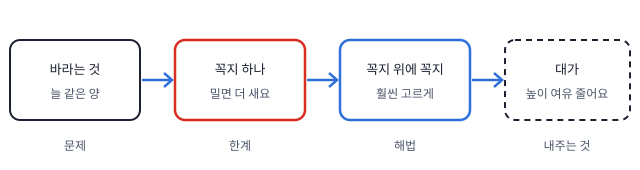

*겹쳐 단 꼭지는 물이 훨씬 고르게 나오지만, 위에 남는 높이 여유가 줄어요.*

**정확히 말하면**

이번 범위는 BJT 소신호 모델과 전류원으로서의 캐스코드(cascode), 두 가지예요. 하나의 질문으로 이어져요. 증폭기 이득을 어떻게 계산하고, 어떻게 키울까.

**1. 풀고 싶은 문제**

증폭기의 이득을 손으로 계산하고, 더 키우고 싶어요. 이득은 트랜지스터의 $g_m$과 출력 쪽 저항이 정해요.

$$
A_v = -g_m R_D
$$

요즘 IC는 대부분 MOSFET이지만, 수십 GHz 이상의 고주파나 수~수십 W급 고전력 회로에는 BJT도 써요. 그래서 BJT도 같은 방법으로 해석할 수 있어야 해요([MOS와 BJT: 같은 전류원, 다른 입력 전류](#s0-mos-vs-bjt), [소신호와 트랜스컨덕턴스 g_m](#s1-gm)).

**2. 단순한 해법과 그 한계**

BJT 쪽: 대신호 식 $I_C = I_S \exp\frac{V_{BE}}{V_T}$를 그대로 KCL·KVL에 넣으면 지수 함수 때문에 방정식을 풀기 어려워요. MOS 소신호 모델을 그대로 가져오면 베이스 전류 $I_B = \frac{I_C}{\beta}$가 빠져서 맞지 않아요([베이스 전류를 모델링하는 r_π](#s1-rpi)).

전류원 쪽: 트랜지스터 하나로 만든 전류원은 출력저항이 유한한 $r_O$예요. 그래서 전류가 양단 전압을 따라 변하고, 부하를 아무리 키워도 이득이 $g_m r_O$에서 멈춰요([Early 효과와 출력저항 r_O](#s1-early), [왜 캐스코드인가: 유한한 출력저항](#s2-why)).

$$
|A_v| \to g_m r_O
$$

**3. 핵심 아이디어**

BJT 소신호 모델: 동작점에서 선형화해 MOS와 같은 $g_m$, $r_O$ 틀을 쓰고, 베이스 전류만 저항 $r_\pi$ 하나로 더해요. PNP는 NPN 식에 절댓값만 씌워요([PNP는 절댓값만 씌우면 된다](#s1-pnp)).

캐스코드: 전류원 트랜지스터 위에 트랜지스터를 하나 더 쌓아요. 전류는 아래 트랜지스터가 그대로 정하고([쌓아도 전류는 그대로: M1은 전류의 통로](#s2-stack)), 출력저항은 위 트랜지스터의 $g_m r_O$배로 커져요([캐스코드의 출력저항 R_out 유도](#s2-rout)).

$$
R_{out} \approx g_{m1} r_{O1} r_{O2}
$$

**4. 대가와 쓰이는 곳**

BJT 모델의 대가는 $r_\pi$ 때문에 식이 MOS보다 조금 복잡해지는 거예요.

캐스코드는 전력 소모가 늘지 않고, 트랜지스터 하나가 더 드는 것도 큰 문제가 아니에요. 진짜 대가는 전압 헤드룸(voltage headroom)이에요. 두 트랜지스터가 모두 포화 영역이어야 해서 출력에 최소 $V_{ov1} + V_{ov2}$가 필요해요([캐스코드의 단점: 전압 헤드룸](#s2-headroom)).

캐스코드는 고이득 증폭기와 정밀한 전류원 같은 고성능 회로에 써요. 증폭기로서의 캐스코드는 다음 시간에 다뤄요([다음 시간 예고](#s3-next)).

**교수님 말씀**

BJT도 다시 보는 이유를 이렇게 말씀하셨어요.

> "모스와 BJT는 어느 하나를 알면 나머지를 알기가 쉽습니다" (0909 02:44)

선형 모델이 필요한 이유예요.

> "익스포넨셜 함수가 들어가면 방정식 풀기가 불가능합니다" (0909 10:19)

트랜지스터 전류원의 한계와 그 답이에요.

> "양단의 전압이 변했을 때 전류가 안 변했으면 좋겠는데" (0909 41:21)

> "고민해서 나온 게 캐스코드 스테이지가 되겠습니다" (0909 44:08)

그리고 대가예요.

> "트랜지스터가 위로 쌓이게 되면 전압을 먹죠." (0909 70:23)

**보충 · 수업에서 유도하진 않았어요**

Razavi 9장 도입부(449쪽)는 캐스코드 단을 공통 이미터·공통 소스 구조를 고친 형태로 소개하고, 이 장의 각 기본 구성 요소를 바이폴라와 MOS 두 가지로 구현해 본다고 해요. BJT 소신호 모델을 MOS와 같은 틀로 정리해 두면 두 구현을 같은 식으로 읽을 수 있어요. 캐스코드라는 이름은 진공관 시대의 "cascaded triode"를 줄인 말로 여겨진다고 해요.

출력저항을 키우는 다른 단순한 방법은 이미터나 소스에 축퇴 저항을 다는 거예요(Razavi 9.1.1, 450쪽). 저항을 키울수록 그 위의 전압 강하도 커져서 여유 전압을 더 먹어요. 캐스코드는 저항 대신 트랜지스터를 두어, 큰 소신호 저항 $r_{O2}$를 얻으면서 전류와 무관한 헤드룸만 써요.

**페이지 요약**

BJT도 MOS와 같은 소신호 틀로 보면, 하나짜리 전류원의 유한한 $r_O$가 보이고, 트랜지스터를 쌓는 캐스코드로 헤드룸을 내주고 출력저항을 키워요.

*핵심 식*

- 하나일 때 이득 한계

  $$
  |A_v| \to g_m r_O
  $$
- 캐스코드 출력저항

  $$
  R_{out} \approx g_{m1} r_{O1} r_{O2}
  $$
- 캐스코드 최소 출력 전압

  $$
  V_{ov1} + V_{ov2}
  $$

*용어*

- **캐스코드(cascode)** — 전류원 트랜지스터 위에 트랜지스터를 하나 더 쌓은 구조
- **전압 헤드룸(voltage headroom)** — 쌓은 트랜지스터가 모두 포화로 동작하려고 떼어 둬야 하는 전압 여유

---

## 1. MOS와 BJT, 그리고 BJT 대신호 모델

### MOS와 BJT: 같은 전류원, 다른 입력 전류

*0909 수업 · L02 s21*

**쉽게 말하면**

둘 다 물 양을 정하는 수도꼭지인데, 한쪽은 손잡이를 쥐고 있는 동안 손잡이로도 물이 조금씩 들어가요.

그 조금이 수백만 개 모이면 큰 물이 되어서, 요즘 기계 속에는 손잡이로 물이 안 드는 쪽을 주로 써요.

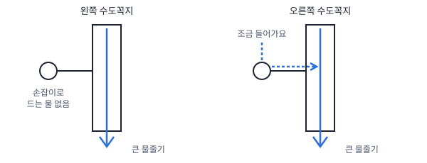

*왼쪽은 손잡이로 드는 물이 없고, 오른쪽은 손잡이로도 물이 조금 들어가요.*

**정확히 말하면**

MOSFET과 BJT는 둘 다 전류원(current source)으로 동작해요. 전류를 정하는 법칙과 동작 영역의 이름만 달라요.

- MOSFET은 포화 영역(saturation region)에서 전류원이에요. 드레인 전류는 $V_{GS}-V_{TH}$의 제곱에 비례해요: $I_D=\tfrac12\mu_nC_{ox}\tfrac{W}{L}(V_{GS}-V_{TH})^2$.
- BJT는 순방향 활성 영역(forward active region)에서 전류원이에요. 컬렉터 전류는 $V_{BE}$의 지수 함수(exponential)에 비례해요: $I_C=I_S\exp\frac{V_{BE}}{V_T}$.

가장 큰 차이는 입력 단자로 흐르는 전류예요.

- MOSFET은 게이트와 소스 사이가 절연체(산화막)라서 게이트 전류(gate current)가 0이에요.
- BJT는 베이스로 전류가 흘러요. 베이스 전류(base current)는 컬렉터 전류의 $\beta$분의 1이에요.

$$
I_B = \frac{I_C}{\beta}
$$

$\beta$가 커서 $I_B$는 작지만, 0이 아니라 유한한 값이에요. 이것은 누설 전류가 아니라 정상 동작 중에 흐르는 전류예요.

| 구분 | MOSFET | BJT |
|---|---|---|
| 전류 법칙 | 제곱 법칙 $(V_{GS}-V_{TH})^2$ | 지수 법칙 $\exp\frac{V_{BE}}{V_T}$ |
| 전류원 영역 | 포화 영역 | 순방향 활성 영역 |
| 입력 전류 | 게이트 전류 0 | 베이스 전류 $I_B = \frac{I_C}{\beta}$ |
| 주로 쓰는 곳 | 디지털·아날로그 IC 대부분 | 수십 GHz 이상 고주파, 수~수십 W 고전력 |

BJT가 먼저 개발됐지만 요즘 IC는 대부분 MOSFET으로 만들어요. 이유는 두 가지예요.

1. 디지털(digital) 로직: 트랜지스터 하나의 베이스 전류는 작아도, 수백만 개의 베이스 전류를 합치면 매우 큰 전류가 돼요. 그래서 BJT로는 디지털 로직 회로를 만들기 어려워요.
2. 집적(integration): 요즘은 아날로그 회로와 디지털 회로를 한 칩에 함께 넣어요. 디지털이 MOSFET이므로 아날로그도 MOSFET으로 만들어야 같은 공정으로 한 칩에 넣을 수 있어요.

BJT는 수십 GHz 이상의 고주파 회로나 수~수십 W급 고전력 회로 같은 특수한 용도에 일부 쓰여요.

교과서(Razavi)는 BJT를 먼저 다루지만, 이 수업은 MOSFET을 먼저 다루고 BJT를 뒤에 다뤄요. 두 소자는 개념이 같아서 하나를 알면 나머지를 이해하기 쉬워요. BJT는 베이스 전류 때문에 식이 조금 더 복잡할 뿐이에요.

BJT의 구조와 동작 조건은 0904 정리노트의 [BJT의 구조와 동작 조건](../0904/정리노트_0904_MOS_Small_Signal_Model.html#s4-bjt-intro)에 있어요.

**교수님 말씀**

BJT의 베이스 전류가 디지털에서 문제가 되는 이유를 트랜지스터 개수로 설명하셨어요.

> 수백만 개 쓰이게 되면 엄청나게 큰 전류가 되기 때문에 디지털 회로에서는 BJT를 쓸 수가 없습니다 (0909 01:28)

BJT가 쓰이는 곳으로는 모바일에서 쓰는 전력보다 훨씬 큰, 수 W에서 수십 W급 전력을 예로 드셨어요(0909 02:01).

두 소자를 다 배우는 이유도 말씀하셨어요.

> 모스와 BJT는 어느 하나를 알면 나머지를 알기가 쉽습니다 (0909 02:44)

**꼭 기억해요**

수업이 교과서와 달리 MOSFET을 먼저 하는 이유예요.

> 모스가 더 중요하기도 하고, 모스를 알면 BJT로 큰 어려움이 없으니까 (0909 03:17)

MOSFET과 BJT의 가장 큰 차이는 입력 전류예요. 게이트 전류는 0이고, 베이스 전류는 작지만 유한해요(0909 00:51).

**페이지 요약**

MOSFET과 BJT는 둘 다 전류원인데, BJT만 입력 단자로 베이스 전류가 흘러요.

*핵심 식*

- 베이스 전류

  $$
  I_B = \frac{I_C}{\beta}
  $$

*용어*

- **게이트 전류(gate current)** — MOSFET은 게이트가 절연체라 0이에요.
- **베이스 전류(base current)** — BJT 베이스로 흐르는 작지만 유한한 전류예요.
- **디지털(digital) 로직** — 수백만 개의 베이스 전류가 쌓여 BJT로는 만들기 어려워요.

---

### BJT의 I/V 특성과 대신호 모델

*0909 수업 · L02 s21–s22*

**쉽게 말하면**

손잡이로 물 양을 정하면, 뒤에서 물을 얼마나 세게 밀어도 그 양이 그대로 나오는 수도꼭지예요.

손잡이를 조금만 더 돌려도 물은 훨씬 많이 늘어나요.

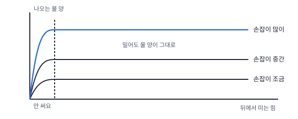

*선마다 손잡이 자리가 다르고, 맨 앞 짧은 오르막 구간은 쓰지 않아요.*

**정확히 말하면**

대신호 모델(large-signal model)은 신호 크기와 상관없이 쓰는 일반 모델이에요. DC 바이어스 전압과 전류, 곧 동작점(operating point)을 구할 때 써요.

소신호 모델(small-signal model)은 동작점이 정해진 상태에서 작은 입력 변화가 출력 변화로 어떻게 이어지는지를 봐요. 이것은 [소신호와 트랜스컨덕턴스 g_m](#s1-gm)에서 이어가요.

BJT 대신호 모델은 두 부품으로 되어 있어요(L02 s21).

- 베이스–에미터 사이: 다이오드(diode)
- 컬렉터–에미터 사이: 전압 제어 전류원(voltage-controlled current source). 크기는 $V_{BE}$가 정해요.

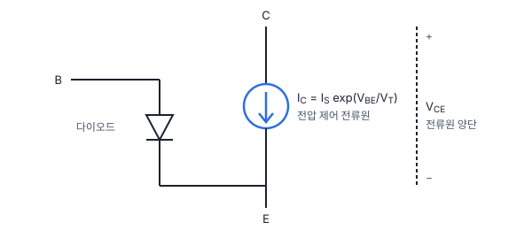

*다이오드는 B–E 사이, 전류원은 C–E 사이에 있어요. 전류원 양단 전압은 VCE예요.*

**$I_C$–$V_{BE}$ 특성**: 순방향 활성 영역에서 컬렉터 전류는 $V_{BE}$의 지수 함수예요(L02 s22).

$$
I_C = I_S \exp\frac{V_{BE}}{V_T}
$$

MOSFET의 제곱 법칙과 비교하면 지수 함수가 더 급격히 증가해요.

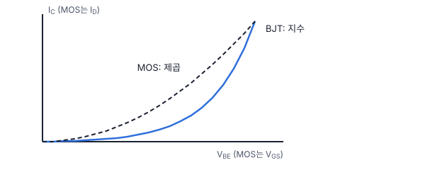

*지수 곡선(강조색 실선)이 제곱 곡선(점선)보다 뒤에서 더 가파르게 올라가요.*

**$I_C$–$V_{CE}$ 특성**: 순방향 활성 영역에서는 $V_{CE}$를 바꿔도 $I_C$가 변하지 않아요. 그래서 BJT는 컬렉터–에미터 사이에서 전류원(current source)으로 동작해요.

1. 전류원 양단의 전압은 $V_{CE}$예요. $V_{BE}$는 양단 전압이 아니에요.
2. $V_{BE}$는 전류의 크기만 정해요: $I_C = I_S \exp\frac{V_{BE}}{V_T}$.
3. $V_{BE}$를 올리면 $I_C$–$V_{CE}$ 곡선의 평평한 높이가 지수적으로 올라가요.

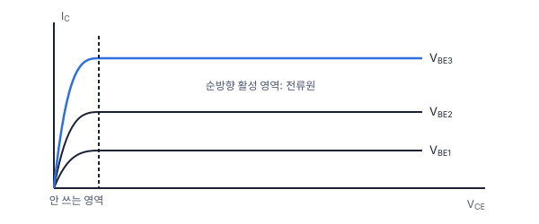

*VBE3가 가장 크고 VBE1이 가장 작아요. 평평한 구간에서 IC는 VCE와 상관없어요.*

$V_{CE}$가 작은 구간에서는 $I_C$가 $V_{CE}$에 거의 선형으로 변해요. MOSFET은 이런 구간(triode)을 저항으로 쓸 수 있지만, BJT는 베이스 전류가 흘러 단자 세 개로 전류가 오가므로 저항으로 쓰기 어려워요. 그래서 이 수업에서는 이 구간을 쓰지 않는 영역으로 보고 넘어가요.

**교수님 말씀**

전류원의 양단 전압을 헷갈리지 말라고 짚으셨어요.

> VBE는 양단의 전압이 아니라 양단의 전압은 VCE가 되는 거예요 (0909 05:21)

작은 $V_{CE}$ 구간은 깊이 볼 필요가 없다고 하셨어요.

> 여기 이해할 필요 없어요. 어차피 안 쓰는 영역이라고 보면 되겠습니다 (0909 06:00)

제곱 곡선을 먼저 그린 뒤 그 위에 지수 곡선을 겹쳐 그리며, 지수 함수가 더 급격히 올라간다고 비교하셨어요(0909 04:39).

**페이지 요약**

BJT는 순방향 활성 영역에서 $V_{BE}$가 크기를 정하고 양단 전압이 $V_{CE}$인 전류원이에요.

*핵심 식*

- 컬렉터 전류

  $$
  I_C = I_S \exp\frac{V_{BE}}{V_T}
  $$

*용어*

- **대신호 모델(large-signal model)** — 동작점(DC 바이어스)을 구할 때 쓰는 일반 모델이에요.
- **순방향 활성 영역(forward active region)** — $I_C$가 $V_{CE}$와 상관없이 일정한 영역이에요.
- **전류원(current source)** — 양단 전압 $V_{CE}$가 변해도 전류가 일정한 소자예요.

---

## 2. BJT 소신호 모델

### 소신호와 트랜스컨덕턴스 g_m

*0909 수업 · L02 s23–s24*

**쉽게 말하면**

지금 서 있는 비탈에서 한 걸음 옮기면 얼마나 올라가는지, 그 가파른 정도예요.

높은 곳에 설수록 비탈이 가팔라서, 같은 한 걸음에도 더 많이 올라가요.

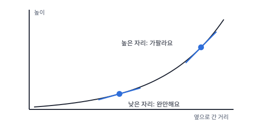

*색칠된 점이 서 있는 자리이고, 강조색 곧은 선의 기울기가 그 자리의 가파른 정도예요.*

**정확히 말하면**

대신호 모델(large-signal model)은 DC 바이어스 전압·전류, 곧 동작점(operating point) $(V_{BE0}, I_{C0})$을 구할 때 써요. 소신호 모델(small-signal model)은 그 동작점 위에서 입력이 조금 변할 때 출력이 얼마나 변하는지만 봐요.

동작점의 $V_{BE0}$에 작은 주기 신호 $\Delta V$를 더하면 컬렉터 전류가 $\Delta I$만큼 변해요. 트랜지스터는 입력이 전압이고 출력이 전류인 소자예요.

두 변화량의 관계를 직선으로 두면, 그 비례 상수가 트랜스컨덕턴스(transconductance) $g_m$이에요.

$$
\Delta I = g_m \Delta V
$$

$g_m$은 동작점에서 $I_C$–$V_{BE}$ 곡선에 그은 접선의 기울기예요.

- 이것은 소신호 근사(small-signal approximation)예요. 접선은 접점, 곧 동작점 근처에서만 곡선과 맞아요. 신호가 커지면 접선과 실제 곡선의 차이만큼 오차가 생겨요.
- 선형으로 두는 이유: KCL·KVL로 세운 연립방정식에 제곱 함수나 지수 함수가 들어가면 풀기 어려워요. 동작점 근처에서 선형이라고 가정하면 회로 이론의 방법을 그대로 쓸 수 있어요.
- 동작점이 바뀌면(예: $V_{BE0}$를 $V_{BE1}$로 올리면) 바이어스 전류도, 접선 기울기도 바뀌어요. 소신호 파라미터는 동작점의 함수예요. $I_C$가 클수록 기울기가 커서 $g_m$도 커요.

순방향 활성 영역(forward active region)에서 $I_C = I_S\exp\dfrac{V_{BE}}{V_T}$예요. $g_m$은 $\Delta I_C$와 $\Delta V_{BE}$의 비이고, $\Delta$가 0으로 가면 미분이 돼요.

1. $g_m = \dfrac{\Delta I_C}{\Delta V_{BE}} \to \dfrac{dI_C}{dV_{BE}}$
2. $= \dfrac{d}{dV_{BE}}\left[I_S\exp\dfrac{V_{BE}}{V_T}\right]$
3. $= \dfrac{1}{V_T}\,I_S\exp\dfrac{V_{BE}}{V_T}$
4. $I_S\exp(V_{BE}/V_T)$는 $I_C$ 자신이므로

   $$
   g_m = \frac{I_C}{V_T}
   $$

여기서 $I_C$는 바이어스 전류 $I_{C0}$이고, $V_T$는 상수예요. 그래서 $g_m$은 $I_C$에 비례하고, 동작점에서만 쓸 수 있는 값이에요.

$g_m$은 $V_{BE}$와 $I_C$의 관계가 아니에요. $V_{BE}$의 변화량과 $I_C$의 변화량의 관계예요. 전압 변화에 대해 전류 변화가 얼마나 생기는지를 나타내요.

**전압 이득과 $g_m$**

증폭기의 목적은 DC 출력이 아니라, 입력 변화량에 대한 출력 변화량인 (소신호) 전압 이득(voltage gain)이에요. 트랜지스터는 전류 변화만 만들어요. 그래서 출력에 부하 저항 $R_D$를 달아 전류 변화에 저항을 곱해 전압 변화로 바꿔요. 가장 간단한 전압 증폭기는 트랜지스터 1개와 저항 1개예요.

$$
A_v = -g_m R_D
$$

이득은 트랜지스터가 전류원으로 동작하기 때문에 생겨요. 트랜지스터가 저항으로만 동작하면 두 저항의 전압 분배일 뿐이라 이득이 없어요. 이득 유도는 [0904 정리노트: CS 증폭기 이득 A_v = -g_m R_D](../0904/정리노트_0904_MOS_Small_Signal_Model.html#s3-cs-gain)에 있어요.

#### 직접 해 보기: 동작점을 옮기면 접선이 얼마나 가팔라질까 *(정적 스냅샷 — 직접 조작은 HTML 버전)*

동작점 $V_{BE0}$를 오른쪽으로 옮기면 접선이 가팔라지고($g_m$ 증가), 신호 크기 $\Delta V$를 키우면 곡선 위의 점과 접선 위의 점이 벌어져 오차가 커져요.

가정: $I_S = 10^{-15}\,\mathrm{A}$, $V_T = 26\,\mathrm{mV}$(상온). 오차는 (곡선의 전류 변화와 접선의 전류 변화의 차이) ÷ 곡선의 전류 변화예요.

**VBE0 = 0.720 V: IC0 = 1.06 mA, 접선 기울기 gm = IC0/VT = 40.9 mS. ΔV = 10 mV: 실제 곡선의 전류 변화 +0.499 / −0.339 mA, 접선의 전류 변화 ±0.409 mA, 접선 근사 오차 18.0 % / 20.5 %**

범례: 지수 곡선 $I_C = I_S\exp(V_{BE}/V_T)$ · 동작점 접선(기울기 $g_m$) · 동작점과 곡선 위의 점 · 접선 위의 점 · 세로 점선: $V_{BE0}\pm\Delta V$

$\Delta V$가 같으면 동작점을 옮겨도 오차(%)는 그대로예요. $g_m$이 바이어스 전류에 비례해서 접선도 곡선과 같은 비율로 커지기 때문이에요. 오차는 $\Delta V$가 $V_T$보다 얼마나 작은지로 정해져요. $\Delta V$가 2 mV이면 오차가 약 4%, 20 mV이면 34%와 43%예요.

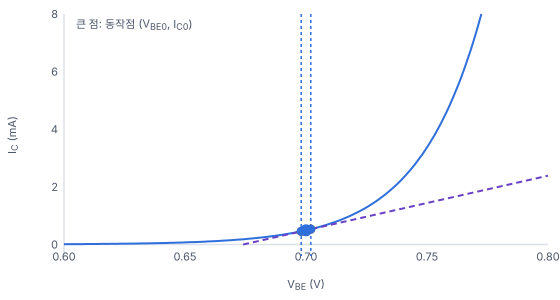

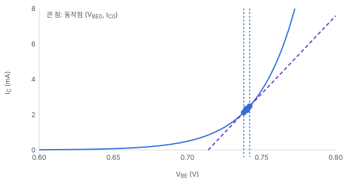

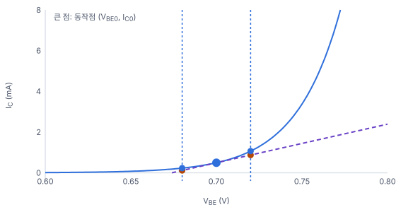

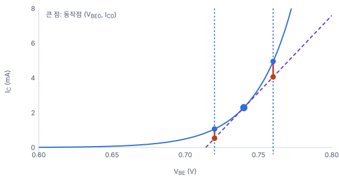

| 설정 (VBE0, ΔV) | IC0 | gm = IC0/VT | 곡선의 전류 변화 (+ΔV / −ΔV) | 접선의 전류 변화 | 접선 근사 오차 (+ΔV / −ΔV) |
|---|---|---|---|---|---|
| 0.70 V, 2 mV | 0.49 mA | 18.9 mS | +0.039 / −0.036 mA | ±0.038 mA | 3.8% / 3.9% |
| 0.74 V, 2 mV | 2.29 mA | 88.3 mS | +0.183 / −0.170 mA | ±0.177 mA | 3.8% / 3.9% |
| 0.70 V, 20 mV | 0.49 mA | 18.9 mS | +0.571 / −0.264 mA | ±0.379 mA | 33.6% / 43.3% |
| 0.74 V, 20 mV | 2.29 mA | 88.3 mS | +2.657 / −1.231 mA | ±1.765 mA | 33.6% / 43.3% |

**교수님 말씀**

전자회로1에서 배운 내용이라 리뷰하는 개념으로 조금 빨리 지나가겠다고 하셨어요(0909 17:44).

> "트랜지스터는 기본적으로 입력이 전압이고 출력이 전류인 소자예요" (0909 07:38)

왜 선형으로 간략화하는지를 이렇게 설명하셨어요.

> "KCL KVL로 식을 세웠는데 거기에 이차 함수 익스포넨셜 함수가 들어가면 방정식 풀기가 불가능합니다" (0909 10:19)

바이어스 포인트가 바뀌었는데 예전 접선을 그대로 쓰면 "당연히 안 맞겠죠"라고 하셨어요(0909 11:23).

"트랜지스터가 저항으로 동작하면 이득을 얻을 수 있나요?"라고 물으신 뒤, 저항이면 두 저항으로 나뉠 뿐이라 이득이 없다고 답하셨어요(0909 16:54–17:05).

**꼭 기억해요**

> "구별해야 됩니다. IC와 V_BE의 관계를 나타내는 게 아니고요, V_BE의 변화량과 IC의 변화량의 관계를 나타냅니다." (0909 14:21)

> "전압 이득을 결정하는 가장 중요한 것이 트랜스컨덕턴스이다 보니까" (0909 15:38)

**페이지 요약**

$g_m$은 동작점에서 그은 접선의 기울기이고, 바이어스 전류에 비례해요.

*핵심 식*

- 소신호 관계

  $$
  \Delta I = g_m \Delta V
  $$
- 트랜스컨덕턴스

  $$
  g_m = \frac{I_C}{V_T}
  $$
- 가장 간단한 증폭기 이득

  $$
  A_v = -g_m R_D
  $$

*용어*

- **동작점(operating point)** — DC 바이어스 $(V_{BE0}, I_{C0})$, 소신호 파라미터가 여기서 정해져요
- **소신호 근사(small-signal approximation)** — 동작점 근처의 곡선을 접선으로 바꿔 보는 것, 신호가 작을 때만 정확해요
- **트랜스컨덕턴스(transconductance)** — $V_{BE}$ 변화량에 대한 $I_C$ 변화량의 비

---

### 베이스 전류를 모델링하는 r_π

*0909 수업 · L02 s25*

**쉽게 말하면**

손잡이를 돌려 큰 물줄기를 조절하는데, 손잡이 쪽에서도 물이 조금 새어 들어와요.

새는 양은 작지만 없는 게 아니라서, 그 길을 가는 관 하나로 따로 그려 둬요.

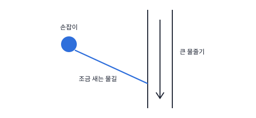

*선 두 줄로 그린 관이 큰 물줄기이고, 색칠된 손잡이에서 강조색 가는 선을 따라 물이 조금 새어 들어가요.*

**정확히 말하면**

소신호는 변화량이라 소문자로 써요: $v_{be}$(또는 $v_\pi$), $i_c$, $i_b$. 컬렉터 전류 변화량은 $g_m$에 비례해요.

$$
i_c = g_m v_\pi
$$

소신호 모델에서는 DC 성분을 모두 없애요. DC 전압·전류는 변화량이 0이기 때문이에요.

- DC 전압원: 전압 변화가 0이면 접지와 같아요. 그래서 교류 접지(AC ground)가 돼요.
- DC 전류원: 전류 변화가 0이면 저항이 무한대, 곧 개방(open)이에요.

MOS와 BJT의 소신호 등가회로는 노드 이름만 달라요($g_m v_{gs}$와 $g_m v_{be}$). 제곱 함수를 선형화하든 지수 함수를 선형화하든, 선형 비례 상수를 $g_m$으로 두는 것은 같아요.

차이는 베이스 전류예요. MOS는 게이트 전류 변화가 0이지만, BJT는 베이스 전류 변화 $i_b$가 0이 아니에요($I_B = I_C/\beta$). B–E 접합은 순방향 바이어스된 다이오드처럼 동작하므로, $v_{be}$와 $i_b$의 관계를 저항 $r_\pi$로 모델링해요.

1. $\dfrac{1}{r_\pi} = \dfrac{\partial I_B}{\partial V_{BE}}$
2. $I_B = \dfrac{I_C}{\beta}$이므로 $= \dfrac{1}{\beta}\dfrac{\partial I_C}{\partial V_{BE}}$
3. $\dfrac{\partial I_C}{\partial V_{BE}} = g_m$이므로 $= \dfrac{g_m}{\beta}$
4. 역수를 취하면

   $$
   r_\pi = \frac{\beta}{g_m}
   $$

- $r_\pi$는 전류원이 아니라 저항이에요. 베이스 전압에 따라 베이스 전류가 바뀌기 때문이에요.
- $\beta$는 보통 100(공정에 따라 50–200)이에요. 그래서 $r_\pi$는 $1/g_m$의 약 100배, 곧 수 kΩ~수십 kΩ이에요.
- $i_b$는 작지만 0이 아니에요. 그만큼 소신호 식이 복잡해져요.

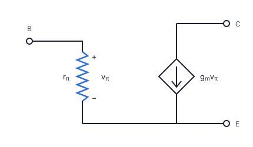

*BJT 소신호 등가회로: B–E 사이 $r_\pi$, C–E 사이 종속 전류원 $g_m v_\pi$. C–E 사이 $r_O$는 [Early 효과와 출력저항 r_O](#s1-early)에서 더해요.*

**교수님 말씀**

"전류가 0이라는 말은 뭐예요?"라고 물으시자 학생들이 "저항이 무한대", "오픈"이라고 답했어요. 교수님은 "잘 대답했는데 저항이 무한대 오픈과 같은 의미"라고 받으셨어요(0909 20:25–20:34).

$r_\pi$ 유도 중에 "i_B가 뭐라 그랬어요?"라고 물으시자 학생들이 "베타분의 1 ic", "gm분의 베타"로 이어 답했어요(0909 24:16–24:58).

> "뭐 노드 이름만 다르고 gm v_gs, 똑같잖아요." (0909 21:42)

$r_\pi$ 때문에 식이 "좀 지저분해지죠"라고 하시며 MOSFET 쪽을 편드셨어요.

> "MOSFET이 더 낫죠. 게이트 쪽으로 전류가 흐르지 않으니까." (0909 26:29)

**페이지 요약**

BJT는 베이스 전류가 흘러서, MOS 소신호 모델에 B–E 사이 저항 $r_\pi$ 하나를 더해요.

*핵심 식*

- 컬렉터 전류 변화

  $$
  i_c = g_m v_\pi
  $$
- 베이스 쪽 저항

  $$
  r_\pi = \frac{\beta}{g_m}
  $$

*용어*

- **교류 접지(AC ground)** — DC 전압원은 변화량이 0이라 소신호에서 접지가 돼요
- **개방(open)** — DC 전류원은 전류 변화가 0이라 소신호에서 끊긴 선이 돼요
- **베이스 쪽 저항 $r_\pi$** — B–E 사이 $v_{be}$와 $i_b$의 관계를 나타내는 저항, $1/g_m$의 약 $\beta$배

---

### Early 효과와 출력저항 r_O

*0909 수업 · L02 s26*

**쉽게 말하면**

아무리 세게 밀어도 똑같이 나와야 할 수도꼭지가, 실제로는 세게 밀수록 아주 조금 더 나와요.

작은 차이지만, 모른 척하면 계산이 틀어져요.

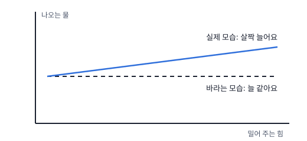

*점선은 늘 같은 바라는 모습, 강조색 선은 살짝 올라가는 실제 모습이에요.*

**정확히 말하면**

이상적인 전류원이라면 $V_{CE}$가 변해도 $I_C$가 일정해야 해요. 실제로는 $V_{CE}$를 올리면 $I_C$가 아주 조금 늘어요. 이것이 Early 효과(Early effect)예요. Early는 사람 이름이고, $V_A$는 Early 전압(Early voltage)이에요.

$V_A$는 대략 10 V(공정에 따라 5–10 V)예요. MOS의 채널 길이 변조(channel-length modulation)와 비교하면 크기가 비슷해요.

- MOS: $\lambda \approx 0.1\,\mathrm{V^{-1}}$이면 $V_{DS}$가 1 V 오를 때 전류가 약 10% 늘어요.
- BJT: $V_A \approx 10\,\mathrm{V}$이면 $V_{CE}$가 1 V 오를 때 전류가 약 10% 늘어요.

DC 전류를 구할 때는 보통 무시해도 돼요. 소신호에서는 달라요. 이상적인 전류원은 양단 전압을 아무리 바꿔도 전류 변화가 없으니 저항이 무한대예요. 실제 트랜지스터는 유한한 저항을 가지므로, 이를 출력저항(output resistance) $r_O$로 모델링해요.

1. $I_C = I_S\exp\dfrac{V_{BE}}{V_T}\left(1+\dfrac{V_{CE}}{V_A}\right)$
2. $\dfrac{\partial I_C}{\partial V_{CE}} = I_S\exp\dfrac{V_{BE}}{V_T}\cdot\dfrac{1}{V_A}$
3. 역수를 취하면 $r_O = \dfrac{V_A}{I_S\exp(V_{BE}/V_T)}$
4. $I_S\exp(V_{BE}/V_T) \approx I_C$이므로

   $$
   r_O = \frac{V_A}{I_C}
   $$

$I_C$는 바이어스 전류, $V_A$는 상수예요. $r_O$는 보통 수십 kΩ으로, 무한대는 아니지만 큰 값이에요.

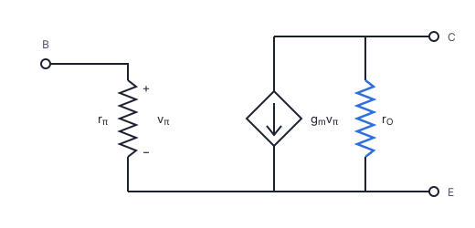

*완성된 BJT 소신호 등가회로: B–E 사이 $r_\pi$, C–E 사이 $g_m v_\pi$와 $r_O$가 병렬이에요.*

**$r_O$를 넣어야 하는 이유**

무한대와 유한은 차이가 커서, 보통 $r_O$를 넣고 해석하는 편이 좋아요. 부하 저항 $R_D$가 $r_O$보다 충분히 작으면 $r_O$의 영향이 작아요. 부하에 큰 저항을 달면 $r_O$가 드러나요. $r_O$를 넣은 이득은 다음과 같아요(L02 s18).

$$
A_v = -g_m (R_D \parallel r_O)
$$

극단적으로 $R_D\to\infty$로 두어도 이득은 무한대가 되지 않아요. $R_D \parallel r_O \to r_O$이므로 이득의 크기는 $g_m r_O$(intrinsic gain)에서 멈춰요.

$$
|A_v| \to g_m r_O
$$

MOS의 경우는 [0904 정리노트: 채널 길이 변조와 출력저항 r_O](../0904/정리노트_0904_MOS_Small_Signal_Model.html#s1-ro)에 있어요. 이 유한한 출력저항을 키우는 것이 다음 절의 출발점이에요: [왜 캐스코드인가: 유한한 출력저항](#s2-why).

**교수님 말씀**

> "얼리는 사람 이름이에요, 대문자로 쓰여 있죠." (0909 27:49)

$\lambda$와 비교하시며 "큰 효과는 아니에요"라고 하셨어요(0909 28:38). DC 전류를 구할 때는 무시해도 된다고 하셨지만, 소신호에서는 다르게 보셨어요.

> "무한대와 유한은 차이가 크죠, 그죠? … 일반적으로 ro는 고려하는 게 더 좋습니다." (0909 32:22–32:24)

부하 저항을 무한대로 두는 것은 개념상 극단이라 실제로는 불가능하다고 덧붙이셨어요(0909 32:57).

> "트랜지스터의 유한한 출력 저항 때문에 이득을 무한한 이득으로 얻을 수는 없습니다." (0909 33:13)

**페이지 요약**

Early 효과 때문에 BJT 전류원도 유한한 출력저항 $r_O$를 가지고, 이득의 크기는 $g_m r_O$에서 멈춰요.

*핵심 식*

- 출력저항

  $$
  r_O = \frac{V_A}{I_C}
  $$
- r_O를 넣은 이득

  $$
  A_v = -g_m (R_D \parallel r_O)
  $$
- 부하 무한대일 때

  $$
  |A_v| \to g_m r_O
  $$

*용어*

- **Early 효과(Early effect)** — $V_{CE}$를 올리면 $I_C$가 조금 늘어나는 현상
- **Early 전압 $V_A$** — 대략 10 V, 클수록 이상적인 전류원에 가까워요
- **채널 길이 변조(channel-length modulation)** — MOS에서 같은 결과를 내는 효과, $\lambda$로 나타내요

---

### PNP는 절댓값만 씌우면 된다

*0909 수업 · L02 s27–s28*

**쉽게 말하면**

모양은 똑같고 물줄기 방향만 반대인 수도꼭지 두 개예요.

하나를 위아래로 뒤집으면 다른 하나와 겹쳐서, 새 규칙 없이 같은 규칙을 크기만 보고 써요.

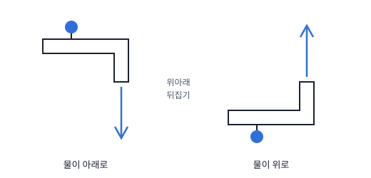

*오른쪽 수도꼭지는 왼쪽을 위아래로 뒤집은 것이라, 색칠된 손잡이와 강조색 물줄기 선의 방향만 반대예요.*

**정확히 말하면**

PNP는 NPN과 극성이 반대예요. 순방향 활성 영역에서 E–B 접합은 순방향 바이어스, B–C 접합은 역방향 바이어스예요. 그래서 이미터 전위가 가장 높고, 베이스가 그다음, 컬렉터가 가장 낮아요.

$$
V_E \gt V_B \gt V_C
$$

NMOS 식에 절댓값을 씌워 PMOS를 해석했던 것처럼, NPN 식에 절댓값을 씌워 PNP에 쓰면 돼요. PNP 식을 따로 외울 필요가 없어요. 이 방법은 [0904 정리노트: PMOS 식: 절댓값으로 통일](../0904/정리노트_0904_MOS_Small_Signal_Model.html#s2-pmos-eq)과 같아요.

- 대신호: $I_C = I_S\exp\dfrac{|V_{BE}|}{V_T}$이고, $|V_{BE}| = V_{EB}$예요. $I_C$는 전류의 크기로 읽어요.
- 소신호 파라미터 $g_m = \dfrac{I_C}{V_T}$, $r_\pi = \dfrac{\beta}{g_m}$, $r_O = \dfrac{V_A}{I_C}$는 식 그대로 써요.
- 극성을 하나하나 따지기보다, 극성이 반대라는 개념을 이해하고 관계식으로부터 극성을 정하면 돼요.

소신호 모델은 B–E 사이 $r_\pi$, C–E 사이 전류원 $g_m v_\pi$와 $r_O$예요. 이미터를 위에 그렸을 뿐 위아래를 뒤집으면 NPN과 같아서, PNP 소신호 모델은 NPN과 똑같아요. 전류 방향은 $v_{be}$의 극성이 처리해 줘요(L02 s28).

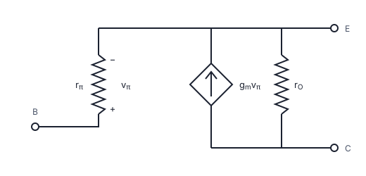

*PNP 소신호 모델을 이미터가 위에 오도록 그린 것이에요. 위아래를 뒤집으면 [Early 효과와 출력저항 r_O](#s1-early)의 NPN 등가회로와 같아요.*

**교수님 말씀**

NPN 식을 외우려고 극성을 따지다 보면 헷갈린다고 하셨어요.

> "괜히 극성을 따지면 좀 헷갈릴 수 있기 때문에" (0909 35:17)

BJT 복습을 마치며, 대신호·소신호 모델의 관계와 표현, 각 파라미터의 의미를 알면 회로 해석이 어렵지 않다고 하셨어요. 개념을 모르면 뒤가 계속 이해되지 않으니 전자회로1 앞 내용을 복습하라고 당부하셨어요.

> "처음에 이해가 안 되면 그다음 계속 이해가 안 되거든요." (0909 37:43)

**꼭 기억해요**

> "NPN 트랜지스터의 식을 기억할 텐데, 다 절댓값을 씌우면 됩니다." (0909 35:01)

> "각각의 파라미터의 의미가 뭐냐? 이런 것들을 좀 잘 기억해 두면, 사실은 회로를 해석하는 데 큰 어려움이 없겠습니다." (0909 36:52)

**페이지 요약**

PNP는 극성만 반대라서 NPN 식에 절댓값을 씌우면 되고, 소신호 모델은 NPN과 같아요.

*핵심 식*

- PNP 활성 영역의 전위 순서

  $$
  V_E \gt V_B \gt V_C
  $$

*용어*

- **PNP** — NPN과 극성이 반대인 BJT, 이미터 전위가 가장 높아요
- **절댓값 규칙** — NPN 식에 절댓값을 씌워 PNP에 그대로 써요
- **소신호 모델(small-signal model)** — PNP도 B–E 사이 $r_\pi$, C–E 사이 $g_m v_\pi$와 $r_O$로 NPN과 같아요

---

## 3. 전류원으로서의 캐스코드

### 왜 캐스코드인가: 유한한 출력저항

*0909 수업 · L03 s1–s3*

**쉽게 말하면**

좋은 전류 공급기는 양쪽 전압이 바뀌어도 늘 같은 양을 흘려야 하는데, 부품 하나로 만들면 조금씩 따라 흔들려요.

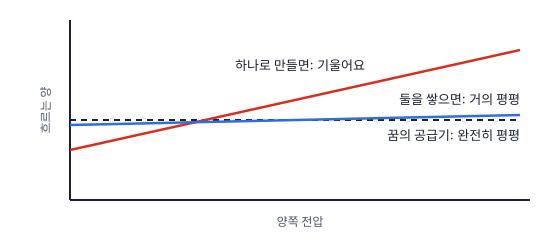

*선이 평평할수록 좋은 공급기예요. 둘을 쌓으면 기울기가 크게 줄어요.*

**정확히 말하면**

회로도에 그리는 전류원(current source) 기호는 따로 파는 부품이 아니에요. 저항이나 커패시터와 달리 전류원은 모두 트랜지스터(MOS나 BJT)로 구현해요. 트랜지스터는 기본적으로 전류원으로 동작하기 때문이에요.

이상적인 전류원은 출력저항(output resistance)이 무한대라서, 양단 전압이 변해도 전류가 변하지 않아요. 트랜지스터 하나로 만든 전류원은 출력저항이 $r_O$로 유한해요. 원인은 MOSFET의 채널 길이 변조와 BJT의 Early 효과예요. 물리적 원리는 다르지만 결과는 같아요([Early 효과와 출력저항 r_O](#s1-early)).

$$
r_O = \frac{1}{\lambda I_D} \quad (\text{MOS})
$$

$$
r_O = \frac{V_A}{I_C} \quad (\text{BJT})
$$

$$
\Delta I = \frac{\Delta V}{r_O}
$$

출력저항이 유한하면 단점이 두 가지 생겨요.

- 전류원으로서: 양단 전압이 변하면 전류가 변해서 부정확해요.
- 증폭기로서: 유한한 출력저항이 전압 이득을 제한해요. 부하를 아무리 키워도 $A_v = -g_m (R_D \parallel r_O)$는 $g_m r_O$를 넘지 못해요.

목표는 출력저항을 키워 이상적인 전류원에 더 가깝게 만드는 것이에요. 실제 환경에서 무한대로 만드는 것은 불가능해요. 예를 들어 전압이 변할 때 1 mA 변할 전류를 0.1 mA만 변하게 하고, 이득을 100에서 1000으로 올리는 거예요. 출력저항은 전압 이득과 직접 연관되어 있어요.

그 해답이 캐스코드(cascode)예요.

- 구조: 트랜지스터 위에 트랜지스터를 하나 더 쌓아요. 이것을 스태킹(stacking)이라고 해요.
- 결과: 출력저항이 크게 늘어나요([캐스코드의 출력저항 R_out 유도](#s2-rout)).
- 위치: 소스가 접지인 CS, 이미터가 접지인 CE 구조를 개선한 형태예요.
- 쓰임: 고이득 증폭기, 정밀한 전류원 같은 고성능 회로에 많이 써요.

Ch.9는 두 부분으로 되어 있어요. 앞부분은 캐스코드 단이고, 뒷부분은 증폭기가 아니라 바이어스 전류를 만드는 바이어스 회로예요([다음 시간 예고](#s3-next)). 캐스코드는 다시 ① 전류원으로서의 캐스코드와 ② 증폭기로서의 캐스코드로 나눠 봐요. 이 섹션은 ①이고, ②는 다음 시간에 다뤄요. 교과서에서는 Razavi 9.1.1이에요.

**교수님 말씀**

단일단 증폭기는 기본 중의 기본이고, 이번 장부터 이를 확장한 구조를 배워요. 교수님은 아무리 복잡한 회로도 결국 아는 블록으로 나눌 수 있다고 했어요. 어려운 부분은 해석이 아니라 나누는 일이에요.

> "커런트 소스는 따로 커런트 소스 부품이 있는 게 아니에요. 트랜지스터로 구현하는 겁니다." (0909 40:59)

출력저항을 키우는 이유는 두 가지로 정리했어요. 전류원으로서는 전류가 변하지 않는 더 정확한 전류원, 증폭기로서는 하이 게인이에요.

**꼭 기억해요**

> "어떻게 하면 키울 수 있느냐. 이게 … 앰프 설계에서는 아주 중요한 이슈가 되고요." (0909 43:38)

출력저항을 키운다는 말은 곧 이상적인 전류원에 더 가깝게 만든다는 말이에요.

**페이지 요약**

트랜지스터 하나로 만든 전류원은 출력저항이 $r_O$로 유한해서, 트랜지스터를 쌓는 캐스코드로 출력저항을 키워요.

*핵심 식*

- MOS 출력저항

  $$
  r_O = \frac{1}{\lambda I_D}
  $$
- 전압 변화에 따른 전류 변화

  $$
  \Delta I = \frac{\Delta V}{r_O}
  $$

*용어*

- **이상적인 전류원** — 출력저항이 무한대라 양단 전압과 무관하게 전류가 일정한 소자
- **캐스코드(cascode)** — 트랜지스터 위에 트랜지스터를 쌓은(stacking) 구조

---

### 쌓아도 전류는 그대로: M1은 전류의 통로

*0909 수업 · L03 s4–s5*

**쉽게 말하면**

관에 문을 하나 더 달아도 흐르는 양은 아래 문이 정하고, 위 문은 지나가게만 해요.

*문을 몇 개 달아도 물방울 수는 어디서나 같아요.*

**정확히 말하면**

전류원은 트랜지스터 $M_2$ 하나(게이트 $V_{b2}$, 소스 접지)로 만들 수 있어요. 캐스코드는 그 위에 $M_1$(게이트 $V_{b1}$)을 하나 더 쌓은 구조이고, 이것도 전류원이에요. 슬라이드 s5의 "전류원 위에 트랜지스터를 쌓은 것"이라는 해석과 같은 그림이에요.

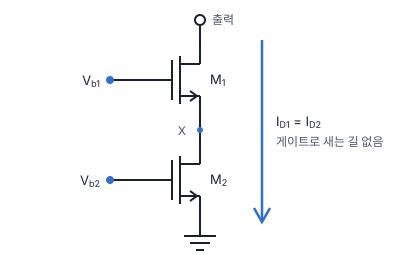

*NMOS 캐스코드 전류원(Razavi Fig 9.8 왼쪽과 같은 회로). $M_1$과 $M_2$ 사이 노드가 X예요.*

DC 전류는 $M_2$가 정해요. 채널 길이 변조는 무시하고, $M_2$의 소스가 접지라 $V_{GS2} = V_{b2}$예요.

$$
I_{D2} = \frac{1}{2}\mu_n C_{ox}\left(\frac{W}{L}\right)_2 (V_{b2} - V_{TH})^2
$$

게이트로는 전류가 흐르지 않아요. 그래서 $M_1$의 드레인 전류는 모두 소스로 나가고, 빠져나갈 다른 길 없이 $M_2$의 드레인으로 들어가요.

$$
I_{D1} = I_{D2}
$$

트랜지스터를 몇 개 쌓아도 전류는 같아요.

$V_{b2}$를 바꾸면 전류가 바뀌어요. 반면 $V_{b1}$을 바꿔도 전류는 바뀌지 않아요. 전류 식에 $V_{b1}$이 없기 때문이에요. 그 이유를 한 줄씩 보면 이래요.

1. KCL: $M_1$의 전류가 $I_{D2}$와 같아야 해요. $\frac{1}{2}\mu_n C_{ox}\left(\frac{W}{L}\right)_1 (V_{GS1} - V_{TH})^2 = I_{D2}$
2. $I_{D2}$가 일정하므로 $V_{GS1}$도 일정해요.
3. $M_1$의 소스(노드 X)는 어디에 묶여 있지 않고 떠 있어요(floating). 그래서 $V_X = V_{b1} - V_{GS1}$이 $V_{b1}$을 그대로 따라 움직여요.
4. $V_{b1}$을 올리면 소스 전압도 그만큼 올라서 $V_{GS1}$이 유지되고, 전류는 그대로예요.
5. $M_2$는 소스가 접지에 묶여 있어서 게이트 전압을 바꾸면 곧바로 $V_{GS2}$가 바뀌고 전류가 바뀌어요.

(수업 중 1단계를 "$V_{GS2}$가 일정"이라고 말했는데, 문맥상 위 트랜지스터의 $V_{GS1}$이에요.)

결론적으로 $M_1$은 전류를 결정하지 않고, 소스 쪽 전류를 드레인 쪽으로 그대로 흘려주는 전류의 통로 역할만 해요. 그런데도 쓰는 이유는 출력저항을 키워 이상적인 전류원에 가깝게 하고, 이득이 큰 증폭기를 만들기 위해서예요([캐스코드의 출력저항 R_out 유도](#s2-rout)).

**교수님 말씀**

"$V_{b1}$을 바꾸면 전류가 어떻게 됩니까?"라는 질문에 학생들이 "안 바뀝니다"라고 답했어요. 교수님은 게이트 전압이 바뀌었는데 왜 안 바뀌는지를 되물었어요(0909 48:06–49:51).

> "M1은 전류를 결정하지 않습니다. … M1은 그냥 통로, 전류의 패스를 만들어주죠." (0909 50:43)

"왜 두 개를 썼습니까? 어차피 전류는 똑같을 텐데"라는 질문에 한 학생이 "전압 증폭"이라고 답했고, 교수님은 이번 장에서 다 배운다고 받았어요(0909 51:13–51:28).

**꼭 기억해요**

> "위에는 소스 전압이 플로팅돼 있으니까 게이트 전압이 올라가면 소스 전압도 같이 올라가서 VGS가 안 바뀌는 거예요." (0909 49:44)

"그 원리를 잘 기억해 두시기 바랍니다." (0909 49:51)

**페이지 요약**

게이트 전류가 없어 쌓은 트랜지스터에도 같은 전류가 흐르고, 전류는 아래 $M_2$가 정해요. 위 $M_1$은 전류의 통로예요.

*핵심 식*

- 전류는 M2가 결정

  $$
  I_{D2} = \frac{1}{2}\mu_n C_{ox}\left(\frac{W}{L}\right)_2
  $$

  $$
  \times (V_{b2} - V_{TH})^2
  $$
- 쌓아도 같은 전류

  $$
  I_{D1} = I_{D2}
  $$
- 떠 있는 소스

  $$
  V_X = V_{b1} - V_{GS1}
  $$

*용어*

- **통로** — $M_1$은 전류를 정하지 않고 그대로 흘려줘요
- **플로팅(floating)** — 노드 X처럼 전압이 고정되지 않고 따라 움직이는 상태

---

### 캐스코드의 출력저항 R_out 유도

*0909 수업 · L03 s4*

**쉽게 말하면**

둘을 쌓으면 두 배만 단단해질 것 같지만, 위쪽이 흔들림을 되받아 막아서 수십 배 단단해져요.

*막대가 길수록 전류가 덜 흔들려요. 실제로 쌓으면 그냥 더한 생각보다 훨씬 길어요.*

**정확히 말하면**

흔한 오해는 이래요. "$M_1$도 출력저항이 $r_{O1}$, $M_2$도 $r_{O2}$이니 둘을 이으면 $r_{O1} + r_{O2}$겠지?" 답은 아니에요.

저항은 변화량의 비이므로 전부 소신호 해석이에요. 소신호에서는 DC 바이어스 $V_{b1}$, $V_{b2}$가 변하지 않으므로 0, 곧 교류 접지예요. 이제 두 트랜지스터를 소신호 모델로 바꿔요.

- $M_2$: 게이트와 소스가 모두 접지라 $v_{gs2} = 0$, 따라서 $g_{m2} v_{gs2} = 0$이에요. 전류원이 사라지고 노드 X와 접지 사이에 $r_{O2}$만 남아요(Razavi Fig 9.8 오른쪽과 같아요).
- $M_1$: 게이트는 접지, 소스는 노드 X, 드레인은 출력이에요. 출력과 X 사이에 종속 전류원 $g_{m1} v_{gs1}$과 $r_{O1}$이 병렬로 있어요. 소스 전압이 0이 아니라서 $v_{gs1} \neq 0$이고, 전류원이 사라지지 않아요.

$M_1$의 전류원이 남아 있기 때문에 단순한 직렬 합이 되지 않아요. 전류원이 없다면 $i_X$가 $r_{O1}$과 $r_{O2}$에 똑같이 흘러 그냥 $r_{O1} + r_{O2}$였을 거예요.

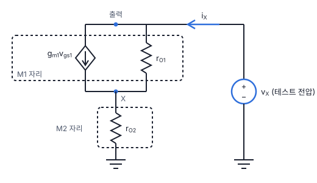

*$M_2$는 $r_{O2}$ 하나로, $M_1$은 $g_{m1} v_{gs1}$과 $r_{O1}$의 병렬로 바뀌어요. $M_1$의 게이트는 교류 접지이고 소스가 노드 X예요.*

잘 모르는 회로의 저항은 테스트 전압을 걸어 구해요. 출력에 소신호 테스트 전압 $v_X$를 걸고 흘러 들어가는 전류 $i_X$를 재서 $R_{out} = v_X / i_X$를 구하는 거예요. 모두 변화량이고, DC 전압과 DC 전류의 관계가 아니에요.

이름 주의: 칠판에서는 가운데 노드 X의 전압과 출력의 테스트 전압을 둘 다 "Vx"라고 불렀어요. 여기서는 $v_X$를 출력에 건 테스트 전압에만 쓰고, 노드 X의 전압은 $i_X r_{O2}$로 따로 써요.

1. KCL(노드 X): 노드 X에서 접지로 가는 길이 $r_{O2}$뿐이라 $i_X$는 전부 $r_{O2}$로 흘러요. 노드 X의 전압 $= i_X r_{O2}$
2. $M_1$의 게이트는 0, 소스는 노드 X예요. $v_{gs1} = 0 - i_X r_{O2}$, 곧 $v_{gs1} = -i_X r_{O2}$ 이므로 $i_{d1} = g_{m1} v_{gs1} = -g_{m1} r_{O2}\, i_X$
3. KCL(출력 노드): $r_{O1}$에 흐르는 전류 $= i_X - i_{d1} = (1 + g_{m1} r_{O2})\, i_X$
4. KVL: $v_X = (1 + g_{m1} r_{O2})\, i_X\, r_{O1} + i_X\, r_{O2}$
5. $R_{out} = v_X / i_X$: $R_{out} = (1 + g_{m1} r_{O2}) r_{O1} + r_{O2}$ $= r_{O1} + g_{m1} r_{O1} r_{O2} + r_{O2}$ (Razavi 식 9.22, 슬라이드 s4)
6. $g_m r_O \gg 1$일 때 가운데 항 $g_{m1} r_{O1} r_{O2}$가 지배해요: $R_{out} \approx g_{m1} r_{O1} r_{O2}$ (식 9.23)

해석: 전류원 $g_{m1} v_{gs1}$ 때문에 $r_{O1}$에 전류가 $g_{m1} r_{O2}\, i_X$만큼 더 흐르고, 그만큼 같은 $i_X$에 더 큰 전압이 걸려 저항이 커져요.

- 트랜지스터 하나일 때 $R_{out} = r_{O2}$예요.
- 위에 $M_1$을 쌓으면 대략 $g_{m1} r_{O1}$배가 돼요. 단순 합처럼 2배가 아니에요.
- $g_m r_O$는 보통 10~수십이므로 출력저항이 10배에서 수십 배 커져요.
- 의미: $\Delta I = \Delta V / R_{out}$이에요. 10배라면 양단 전압이 변할 때 0.1 mA 변할 전류가 0.01 mA만 변해요. 더 이상적인 전류원이 돼요.

다른 해석(슬라이드 s4 제목의 해석이고, 칠판에서 직접 말하지는 않았어요): $M_1$을 소스에 저항 $R_S = r_{O2}$가 달린 소스 축퇴(source degeneration) 트랜지스터로 보면, 축퇴된 MOS의 출력저항 $(1 + g_m R_S) r_O + R_S$에 $R_S = r_{O2}$를 넣은 것과 같아요.

문제에 쓰는 식(0904에서 배운 식을 한 줄로 상기해요):

$$
r_O = \frac{1}{\lambda I_D}
$$

$$
g_m = \sqrt{2\mu_n C_{ox}\frac{W}{L} I_D} = \frac{2 I_D}{V_{GS} - V_{TH}}
$$

- 두 트랜지스터가 같으면($g_{m1} = g_m$, $r_{O1} = r_{O2} = r_O$) $R_{out} \approx g_m r_O^2$예요.
- 문제가 근사를 허용하면 근사식 $R_{out} \approx g_{m1} r_{O1} r_{O2}$를, 아니면 정확식 $R_{out} = (1 + g_{m1} r_{O2}) r_{O1} + r_{O2}$를 써요.

#### 직접 해 보기: 쌓으면 출력저항이 몇 배가 될까 *(정적 스냅샷 — 직접 조작은 HTML 버전)*

$g_m$과 $r_O$를 바꾸면 세 막대(로그 눈금)와 1 V 변화에 대한 전류 변화가 함께 바뀌어요. 두 트랜지스터는 같다고 두었어요($g_{m1} = g_m$, $r_{O1} = r_{O2} = r_O$).

$g_m r_O$: **25.0** · 캐스코드 $R_{out}$: **540 kΩ** · 근사 $g_{m1} r_{O1} r_{O2}$: **500 kΩ** (정확식과 차이 **7.4 %**)

트랜지스터 하나 $r_O$의 **27.0**배 · 단순 합 $r_{O1} + r_{O2}$의 **13.5**배

양단 전압이 1 V 변할 때 $\Delta I = \Delta V / R$: 하나 **50.0 μA** → 캐스코드 **1.85 μA**

**gmrO ≫ 1이라 가운데 항이 지배해요. 근사식 gm1rO1rO2로 충분해요.**

범례: 테두리 막대: 트랜지스터 하나 $r_O$ · 빨간 테두리 막대: 단순 합 $r_{O1} + r_{O2}$ (오해) · 색칠된 막대: 캐스코드 $R_{out}$ · 세로 점선: 근사 $g_{m1} r_{O1} r_{O2}$

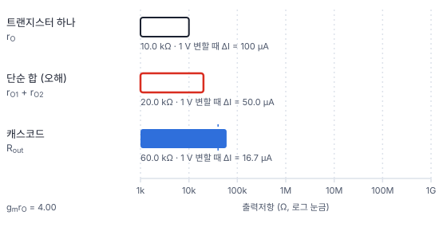

*대표 설정 1: $g_m$ = 0.4 mS, $r_O$ = 10 kΩ ($g_m r_O$ = 4)*

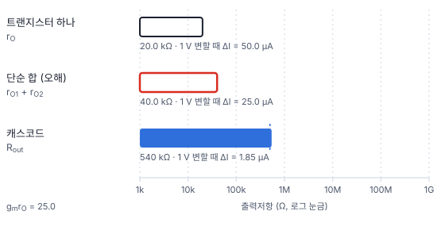

*대표 설정 2: $g_m$ = 1.25 mS, $r_O$ = 20 kΩ ($g_m r_O$ = 25)*

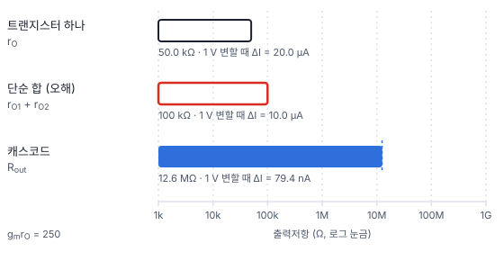

*대표 설정 3: $g_m$ = 5 mS, $r_O$ = 50 kΩ ($g_m r_O$ = 250)*

| 설정 | $g_m$ | $r_O$ | $g_m r_O$ | $r_{O1} + r_{O2}$ | $R_{out}$ (정확) | $g_{m1} r_{O1} r_{O2}$ | $R_{out} / r_O$ | 1 V당 $\Delta I$ (하나 → 캐스코드) |
|---|---|---|---|---|---|---|---|---|
| 1 | 0.4 mS | 10 kΩ | 4.00 | 20.0 kΩ | 60.0 kΩ | 40.0 kΩ (차이 33.3 %) | 6.00 | 100 μA → 16.7 μA |
| 2 | 1.25 mS | 20 kΩ | 25.0 | 40.0 kΩ | 540 kΩ | 500 kΩ (차이 7.4 %) | 27.0 | 50.0 μA → 1.85 μA |
| 3 | 5 mS | 50 kΩ | 250 | 100 kΩ | 12.6 MΩ | 12.5 MΩ (차이 0.8 %) | 252 | 20.0 μA → 79.4 nA |

$g_m r_O$가 클수록 근사식이 정확식에 붙고, 캐스코드의 전류 변화가 하나일 때보다 $R_{out} / r_O$배 작아져요.

**교수님 말씀**

"$r_{O1}$과 $r_{O2}$의 합일까?"라고 물은 뒤 교수님은 "질문의 의도를 파악했더니 '노'라고 대답할 줄 알았죠?"라며 단순한 합이 아니라고 했어요(0909 53:15–53:36).

"잘 모르는 회로의 저항을 구하려면?"이라는 질문에 한 학생이 "테스트 전압을 인가해요"라고 답했어요(0909 58:31–58:40).

> "구하고자 하는 거를 헷갈리면 수식이 산으로 가죠. … ix와 vx의 관계를 구하는 거예요." (0909 62:24)

교수님은 $M_2$ 하나일 때 $r_{O2}$였던 출력저항이 위에 쌓은 $M_1$의 $g_m r_O$만큼 곱해진다며 "굉장히 좋은 식"이라고 했어요(0909 66:38–67:05).

**꼭 기억해요**

> "단순히 ro1과 ro2의 합으로 2배 커지는 게 아니라 gm ro만큼 커지고" (0909 65:31)

> "요 정도를 기억하면 됩니다. … 요 두 번째 텀이 도미넌트한 값이에요." (0909 66:01)

기억할 식은 $R_{out} \approx g_{m1} r_{O1} r_{O2}$예요.

**페이지 요약**

테스트 전압으로 구하면 캐스코드 출력저항은 $r_{O1} + r_{O2}$가 아니라 대략 $g_m r_O$배로 커져요.

*핵심 식*

- M1의 게이트–소스 전압

  $$
  v_{gs1} = -i_X r_{O2}
  $$
- 정확식 (식 9.22)

  $$
  R_{out} = (1 + g_{m1} r_{O2}) r_{O1}
  $$

  $$
  + r_{O2}
  $$
- 근사식 (식 9.23)

  $$
  R_{out} \approx g_{m1} r_{O1} r_{O2}
  $$

*용어*

- **테스트 전압(test voltage)** — 출력에 $v_X$를 걸고 $i_X$를 재서 $R_{out} = v_X / i_X$를 구해요
- **$g_m r_O \gg 1$** — 가운데 항이 지배해 근사식이 성립하는 조건

---

### 캐스코드의 단점: 전압 헤드룸

*0909 수업 · L03 s4 이후 칠판*

**쉽게 말하면**

층을 하나 더 쌓으면 층마다 버틸 높이가 필요해서, 위에 남는 여유 공간이 줄어요.

*방 높이는 같은데 층이 늘면 남는 여유가 줄어요.*

**정확히 말하면**

교수님이 "단점은 뭘까요?"라고 물었고, 후보를 하나씩 따졌어요.

- 전력 소모: 늘지 않아요. 게이트 전류가 없고, 같은 전류가 두 트랜지스터를 그대로 흐르기 때문이에요. 다만 같은 전류를 흘리려면 바이어스 전압을 새로 잡아야 해요.
- 트랜지스터 개수: 하나 더 필요하지만 큰 단점은 아니에요. 디지털 회로는 트랜지스터를 수백만 개 쓰기 때문이에요.
- 진짜 단점: 트랜지스터를 위로 쌓으면 전압을 먹어요. 곧 전압 헤드룸(voltage headroom)을 소비해요.

포화 영역에서 동작하려면 드레인–소스 사이에 최소한 오버드라이브 전압이 걸려야 해요.

$$
V_{DS} \ge V_{GS} - V_{TH} = V_{ov}
$$

$V_{ov}$는 설계에 따라 달라요(예: 0.5 V). 트랜지스터 하나면 출력에 최소 $V_{ov}$ 하나만 있으면 돼요. 캐스코드는 $M_1$과 $M_2$가 모두 포화여야 하므로 오버드라이브 전압이 두 개 필요해요.

그래서 캐스코드 출력에는 최소 $V_{ov1} + V_{ov2}$가 필요해요.

그만큼 출력 전압이 움직일 수 있는 범위(스윙)가 줄어요. 교과서(Razavi 9.1.1)도 같은 이야기를 해요. 출력저항을 키우려고 아래에 무언가를 두면 그 전압 강하만큼 여유 전압이 더 필요하고, 결국 그 전류원을 쓰는 회로의 전압 변화폭이 제한된다고 해요.

**교수님 말씀**

한 학생이 "$M_2$의 포화 조건이 더 까다롭다"고 답하자, 교수님은 위의 $M_1$도 당연히 포화 영역이어야 하니 그런 단점이 있다고 받았어요(0909 68:44–69:14). 다른 학생이 "전력을 더 쓸 것 같다"고 하자, 게이트 전류가 없어 추가 전류 소모는 없다고 정정했어요(0909 69:19–70:00).

> "디지털 회로에서는 수백만 개 이렇게 쓰는데, 아날로그 회로에서 뭐 그까짓 거 하나 더 쓰는 거는요." (0909 70:16)

> "트랜지스터가 위로 쌓이게 되면 전압을 먹죠." (0909 70:23)

교수님은 "요즘 이게 왜 더 크리티컬해지냐면" 하고 말을 꺼냈지만, 시간이 다 되어 다음 시간으로 넘겼어요(0909 71:16).

**보충 · 수업에서 유도하진 않았어요**

수업이 끊긴 "요즘 헤드룸이 왜 더 크리티컬한가"의 흔한 답은 공급 전압(supply voltage)이 낮아지는 추세예요. 공정이 미세해질수록 트랜지스터가 견디는 전압이 낮아져 공급 전압도 함께 내려가요. 그런데 포화에 필요한 오버드라이브 전압은 그만큼 줄지 않아요. 이 추세 자체는 교과서 9장이 직접 설명하지 않아서 배경지식으로 적어요.

출력 최소 전압이 $V_{ov1} + V_{ov2}$가 되는 과정을 노드 전압으로 따라가면 이래요.

1. 오버드라이브 전압: $V_{ov} = \sqrt{\dfrac{2 I_D}{\mu_n C_{ox}(W/L)}}$, $V_{GS} = V_{TH} + V_{ov}$
2. 노드 X 전압: $V_X = V_{b1} - V_{GS1}$
3. $M_2$ 포화: $V_X \ge V_{ov2}$, 곧 $V_{b1} \ge V_{GS1} + V_{ov2}$
4. $M_1$ 포화: $V_{out} - V_X \ge V_{ov1}$, 곧 $V_{out} \ge V_{b1} - V_{TH}$
5. $V_{b1}$을 최솟값으로 잡으면 출력의 최소 전압은 $V_{ov1} + V_{ov2}$예요.

교과서에서 확인할 수 있는 근거는 이래요.

- Razavi 9.1.1은 출력저항을 키우려고 쌓은 소자의 전압 강하가 여유 전압을 요구해 전압 변화폭을 제한한다고 설명해요. 예로 축퇴 저항에 300 mV, 트랜지스터에 최소 500 mV가 필요하면 합쳐서 800 mV를 따로 남겨야 해요.
- 장말문제는 0.18 μm 공정 소자($W/L = 20/0.18$)와 $V_{DD} = 1.8$ V를 함께 써요(P9.15).

P9.15의 수치($V_{ov1} \approx 0.42$ V, $V_{ov2} = 0.30$ V)로 보면 $V_{ov1} + V_{ov2} \approx 0.72$ V예요. $V_{DD} = 1.8$ V에서는 전원의 약 40 %이지만, 같은 오버드라이브로 공급 전압이 1 V라면 약 72 %를 쌓은 두 트랜지스터가 먹어요. 남는 출력 스윙이 그만큼 좁아지므로 공급 전압이 낮을수록 캐스코드의 헤드룸 문제가 커져요. 교수님이 이어서 할 설명은 [다음 시간 예고](#s3-next)에 이어져요.

**페이지 요약**

캐스코드는 전력이나 개수보다 헤드룸이 문제예요. 두 트랜지스터가 모두 포화여야 해서 출력에 최소 $V_{ov1} + V_{ov2}$가 필요해요.

*핵심 식*

- 포화 조건

  $$
  V_{DS} \ge V_{GS} - V_{TH}
  $$
- 캐스코드 최소 출력 전압

  $$
  V_{ov1} + V_{ov2}
  $$

*용어*

- **오버드라이브 전압** — $V_{GS} - V_{TH}$. 포화에 필요한 최소 $V_{DS}$
- **헤드룸(headroom)** — 소자를 동작 영역에 두려고 전원 안에서 떼어 둬야 하는 전압 여유

---

## 4. 요약 · 예고

### 한 장 요약

*0909 수업 · L02 s21–28, L03 s1–5*

이번 수업의 식과 핵심 문장을 한 표에 모았어요. 주제 이름을 누르면 그 토픽으로 가요.

| 주제 | 핵심 식 | 한 줄 정리 |
|---|---|---|
| [MOS와 BJT](#s0-mos-vs-bjt) | $I_B = \frac{I_C}{\beta}$ | 둘 다 전류원이에요. MOS는 게이트 전류가 0이고, BJT는 베이스 전류가 작게 흘러요. |
| [BJT I/V와 대신호 모델](#s0-bjt-iv) | $I_C = I_S \exp\frac{V_{BE}}{V_T}$ | 순방향 활성 영역에서 $I_C$는 $V_{CE}$와 거의 무관해요. 전류원 양단 전압은 $V_{CE}$예요. |
| [트랜스컨덕턴스](#s1-gm) | $g_m = \frac{I_C}{V_T}$ $\Delta I = g_m \Delta V$ | 동작점에서 그은 접선의 기울기예요. 변화량끼리의 관계이고, 바이어스 전류에 비례해요. |
| [베이스 쪽 저항](#s1-rpi) | $r_\pi = \frac{\beta}{g_m}$ $i_c = g_m v_\pi$ | 베이스 전류 변화를 저항 하나로 나타내요. $1/g_m$의 약 $\beta$배예요. |
| [Early 효과](#s1-early) | $r_O = \frac{V_A}{I_C}$ | $V_{CE}$가 오르면 $I_C$가 조금 늘어요. MOS의 채널 길이 변조와 같은 역할이에요. |
| [PNP](#s1-pnp) | $V_E \gt V_B \gt V_C$ | NPN 식에 절댓값만 씌우면 돼요. 소신호 모델은 NPN과 같아요. |
| [왜 캐스코드인가](#s2-why) | $\Delta I = \frac{\Delta V}{r_O}$ $A_v = -g_m (R_D \parallel r_O)$ | 유한한 출력저항 때문에 전류원이 부정확하고 이득이 제한돼요. 해답은 트랜지스터를 쌓는 거예요. |
| [쌓아도 전류는 그대로](#s2-stack) | $I_{D1} = I_{D2}$ | 전류는 아래 $M_2$가 정하고, 위 $M_1$은 전류의 통로예요. |
| [출력저항 유도](#s2-rout) | $R_{out} = (1 + g_{m1} r_{O2}) r_{O1} + r_{O2}$ $R_{out} \approx g_{m1} r_{O1} r_{O2}$ | $g_m r_O \gg 1$일 때 출력저항이 $r_{O1} + r_{O2}$가 아니라 약 $g_m r_O$배로 커져요. |
| [단점: 헤드룸](#s2-headroom) | $V_{DS} \ge V_{GS} - V_{TH}$ $V_{ov1} + V_{ov2}$ | 두 트랜지스터가 모두 포화여야 해서 출력에 필요한 최소 전압이 늘어요. 전력 소모는 늘지 않아요. |

---

### 다음 시간 예고

*0909 수업 · L03 s6–s16*

- 헤드룸이 요즘 더 중요해지는 이유 (0909 수업 끝에 말하다 끊김)
- 예제: 500 kΩ NMOS 캐스코드 설계 (L03 s6)
- PMOS 캐스코드 (L03 s7)
- 바이폴라 캐스코드와 PNP 캐스코드 (L03 s8–s10)
- 캐스코드 증폭기: 증폭기로서의 캐스코드 (L03 s11–s16)
- 전류 거울(current mirror) (9장 후반)
- 차동 증폭기 (10장)

---

### 함께 보면 좋은 자료

*0909 수업*

- [복습문제 8개 (PDF)](복습문제_0909_Cascode_Stage-문제.pdf) — P9.14는 바이어스($V_{b1}$ 최솟값)와 출력 임피던스, E9.05, X9.05, E9.06, X9.06, P9.12, P9.18은 캐스코드 출력저항, P9.15는 헤드룸($V_{b1}$ 상한과 $V_X$)을 연습해요.
- [답안 (PDF)](복습문제_0909_Cascode_Stage-답안.pdf)
- [9장 문제집 전체](../../workbook/pdf/ch09-문제.pdf)
- [0904 정리노트: MOS 소신호 모델](../0904/정리노트_0904_MOS_Small_Signal_Model.html)

---

출처: 권익진 교수님 강의자료(Lec2, Lec3) · 수업 녹음 전사(0909) · B. Razavi, *Fundamentals of Microelectronics*, 2nd ed. (Wiley) 4장, 9장.
