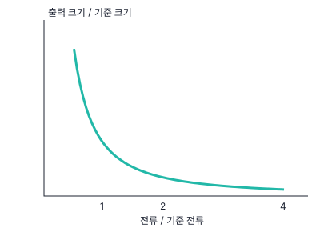

# 전자회로2 복습 0911 문제설명

주어진 조건을 읽고, 첫 줄을 쓰고, 이유를 따라가며 답을 확인해요.

문제의 첫 줄부터 검산까지 설명해요.

**목차**

- [문항별 설명](#problems)
  - [MOS 캐스코드 전류원의 바이어스 설계와 출력 임피던스](#p1)
  - [출력 임피던스 500 kΩ, 전류 0.5 mA인 NMOS 캐스코드 설계](#p2)
  - [W/L = 32일 때 출력 임피던스 (예제 9.5 변형)](#p3)
  - [MOS 캐스코드 출력 저항의 I_D 의존성과 바이폴라 비교](#p4)
  - [PMOS 캐스코드 전류원의 W/L 결정](#p5)
  - [바이폴라 캐스코드 전류원의 출력 저항](#p6)
  - [목표 출력 저항에 필요한 Early 전압 (예제 9.1 변형)](#p7)
  - [CS 단의 트랜스컨덕턴스](#p8)
  - [폭과 바이어스 전류를 2배로 할 때 G_m의 변화 (예제 9.7 이어서)](#p9)
  - [이득 200을 위한 MOS 캐스코드 증폭기의 W/L](#p10)

## 문항별 설명

### MOS 캐스코드 전류원의 바이어스 설계와 출력 임피던스

P9.14 · 장말문제 9.14 · [원 문제 보기](../%EB%B3%B5%EC%8A%B5%EB%AC%B8%EC%A0%9C_0911_Cascode_Amplifier-%EB%AC%B8%EC%A0%9C.pdf)

#### 주어진 조건

- 회로: Fig 9.50 캐스코드 전류원, 바이어스 전류 $0.5\ \text{mA}$로 설계
- $\mu_n C_{ox} = 100\ \mu\text{A/V}^2$, $V_{TH} = 0.4\ \text{V}$
- $M_1$: $W/L = 30/0.18$, $M_2$: $W/L = 20/0.18$ (그림에 표시)

#### 구할 것

- (a) 채널 길이 변조를 무시할 때 필요한 $V_{b2}$. 그리고 $M_2$가 포화 영역에 머물러야 할 때 $V_{b1}$의 최솟값
- (b) $\lambda = 0.1\ \text{V}^{-1}$일 때 회로의 출력 임피던스

원문 보기

The cascode current source shown in Fig. 9.50 must be designed for a bias current of $0.5\ \text{mA}$. Assume $\mu_n C_{ox} = 100\ \mu\text{A/V}^2$ and $V_{TH} = 0.4\ \text{V}$.

(a) Neglecting channel-length modulation, compute the required value of $V_{b2}$. What is the minimum tolerable value of $V_{b1}$ if $M_2$ must remain in saturation?

(b) Assuming $\lambda = 0.1\ \text{V}^{-1}$, calculate the output impedance of the circuit.

#### 문제를 이렇게 읽어요

아래 $M_2$가 0.5 mA를 정하고 위 $M_1$이 출력까지 전달해요. DC 게이트 전압을 먼저 정하고 같은 동작점에서 출력 저항을 구해요.

#### 이 문제를 봤을 때 떠올릴 개념과 공식

바이어스는 포화 제곱 법칙(saturation square law), 출력 임피던스는 소스 축퇴(source degeneration)로 읽어요. $V_{ov}=V_{GS}-V_{TH}$는 과구동 전압, $g_m=2I_D/V_{ov}$는 전압당 전류 변화, $r_O=1/(\lambda I_D)$는 출력 저항이에요. (a)는 채널 길이 변조를 무시하고 (b)에서만 유한한 $r_O$를 남겨요.

#### 종이에 쓰는 실제 첫 줄

먼저 다음 식을 적어요.

$$
I_D=\frac12\mu_nC_{ox}(W/L)_2(V_{b2}-V_{TH})^2
$$

#### 왜 이렇게 푸는지 함께 따라가요

#### (a) 풀이

$M_2$의 소스는 접지이므로 $V_{GS2}=V_{b2}$예요.

$$
V_{ov2}=\sqrt{\frac{2(0.5\mathrm{mA})}{100\mathrm{\mu A/V^2}(20/0.18)}}=0.300\mathrm V
$$

따라서 $V_{b2}=0.400+0.300=0.700\mathrm V$예요. 위 소자는 같은 전류를 더 넓은 폭으로 흘리므로

$$
V_{ov1}=\sqrt{\frac{2(0.5\mathrm{mA})}{100\mathrm{\mu A/V^2}(30/0.18)}}=0.24495\mathrm V
$$

중간 노드는 $V_X=V_{b1}-(V_{TH}+V_{ov1})$예요. 아래 소자의 포화 조건 $V_X\ge V_{ov2}$에서 $V_{b1,\min}=0.300+0.400+0.24495=0.94495\mathrm V$예요.

#### (b) 풀이

바이어스 전압원은 AC 접지로 보내요. 아래는 $v_{gs2}=0$이라 $r_{O2}$만 남고 위 소자의 축퇴 저항이 돼요.

$$
r_{O1}=r_{O2}=\frac1{0.1(0.5\mathrm{mA})}=20.0\mathrm{k\Omega}
$$

$$
g_{m1}=\frac{1.00\mathrm{mA}}{0.24495\mathrm V}=4.0825\mathrm{mS}
$$

$$
R_{out}=r_{O1}+r_{O2}+g_{m1}r_{O1}r_{O2}=1.673\mathrm{M\Omega}
$$

곱 항만 남기는 교재 근사는 $1.633\mathrm{M\Omega}$예요.

#### 완성 답과 검산

#### (a) 답과 검산

**$V_{b2}=0.700\mathrm V$, $V_{b1,\min}=0.945\mathrm V$예요.** 경계에서 $V_X=0.300\mathrm V=V_{ov2}$여서 아래 소자의 포화 조건을 만족해요.

#### (b) 답과 검산

**교재 근사 $R_{out}\approx1.63\mathrm{M\Omega}$예요.** $g_{m1}r_{O2}=81.65$이고 생략한 40 kΩ은 정확식의 약 2.4%예요. $\mathrm S\cdot\Omega^2=\Omega$로 단위도 맞아요.

#### 이 문제에서 조심할 점

이 그림에서 위가 $M_1$, 아래가 $M_2$예요. 최소 게이트 전압에는 위의 $V_{GS1}$뿐 아니라 아래에 남겨 줄 $V_{ov2}$까지 더해야 해요.

#### 설명을 닫고 규칙을 적용해 봐요

1. 아래 소자의 과구동을 0.1 V 키우고 위 VGS를 유지하면 최소 Vb1은 어떻게 바뀌나요?
2. 사용한 규칙과 적용 조건을 한 문장으로 설명하고, 본문을 닫은 채 계산 또는 전류 경로를 보여 주세요.

**페이지 요약**

#### 떠올릴 개념·공식

바이어스는 포화 제곱 법칙(saturation square law), 출력 임피던스는 소스 축퇴(source degeneration)로 읽어요. $V_{ov}=V_{GS}-V_{TH}$는 과구동 전압, $g_m=2I_D/V_{ov}$는 전압당 전류 변화, $r_O=1/(\lambda I_D)$는 출력 저항이에요. (a)는 채널 길이 변조를 무시하고 (b)에서만 유한한 $r_O$를 남겨요.

#### 첫 줄

$I_D=\frac12\mu_nC_{ox}(W/L)_2(V_{b2}-V_{TH})^2$

#### 핵심 판단

이 그림에서 위가 $M_1$, 아래가 $M_2$예요. 최소 게이트 전압에는 위의 $V_{GS1}$뿐 아니라 아래에 남겨 줄 $V_{ov2}$까지 더해야 해요.

#### 검산

**$V_{b2}=0.700\mathrm V$, $V_{b1,\min}=0.945\mathrm V$예요.** 경계에서 $V_X=0.300\mathrm V=V_{ov2}$여서 아래 소자의 포화 조건을 만족해요.

**교재 근사 $R_{out}\approx1.63\mathrm{M\Omega}$예요.** $g_{m1}r_{O2}=81.65$이고 생략한 40 kΩ은 정확식의 약 2.4%예요. $\mathrm S\cdot\Omega^2=\Omega$로 단위도 맞아요.

---

### 출력 임피던스 500 kΩ, 전류 0.5 mA인 NMOS 캐스코드 설계

E9.05 · 예제 9.5 · [원 문제 보기](../%EB%B3%B5%EC%8A%B5%EB%AC%B8%EC%A0%9C_0911_Cascode_Amplifier-%EB%AC%B8%EC%A0%9C.pdf)

#### 주어진 조건

- 목표: 출력 임피던스 $R_{out} = 500\ \text{k}\Omega$, 전류 $I_D = 0.5\ \text{mA}$
- 단순화를 위해 $M_1$과 $M_2$가 같다고 가정 (같을 필요는 없음)
- $\mu_n C_{ox} = 100\ \mu\text{A}/\text{V}^2$, $\lambda = 0.1\ \text{V}^{-1}$

#### 구할 것

- 트랜지스터의 $W/L$ (설계)

원문 보기

출력 임피던스가 $500\ \text{k}\Omega$이고 전류가 $0.5\ \text{mA}$인 NMOS 캐스코드를 설계하라. 단순화를 위해 그림 9.8에서 $M_1$과 $M_2$가 같다고 가정하라(같을 필요는 없다). $\mu_n C_{ox} = 100\ \mu\text{A}/\text{V}^2$, $\lambda = 0.1\ \text{V}^{-1}$이라고 가정하라.

#### 문제를 이렇게 읽어요

전류와 공정으로 $r_O$는 이미 정해져 있어요. 목표 500 kΩ를 만드는 $g_m$을 정한 뒤 두 소자의 공통 형상비를 찾아요.

교재의 지배항 근사 $R_{out}\approx g_mr_O^2$로는 $W/L=15.625$가 나오지만, 더하기 항까지 남긴 정확 소신호 식으로 500 kΩ를 맞추면 $13.225$예요. 두 설계 기준을 구별해 계산해요.

#### 이 문제를 봤을 때 떠올릴 개념과 공식

동일한 MOS 캐스코드(cascode)라는 단서에서 $R_{out}\approx g_mr_O^2$를 떠올려요. $r_O=1/(\lambda I_D)$는 채널 길이 변조 저항, $g_m=\sqrt{2\mu_nC_{ox}(W/L)I_D}$는 트랜스컨덕턴스예요. $g_mr_O\gg1$일 때 곱 항을 남기며 정확식은 $2r_O+g_mr_O^2$예요.

#### 종이에 쓰는 실제 첫 줄

먼저 다음 식을 적어요.

$$
r_O=\frac1{0.1(0.5\mathrm{mA})}=20\mathrm{k\Omega}
$$

#### 왜 이렇게 푸는지 함께 따라가요

#### 풀이

아래 소자는 게이트와 소스가 AC 접지라 $r_O$가 되고 위 소자는 이것으로 축퇴돼요.

$$
g_m=\frac{500\mathrm{k\Omega}}{(20\mathrm{k\Omega})^2}=1.25\mathrm{mS}
$$

제곱근 식을 제곱해 형상비를 고립시켜요.

$$
\frac WL=\frac{g_m^2}{2\mu_n C_{ox}I_D}=\frac{(1.25\times10^{-3})^2}{2(100\times10^{-6})(0.5\times10^{-3})}=15.625
$$

두 소자를 모두 $W/L\approx15.6$으로 골라요. 정확히 500 kΩ를 맞추려면 $g_m=(500-40)\mathrm{k\Omega}/(20\mathrm{k\Omega})^2=1.15\mathrm{mS}$이므로 정확식 기준 형상비는 13.225예요.

#### 완성 답과 검산

#### 답과 검산

**교재 근사 설계는 두 소자 모두 $W/L=15.6$이에요.** $g_mr_O=25$이고 정확식에서는 540 kΩ이므로 근사 목표보다 8% 높아요. 형상비는 무차원이며 폭 자체가 15.6 μm라는 뜻은 아니에요.

정확식 기준의 $W/L=13.225$를 넣으면 $g_m=1.15$ mS여서 $R_{out}=40+460=500$ kΩ예요. 교재의 15.625를 넣은 540 kΩ와 같은 목표 모델로 혼동하지 않아요.

#### 이 문제에서 조심할 점

500 kΩ를 개별 소자의 $r_O$로 놓지 않아요. 출력저항 사양과 바이어스 전류를 동시에 만족하도록 $g_m$을 역산해요.

$W/L=15.625$를 쓰면서 정확히 500 kΩ라고 단정하면 지배항 근사와 정확식을 섞은 것이에요. 정확히 맞출 값은 13.225이고, 15.625는 정확식에서 540 kΩ예요.

#### 설명을 닫고 규칙을 적용해 봐요

1. 전류와 λ를 유지하고 목표 Rout을 2배로 하면 주항 설계의 W/L은 몇 배인가요?
2. 사용한 규칙과 적용 조건을 한 문장으로 설명하고, 본문을 닫은 채 계산 또는 전류 경로를 보여 주세요.

**페이지 요약**

#### 떠올릴 개념·공식

동일한 MOS 캐스코드(cascode)라는 단서에서 $R_{out}\approx g_mr_O^2$를 떠올려요. $r_O=1/(\lambda I_D)$는 채널 길이 변조 저항, $g_m=\sqrt{2\mu_nC_{ox}(W/L)I_D}$는 트랜스컨덕턴스예요. $g_mr_O\gg1$일 때 곱 항을 남기며 정확식은 $2r_O+g_mr_O^2$예요.

#### 첫 줄

$r_O=\frac1{0.1(0.5\mathrm{mA})}=20\mathrm{k\Omega}$

#### 핵심 판단

500 kΩ를 개별 소자의 $r_O$로 놓지 않아요. 출력저항 사양과 바이어스 전류를 동시에 만족하도록 $g_m$을 역산해요.

#### 검산

**교재 근사 설계는 두 소자 모두 $W/L=15.6$이에요.** $g_mr_O=25$이고 정확식에서는 540 kΩ이므로 근사 목표보다 8% 높아요. 형상비는 무차원이며 폭 자체가 15.6 μm라는 뜻은 아니에요.

#### 해석과 모델 범위

500 kΩ 설계: 교재 지배항 $W/L=15.625$; 정확 소신호 식 $13.225$. 전자는 정확식에 넣으면 540 kΩ예요.

---

### W/L = 32일 때 출력 임피던스 (예제 9.5 변형)

X9.05 · 연습문제 9.5 · [원 문제 보기](../%EB%B3%B5%EC%8A%B5%EB%AC%B8%EC%A0%9C_0911_Cascode_Amplifier-%EB%AC%B8%EC%A0%9C.pdf)

#### 주어진 조건

- 예제 9.5와 같은 NMOS 캐스코드(Fig 9.8)와 조건: $I_D = 0.5\ \text{mA}$, $\mu_n C_{ox} = 100\ \mu\text{A}/\text{V}^2$, $\lambda = 0.1\ \text{V}^{-1}$, $M_1$과 $M_2$가 같음
- 바뀐 점: $W/L = 32$ (두 트랜지스터 모두)

#### 구할 것

- 출력 임피던스 $R_{out}$

원문 보기

$W/L = 32$일 때 출력 임피던스는 얼마인가?

#### 문제를 이렇게 읽어요

형상비가 32로 주어졌으므로 같은 0.5 mA에서 $g_m$을 계산한 다음 출력 저항을 구해요.

#### 이 문제를 봤을 때 떠올릴 개념과 공식

폭만 바뀌고 전류와 $\lambda$가 고정이라는 단서가 중요해요. $g_m$은 $\sqrt{W/L}$에 비례하지만 $r_O=1/(\lambda I_D)$는 그대로예요. $g_mr_O\gg1$이면 소스 축퇴(source degeneration) 근사 $R_{out}\approx g_mr_O^2$를 적용해요.

#### 종이에 쓰는 실제 첫 줄

먼저 다음 식을 적어요.

$$
g_m=\sqrt{2\mu_nC_{ox}(W/L)I_D}
$$

#### 왜 이렇게 푸는지 함께 따라가요

#### 풀이

단위를 A로 맞춰 넣어요.

$$
g_m=\sqrt{2(100\times10^{-6})(32)(0.5\times10^{-3})}=1.78885\mathrm{mS}
$$

$$
r_O=\frac1{0.1(0.5\mathrm{mA})}=20.0\mathrm{k\Omega}
$$

아래는 AC 접지된 게이트와 소스 때문에 저항만 남고, 위는 이 저항으로 축퇴돼요.

$$
R_{out}\approx(1.78885\mathrm{mS})(20\mathrm{k\Omega})^2=715.54\mathrm{k\Omega}
$$

정확식은 두 저항의 합 40 kΩ을 더해 755.54 kΩ이에요.

#### 완성 답과 검산

#### 답과 검산

**$R_{out}\approx716\mathrm{k\Omega}$예요.** $g_mr_O=35.78$이고 예제와 비교하면 $\sqrt{32/15.625}=1.431$배예요. $500\mathrm{k\Omega}\times1.431=715.5\mathrm{k\Omega}$로 직접 계산과 맞아요.

#### 이 문제에서 조심할 점

형상비를 약 두 배로 해도 출력 저항은 두 배가 아니에요. 전류 고정 조건에서는 제곱근으로 증가해요.

#### 설명을 닫고 규칙을 적용해 봐요

1. W/L을 4배로 하고 전류를 유지하면 캐스코드 근사 Rout은 몇 배인가요?
2. 사용한 규칙과 적용 조건을 한 문장으로 설명하고, 본문을 닫은 채 계산 또는 전류 경로를 보여 주세요.

**페이지 요약**

#### 떠올릴 개념·공식

폭만 바뀌고 전류와 $\lambda$가 고정이라는 단서가 중요해요. $g_m$은 $\sqrt{W/L}$에 비례하지만 $r_O=1/(\lambda I_D)$는 그대로예요. $g_mr_O\gg1$이면 소스 축퇴(source degeneration) 근사 $R_{out}\approx g_mr_O^2$를 적용해요.

#### 첫 줄

$g_m=\sqrt{2\mu_nC_{ox}(W/L)I_D}$

#### 핵심 판단

형상비를 약 두 배로 해도 출력 저항은 두 배가 아니에요. 전류 고정 조건에서는 제곱근으로 증가해요.

#### 검산

**$R_{out}\approx716\mathrm{k\Omega}$예요.** $g_mr_O=35.78$이고 예제와 비교하면 $\sqrt{32/15.625}=1.431$배예요. $500\mathrm{k\Omega}\times1.431=715.5\mathrm{k\Omega}$로 직접 계산과 맞아요.

---

### MOS 캐스코드 출력 저항의 I_D 의존성과 바이폴라 비교

P9.13 · 장말문제 9.13 · [원 문제 보기](../%EB%B3%B5%EC%8A%B5%EB%AC%B8%EC%A0%9C_0911_Cascode_Amplifier-%EB%AC%B8%EC%A0%9C.pdf)

#### 주어진 조건

- $G_m = \sqrt{2 \mu_n C_{ox} (W/L) I_D}$로 씀 (원문 표기 그대로 대문자 $G_m$)
- 이 $G_m$은 식 9.23의 $g_{m1}$을 가리킴
- 소자 값은 주어지지 않음

#### 구할 것

- (a) 식 (9.23)을 $I_D$로 나타내고, 그 결과를 $I_D$의 함수로 그림
- (b) (a)의 식을 바이폴라 캐스코드의 식 (9.9)와 비교: 어느 쪽이 바이어스 전류에 더 강하게 의존하는가

원문 보기

(a) Writing $G_m = \sqrt{2 \mu_n C_{ox} (W/L) I_D}$, express Eq. (9.23) in terms of $I_D$ and plot the result as a function of $I_D$.

(b) Compare this expression with that in Eq. (9.9) for the bipolar counterpart. Which one is a stronger function of the bias current?

#### 문제를 이렇게 읽어요

같은 공정과 형상비에서 바이어스 전류만 바꿔요. MOS 캐스코드 출력 저항의 전류 지수를 구하고 바이폴라와 얼마나 빠르게 달라지는지 비교해요.

#### 이 문제를 봤을 때 떠올릴 개념과 공식

전류에 따른 함수라는 단서는 거듭제곱 스케일링(power-law scaling)을 부르므로 $g_m$과 $r_O$를 전류로 바꿔요. $g_m=\sqrt{2\mu_nC_{ox}(W/L)I_D}$, $r_O=1/(\lambda I_D)$예요. 공정·형상비 고정과 강반전 제곱 법칙, $g_mr_O\gg1$ 범위에서 식 (9.23)을 써요. 바이폴라는 $g_m=I_C/V_T$, $r_\pi=\beta V_T/I_C$예요.

#### 종이에 쓰는 실제 첫 줄

먼저 다음 식을 적어요.

$$
R_{out}\approx G_mr_O^2=\sqrt{2\mu_nC_{ox}(W/L)I_D}\frac1{\lambda^2I_D^2}
$$

#### 왜 이렇게 푸는지 함께 따라가요

#### (a) 풀이

제곱근의 전류 인수는 $I_D^{1/2}$이고 저항 두 개는 $I_D^{-2}$이므로

$$
R_{out}\approx C I_D^{-3/2}
$$

$$
C=\frac{\sqrt{2\mu_nC_{ox}(W/L)}}{\lambda^2}
$$

예요. 곡선을 그릴 때 기준점 $I_0,R_0$를 잡으면

$$
R_{out}/R_0=(I_D/I_0)^{-3/2}
$$

이에요. 정규화 좌표 $(I_D/I_0,R_{out}/R_0)$는 $(1/2,2.828),(1,1),(2,0.354),(4,0.125)$예요. 이 점들을 지나는 매끄러운 감소 곡선을 그려요. 기울기는 $-(3/2)CI_D^{-5/2}<0$, 이차 미분은 $(15/4)CI_D^{-7/2}>0$이에요.

*적용 가능한 제곱 법칙 범위에서의 정규화 곡선이에요.*

#### (b) 풀이

바이폴라 식 (9.9)는

$$
R_{out,BJT}\approx\frac1{I_C}\frac{\beta V_A^2}{V_A+\beta V_T}
$$

예요. 공정과 온도가 같으면 뒤 분수는 상수이므로 전류 지수는 $-1$이에요. 전류 두 배에서 BJT는 0.5배, MOS는 $2^{-3/2}=0.354$배예요. 따라서 같은 비율의 전류 변화에 MOS가 더 민감해요.

#### 완성 답과 검산

#### (a) 답과 검산

**$R_{out}\approx C I_D^{-3/2}$예요.** 로그 기울기 $d\ln R_{out}/d\ln I_D=-3/2$가 전류의 상대 변화당 저항 변화를 직접 보여 줘요. $I_D\to0$의 발산은 제곱 법칙 모델의 형식적 극한이며 실제 약반전까지 적용하지 않아요.

#### (b) 답과 검산

**MOS의 전류 의존성이 더 강해요.** BJT의 로그 기울기는 $-1$로 MOS의 $-1.5$보다 절댓값이 작아요. 서로 다른 공정의 절대 저항 크기를 비교한 결론은 아니에요.

#### 이 문제에서 조심할 점

전류를 늘리면 $g_m$이 커진다는 사실만 보고 출력 저항도 커진다고 판단하지 않아요. $r_O$ 두 개의 감소가 더 강해요.

#### 설명을 닫고 규칙을 적용해 봐요

1. MOS 크기를 고정하고 ID를 4배로 하면 근사 Rout은 몇 배인가요? 같은 조건의 BJT는요?
2. 사용한 규칙과 적용 조건을 한 문장으로 설명하고, 본문을 닫은 채 계산 또는 전류 경로를 보여 주세요.

**페이지 요약**

#### 떠올릴 개념·공식

전류에 따른 함수라는 단서는 거듭제곱 스케일링(power-law scaling)을 부르므로 $g_m$과 $r_O$를 전류로 바꿔요. $g_m=\sqrt{2\mu_nC_{ox}(W/L)I_D}$, $r_O=1/(\lambda I_D)$예요. 공정·형상비 고정과 강반전 제곱 법칙, $g_mr_O\gg1$ 범위에서 식 (9.23)을 써요. 바이폴라는 $g_m=I_C/V_T$, $r_\pi=\beta V_T/I_C$예요.

#### 첫 줄

$R_{out}\approx G_mr_O^2=\sqrt{2\mu_nC_{ox}(W/L)I_D}\frac1{\lambda^2I_D^2}$

#### 핵심 판단

전류를 늘리면 $g_m$이 커진다는 사실만 보고 출력 저항도 커진다고 판단하지 않아요. $r_O$ 두 개의 감소가 더 강해요.

#### 검산

**$R_{out}\approx C I_D^{-3/2}$예요.** 로그 기울기 $d\ln R_{out}/d\ln I_D=-3/2$가 전류의 상대 변화당 저항 변화를 직접 보여 줘요. $I_D\to0$의 발산은 제곱 법칙 모델의 형식적 극한이며 실제 약반전까지 적용하지 않아요.

**MOS의 전류 의존성이 더 강해요.** BJT의 로그 기울기는 $-1$로 MOS의 $-1.5$보다 절댓값이 작아요. 서로 다른 공정의 절대 저항 크기를 비교한 결론은 아니에요.

---

### PMOS 캐스코드 전류원의 W/L 결정

P9.17 · 장말문제 9.17 · [원 문제 보기](../%EB%B3%B5%EC%8A%B5%EB%AC%B8%EC%A0%9C_0911_Cascode_Amplifier-%EB%AC%B8%EC%A0%9C.pdf)

#### 주어진 조건

- 바이어스 전류 $0.5\ \text{mA}$를 공급하면서 출력 임피던스 $40\ \text{k}\Omega$를 가져야 함
- $\mu_p C_{ox} = 50\ \mu\text{A/V}^2$, $\lambda = 0.2\ \text{V}^{-1}$
- $(W/L)_1 = (W/L)_2$
- $\lambda$는 두 트랜지스터가 같음

#### 구할 것

- 필요한 $(W/L)_1 = (W/L)_2$ 값

원문 보기

The PMOS cascode of Fig. 9.53 must provide a bias current of $0.5\ \text{mA}$ with an output impedance of $40\ \text{k}\Omega$. If $\mu_p C_{ox} = 50\ \mu\text{A/V}^2$ and $\lambda = 0.2\ \text{V}^{-1}$, determine the required value of $(W/L)_1 = (W/L)_2$.

#### 문제를 이렇게 읽어요

PMOS 전류는 크기 0.5 mA로 고정돼요. 40 kΩ 출력 저항을 만들 $g_m$을 역산하여 두 소자의 같은 형상비를 구해요.

이 문제에서는 교재 지배항 근사 답 $W/L=3.20$과 정확 소신호 저항식의 설계값 $0.800$이 크게 달라요. 3.20을 정확식에 넣으면 40 kΩ가 아니라 60 kΩ이므로, 목표 40 kΩ를 정확히 맞추는 설계와 근사 답을 함께 구별해요.

#### 이 문제를 봤을 때 떠올릴 개념과 공식

PMOS 캐스코드(cascode)는 양의 전류 크기 $|I_D|$와 $g_m$으로 NMOS와 같은 저항 공식을 사용해요. $r_O=1/(\lambda|I_D|)$이고 $g_m=\sqrt{2\mu_pC_{ox}(W/L)|I_D|}$예요. 여기서는 목표 저항이 개별 저항의 네 배뿐이라 곱 항 근사를 무조건 쓰지 말고 정확식 $2r_O+g_mr_O^2$도 계산해요.

#### 종이에 쓰는 실제 첫 줄

먼저 다음 식을 적어요.

$$
r_O=\frac1{0.2(0.5\mathrm{mA})}=10.0\mathrm{k\Omega}
$$

#### 왜 이렇게 푸는지 함께 따라가요

#### 풀이

교재 곱 항 근사에서는

$$
g_m\approx\frac{40\mathrm{k\Omega}}{(10\mathrm{k\Omega})^2}=0.400\mathrm{mS}
$$

$$
W/L=\frac{(0.400\mathrm{mS})^2}{2(50\mathrm{\mu A/V^2})(0.5\mathrm{mA})}=3.20
$$

예요. 하지만 이때 $g_mr_O=4$라 근사가 거칠어요. 정확 저항식을 사용하면

$$
g_m=\frac{40\mathrm{k\Omega}-2(10\mathrm{k\Omega})}{(10\mathrm{k\Omega})^2}=0.200\mathrm{mS}
$$

$$
W/L=\frac{(0.200\mathrm{mS})^2}{2(50\mathrm{\mu A/V^2})(0.5\mathrm{mA})}=0.800
$$

예요. 따라서 사양을 정확히 맞추는 소신호 설계와 교재 근사 답을 구분해요.

#### 완성 답과 검산

#### 답과 검산

**교재 근사 답은 두 소자 $W/L\approx3.20$, 정확 저항 모델의 설계값은 $0.800$이에요.** 3.20을 정확식에 넣으면 $20+40=60\mathrm{k\Omega}$라 목표보다 50% 커요. 0.800에서는 $g_mr_O=2$이고 $20+20=40\mathrm{k\Omega}$로 목표에 맞아요.

#### 이 문제에서 조심할 점

“$g_mr_O=4$이므로 충분히 크다”라고 쓰지 않아요. 큰 항 근사가 형상비를 네 배나 바꾸는 예예요.

#### 설명을 닫고 규칙을 적용해 봐요

1. 같은 전류에서 W/L을 4배로 하면 Rout의 곱 항과 단순 ro 합은 각각 어떻게 변하나요?
2. 사용한 규칙과 적용 조건을 한 문장으로 설명하고, 본문을 닫은 채 계산 또는 전류 경로를 보여 주세요.

**페이지 요약**

#### 떠올릴 개념·공식

PMOS 캐스코드(cascode)는 양의 전류 크기 $|I_D|$와 $g_m$으로 NMOS와 같은 저항 공식을 사용해요. $r_O=1/(\lambda|I_D|)$이고 $g_m=\sqrt{2\mu_pC_{ox}(W/L)|I_D|}$예요. 여기서는 목표 저항이 개별 저항의 네 배뿐이라 곱 항 근사를 무조건 쓰지 말고 정확식 $2r_O+g_mr_O^2$도 계산해요.

#### 첫 줄

$r_O=\frac1{0.2(0.5\mathrm{mA})}=10.0\mathrm{k\Omega}$

#### 핵심 판단

“$g_mr_O=4$이므로 충분히 크다”라고 쓰지 않아요. 큰 항 근사가 형상비를 네 배나 바꾸는 예예요.

#### 검산

**교재 근사 답은 두 소자 $W/L\approx3.20$, 정확 저항 모델의 설계값은 $0.800$이에요.** 3.20을 정확식에 넣으면 $20+40=60\mathrm{k\Omega}$라 목표보다 50% 커요. 0.800에서는 $g_mr_O=2$이고 $20+20=40\mathrm{k\Omega}$로 목표에 맞아요.

---

### 바이폴라 캐스코드 전류원의 출력 저항

E9.01 · 예제 9.1 · [원 문제 보기](../%EB%B3%B5%EC%8A%B5%EB%AC%B8%EC%A0%9C_0911_Cascode_Amplifier-%EB%AC%B8%EC%A0%9C.pdf)

#### 주어진 조건

- $Q_1$, $Q_2$ 모두 컬렉터 전류 $I_C = 1\ \text{mA}$로 바이어스
- 두 트랜지스터 모두 $\beta = 100$, $V_A = 5\ \text{V}$

#### 구할 것

- 출력 저항 $R_{out}$

원문 보기

그림 9.2(a)의 $Q_1$과 $Q_2$가 $1\ \text{mA}$의 컬렉터 전류로 바이어스되었을 때 출력 저항을 결정하라. 두 트랜지스터 모두 $\beta = 100$, $V_A = 5\ \text{V}$라고 가정하라.

#### 문제를 이렇게 읽어요

두 BJT의 베이스는 DC 바이어스예요. 출력에서 아래를 들여다볼 때 위 소자의 이미터 저항이 아래 소자의 $r_O$가 되어 출력 저항을 증대해요.

#### 이 문제를 봤을 때 떠올릴 개념과 공식

바이폴라 캐스코드(bipolar cascode)라는 단서에서 이미터 축퇴(emitter degeneration)를 골라요. $g_m=I_C/V_T$는 트랜스컨덕턴스, $r_\pi=\beta/g_m$는 베이스 전류를 표현하는 저항, $r_O=V_A/I_C$는 Early 효과 저항이에요. $V_T=26\mathrm{mV}$를 쓰고 $g_m(r_O\parallel r_\pi)\gg1$이면 곱 항이 지배해요.

#### 종이에 쓰는 실제 첫 줄

먼저 다음 식을 적어요.

$$
g_m=\frac{1\mathrm{mA}}{26\mathrm{mV}},\qquad r_\pi=\frac{\beta}{g_m},\qquad r_O=\frac{V_A}{I_C}
$$

#### 왜 이렇게 푸는지 함께 따라가요

#### 풀이

수치를 계산하면 $g_m=38.4615\mathrm{mS}$, $r_\pi=2.60\mathrm{k\Omega}$, $r_O=5.00\mathrm{k\Omega}$예요. 두 베이스를 AC 접지로 보내면 아래 BJT는 $v_{be}=0$이라 $r_O$만 남아요. 위 이미터에서 접지를 보는 저항은

$$
R_E=r_O\parallel r_\pi=\frac{5(2.6)}{5+2.6}\mathrm{k\Omega}=1.71053\mathrm{k\Omega}
$$

이미터 전압이 시험 출력 전류 변화에 맞서 움직이므로

$$
R_{out}=(1+g_mR_E)r_O+R_E
$$

$$
R_{out}\approx g_mr_OR_E=328.947\mathrm{k\Omega}
$$

예요. 정확식은 335.658 kΩ이에요.

#### 완성 답과 검산

#### 답과 검산

**$R_{out}\approx329\mathrm{k\Omega}$예요.** 증대 인수 $g_mR_E=65.79$라 근사는 약 2% 오차예요. $\beta\to\infty$이면 $r_\pi\to\infty$이므로 $R_E\to r_O$가 되어 MOS와 같은 축퇴 구조로 돌아가요.

#### 이 문제에서 조심할 점

BJT의 베이스가 AC 접지라고 $r_\pi$를 제거하지 않아요. 이미터가 움직이면 $r_\pi$에 전류가 흐르므로 아래 $r_O$와 병렬이에요.

#### 설명을 닫고 규칙을 적용해 봐요

1. 상부 rπ와 하부 ro가 같은 값이면 이미터 쪽 합성저항은 얼마인가요? rπ를 버렸을 때와 비교해 보세요.
2. 사용한 규칙과 적용 조건을 한 문장으로 설명하고, 본문을 닫은 채 계산 또는 전류 경로를 보여 주세요.

**페이지 요약**

#### 떠올릴 개념·공식

바이폴라 캐스코드(bipolar cascode)라는 단서에서 이미터 축퇴(emitter degeneration)를 골라요. $g_m=I_C/V_T$는 트랜스컨덕턴스, $r_\pi=\beta/g_m$는 베이스 전류를 표현하는 저항, $r_O=V_A/I_C$는 Early 효과 저항이에요. $V_T=26\mathrm{mV}$를 쓰고 $g_m(r_O\parallel r_\pi)\gg1$이면 곱 항이 지배해요.

#### 첫 줄

$g_m=\frac{1\mathrm{mA}}{26\mathrm{mV}},\qquad r_\pi=\frac{\beta}{g_m},\qquad r_O=\frac{V_A}{I_C}$

#### 핵심 판단

BJT의 베이스가 AC 접지라고 $r_\pi$를 제거하지 않아요. 이미터가 움직이면 $r_\pi$에 전류가 흐르므로 아래 $r_O$와 병렬이에요.

#### 검산

**$R_{out}\approx329\mathrm{k\Omega}$예요.** 증대 인수 $g_mR_E=65.79$라 근사는 약 2% 오차예요. $\beta\to\infty$이면 $r_\pi\to\infty$이므로 $R_E\to r_O$가 되어 MOS와 같은 축퇴 구조로 돌아가요.

---

### 목표 출력 저항에 필요한 Early 전압 (예제 9.1 변형)

X9.01 · 연습문제 9.1 · [원 문제 보기](../%EB%B3%B5%EC%8A%B5%EB%AC%B8%EC%A0%9C_0911_Cascode_Amplifier-%EB%AC%B8%EC%A0%9C.pdf)

#### 주어진 조건

- 예제 9.1과 같은 회로·바이어스: Fig 9.2(a), $Q_1$, $Q_2$ 모두 $I_C = 1\ \text{mA}$, $\beta = 100$
- 바뀐 점: $V_A$가 미지수, 목표 $R_{out} = 500\ \text{k}\Omega$
- $V_A$는 예제처럼 두 트랜지스터가 같음

#### 구할 것

- $R_{out} = 500\ \text{k}\Omega$이 되게 하는 $V_A$

원문 보기

출력 저항이 $500\ \text{k}\Omega$이 되기 위해 요구되는 얼리 전압은 얼마인가?

#### 문제를 이렇게 읽어요

이전 예제와 같은 전류와 $\beta$에서 Early 전압만 바꿔 500 kΩ를 만들어요. 따라서 $g_m$과 $r_\pi$는 고정이고 $r_O$를 먼저 풀면 돼요.

교재의 지배항 근사로 얻는 Early 전압은 약 6.8875 V이고, 작은 더하기 항까지 유지해 500 kΩ를 맞추는 값은 약 6.792 V예요. 이하에서 두 값을 각각의 저항 모델에 맞춰 비교해요.

#### 이 문제를 봤을 때 떠올릴 개념과 공식

목표 저항 역산이라는 단서에서 이미터 축퇴(emitter degeneration) 식을 이차방정식으로 바꿔요. $r_O=V_A/I_C$만 미지수, $g_m=I_C/V_T$, $r_\pi=\beta V_T/I_C$는 고정이에요. $g_m(r_O\parallel r_\pi)\gg1$ 근사를 사용하며 마지막에 이 조건을 확인해요.

#### 종이에 쓰는 실제 첫 줄

먼저 다음 식을 적어요.

$$
500\mathrm{k\Omega}=g_mr_O\frac{r_Or_\pi}{r_O+r_\pi}
$$

#### 왜 이렇게 푸는지 함께 따라가요

#### 풀이

먼저 $g_m=38.4615\mathrm{mS}$, $r_\pi=2.60\mathrm{k\Omega}$예요. $g_mr_\pi=100$이므로

$$
100r_O^2-(500\mathrm{k\Omega})r_O-(500\mathrm{k\Omega})(2.60\mathrm{k\Omega})=0
$$

저항을 kΩ 단위 수치 $x$로 쓰면

$$
100x^2-500x-1300=0
$$

$$
x=\frac{500+\sqrt{500^2+4(100)(1300)}}{200}=6.8875
$$

음의 근은 양의 소자 저항이 될 수 없어요.

$$
V_A=I_Cr_O=(1\mathrm{mA})(6.8875\mathrm{k\Omega})=6.8875\mathrm V
$$

정확 저항식까지 맞추면 약 6.792 V로 조금 낮아져요.

#### 완성 답과 검산

#### 답과 검산

**교재 근사에서 $V_A\approx6.89\mathrm V$예요.** $R_E=6.8875\parallel2.6=1.8875\mathrm{k\Omega}$이므로 $g_mR_E\approx72.60$, $72.60\times6.8875\mathrm{k\Omega}\approx500\mathrm{k\Omega}$예요. $\Omega\cdot\mathrm A=\mathrm V$로 단위가 맞아요.

더하기 항을 유지한 정확식 $R_{out}=(1+g_mR_E)r_O+R_E$에서 $V_A\approx6.792$ V를 넣으면 약 500 kΩ예요. 6.8875 V는 곱 항만 500 kΩ이고, 정확식에서는 약 508.8 kΩ가 돼요.

#### 이 문제에서 조심할 점

$r_\pi$를 $r_O$와 함께 바꾸지 않아요. 이 문제는 전류와 $\beta$가 같아서 $r_\pi$가 그대로예요.

6.8875 V를 정확한 500 kΩ 설계값이라고 부르지 않아요. 이 값은 지배항 근사이고, 정확식 기준으로는 약 6.792 V가 필요해요.

#### 설명을 닫고 규칙을 적용해 봐요

1. 같은 IC와 β에서 VA를 키우면 gm, rπ, ro 중 무엇이 바뀌고, 출력저항은 어느 방향으로 바뀌나요?
2. 사용한 규칙과 적용 조건을 한 문장으로 설명하고, 본문을 닫은 채 계산 또는 전류 경로를 보여 주세요.

**페이지 요약**

#### 떠올릴 개념·공식

목표 저항 역산이라는 단서에서 이미터 축퇴(emitter degeneration) 식을 이차방정식으로 바꿔요. $r_O=V_A/I_C$만 미지수, $g_m=I_C/V_T$, $r_\pi=\beta V_T/I_C$는 고정이에요. $g_m(r_O\parallel r_\pi)\gg1$ 근사를 사용하며 마지막에 이 조건을 확인해요.

#### 첫 줄

$500\mathrm{k\Omega}=g_mr_O\frac{r_Or_\pi}{r_O+r_\pi}$

#### 핵심 판단

$r_\pi$를 $r_O$와 함께 바꾸지 않아요. 이 문제는 전류와 $\beta$가 같아서 $r_\pi$가 그대로예요.

#### 검산

**교재 근사에서 $V_A\approx6.89\mathrm V$예요.** $R_E=6.8875\parallel2.6=1.8875\mathrm{k\Omega}$이므로 $g_mR_E\approx72.60$, $72.60\times6.8875\mathrm{k\Omega}\approx500\mathrm{k\Omega}$예요. $\Omega\cdot\mathrm A=\mathrm V$로 단위가 맞아요.

#### 해석과 모델 범위

500 kΩ 목표: 교재 지배항 $V_A\approx6.8875$ V; 더하기 항을 남긴 정확식 약 6.792 V. 고정 전류·β에서 비교해요.

---

### CS 단의 트랜스컨덕턴스

E9.07 · 예제 9.7 · [원 문제 보기](../%EB%B3%B5%EC%8A%B5%EB%AC%B8%EC%A0%9C_0911_Cascode_Amplifier-%EB%AC%B8%EC%A0%9C.pdf)

#### 주어진 조건

- 소자 값은 주어지지 않음 (답은 소신호 파라미터 기호로)

#### 구할 것

- 회로의 트랜스컨덕턴스 $G_m$

원문 보기

그림 9.13(a)에 나와 있는 CS 단의 트랜스컨덕턴스를 계산하라.

#### 문제를 이렇게 읽어요

구할 것은 출력 전압 이득이 아니라 입력 전압이 출력 단락 전류로 얼마나 바뀌는지예요. 출력 노드를 AC 접지에 단락한 상태를 먼저 만들어요.

#### 이 문제를 봤을 때 떠올릴 개념과 공식

트랜스컨덕턴스(transconductance)는 $G_m=i_{out}/v_{in}$을 $v_{out}=0$에서 정의해요. $g_{m1}$은 소자 자체의 트랜스컨덕턴스이고 $G_m$은 회로 전체 값이에요. 이 CS(common-source) 단은 소스가 접지라 $v_{gs1}=v_{in}$이에요. $r_O$를 무시할 필요 없이 양끝 전압이 0인지 확인해요.

#### 종이에 쓰는 실제 첫 줄

먼저 다음 식을 적어요.

$$
v_{out}=0,\quad v_{gs1}=v_{in},\quad i_{out}=g_{m1}v_{in}+\frac{v_{out}}{r_{O1}}+\frac{v_{out}}{R_D}
$$

#### 왜 이렇게 푸는지 함께 따라가요

#### 풀이

$V_{DD}$는 AC 접지이고 출력도 단락했으므로 $R_D$ 양 끝의 AC 전압은 0이에요. $r_{O1}$도 드레인과 소스가 모두 AC 접지라 전류가 0이에요. 따라서 출력 단락선에서 노드로 공급하는 전류는

$$
i_{out}=g_{m1}v_{gs1}=g_{m1}v_{in}
$$

$$
G_m=\left.\frac{i_{out}}{v_{in}}\right|_{v_{out}=0}=g_{m1}
$$

예요. 이것은 부하에 걸리는 실제 출력 전압을 구한 식이 아니라 회로의 전압–전류 변환 능력을 측정한 식이에요.

#### 완성 답과 검산

#### 답과 검산

**$G_m=g_{m1}$이에요.** 단위는 A/V=S예요. $R_D\to\infty$ 또는 유한한 $r_{O1}$을 남겨도 단락 조건에서는 두 저항 전류가 0이라 결과가 같아요. $v_{in}=0$이면 단락 전류도 0이에요.

#### 이 문제에서 조심할 점

출력 단락과 DC 바이어스 제거를 혼동하지 않아요. 작은 신호만 0으로 두며 DC 동작점과 $g_m$은 살아 있어요. 전류 방향을 반대로 정의하면 부호도 바뀌어요.

#### 설명을 닫고 규칙을 적용해 봐요

1. 출력을 단락하고 입력을 +1 mV 바꾸었을 때 gm=2 mS인 CS 단의 단락 전류 변화는 얼마인가요?
2. 사용한 규칙과 적용 조건을 한 문장으로 설명하고, 본문을 닫은 채 계산 또는 전류 경로를 보여 주세요.

**페이지 요약**

#### 떠올릴 개념·공식

트랜스컨덕턴스(transconductance)는 $G_m=i_{out}/v_{in}$을 $v_{out}=0$에서 정의해요. $g_{m1}$은 소자 자체의 트랜스컨덕턴스이고 $G_m$은 회로 전체 값이에요. 이 CS(common-source) 단은 소스가 접지라 $v_{gs1}=v_{in}$이에요. $r_O$를 무시할 필요 없이 양끝 전압이 0인지 확인해요.

#### 첫 줄

$v_{out}=0,\quad v_{gs1}=v_{in},\quad i_{out}=g_{m1}v_{in}+\frac{v_{out}}{r_{O1}}+\frac{v_{out}}{R_D}$

#### 핵심 판단

출력 단락과 DC 바이어스 제거를 혼동하지 않아요. 작은 신호만 0으로 두며 DC 동작점과 $g_m$은 살아 있어요. 전류 방향을 반대로 정의하면 부호도 바뀌어요.

#### 검산

**$G_m=g_{m1}$이에요.** 단위는 A/V=S예요. $R_D\to\infty$ 또는 유한한 $r_{O1}$을 남겨도 단락 조건에서는 두 저항 전류가 0이라 결과가 같아요. $v_{in}=0$이면 단락 전류도 0이에요.

---

### 폭과 바이어스 전류를 2배로 할 때 G_m의 변화 (예제 9.7 이어서)

X9.07 · 연습문제 9.7 · [원 문제 보기](../%EB%B3%B5%EC%8A%B5%EB%AC%B8%EC%A0%9C_0911_Cascode_Amplifier-%EB%AC%B8%EC%A0%9C.pdf)

#### 주어진 조건

- 예제 9.7의 CS 단: Fig 9.13(a)
- 트랜지스터의 폭 $W$와 바이어스 전류 $I_D$를 모두 2배로 함 (길이 $L$ 등 나머지는 그대로)

#### 구할 것

- $G_m$이 어떻게 변하는지

원문 보기

트랜지스터의 폭과 바이어스 전류가 2배로 된다면 $G_m$은 어떻게 변하는가?

#### 문제를 이렇게 읽어요

CS 단의 폭과 바이어스 전류를 함께 두 배로 해요. 이전 문제처럼 소스는 접지이므로 회로 $G_m$의 변화는 소자 $g_m$ 변화와 같아요.

#### 이 문제를 봤을 때 떠올릴 개념과 공식

폭과 전류 동시 변화라는 단서에서 제곱근 스케일링(scaling)을 사용해요. $g_m=\sqrt{2\mu_nC_{ox}(W/L)I_D}$에서 $W$와 $I_D$가 각각 두 배이고 $L$·공정은 그대로예요. 포화 제곱 법칙이 성립하며 $G_m$은 출력 단락 정의로 계산해요.

#### 종이에 쓰는 실제 첫 줄

먼저 다음 식을 적어요.

$$
G_m\prime=g_m\prime=\sqrt{2\mu_nC_{ox}\frac{2W}{L}(2I_D)}
$$

#### 왜 이렇게 푸는지 함께 따라가요

#### 풀이

제곱근 안에서는 폭의 두 배와 전류의 두 배가 곱해져 네 배가 돼요.

$$
G_m\prime=\sqrt4\sqrt{2\mu_nC_{ox}(W/L)I_D}=2G_m
$$

다른 방법으로 전류 밀도 $I_D/W$가 같으므로

$$
V_{ov}\prime=\sqrt{\frac{2(2I_D)}{\mu_nC_{ox}(2W/L)}}=V_{ov}
$$

따라서

$$
g_m\prime=\frac{2(2I_D)}{V_{ov}}=2g_m
$$

로도 확인해요.

#### 완성 답과 검산

#### 답과 검산

**$G_m$은 두 배예요.** 같은 소자를 두 개 병렬로 놓으면 같은 입력에서 각 소자의 전류 변화가 더해져 두 배가 되는 것과 같아요. 폭만 두 배였으면 $\sqrt2$배지만 이 문제는 전류도 두 배예요.

#### 이 문제에서 조심할 점

폭과 전류 중 하나만 바꾼 식으로 계산하지 않아요. $r_O$ 변화는 단락 트랜스컨덕턴스에 직접 들어가지 않아요.

#### 설명을 닫고 규칙을 적용해 봐요

1. 폭과 전류를 각각 3배로 하면 gm은 몇 배인가요? 제곱근 안의 두 인자로 설명해 보세요.
2. 사용한 규칙과 적용 조건을 한 문장으로 설명하고, 본문을 닫은 채 계산 또는 전류 경로를 보여 주세요.

**페이지 요약**

#### 떠올릴 개념·공식

폭과 전류 동시 변화라는 단서에서 제곱근 스케일링(scaling)을 사용해요. $g_m=\sqrt{2\mu_nC_{ox}(W/L)I_D}$에서 $W$와 $I_D$가 각각 두 배이고 $L$·공정은 그대로예요. 포화 제곱 법칙이 성립하며 $G_m$은 출력 단락 정의로 계산해요.

#### 첫 줄

$G_m\prime=g_m\prime=\sqrt{2\mu_nC_{ox}\frac{2W}{L}(2I_D)}$

#### 핵심 판단

폭과 전류 중 하나만 바꾼 식으로 계산하지 않아요. $r_O$ 변화는 단락 트랜스컨덕턴스에 직접 들어가지 않아요.

#### 검산

**$G_m$은 두 배예요.** 같은 소자를 두 개 병렬로 놓으면 같은 입력에서 각 소자의 전류 변화가 더해져 두 배가 되는 것과 같아요. 폭만 두 배였으면 $\sqrt2$배지만 이 문제는 전류도 두 배예요.

---

### 이득 200을 위한 MOS 캐스코드 증폭기의 W/L

P9.29 · 장말문제 9.29 · [원 문제 보기](../%EB%B3%B5%EC%8A%B5%EB%AC%B8%EC%A0%9C_0911_Cascode_Amplifier-%EB%AC%B8%EC%A0%9C.pdf)

#### 주어진 조건

- 목표 전압 이득 200, 바이어스 전류 $1\ \text{mA}$
- 두 트랜지스터 모두 $\mu_n C_{ox} = 100\ \mu\text{A/V}^2$, $\lambda = 0.1\ \text{V}^{-1}$
- $(W/L)_1 = (W/L)_2$
- 부하 $I_1$은 이상적인 전류원

#### 구할 것

- 필요한 $(W/L)_1 = (W/L)_2$ 값

원문 보기

The MOS cascode of Fig. 9.20(a) must provide a voltage gain of 200 with a bias current of $1\ \text{mA}$. If $\mu_n C_{ox} = 100\ \mu\text{A/V}^2$ and $\lambda = 0.1\ \text{V}^{-1}$ for both transistors, determine the required value of $(W/L)_1 = (W/L)_2$.

#### 문제를 이렇게 읽어요

아래 $M_1$이 입력을 받고 위 $M_2$가 캐스코드로 동작해요. 이상적 전류원 부하라 출력 저항을 깎는 별도 부하가 없어요. 목표 이득의 크기 200을 형상비로 바꿔요.

교재의 곱 항 근사로는 두 소자 $W/L=10.0$이고, 정확한 무부하 소신호 이득을 200에 맞추면 약 9.32예요. 10.0을 정확식에 넣으면 이득 크기가 약 214.14가 되므로 두 설계값의 의미를 구별해요.

#### 이 문제를 봤을 때 떠올릴 개념과 공식

이상적 부하와 동일 소자라는 단서에서 $A_v=-G_mR_{out}$를 골라요. $G_m\approx g_m$, $R_{out}\approx g_mr_O^2$이므로 $|A_v|\approx(g_mr_O)^2$예요. $r_O=1/(\lambda I_D)$, $g_m=\sqrt{2\mu_nC_{ox}(W/L)I_D}$이며 $g_mr_O\gg1$ 근사를 마지막에 점검해요.

#### 종이에 쓰는 실제 첫 줄

먼저 다음 식을 적어요.

$$
r_O=\frac1{0.1(1\mathrm{mA})}=10.0\mathrm{k\Omega},\qquad (g_mr_O)^2=200
$$

#### 왜 이렇게 푸는지 함께 따라가요

#### 풀이

**정확식 보충의 출발점.** 중간 노드를 $v_x$라 하고 모든 $g_m,r_O$가 같은 무부하 모델을 써요. 위 소자는 게이트가 AC 접지이므로 출력 KCL은

$$
\frac{v_o-v_x}{r_O}-g_mv_x=0
$$

따라서 $v_o=(1+x)v_x$, $x=g_mr_O$예요. 중간 노드 KCL은

$$
\frac{v_x}{r_O}+g_mv_{in}+\frac{v_x-v_o}{r_O}+g_mv_x=0
$$

출력 KCL로 마지막 두 항의 합이 0이라 $v_x=-xv_{in}$이에요. 두 식을 잇으면 $A_v=-x(1+x)$예요. 예를 들어 $x=10$이면 주항 크기 100에 작은 항 10이 더해져 정확식은 110이에요. 같은 소신호 모델 안에서의 비교예요.

목표 이득에서

$$
g_mr_O=\sqrt{200}=14.142
$$

$$
g_m=1.4142\mathrm{mS}
$$

이를 형상비로 바꾸면

$$
W/L=\frac{(1.4142\mathrm{mS})^2}{2(100\mathrm{\mu A/V^2})(1\mathrm{mA})}=10.0
$$

예요. 유한한 $r_O$까지 포함한 무부하 MOS 두 노드 KCL은 정확히 $|A_v|=x(1+x)$, $x=g_mr_O$를 줘요. 따라서 정확히 200에 맞추려면

$$
x=\frac{\sqrt{801}-1}2=13.651
$$

형상비는 $W/L=x^2/20\approx9.32$예요.

#### 완성 답과 검산

#### 답과 검산

**교재 근사로 두 소자 $W/L\approx10.0$이에요.** $x=14.142$이므로 정확 이득은 $x(x+1)=214.14$로 목표보다 약 7.1% 커요. 반전 증폭기라 실제 부호는 음수이고 “200”은 크기예요.

#### 이 문제에서 조심할 점

이득 목표를 $g_mr_O=200$으로 놓지 않아요. 캐스코드에서는 두 소자의 고유 이득 곱이 나와요.

$W/L=10.0$은 지배항 근사의 200 설계이며 정확식에서는 약 214.14예요. 정확히 200을 요구하면 $x(x+1)=200$에서 구한 $W/L\approx9.32$를 써야 해요.

#### 설명을 닫고 규칙을 적용해 봐요

1. x=gmro가 10일 때 주항 이득 크기와 정확 무부하 이득 크기는 각각 얼마인가요?
2. 사용한 규칙과 적용 조건을 한 문장으로 설명하고, 본문을 닫은 채 계산 또는 전류 경로를 보여 주세요.

**페이지 요약**

#### 떠올릴 개념·공식

이상적 부하와 동일 소자라는 단서에서 $A_v=-G_mR_{out}$를 골라요. $G_m\approx g_m$, $R_{out}\approx g_mr_O^2$이므로 $|A_v|\approx(g_mr_O)^2$예요. $r_O=1/(\lambda I_D)$, $g_m=\sqrt{2\mu_nC_{ox}(W/L)I_D}$이며 $g_mr_O\gg1$ 근사를 마지막에 점검해요.

#### 첫 줄

$r_O=\frac1{0.1(1\mathrm{mA})}=10.0\mathrm{k\Omega},\qquad (g_mr_O)^2=200$

#### 핵심 판단

이득 목표를 $g_mr_O=200$으로 놓지 않아요. 캐스코드에서는 두 소자의 고유 이득 곱이 나와요.

#### 검산

**교재 근사로 두 소자 $W/L\approx10.0$이에요.** $x=14.142$이므로 정확 이득은 $x(x+1)=214.14$로 목표보다 약 7.1% 커요. 반전 증폭기라 실제 부호는 음수이고 “200”은 크기예요.

#### 해석과 모델 범위

이득 크기 200: 지배항 근사 $W/L=10.0$; 정확 무부하 식 약 9.32. 10.0의 정확 이득 크기는 214.14예요.

#### 규칙을 적용하는 순서

정확식: $v_o=(1+x)v_x$, $v_x=-xv_{in}$

따라서 $|A_v|=x(1+x)$, 큰 $x$에서만 $x^2$로 줄여요.

---

원 문제·정리노트·PDF는 보존해요.
