# 캐스코드 전류원과 증폭기 — 5살도 이해하는 정리노트

권익진 교수님 전자회로2 · 0911 수업 (Lec3, Razavi 9장)

> `정리노트_0911_Cascode_Amplifier.html`를 마크다운으로 옮겼어요. 그림은 `figures_0911/` 폴더의 SVG, 위젯은 대표 설정의 정적 그림으로 바꿨어요. 수식은 `$…$` / `$$…$$`라서 GitHub, Obsidian, Typora에서 보여요.

**목차**

- [1. NMOS 캐스코드 전류원 설계](#s0)
  - [바이어스부터: 포화 조건과 V_B1의 범위](#s0-bias)
  - [출력저항 500 kΩ에서 W/L 구하기](#s0-wl)
  - [25배의 힘과 손계산의 목적](#s0-hand-calc)
  - [쌓을수록 드는 비용: 헤드룸과 3단 캐스코드](#s0-headroom)
- [2. PMOS·바이폴라 캐스코드](#s1)
  - [PMOS 캐스코드: 뒤집으면 같다](#s1-pmos)
  - [NPN 캐스코드: r_π가 끼어든다](#s1-npn)
  - [바이폴라 캐스코드 다시 보기: 쌓을 때마다 g_m r_O배](#s1-stack)
  - [PNP 캐스코드와 소신호 모델의 공통성](#s1-pnp)
- [3. 증폭기로서의 캐스코드](#s2)
  - [단락 트랜스컨덕턴스 G_m](#s2-gm)
  - [CS 단의 G_m은 g_m](#s2-cs-gm)
  - [전압 이득 A_v = -G_m R_out](#s2-gain)
  - [MOS 캐스코드 증폭기의 이득](#s2-cascode-amp)
- [4. 요약 · 예고](#s3)
  - [한눈에 보는 식](#s3-cheatsheet)
  - [다음 시간 예고](#s3-next)
  - [함께 보면 좋은 자료](#s3-links)

## 1. NMOS 캐스코드 전류원 설계

### 바이어스부터: 포화 조건과 V_B1의 범위

*0911 수업 · L03 s6*

**쉽게 말하면**

물의 양은 아래 꼭지가 정하고, 위 손잡이는 알맞은 높이 범위 안에 두기만 하면 돼요.

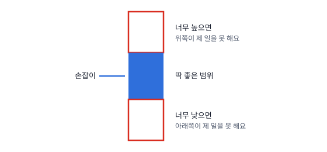

*손잡이가 색칠된 가운데 칸에 있으면 둘 다 제 일을 하고, 테두리만 있는 위아래 칸으로 벗어나면 한쪽이 일을 못 해요.*

**정확히 말하면**

설계 문제(L03 s6, Razavi 예제 9.5)는 이래요.

- 출력저항(output resistance) $R_{out}=500\,\text{k}\Omega$, 전류 $0.5\,\text{mA}$인 NMOS 캐스코드 전류원을 설계해요.
- $\mu_n C_{ox}=100\,\mu\text{A/V}^2$, $\lambda=0.1\,\text{V}^{-1}$이에요.
- 계산을 줄이려고 $M_1$과 $M_2$가 같다고 가정해요. 같을 필요는 없어요.
- 이 회로에서 $M_1$은 위(출력 쪽, 캐스코드 소자)이고 $M_2$는 아래(소스가 접지)예요.

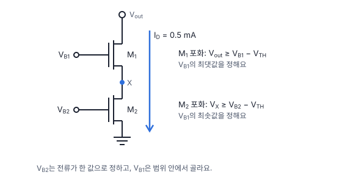

*NMOS 캐스코드 전류원. 전류는 아래 $M_2$가 정하고, 위 $M_1$의 게이트 전압 $V_{B1}$은 두 포화 조건 사이에서 골라요.*

게이트에 DC 전압만 걸려 있으면 이 회로는 일정한 전류를 흘리는 전류원이에요. DC 바이어스 위에 소신호를 얹으면 출력 전압이 변해서 증폭기가 돼요([MOS 캐스코드 증폭기의 이득](#s2-cascode-amp)).

설계는 DC 바이어스, 곧 동작점(operating point)을 정하는 일부터 시작해요. 트랜지스터에는 두 조건이 필요해요.

- 켜짐: $V_{GS} \gt V_{TH}$.
- 전류원으로 동작하려면 포화 영역(saturation)에 있어야 해요: $V_{DS} \ge V_{GS} - V_{TH}$.
- $V_{GS}-V_{TH}$를 오버드라이브 전압(overdrive voltage) $V_{OD}$라고 불러요. $V_{DS}$가 $V_{OD}$보다 작으면 트랜지스터는 저항처럼(triode) 동작해요.

전류를 정하는 것은 아래 $M_2$예요.

1. $M_2$의 소스가 접지라서 $V_{GS2}=V_{B2}$예요.
2. $$
   I_{D2}=\frac{1}{2}\mu_n C_{ox}\frac{W}{L}(V_{B2}-V_{TH})^2
   $$
3. $V_{B2}$와 $W/L$로 $I_{D2}=0.5\,\text{mA}$를 맞춰요.

위 $M_1$의 $V_{GS1}$은 $V_{B1}$이 정하지 않아요.

1. 직렬이라 $I_{D1}=I_{D2}$예요. 그래서 전류가 $V_{GS1}$을 정해요.
2. $V_{B1}$을 올리면 소스 노드 $X$도 같이 올라가요: $V_X=V_{B1}-V_{GS1}$.
3. $V_{GS1}$은 그대로이므로 $V_{B1}$은 전류를 바꾸지 않아요.

두 트랜지스터를 모두 포화에 두는 조건을 $V_{B1}$에 대해 풀어요. 노드 $X$는 $M_1$의 소스이자 $M_2$의 드레인이에요.

1. $M_2$ 포화: $V_{DS2}=V_X \ge V_{B2}-V_{TH}$
2. $V_X=V_{B1}-V_{GS1}$을 넣으면: $V_{B1}-V_{GS1} \ge V_{B2}-V_{TH}$
3. $V_{B1}$의 최솟값: $V_{B1} \ge V_{GS1}+(V_{B2}-V_{TH})$
4. $M_1$ 포화: $V_{DS1}=V_{out}-V_X \ge V_{GS1}-V_{TH}$
5. $V_X=V_{B1}-V_{GS1}$을 넣으면 $V_{GS1}$이 지워져요: $V_{out} \ge V_{B1}-V_{TH}$
6. $V_{B1}$의 최댓값: $V_{B1} \le V_{out}+V_{TH}$

$$
V_{GS1} + (V_{B2} - V_{TH}) \le V_{B1} \le V_{out} + V_{TH}
$$

그래서 $V_{B2}$는 전류로 값이 하나로 정해지지만 $V_{B1}$은 범위를 가져요. $V_{B1}$이 너무 낮으면 $M_2$가, 너무 높으면 $M_1$이 포화를 벗어나요.

**교수님 말씀**

교수님이 설계 순서를 질문으로 짚었어요.

- "설계할 때 뭘 먼저 설계하죠?"라는 물음에 한 학생이 "DC 바이어스"라고 답했어요. (0911 01:29)
- 트랜지스터의 두 동작 영역을 묻자 "저항과 전류원", 그 영역의 이름을 묻자 "포화(saturation)"라는 답이 나왔어요. (0911 02:18–02:37)
- 포화에서는 전류원으로 동작한다는 답까지 이어졌어요. (0911 03:02)

$V_{B1}$이 범위를 갖는다는 정리는 슬라이드에 없고 칠판에서 두 포화 조건을 풀어 얻었어요. (0911 05:34–08:18)

**꼭 기억해요**

> "여기 나와 있듯이 꼭 동일할 필요는 없습니다." (0911 01:05)

$M_1=M_2$는 계산을 줄이려는 가정일 뿐이에요. 설계는 늘 DC 바이어스(동작점)부터 정해요.

**페이지 요약**

전류는 아래 $M_2$가 정하고, 위 $M_1$의 $V_{B1}$은 두 포화 조건 사이의 범위에서 골라요.

*핵심 식*

- 포화 조건

  $$
  V_{DS} \ge V_{GS} - V_{TH}
  $$
- V_B1의 범위

  $$
  V_{GS1} + (V_{B2} - V_{TH})
  $$

  $$
  \le V_{B1} \le V_{out} + V_{TH}
  $$

*용어*

- **동작점(operating point)** — DC 바이어스로 정한 전압·전류 값
- **오버드라이브 전압 $V_{OD}$** — 곧 $V_{GS}-V_{TH}$로, 포화에 필요한 최소 $V_{DS}$

---

### 출력저항 500 kΩ에서 W/L 구하기

*0911 수업 · L03 s6*

**쉽게 말하면**

혼자 버티는 사람 뒤에 한 사람이 더 받쳐 주면, 밀어도 훨씬 덜 밀려요.

*하나일 때보다 둘을 쌓으면 버티는 힘이 25배로 커져요.*

**정확히 말하면**

출력저항은 소신호로 구해요. DC 전압원($V_{B1}$, $V_{B2}$)은 모두 AC 접지로 두어요.

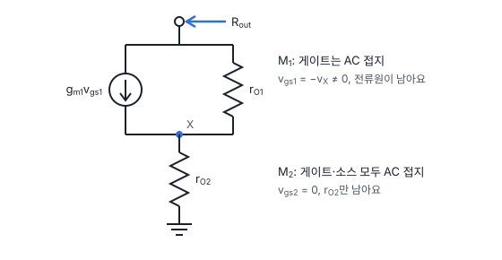

*소신호 등가회로. 아래 $M_2$는 저항 $r_{O2}$ 하나가 되고, 위 $M_1$은 전류원 $g_{m1}v_{gs1}$과 $r_{O1}$이 그대로 남아요.*

1. $M_2$: 게이트와 소스가 모두 AC 접지라 $v_{gs2}=0$, $g_{m2}v_{gs2}=0$이에요.
2. 그래서 $M_2$는 노드 $X$와 접지 사이의 저항 $r_{O2}$ 하나로 바뀌어요.
3. $M_1$: 게이트는 AC 접지지만 소스($X$)가 0이 아니라서 $v_{gs1}=-v_X\ne0$이에요.
4. 그래서 드레인(출력)과 소스($X$) 사이의 전류원 $g_{m1}v_{gs1}$이 남고, $r_{O1}$이 병렬로 붙어요.

이 회로의 출력저항은 0909에 유도한 식(L03 s4)이에요.

$$
R_{out} = (1 + g_{m1} r_{O2}) r_{O1} + r_{O2}
$$

$$
R_{out} \approx g_{m1} r_{O1} r_{O2}
$$

근사는 $g_m r_O \gg 1$일 때 맞아요([25배의 힘과 손계산의 목적](#s0-hand-calc)). 트랜지스터 하나만 있으면 출력저항은 $r_{O2}$인데, 위에 쌓은 $M_1$의 $g_{m1}r_{O1}$배만큼 커져요.

소신호 파라미터는 동작점에서 정해져요. $g_m$은 포화 전류식을 $V_{GS}$로 미분한 값이에요.

$$
g_m = \mu_n C_{ox} \frac{W}{L} V_{OD}
$$

$$
g_m = \sqrt{2 \mu_n C_{ox} \frac{W}{L} I_D}
$$

전류가 주어졌으니 전류로 쓴 두 번째 식이 편해요. $r_O$는 전류만으로 정해져요.

$$
r_O = \frac{1}{\lambda I_D}
$$

$$
= \frac{1}{0.1\,\text{V}^{-1} \times 0.5\,\text{mA}} = 20\,\text{k}\Omega
$$

두 트랜지스터는 전류가 같으므로 $r_{O1}=r_{O2}=20\,\text{k}\Omega$예요. 남은 설계 변수는 $W/L$ 하나예요.

1. $g_{m1} r_{O1} r_{O2} = 500\,\text{k}\Omega$
2. $g_{m1} = \dfrac{500\,\text{k}\Omega}{(20\,\text{k}\Omega)^2} = \dfrac{1}{800\,\Omega} = 1.25\,\text{mS}$
3. $\sqrt{2 \times 100\,\mu\text{A/V}^2 \times \dfrac{W}{L} \times 0.5\,\text{mA}} = \dfrac{1}{800\,\Omega}$
4. 양변을 제곱: $10^{-7} \times \dfrac{W}{L} = 1.5625 \times 10^{-6}$
5. $W/L \approx 15.6$ (두 트랜지스터 모두)

$500\,\text{k}\Omega$를 $20\,\text{k}\Omega$로 한 번 나눈 25는 $g_{m1}r_{O1}$이에요. $g_{m1}$을 얻으려면 한 번 더 나눠야 해요.

설계 결과를 모으면 이래요.

- $(W/L)_1=(W/L)_2 \approx 15.6$
- $V_{B2}$는 전류가 정해요. 이 $W/L$이면 $V_{OD}=V_{B2}-V_{TH}$는

  $$
  V_{OD}=\sqrt{2I_D/(\mu_n C_{ox} W/L)}\approx0.8\,\text{V}
  $$

  예요. 문제에 $V_{TH}$가 없어서 수업에서는 값을 따로 계산하지 않았어요.
- $V_{B1}$은 포화 범위 안에서 골라요([바이어스부터: 포화 조건과 V_B1의 범위](#s0-bias)).

#### 직접 해 보기: $W/L$과 $I_D$를 바꾸면 캐스코드 $R_{out}$은? *(정적 스냅샷 — 직접 조작은 HTML 버전)*

$M_1=M_2$, $\mu_n C_{ox}=100\,\mu\text{A/V}^2$, $\lambda=0.1\,\text{V}^{-1}$에서 $W/L$과 $I_D$를 움직이면 $1/g_{m1}$, 트랜지스터 하나일 때의 $r_{O2}$, 캐스코드 $R_{out}$이 로그 눈금 막대로 비교돼요.

로그 눈금이라 두 막대 끝 사이의 거리가 곱한 배수예요. $1/g_{m1}$에서 $r_{O2}$까지와 $r_{O2}$에서 $R_{out}$까지는 똑같이 $g_{m1}r_{O1}$배 떨어져 있어요.

**W/L = 15.6, I_D = 0.50 mA: g_m1 = 1.25 mS (1/g_m1 = 801 Ω), r_O1 = r_O2 = 20.0 kΩ, g_m1 r_O1 = 25.0배, R_out ≈ 500 kΩ (목표의 1.00배, 정확 식으로는 540 kΩ), V_OD = 0.80 V**

범례: 테두리 막대: $1/g_{m1}$, $r_{O2}$(트랜지스터 하나) · 색칠된 막대: 캐스코드 $R_{out} \approx g_{m1} r_{O1} r_{O2}$ · 세로 점선: 목표 $500\,\text{k}\Omega$

$W/L=15.6$, $I_D=0.5\,\text{mA}$에서 $R_{out}\approx500\,\text{k}\Omega$, 곧 $r_{O2}$의 25배가 돼요. $W/L$을 약 4배(62.5)로 키우면 $g_{m1}$이 2배라 $R_{out}\approx1\,\text{M}\Omega$이 돼요. 반대로 $I_D$를 $1\,\text{mA}$로 올리면 $g_{m1}$은 $\sqrt{2}$배지만 $r_O$가 절반이 되어 $R_{out}$은 $177\,\text{k}\Omega$로 줄어요.

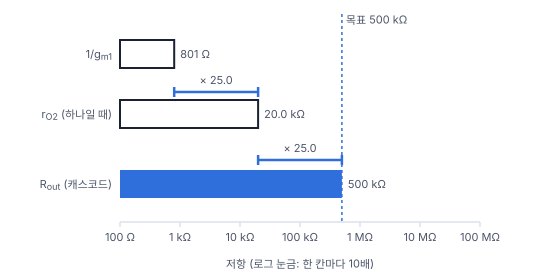

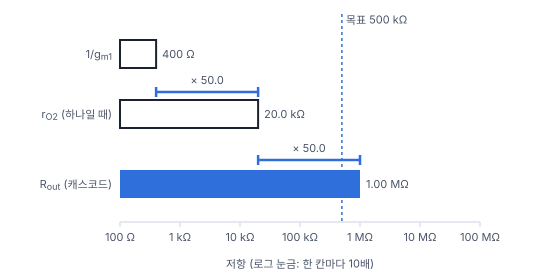

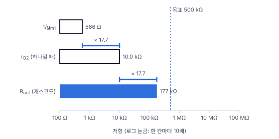

| 설정 | 트랜스컨덕턴스 $g_{m1}$ | 출력저항 $r_{O1}=r_{O2}$ | 배수 $g_{m1}r_{O1}$ | 근사 $R_{out}\approx g_{m1}r_{O1}r_{O2}$ | 정확 식 |
|---|---|---|---|---|---|
| W/L = 15.6, I_D = 0.50 mA | 1.25 mS | 20.0 kΩ | 25.0 | 500 kΩ (목표의 1.00배) | 540 kΩ |
| W/L = 62.5, I_D = 0.50 mA | 2.50 mS | 20.0 kΩ | 50.0 | 1.00 MΩ (목표의 2.00배) | 1.04 MΩ |
| W/L = 15.6, I_D = 1.00 mA | 1.77 mS | 10.0 kΩ | 17.7 | 177 kΩ (목표의 0.35배) | 197 kΩ |

**교수님 말씀**

- "$r_O$는 어떻게 표현돼요?"라는 물음에 한 학생이 "$\lambda I_D$"라고 답했고, 교수님이 "$\lambda I_D$분의 1"로 고쳐 말했어요. (0911 12:33–12:40)
- 트랜지스터 하나만 있으면 $r_{O2}$인데, 위에 쌓은 트랜지스터의 $g_m r_O$배만큼 커진다고 정리했어요. (0911 10:30–10:55)
- $W/L$ 계산은 각자 해 보라고 하고 결과 15.6만 확인했어요. (0911 13:40–15:26)

**페이지 요약**

$r_O$는 전류로 정해지니, 목표 $R_{out}$에서 $g_{m1}$을 거꾸로 구하고 $W/L$을 풀어요.

*핵심 식*

- 캐스코드 출력저항

  $$
  R_{out} \approx g_{m1} r_{O1} r_{O2}
  $$
- 트랜스컨덕턴스

  $$
  g_m = \sqrt{2 \mu_n C_{ox} \frac{W}{L} I_D}
  $$
- 출력저항

  $$
  r_O = \frac{1}{\lambda I_D}
  $$

*용어*

- **AC 접지(AC ground)** — 소신호에서 DC 전압원을 0 V로 두는 것

---

### 25배의 힘과 손계산의 목적

*0911 수업 · L03 s6 · 슬라이드 외*

**쉽게 말하면**

조금 어긋난 지도라도 어느 쪽으로 가야 할지는 바로 알려 줘요.

*테두리 동그라미처럼 여기저기 다 해 보는 대신, 대충 맞는 셈이 색칠된 목표점으로 가는 방향을 곧장 알려 줘요.*

**정확히 말하면**

캐스코드가 출력저항을 얼마나 키웠는지 비교해요.

1. $M_1$ 없이 $M_2$만 쓰면: $R_{out}=r_{O2}=20\,\text{k}\Omega$
2. 캐스코드로 쌓으면: $R_{out}\approx500\,\text{k}\Omega$
3. 늘어난 배수: $g_{m1} r_{O1} = 1.25\,\text{mS} \times 20\,\text{k}\Omega = 25$

두 저항을 직렬로 이은 $r_{O1}+r_{O2}=40\,\text{k}\Omega$(2배)가 아니라 25배예요. 적은 소자로 출력저항을 크게 키우는 구조예요.

이 예제에서 $g_m r_O = 25$이므로 $g_m r_O \gg 1$ 근사가 타당해요. 보통의 설계에서도 이 가정은 맞아요.

정확한 식과 근사식의 차이는 손계산이 감당할 만한 크기예요. 아래 비교는 수업에서 계산하지 않았고, 수업 값을 넣어 본 거예요.

1. 정확한 식:

   $$
   (1+g_{m1}r_{O2})r_{O1}+r_{O2}
   $$

   $$
   =(1+25)\times20\,\text{k}\Omega+20\,\text{k}\Omega
   $$

   $$
   =540\,\text{k}\Omega
   $$
2. 근사식: $g_{m1}r_{O1}r_{O2}=500\,\text{k}\Omega$
3. 차이는 약 7%로, 손계산의 허용 범위(10% 안팎) 안이에요.

손계산(hand calculation)은 10% 안팎의 오차면 충분해요.

- 포화 전류식 $I_D=\frac{1}{2}\mu_n C_{ox}\frac{W}{L}(V_{GS}-V_{TH})^2$ 자체가 근사예요.
- 실제 공정 모델은 파라미터가 훨씬 많아요.
- 남는 오차는 시뮬레이션(simulation) 툴로 보정해요.

식을 구하는 목적은 어떤 파라미터를 바꿔야 하는지 아는 거예요. 식을 모르면 파라미터를 sweep하며(하나씩 바꿔 가며) 답을 찾아야 해요.

1. 설계했더니 $250\,\text{k}\Omega$가 나왔다면 2배로 키워야 해요.
2. $R_{out}\approx g_{m1}r_{O1}r_{O2}$이므로 $g_{m1}$을 2배로 하거나 $r_O$를 키우면 돼요.
3. $g_m\propto\sqrt{W/L}$이므로 $g_{m1}$을 2배로 하려면 $W/L$을 4배로 해요.

수업에서는 전류를 늘려 $g_m$을 키우는 방법도 말했어요. 다만 전류를 바꾸면 $r_O=1/(\lambda I_D)$도 함께 바뀐다는 점은 따로 말하지 않았어요. $M_1=M_2$인 이 회로에 넣어 보면 이래요.

1. $$
   R_{out}\approx g_m r_O^2
   $$

   $$
   = \sqrt{2 \mu_n C_{ox} \frac{W}{L} I_D}\times\frac{1}{\lambda^2 I_D^2}
   $$
2. $R_{out}\propto\sqrt{W/L}\,/\,I_D^{3/2}$
3. 그래서 $I_D$를 키우면 $g_m$은 커지지만 $R_{out}$은 오히려 줄어요. 전류가 고정된 조건에서는 $W/L$을 바꾸는 쪽이 맞아요.

이 관계는 [출력저항 500 kΩ에서 W/L 구하기](#s0-wl)의 막대 비교에서 $I_D$를 움직여 확인할 수 있어요.

**교수님 말씀**

- 정확한 식은 더 복잡하지만 근사식 $g_{m1}r_{O1}r_{O2}$를 쓰면 된다고 했어요. (0911 17:10–18:06)
- 식을 모르면 파라미터를 "sweep"하며 답을 찾아야 하지만, 식을 알면 어느 파라미터를 몇 배 바꿀지 바로 안다고 비유했어요. (0911 18:53)
- 손으로 정확히 맞추는 것보다, 남는 오차는 시뮬레이션 툴에 맡기고 방향을 잡는 데 식을 쓰라고 했어요. (0911 17:20–18:06)

**꼭 기억해요**

> "여러분들이 정확하게 계산하는 게 손으로 계산하고 이런 게 목적이 아니에요." (0911 17:20)

> "그래서 굉장히 유용한 구조고요." (0911 16:45)

캐스코드는 출력저항을 직렬 합(2배)이 아니라 $g_{m1} r_{O1}$배(이 예제에서 25배) 키워요.

**페이지 요약**

캐스코드는 출력저항을 $g_{m1} r_{O1}$배 키우고, 손계산은 어떤 파라미터를 바꿀지 알려 주는 도구예요.

*핵심 식*

- 늘어난 배수

  $$
  g_{m1} r_{O1} = 1.25\,\text{mS} \times 20\,\text{k}\Omega = 25
  $$

*용어*

- **손계산(hand calculation)** — 근사식으로 10% 안팎까지 맞추는 계산
- **sweep** — 파라미터를 하나씩 바꿔 가며 답을 찾는 것

---

### 쌓을수록 드는 비용: 헤드룸과 3단 캐스코드

*0911 수업 · 슬라이드 외*

**쉽게 말하면**

블록을 한 층 더 쌓을 때마다 천장도 한 칸 더 높아야 해요.

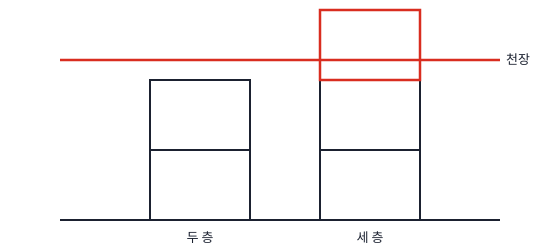

*두 층은 천장 아래에 들어가지만, 세 층은 천장을 뚫고 나가요.*

**정확히 말하면**

트랜지스터 하나를 포화에 두려면 $V_{DS,min}=V_{OD}$가 필요해요. 하나를 쌓을 때마다 $V_{OD}$가 하나씩 더 필요해요. 이 전압 여유를 헤드룸(headroom)이라고 해요.

2단 캐스코드의 최소 출력 전압은 [바이어스부터: 포화 조건과 V_B1의 범위](#s0-bias)의 두 조건에서 나와요. 아래 유도는 수업에서 칠판에 쓰지 않았고, 그 두 조건을 이어 본 거예요.

1. $V_{B1}$을 최솟값에 두면: $V_X = V_{B2}-V_{TH} = V_{OD2}$
2. $M_1$ 포화:

   $$
   V_{out} \ge V_{B1}-V_{TH}
   $$

   $$
   = V_{GS1}+V_{OD2}-V_{TH}
   $$
3. $V_{out,min} = V_{OD1}+V_{OD2}$
4. 이 예제 값($V_{OD}\approx0.8\,\text{V}$)을 넣으면 약 $1.6\,\text{V}$예요. 트랜지스터 하나였다면 $0.8\,\text{V}$면 돼요.

3단으로 쌓을 때는 노드 방정식을 다시 풀 필요가 없어요.

1. 2단 캐스코드를 한 덩어리로 보고, 그 출력저항 $R_{out,2}=500\,\text{k}\Omega$를 $r_O$ 자리에 넣어요.
2. $$
   R_{out,3} \approx g_{m3} r_{O3} R_{out,2}
   $$
3. $R_{out,3} \approx 25 \times 500\,\text{k}\Omega = 12.5\,\text{M}\Omega$

그래도 실제로는 보통 2단까지만 써요.

- 증폭기로 만들면 부하 쪽에도 같은 구조가 필요해요. 3단이면 트랜지스터가 6개, $V_{OD}$도 6개 필요해요.
- 그만큼 전원 전압(supply voltage)이 높아야 해요.
- 2단으로도 $500\,\text{k}\Omega$ 정도면 충분히 커요. 전원 전압이 충분하면 더 쌓을 수 있어요.

**교수님 말씀**

- 0909 끝에서 예고한 캐스코드의 단점을 이어서 설명했어요. 하나를 쌓을 때마다 $V_{OD}$가 하나씩 더 든다고 했어요. (0911 19:36–20:13)
- 3단은 2단을 "한 덩어리"로 보고, 그 $R_{out}$이 $r_O$ 자리에 들어간다고 생각하면 된다고 했어요. (0911 20:22–21:18)
- 부하까지 같은 구조로 만들면 트랜지스터 6개가 필요해서, 보통은 2단까지만 쓴다고 했어요. (0911 21:21–22:42)

**페이지 요약**

한 층 쌓을 때마다 출력저항은 $g_m r_O$배 커지지만 헤드룸으로 $V_{OD}$ 하나를 더 내줘야 해요.

*핵심 식*

- 3단 캐스코드

  $$
  R_{out,3} \approx g_{m3} r_{O3} R_{out,2}
  $$
- 2단 최소 출력 전압

  $$
  V_{out,min} = V_{OD1}+V_{OD2}
  $$

*용어*

- **헤드룸(headroom)** — 트랜지스터를 모두 포화에 두는 데 드는 전압 여유

---

## 2. PMOS·바이폴라 캐스코드

### PMOS 캐스코드: 뒤집으면 같다

*0911 수업 · L03 s7*

**쉽게 말하면**

바닥으로 빼 주는 탑과 위에서 부어 주는 탑은 위아래만 바뀐 같은 모양이에요.

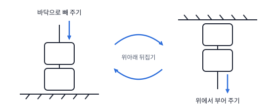

*그래서 한쪽을 알면 다른 쪽은 뒤집기만 하면 돼요.*

**정확히 말하면**

전류원은 전류가 흐르는 방향에 따라 두 가지로 나눠요.

- 싱크(sink)형: 어떤 노드에서 접지로 전류를 빼내요. NMOS로 만들고, 캐스코드로 만들 때는 트랜지스터를 **위로** 쌓아요.
- 소스(source)형: 전원 $V_{DD}$에서 어떤 노드로 전류를 넣어 줘요. PMOS로 만들고, 캐스코드로 만들 때는 트랜지스터를 **아래로** 쌓아요.

PMOS 하나($M_2$)만 쓰면 출력저항은 $r_{O2}$예요. 그 아래에 $M_1$을 하나 더 쌓은 것이 PMOS 캐스코드 전류원이에요. 전원 쪽이 $M_2$, 출력 쪽(캐스코드 소자)이 $M_1$이에요.

*왼쪽은 PMOS 캐스코드 전류원, 오른쪽은 그 소신호 등가회로예요. $M_2$ 자리에는 $r_{O2}$만 남아요.*

**바이어스.** 아무 전압이나 $V_{B1}$, $V_{B2}$에 걸면 안 되고, 동작점을 먼저 정해요.

- $M_2$는 소스가 $V_{DD}$에 고정돼 있어요. 그래서 $V_{B2}$가 $|V_{GS2}| = V_{DD} - V_{B2}$를 정하고, 전류도 $M_2$가 정해요. PMOS라 $V_{GS}$가 음수여서 절댓값으로 써요.
- $M_1$은 $V_{B1}$을 바꿔도 노드 $X$가 같이 움직여서 $|V_{GS1}|$이 그대로예요. 그래서 $M_1$은 전류를 정하지 않아요.

**소신호 출력저항.** 동작점과 포화 조건이 모두 만족된 상태에서 구해요. 출력에 시험 전압 $v_t$를 걸고 들어가는 전류를 $i_t$라고 둬요.

1. DC 전압 $V_{DD}$, $V_{B1}$, $V_{B2}$는 모두 AC 접지예요.
2. $M_2$: 게이트와 소스가 모두 AC 접지라서

   $$
   v_{gs2} = 0 \;\Rightarrow\; g_{m2} v_{gs2} = 0
   $$

   전류원이 사라지고 $X$와 AC 접지 사이에 $r_{O2}$만 남아요.
3. $M_1$: 게이트는 0이지만 소스($X$)는 0이 아니에요.

   $$
   v_{gs1} = -v_X \ne 0
   $$

   그래서 전류원 $g_{m1} v_{gs1}$과 $r_{O1}$이 그대로 남아요.
4. $i_t$는 모두 $r_{O2}$로 흘러요:

   $$
   v_X = i_t r_{O2}
   $$
5. 출력 노드 KCL:

   $$
   i_t = g_{m1} v_{gs1} + \frac{v_t - v_X}{r_{O1}} = -g_{m1} r_{O2} i_t + \frac{v_t - i_t r_{O2}}{r_{O1}}
   $$
6. 정리하면 NMOS 캐스코드와 같은 식이에요:

   $$
   R_{out} = \frac{v_t}{i_t} = (1 + g_{m1} r_{O2}) r_{O1} + r_{O2}
   $$

수업에서는 이 단계를 다시 풀지 않았어요. 등가회로를 위아래로 뒤집으면 NMOS 캐스코드의 등가회로와 구조가 똑같아서, 0909에 구한 식을 그대로 가져왔어요.

$$
R_{out} = (1 + g_{m1} r_{O2}) r_{O1} + r_{O2} \approx g_{m1} r_{O1} r_{O2}
$$

세 항 가운데 두 번째 항 $g_{m1} r_{O1} r_{O2}$가 가장 커요. 이 근사는 $g_m r_O \gg 1$일 때 타당하고, 보통의 트랜지스터는 이 조건을 만족해요.

개념으로 보면, 하나만 있을 때 $r_{O2}$였던 출력저항이 아래에 쌓은 $M_1$의 $g_{m1} r_{O1}$배만큼 커진(부스팅된) 거예요. NMOS에서 이 배수가 얼마나 되는지는 [25배의 힘과 손계산의 목적](#s0-hand-calc)에서 봤어요.

**교수님 말씀**

NMOS와 PMOS는 쌓는 방향만 반대라고 정리하셨어요.

> "NMOS는 위로 쌓는 거지만, PMOS 커런트 소스는 아래로 쌓는다" (0911 23:57)

근사식이 늘 써도 되는 식이라는 점도 짚으셨어요. 보통의 트랜지스터는 $g_m r_O \gg 1$을 만족하기 때문이에요.

> "typical이 이런 조건을 만족하기 때문에 우리가 이렇게 써도 무방하다" (0911 29:06)

식보다 개념으로 기억하라고 하셨어요. 아래에 쌓은 $M_1$이 $r_{O2}$를 키워 준다는 그림이에요.

> "아래쪽에 쌓여 있는 … M1의 g_m1 r_o1 만큼 더 출력 임피던스가 더 부스팅된 거죠." (0911 29:25)

**꼭 기억해요**

PMOS 캐스코드는 새로 풀 필요가 없어요. 뒤집으면 NMOS 캐스코드와 같아서 식도 같아요.

> "PMOS는 동일해요. 뒤집으면 동일하기 때문에." (0911 29:44)

뒤집어도 번호는 그대로예요. 출력 쪽 캐스코드 소자가 $M_1$, 전류를 정하는 전원 쪽 소자가 $M_2$예요. 그래서 식에 들어가는 $g_m$은 $g_{m1}$이에요.

**페이지 요약**

PMOS 캐스코드는 위아래로 뒤집으면 NMOS 캐스코드와 같아서, 출력저항 식도 같아요.

*핵심 식*

- 출력저항

  $$
  R_{out} = (1 + g_{m1} r_{O2}) r_{O1} + r_{O2}
  $$

  $$
  \approx g_{m1} r_{O1} r_{O2}
  $$
- M1의 소신호 전압

  $$
  v_{gs1} = -v_X \ne 0
  $$

*용어*

- **싱크(sink)형 전류원** — 노드에서 접지로 전류를 빼내요. NMOS로 만들고 위로 쌓아요
- **소스(source)형 전류원** — $V_{DD}$에서 노드로 전류를 넣어요. PMOS로 만들고 아래로 쌓아요

---

### NPN 캐스코드: r_π가 끼어든다

*0911 수업 · L03 s8*

**쉽게 말하면**

하나 위에 하나를 더 올리면 훨씬 잘 버티는데, 이번에 올린 부품에는 옆으로 조금 새는 길이 있어요.

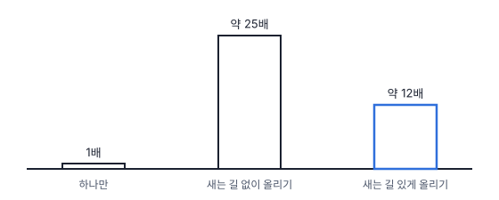

*새는 길 때문에 버티는 힘이 절반쯤 줄지만, 하나만 있을 때보다는 여전히 훨씬 커요.*

**정확히 말하면**

BJT로도 접지로 전류를 빼내는 싱크형 전류원을 만들 수 있어요. $Q_2$ 하나로도 전류원이지만 출력저항이 $r_{O2}$로 작아요. 그래서 위에 $Q_1$을 하나 더 쌓아요. 출력 쪽(캐스코드 소자)이 $Q_1$, 접지 쪽이 $Q_2$예요.

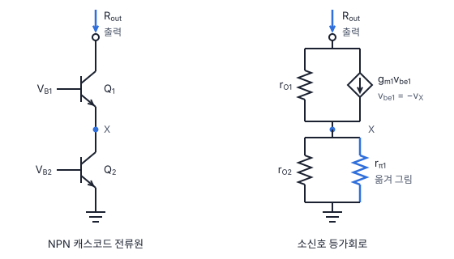

*왼쪽은 NPN 캐스코드 전류원, 오른쪽은 소신호 등가회로예요. $r_{\pi 1}$을 옮겨 그리면 $X$와 접지 사이에서 $r_{O2}$와 나란해져요.*

**바이어스.** 전류는 $Q_2$가 정해요.

- $Q_2$는 이미터가 접지라서 $V_{BE2} = V_{B2}$예요. 순방향 활성 영역(forward active region)에서

  $$
  I_C = I_S e^{V_{BE}/V_T}
  $$

  이므로 $V_{B2}$가 $I_{C2}$를 정해요.
- $Q_1$은 $V_{B1}$을 올려도 이미터($X$)가 같이 올라가서 $V_{BE1}$이 그대로예요. 그래서 $Q_1$은 전류를 바꾸지 않아요. $Q_1$을 쓰는 이유는 출력저항을 키우기 위해서예요.

엄밀히 말하면 BJT는 컬렉터 전류와 이미터 전류가 같지 않아요. MOS는 게이트로 흐르는 길이 없어서 드레인 전류와 소스 전류가 정확히 같지만, BJT는 베이스 전류가 더해져요.

$$
I_E = I_C + I_B, \quad I_B = I_C / \beta
$$

$\beta = 100$이면 $I_B$는 $I_C$의 1% 정도예요. 그래서 $I_C \approx I_E$로 둬요.

**소신호 출력저항.** 출력에 시험 전압 $v_t$를 걸고 들어가는 전류를 $i_t$라고 둬요.

1. DC 전압 $V_{B1}$, $V_{B2}$는 AC 접지예요.
2. $Q_2$: 베이스와 이미터가 모두 AC 접지라서

   $$
   v_{be2} = 0 \;\Rightarrow\; g_{m2} v_{be2} = 0
   $$

   $X$와 접지 사이에 $r_{O2}$만 남아요.
3. $Q_1$: 베이스는 0이지만 이미터($X$)는 접지가 아니에요.

   $$
   v_{be1} = -v_X \ne 0
   $$

   그래서 전류원 $g_{m1} v_{be1}$과 $r_{O1}$이 남아요.
4. MOS와 다른 점: $Q_1$의 베이스와 이미터 사이에 $r_{\pi 1}$이 있어요. 베이스가 AC 접지이므로 $r_{\pi 1}$은 $X$와 접지 사이에 있는 것과 같아요.
5. 옮겨 그리면 $r_{\pi 1}$이 $r_{O2}$와 병렬이에요. MOS 식의 $r_{O2}$ 자리에

   $$
   r_{O2} \parallel r_{\pi 1}
   $$

   을 넣으면 돼요.
6. 결과:

   $$
   R_{out} = [1 + g_{m1} (r_{O2} \parallel r_{\pi 1})] r_{O1} + r_{O2} \parallel r_{\pi 1}
   $$
7. $g_m r_O \gg 1$일 때 두 번째 항이 지배적이에요:

   $$
   R_{out} \approx g_{m1} r_{O1} (r_{O2} \parallel r_{\pi 1})
   $$

식을 다시 유도할 필요는 없어요. [PMOS 캐스코드: 뒤집으면 같다](#s1-pmos)의 MOS 식에서 $r_{O2}$ 하나만 바꾸면 돼요.

$Q_2$의 $r_{\pi 2}$도 무시한 게 아니에요. $r_{\pi 2}$는 베이스와 이미터가 둘 다 AC 접지라 양 끝이 모두 접지여서 출력에서 보이지 않아요. $r_{\pi 1}$은 한쪽만 접지이고 다른 쪽이 $X$여서 의미가 있어요.

병렬 저항은 원래 저항보다 작아요. 그래서 BJT 캐스코드의 부스팅은 MOS보다 줄어요. $r_\pi$는 보통 수십 kΩ으로 충분히 커서, 교수님 어림으로는 대략 절반 정도, 예컨대 25배가 12배 정도로 줄어요. 줄어도 출력저항을 크게 키우는 좋은 구조예요.

**교수님 말씀**

"BJT는 MOSFET하고 무슨 차이점이 있겠어요?"라고 물으셨어요. 한 학생이 베이스 전류와 $r_\pi$를 답하자 "네 아주 잘"이라고 받으셨어요 (0911 37:02).

$r_\pi$ 때문에 식이 조금 지저분해졌다고 하셨어요. MOS처럼 게이트 전류가 없으면 가장 깔끔하다는 말씀이에요.

> "원래 전류가 없는 게 깔끔한데." (0911 39:29)

효과가 줄어도 구조의 가치는 그대로라고 강조하셨어요.

> "한 열두 배 정도 증가하는 효과로 줄어드는 거지, 이게 이제 늘어나는 효과가 없다는 건 아니에요." (0911 42:57)

**꼭 기억해요**

식을 외우지 말고 물리적으로 이해하라고 하셨어요.

> "헷갈리지 않나요? 나중에 되면 항상 식을 외우면 헷갈려요." (0911 41:16)

"$Q_1$을 쌓으면서 $Q_1$의 베이스–이미터 저항이 $r_{O2}$와 병렬로 보인다"고 생각하면 $r_{\pi 1}$인지 $r_{\pi 2}$인지 헷갈리지 않아요. 쌓은 소자의 $r_\pi$가 들어가요.

흔한 오답도 짚으셨어요. $Q_1$의 베이스가 접지라고 전류원을 지워서 $r_{O1} + r_{O2}$ 직렬로 보면 틀려요. 이미터가 접지가 아니라서 $v_{be1} \ne 0$이에요.

> "이게 아니라고 얘기했죠? … 베이스는 0이지만 에미터가 0이 아니죠." (0911 36:11)

**페이지 요약**

NPN 캐스코드는 MOS 식에서 $r_{O2}$ 자리만 $r_{O2} \parallel r_{\pi 1}$로 바꾸면 돼요. 쌓은 $Q_1$의 $r_{\pi 1}$ 때문에 부스팅이 조금 줄어요.

*핵심 식*

- 바이어스 전류

  $$
  I_C = I_S e^{V_{BE}/V_T}
  $$

  $$
  I_B = I_C / \beta
  $$
- 출력저항

  $$
  R_{out} \approx g_{m1} r_{O1} (r_{O2} \parallel r_{\pi 1})
  $$

*용어*

- **$r_\pi$** — 베이스–이미터 사이의 소신호 저항. 베이스 전류가 있어서 생겨요
- **부스팅(boosting)** — 쌓은 소자의 $g_m r_O$배만큼 아래 저항이 커 보이는 것

---

### 바이폴라 캐스코드 다시 보기: 쌓을 때마다 g_m r_O배

*0911 수업 · L03 s9*

**쉽게 말하면**

몇 층을 쌓든 흐르는 양은 맨 아래 한 칸이 정해요.

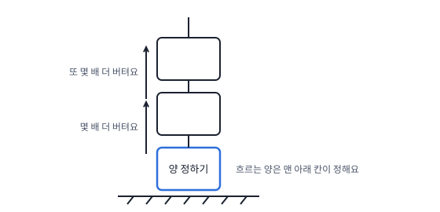

*위에 한 층씩 올릴 때마다 버티는 힘만 몇 배씩 커져요.*

**정확히 말하면**

슬라이드 s9는 캐스코드를 "전류원 $Q_2$ 위에 $Q_1$을 쌓아 $Q_2$의 출력저항을 키운 것"으로 다시 봐요.

- $Q_2$ 하나도 전류원이고, 2개, 3개, 4개를 쌓아도 모두 전류원이에요.
- 바이어스 전류 $I_C$는 맨 아래 트랜지스터가 정해요. 위에 쌓은 트랜지스터는 전류를 바꾸지 않아요.
- 하나를 더 쌓을 때마다 출력저항은 쌓은 트랜지스터의 $g_m r_O$배만큼 커져요.
- 다만 쌓은 트랜지스터의 $r_\pi$가 아래쪽 저항과 병렬로 보여서 조금 줄어요. $Q_1$이 없으면(베이스–이미터 저항이 무한대인 것과 같으면) 그냥 $r_{O2}$로 보여요.

*2단 캐스코드($Q_1$, $Q_2$) 위에 $Q_3$을 쌓은 3단 캐스코드예요. $Q_3$에서 보면 아래 2단 전체가 $r_O$ 하나 자리에 들어가요.*

**3단 캐스코드.** 노드 방정식을 다시 풀지 않고, 아래 2단을 한 덩어리로 봐요.

1. 아래 2단 캐스코드의 출력저항:

   $$
   R_{out,2} \approx g_{m1} r_{O1} (r_{O2} \parallel r_{\pi 1})
   $$
2. 그 위에 $Q_3$을 쌓으면 $R_{out,2}$가 2단 식의 $r_{O2}$ 자리에 들어가요.
3. $Q_3$의 베이스는 AC 접지라서 $r_{\pi 3}$이 노드 $Y$와 접지 사이에 보이고, $R_{out,2}$와 병렬이 돼요.
4. 결과:

   $$
   R_{out,3} \approx g_{m3} r_{O3} (R_{out,2} \parallel r_{\pi 3})
   $$

실제로는 3단까지는 잘 쓰지 않아요. 쌓을 때마다 전압 여유가 더 필요하기 때문이에요. 이유는 [쌓을수록 드는 비용: 헤드룸과 3단 캐스코드](#s0-headroom)와 같아요.

**교수님 말씀**

몇 개를 쌓든 전류원이라는 점은 변하지 않는다고 하셨어요.

> "세 개를 쌓아도 커런트 소스고 네 개를 쌓아도 커런트 소스예요" (0911 43:44)

3단은 식으로는 가능하지만 실제로는 드물다고 하셨어요.

> "세 개까지는 잘 안 쓴다고 보시면 되겠습니다." (0911 45:20)

**페이지 요약**

전류는 맨 아래 트랜지스터가 정하고, 하나 쌓을 때마다 출력저항이 그 소자의 $g_m r_O$배(단, $r_\pi$ 병렬만큼 감쇄)로 커져요.

*핵심 식*

- 3단 캐스코드

  $$
  R_{out,3} \approx g_{m3} r_{O3}
  $$

  $$
  \times (R_{out,2} \parallel r_{\pi 3})
  $$

*용어*

- **$R_{out,2}$** — 아래 2단 캐스코드의 출력저항. 3단에서는 $r_O$ 자리에 들어가요
- **$r_{\pi 3}$** — 새로 쌓은 $Q_3$의 베이스–이미터 저항. $R_{out,2}$와 병렬로 보여요

---

### PNP 캐스코드와 소신호 모델의 공통성

*0911 수업 · L03 s10*

**쉽게 말하면**

부품마다 크게 움직일 때의 모습은 달라도, 조금씩만 흔들면 모두 비슷하게 움직여요.

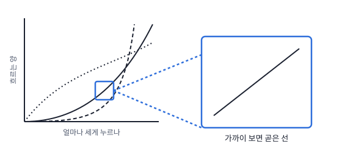

*그래서 한 가지 부품을 잘 알면 다른 부품도 거의 같은 방법으로 풀 수 있어요.*

**정확히 말하면**

전원에서 어떤 노드로 전류를 넣는 소스(source)형 전류원은 PNP로 만들어요. 전원에 붙은 쪽이 이미터이고, 이미터–베이스–컬렉터 순서예요. NPN은 노드에서 접지로 빼내는 싱크(sink)형이에요.

PNP 하나($Q_2$)로도 전류원이지만 출력저항이 작아요. 그래서 PMOS처럼 **아래로** $Q_1$을 하나 더 쌓아 PNP 캐스코드 전류원을 만들어요. 전원 쪽이 $Q_2$, 출력 쪽(캐스코드 소자)이 $Q_1$이에요.

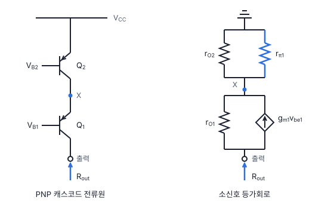

*왼쪽은 PNP 캐스코드 전류원, 오른쪽은 소신호 등가회로예요. 위아래로 뒤집으면 NPN 캐스코드의 등가회로와 같아요.*

1. $V_{CC}$, $V_{B1}$, $V_{B2}$는 모두 AC 접지예요.
2. $Q_2$: 베이스와 이미터가 모두 AC 접지라서 전류원이 사라지고 $r_{O2}$만 남아요.
3. $Q_1$: 베이스는 AC 접지지만 이미터($X$)가 접지가 아니어서 전류원 $g_{m1} v_{be1}$과 $r_{O1}$이 남아요.
4. 쌓은 $Q_1$의 $r_{\pi 1}$은 $X$와 AC 접지 사이에 보여서 $r_{O2}$와 병렬이에요.
5. 뒤집으면 [NPN 캐스코드: r_π가 끼어든다](#s1-npn)와 같은 구조라서 식도 같아요(슬라이드 s10의 식은 s8과 같아요):

   $$
   R_{out} \approx g_{m1} r_{O1} (r_{O2} \parallel r_{\pi 1})
   $$

뜻으로 읽으면, $Q_2$의 $r_{O2}$가 $Q_1$의 $g_{m1} r_{O1}$배만큼 부스팅되고, $Q_1$을 쌓으면서 보이는 $r_{\pi 1}$을 병렬로 고려한 거예요.

(수업 중 이 자리에서 "$r_{\pi 2}$가 $r_{O2}$와 병렬"이라고 말했다가, 슬라이드 s10과 41:44의 설명대로 쌓은 소자의 $r_{\pi 1}$로 바로잡아요.)

**MOS와 BJT의 공통성.**

| 구분 | MOS | BJT |
|---|---|---|
| 대신호 모델 | 제곱 법칙 $I_D = \frac{1}{2}\mu_n C_{ox}\frac{W}{L}(V_{GS}-V_{TH})^2$ | 지수 법칙 $I_C = I_S e^{V_{BE}/V_T}$ |
| 소신호 모델 | $g_m$, $r_O$ | $g_m$, $r_O$, 그리고 $r_\pi$ |
| 캐스코드 $R_{out}$ | $g_{m1} r_{O1} r_{O2}$ | $g_{m1} r_{O1} (r_{O2} \parallel r_{\pi 1})$ |

- MOS와 BJT는 대신호 모델이 달라도 소신호 모델은 거의 같아요. 차이는 $r_\pi$ 정도예요.
- 새로운 트랜지스터(예: 카본 나노튜브 트랜지스터)가 나와 대신호 식이 세제곱이나 네제곱이 되어도, 소신호에서는 여전히 선형이에요. 출력이 전류이면 그 비례 계수를 $g_m$으로 써요.
- 그래서 수업은 대부분을 MOS로 다루고, BJT는 MOS와 다른 부분만 다뤄요.

**교수님 말씀**

새 소자가 나와도 소신호 해석의 원리는 같다고 하셨어요.

> "나노튜브가 됐든 카본 나노튜브가 됐든 … 원리는 동일하다" (0911 49:23)

그래서 두 소자를 똑같은 비중으로 다루지 않는다고 하셨어요.

> "BJT와 MOS를 둘 다 사실 다 다룰 필요는 없어요. MOS만 알아도" (0911 49:33)

**페이지 요약**

PNP 캐스코드는 뒤집으면 NPN 캐스코드와 같고, MOS와 BJT는 대신호 모델이 달라도 소신호 모델은 거의 같아요.

*핵심 식*

- PNP 캐스코드

  $$
  R_{out} \approx g_{m1} r_{O1} (r_{O2} \parallel r_{\pi 1})
  $$

*용어*

- **대신호 모델(large-signal model)** — 소자마다 다른 전압–전류 식(MOS는 제곱, BJT는 지수)
- **소신호 모델(small-signal model)** — 동작점 근처의 선형 모델. $g_m$, $r_O$로 거의 같고 BJT만 $r_\pi$가 더해져요

---

## 3. 증폭기로서의 캐스코드

### 단락 트랜스컨덕턴스 G_m

*0911 수업 · L03 s11*

**쉽게 말하면**

이 회로가 입력을 흔든 만큼 흐름을 얼마나 바꾸는지 재는 자예요.

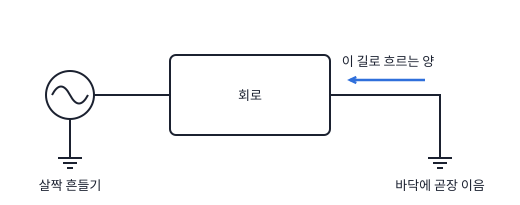

*입력을 살짝 흔들고, 출구를 바닥에 곧장 이은 채 그 길로 흐르는 양을 재요. 흔든 만큼 흐름이 얼마나 바뀌는지가 이 회로의 세기예요.*

**정확히 말하면**

트랜지스터 하나의 트랜스컨덕턴스(transconductance)는 소문자 $g_m$이에요. 게이트-소스 전압이 변할 때 드레인 전류가 얼마나 변하는지를 나타내요. BJT에서는 $i_c = g_m v_{be}$로 같아요.

$$
i_d = g_m v_{gs}
$$

회로 전체의 트랜스컨덕턴스는 대문자 $G_m$으로 써요. 회로의 입력 전압이 변할 때 출력 전류가 얼마나 변하는지를 나타내요.

보통의 컨덕턴스는 한 소자 양 끝의 전압과 그 소자의 전류를 잇는 비예요. 트랜스컨덕턴스는 서로 다른 노드, 곧 입력 전압과 출력 전류를 잇는 비예요.

출력 쪽은 노턴 등가(Norton equivalent)로 볼 수 있어요. 등가 전류원 $G_m v_{in}$과 출력저항 $R_{out}$이 병렬로 있는 모양이에요.

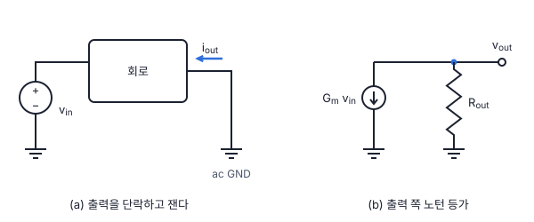

*(a) 출력을 교류 접지로 단락하면 등가 전류원의 전류가 $R_{out}$으로 나뉘지 않고 모두 $i_{out}$으로 나와요. (b) 출력 쪽 노턴 등가.*

1. 출력에 무언가가 걸려 있으면 등가 전류원의 전류가 $R_{out}$과 바깥으로 나뉘어요.
2. 출력을 교류 접지에 단락(short)하면 $v_{out} = 0$이에요. $R_{out}$ 양 끝 전압이 0이라 $R_{out}$에는 전류가 흐르지 않아요.
3. 그래서 등가 전류원의 전류가 모두 단락선으로 나와 $i_{out}$이 돼요.
4. 이 조건에서 정의한 값이 단락 회로 트랜스컨덕턴스(short-circuit transconductance)예요:

   $$
   G_m = \left.\dfrac{i_{out}}{v_{in}}\right|_{v_{out} = 0}
   $$

$i_{out}$은 단락선에서 회로의 출력 노드로 들어가는 방향을 양으로 잡아요(교과서 그림 9.12). 슬라이드는 $G_m$을 회로가 입력 전압을 출력 전류로 바꾸는 세기라고 정리해요.

**교수님 말씀**

지금까지는 캐스코드를 DC 바이어스 전류원으로 봤고, 이제 입력에 소신호를 넣는 증폭기로 본다고 하셨어요. 그 전에 이득을 구할 도구로 회로의 트랜스컨덕턴스를 정리하셨어요. (0911 49:53)

소문자 $g_m$은 트랜지스터, 대문자 $G_m$은 회로 전체라고 구분하셨어요. (0911 50:30)

보통 컨덕턴스는 한 소자 양단의 관계이고, 트랜스컨덕턴스는 서로 다른 노드의 관계라는 점을 짚으셨어요. (0911 52:55)

출력을 단락하지 않으면 전류가 $R_{out}$으로 나뉘어서 등가 전류원의 전류를 그대로 잴 수 없다고 하셨어요. 그래서 이름에 "단락 회로"가 붙어요. (0911 53:16)

**페이지 요약**

출력을 교류 접지에 단락한 채 입력 전압 대비 출력 전류를 재면 회로의 트랜스컨덕턴스 $G_m$이 돼요.

*핵심 식*

- 단락 트랜스컨덕턴스

  $$
  G_m = \left.\dfrac{i_{out}}{v_{in}}\right|_{v_{out} = 0}
  $$
- 소자의 트랜스컨덕턴스

  $$
  i_d = g_m v_{gs}
  $$

*용어*

- **단락 회로 트랜스컨덕턴스(short-circuit transconductance)** — 출력을 교류 접지에 단락했을 때 입력 전압에 대한 출력 전류의 비
- **노턴 등가(Norton equivalent)** — 출력 쪽을 등가 전류원과 $R_{out}$의 병렬로 보는 모델

---

### CS 단의 G_m은 g_m

*0911 수업 · L03 s12*

**쉽게 말하면**

손잡이 하나에 밸브 하나면, 회로 전체의 세기가 곧 그 밸브의 세기예요.

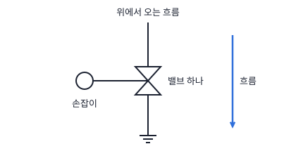

*밸브가 하나뿐이라 손잡이를 돌린 만큼 흐름이 그대로 바뀌어요.*

**정확히 말하면**

소스가 접지인 단순한 CS(common-source) 단에서 $G_m$을 구해요(교과서 예제 9.7).

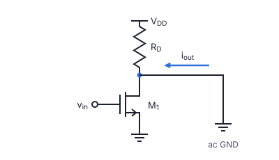

*출력을 교류 접지로 단락한 CS 단(교과서 예제 9.7). 화살표 방향이 $i_{out}$의 양의 방향이에요.*

1. 출력(드레인)을 교류 접지에 단락해요:

   $$
   v_{out} = 0
   $$
2. $V_{DD}$도 교류 접지라 $R_D$ 양 끝이 모두 0이에요. $R_D$에는 소신호 전류가 없어요.
3. $r_{O1}$도 드레인과 소스가 모두 교류 접지라 전류가 없어요.
4. 소스가 접지라 $v_{gs1} = v_{in}$이고, 드레인 전류는 전류원 몫뿐이에요:

   $$
   i_{d1} = g_{m1} v_{gs1} = g_{m1} v_{in}
   $$
5. 이 전류를 모두 단락선이 공급해요:

   $$
   i_{out} = g_{m1} v_{in}
   $$
6. 정의에 넣어요:

   $$
   G_m = \dfrac{i_{out}}{v_{in}} = g_{m1}
   $$

따라서 CS 단은 $G_m = g_{m1}$이에요.

부호는 $i_{out}$의 방향을 어떻게 잡느냐에 달려 있어요. 슬라이드와 교과서는 $i_{out}$을 단락선에서 드레인으로 들어가는 방향으로 잡아요. 이 방향이면 $G_m$은 양수이고, 신호가 뒤집히는 부호는 이득 식 $A_v = -G_m R_{out}$의 마이너스가 맡아요.

수업 중에는 화살표를 반대 방향으로 잡아 $i_{out} = -g_m v_{in}$으로 적었어요. 크기는 같고 방향 정의만 달라요.

이 회로에서 $G_m$이 트랜지스터의 $g_m$과 같은 것은 트랜지스터가 하나뿐이기 때문이에요. 전압을 전류로 바꾸는 일이 그 하나에서만 일어나요. 트랜지스터가 여럿이면 회로의 $G_m$은 여러 $g_m$의 조합이 되어 $g_m$과 달라질 수 있어요.

**교수님 말씀**

칠판에서 출력을 AC 접지로 두면 $g_m v_{in}$이 모두 출력 쪽으로 흐르니, 회로의 트랜스컨덕턴스가 트랜지스터의 트랜스컨덕턴스와 같다고 하셨어요. (0911 55:12–56:14)

같은 이유는 트랜지스터가 하나뿐이어서이고, 일반적으로 회로의 $G_m$은 $g_m$과 다르다고 덧붙이셨어요. (0911 56:16)

**페이지 요약**

출력을 단락하면 $R_D$와 $r_{O1}$에는 전류가 없어서 CS 단의 $G_m$은 $g_{m1}$과 같아요.

*핵심 식*

- 단락 출력 전류

  $$
  i_{out} = g_{m1} v_{in}
  $$
- CS 단의 트랜스컨덕턴스

  $$
  G_m = \dfrac{i_{out}}{v_{in}} = g_{m1}
  $$

*용어*

- **CS(common-source) 단** — 소스를 접지하고 게이트로 입력, 드레인으로 출력하는 단
- **$i_{out}$의 방향** — 단락선에서 드레인으로 들어가는 쪽을 양으로 잡아요

---

### 전압 이득 A_v = -G_m R_out

*0911 수업 · L03 s13*

**쉽게 말하면**

출력의 크기는 흐름을 만드는 힘과 출구가 버티는 힘을 곱한 값이에요.

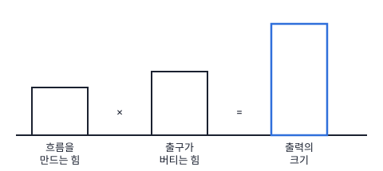

*두 힘을 곱한 만큼 출력이 커지니, 둘 중 하나만 키워도 출력이 커져요.*

**정확히 말하면**

$G_m$과 출력저항 $R_{out}$을 알면 전압 이득 $A_v$를 바로 쓸 수 있어요(교과서 식 9.33). 출력 쪽을 노턴 등가로 그려요.

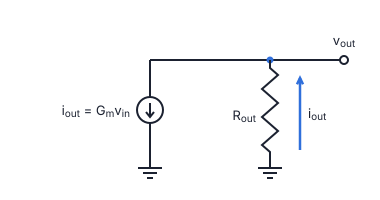

*출력을 열어 두면 전류원이 끌어가는 $i_{out}$을 $R_{out}$이 전부 공급해요.*

1. $G_m$의 정의에서 등가 전류원의 전류:

   $$
   i_{out} = G_m v_{in}
   $$
2. 출력을 열어 두면 이 전류는 $R_{out}$을 통해서만 공급돼요. 출력 노드의 노드 방정식(KCL):

   $$
   \dfrac{v_{out}}{R_{out}} + i_{out} = 0
   $$
3. 정리해요:

   $$
   v_{out} = -i_{out} R_{out}
   $$
4. 1번 식을 넣어요:

   $$
   v_{out} = -G_m v_{in} R_{out}
   $$
5. $v_{in}$으로 나눠요:

   $$
   A_v = \dfrac{v_{out}}{v_{in}} = -G_m R_{out}
   $$

곧 $A_v = -G_m R_{out}$이에요. 이득을 키우려면 $G_m$을 키우거나 $R_{out}$을 키우면 돼요. 슬라이드는 특히 출력 임피던스를 키우면 이득을 키울 수 있다고 정리해요.

회로 전체를 노드 방정식으로 한꺼번에 풀어도 같은 답이 나와요. 하지만 $R_{out}$을 이미 안다면 $G_m$만 새로 구하면 되니 훨씬 쉬워요. 대표적인 예가 [MOS 캐스코드 증폭기의 이득](#s2-cascode-amp)이에요.

**교수님 말씀**

이득은 $G_m$을 키워도, $R_{out}$을 키워도 커진다고 하셨어요. (0911 59:37)

노드 방정식으로 직접 풀 수도 있지만, $R_{out}$을 이미 알면 $G_m$만 구하는 편이 훨씬 쉽다고 하셨어요. 대표적인 예로 캐스코드 증폭기를 드셨어요. (0911 59:49)

**페이지 요약**

출력 쪽을 노턴 등가로 보면 전압 이득은 $G_m$과 $R_{out}$의 곱에 마이너스를 붙인 값이에요.

*핵심 식*

- 출력 전압

  $$
  v_{out} = -i_{out} R_{out}
  $$
- 전압 이득

  $$
  A_v = -G_m R_{out}
  $$

*용어*

- **전압 이득(voltage gain)** — 입력 전압에 대한 출력 전압의 비 $A_v$

---

### MOS 캐스코드 증폭기의 이득

*0911 수업 · L03 s14*

**쉽게 말하면**

아래 부품 위에 하나를 더 쌓으면 출구가 훨씬 잘 버텨서, 출력이 그만큼 커져요.

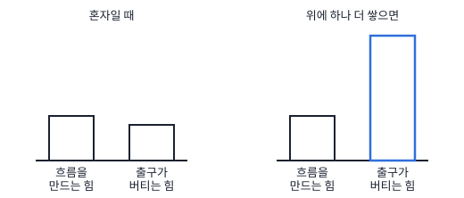

*흐름을 만드는 힘은 그대로이고, 버티는 힘만 크게 늘어나요.*

**정확히 말하면**

회로 구성이에요.

- 아래 $M_1$이 입력 트랜지스터예요. 게이트에 DC 바이어스 $V_{B1}$과 소신호 $v_{in}$이 함께 걸려요.
- 위 $M_2$는 캐스코드 소자예요. 게이트는 DC 전압 $V_b$라서 소신호로는 교류 접지예요.
- 부하는 우선 이상적 전류원(ideal current source)으로 둬요. 임피던스가 무한대예요. 실제로는 트랜지스터로 만들어야 하고, 그 구현은 뒤에서 다뤄요.
- 대문자는 DC, 소문자는 소신호예요. 이득의 크기가 1보다 크면 증폭기예요.

번호에 주의해요. 캐스코드 전류원(s4–s10)에서는 $M_1$이 위(캐스코드 소자), $M_2$가 아래였어요. 증폭기(s14)에서는 $M_1$이 아래(입력), $M_2$가 위예요. 그래서 출력저항 식의 첨자가 바뀌어 보여요. 전류원 토픽에서는 $V_{B1}$이 캐스코드 소자의 게이트였지만, 여기서는 입력 쪽 $M_1$의 바이어스예요.

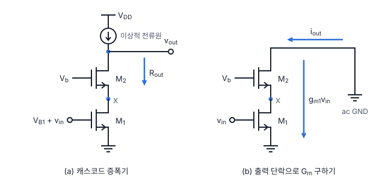

*(a) 입력은 아래 $M_1$, 캐스코드 소자는 위 $M_2$, 부하는 이상적 전류원이에요. (b) 출력을 단락하면 $M_1$이 만든 전류가 $M_2$를 지나 그대로 $i_{out}$이 돼요.*

**방법 2: $G_m$과 $R_{out}$으로 구하기**

1. $R_{out}$: 위쪽 부하가 무한대이므로 출력저항은 아래 캐스코드가 정해요. 캐스코드 출력저항 식에 번호만 바꿔 넣어요:

   $$
   R_{out} = (1 + g_{m2} r_{O2}) r_{O1} + r_{O2}
   $$
2. $G_m$: 출력을 교류 접지에 단락하면 $i_{out}$은 $M_2$를 지나 $M_1$의 드레인 쪽으로 흘러요. $M_2$의 드레인 전류와 소스 전류가 같고, $r_{O1}$으로 새는 몫을 무시하면(아래 설명):

   $$
   i_{out} \approx g_{m1} v_{gs1} = g_{m1} v_{in}
   $$
3. 따라서 캐스코드의 트랜스컨덕턴스는 $M_1$의 $g_m$과 같아요:

   $$
   G_m = g_{m1}
   $$
4. 이득:

   $$
   A_v = -G_m R_{out}
   $$

   $$
   = -g_{m1}\left[(1 + g_{m2} r_{O2}) r_{O1} + r_{O2}\right]
   $$
5. $g_m r_O \gg 1$일 때:

   $$
   A_v \approx -g_{m1} r_{O1} g_{m2} r_{O2}
   $$

2번에서 $g_{m1} v_{in}$의 일부는 $r_{O1}$으로 새요. 출력을 단락하면 $X$에서 $M_2$ 쪽으로 본 저항이 약 $1/g_{m2}$로 작고 $r_{O1}$은 이보다 훨씬 커서, 새는 몫을 무시하고 $G_m = g_{m1}$로 둬요.

**방법 1: CS 단과 CG 단으로 나누기**

아래 $M_1$은 게이트로 입력을 받는 CS 단이에요. 위 $M_2$는 노드 $X$를 소스로 받아 드레인으로 내보내는 CG(common-gate) 단이에요. 이득을 두 단의 곱으로 나눠요.

1. 나누기:

   $$
   A_v = \dfrac{v_X}{v_{in}}\cdot\dfrac{v_{out}}{v_X}
   $$
2. 부하가 이상적 전류원이면 $M_2$에 소신호 전류가 흐를 수 없어요. $X$에서 위로 본 저항이 무한대라 $g_{m1} v_{in}$은 모두 $r_{O1}$으로 흘러요:

   $$
   \dfrac{v_X}{v_{in}} = -g_{m1} r_{O1}
   $$
3. $M_2$의 전류가 0이고 $v_{gs2} = -v_X$예요. $M_2$의 드레인-소스 전류:

   $$
   -g_{m2} v_X + \dfrac{v_{out} - v_X}{r_{O2}} = 0
   $$
4. 정리해요:

   $$
   \dfrac{v_{out}}{v_X} = 1 + g_{m2} r_{O2}
   $$
5. 곱해요:

   $$
   A_v = -g_{m1} r_{O1}(1 + g_{m2} r_{O2})
   $$

   $$
   \approx -g_{m1} r_{O1} g_{m2} r_{O2}
   $$

방법 1의 결과는 이 회로의 정확한 값이에요. 방법 2와는 $-g_{m1} r_{O2}$ 한 항만큼 다른데, 방법 2가 $r_{O1}$으로 새는 몫을 무시했기 때문이에요. $g_m r_O \gg 1$이면 이 항은 작아서 두 방법이 같은 근사식을 줘요.

수업 중에는 $X$에서 위로 본 저항을 $1/g_{m2}$로 놓고 풀었어요. 그 값은 부하 저항이 작을 때의 근사이고, 부하가 이상적 전류원이면 위의 분해가 맞아요.

**무엇이 이득을 키웠나**

같은 $M_1$에 이상적 전류원 부하만 단 CS 단은 $G_m = g_{m1}$, $R_{out} = r_{O1}$이라 $A_v = -g_{m1} r_{O1}$이에요. 캐스코드도 $G_m$은 $g_{m1}$ 그대로예요. $M_2$는 전류를 전달만 해요.

바뀐 것은 $R_{out}$이에요. $r_{O1}$에서 약 $g_{m2} r_{O2} r_{O1}$로 커졌고, 이득도 같은 배수 $1 + g_{m2} r_{O2}$만큼 커져요.

**교수님 말씀**

이상적 전류원의 임피던스를 물으시자 한 학생이 "무한대"라고 답했어요. 실제 부하는 트랜지스터로 만들어야 하고, 그 구현은 뒤에서 본다고 하셨어요. (0911 62:55–63:39)

$v_X$에서 $v_{out}$까지는 무슨 구조냐고 물으시자 "커먼 게이트"라는 답이 나왔어요. (0911 64:42)

방법 1도 칠판에 보이셨지만 더 복잡하다고 하셨어요. 한 덩어리로 보고 $M_1$이 정하는 $G_m$과 $R_{out}$을 곱하는 편이 편하다고 하셨어요. 3단을 쌓으면 방법 1은 세 단의 이득을 따로 구해야 해서 차이가 더 커진다고 하셨어요. (0911 69:52–71:21)

$M_2$는 전류를 전달만 하고, 캐스코드로 고이득 증폭기를 만들 수 있다고 정리하셨어요. (0911 71:21–73:39)

**꼭 기억해요**

캐스코드를 쌓아도 $G_m$은 CS 단과 같은 $g_{m1}$이에요.

> "$G_m$이 더 증가하는 건 아니에요. $G_m$은 동일해요." (0911 72:00)

이득이 커진 이유는 출력저항이 $r_{O1}$에서 약 $g_{m2} r_{O2} r_{O1}$로 커졌기 때문이에요.

> "출력 임피던스가 증가하는 만큼 이득도 증가합니다." (0911 73:20)

**페이지 요약**

캐스코드 증폭기의 $G_m$은 $g_{m1}$ 그대로이고, $R_{out}$이 커진 만큼 이득이 커져요.

*핵심 식*

- 트랜스컨덕턴스

  $$
  G_m = g_{m1}
  $$
- 출력저항

  $$
  R_{out}
  $$

  $$
  = (1 + g_{m2} r_{O2}) r_{O1} + r_{O2}
  $$
- 전압 이득

  $$
  A_v \approx -g_{m1} r_{O1} g_{m2} r_{O2}
  $$

*용어*

- **이상적 전류원(ideal current source)** — 임피던스가 무한대인 부하. 소신호 전류를 흘리지 않아요
- **CG(common-gate) 단** — 게이트가 교류 접지이고 소스로 받아 드레인으로 내보내는 단. 캐스코드의 위 트랜지스터예요

---

## 4. 요약 · 예고

### 한눈에 보는 식

*0911 수업 · L03 s6–14*

0911 수업의 식을 한 표에 모았어요. 오른쪽 칸의 링크를 누르면 그 토픽으로 가요.

번호에 주의해요. 전류원(L03 s6–10)에서는 $M_1$, $Q_1$이 위(쌓은 쪽)이고 $M_2$, $Q_2$가 아래예요. 증폭기(L03 s14)에서는 $M_1$이 아래(입력), $M_2$가 위예요.

| 항목 | 식 · 규칙 | 자세히 |
|---|---|---|
| 바이어스와 포화 조건 | 포화: $V_{DS} \ge V_{GS} - V_{TH}$ $V_{GS1} + (V_{B2} - V_{TH}) \le V_{B1} \le V_{out} + V_{TH}$ 전류는 아래 $M_2$($V_{B2}$)가 정하고, $V_{B1}$은 범위 안에서 골라요. | [보기](#s0-bias) |
| $g_m$, $r_O$ | $g_m = \sqrt{2 \mu_n C_{ox} \frac{W}{L} I_D}$ $r_O = \frac{1}{\lambda I_D}$ | [보기](#s0-wl) |
| NMOS 캐스코드 $R_{out}$ | $R_{out} = (1 + g_{m1} r_{O2}) r_{O1} + r_{O2}$ $R_{out} \approx g_{m1} r_{O1} r_{O2}$ ($g_m r_O \gg 1$일 때) 아래 $r_{O2}$가 위 소자의 $g_{m1} r_{O1}$배로 커져요. | [보기](#s0-wl) |
| 설계 예제 결과 | $0.5\,\text{mA}$, $500\,\text{k}\Omega$: $r_{O1} = r_{O2} = 20\,\text{k}\Omega$ $g_{m1} = \frac{1}{800\,\Omega}$, $W/L \approx 15.6$ $M_2$ 하나일 때 $20\,\text{k}\Omega$의 $g_{m1} r_{O1} = 25$배예요. | [보기](#s0-hand-calc) |
| 3단 적층 (MOS) | $R_{out,3} \approx g_{m3} r_{O3} R_{out,2}$ 하나 쌓을 때마다 $V_{OD}$가 하나씩 더 필요해서 보통 2단까지만 써요. | [보기](#s0-headroom) |
| PMOS 캐스코드 $R_{out}$ | 뒤집으면 NMOS와 같아요. $R_{out} \approx g_{m1} r_{O1} r_{O2}$ | [보기](#s1-pmos) |
| 바이폴라(NPN, PNP) 캐스코드 $R_{out}$ | $R_{out} = [1 + g_{m1} (r_{O2} \parallel r_{\pi 1})] r_{O1} + r_{O2} \parallel r_{\pi 1}$ $R_{out} \approx g_{m1} r_{O1} (r_{O2} \parallel r_{\pi 1})$ 쌓은 $Q_1$의 $r_{\pi 1}$이 $r_{O2}$와 병렬로 보여요. | [보기](#s1-npn) |
| 3단 적층 (바이폴라) | $R_{out,3} \approx g_{m3} r_{O3} (R_{out,2} \parallel r_{\pi 3})$ | [보기](#s1-stack) |
| 단락 트랜스컨덕턴스 $G_m$ | $G_m = \left.\dfrac{i_{out}}{v_{in}}\right\vert _{v_{out} = 0}$ 소문자 $g_m$은 소자, 대문자 $G_m$은 회로예요. | [보기](#s2-gm) |
| CS 단의 $G_m$ | $G_m = g_{m1}$ | [보기](#s2-cs-gm) |
| 전압 이득 | $v_{out} = -i_{out} R_{out}$ $A_v = -G_m R_{out}$ | [보기](#s2-gain) |
| MOS 캐스코드 증폭기 | $G_m = g_{m1}$ $R_{out} = (1 + g_{m2} r_{O2}) r_{O1} + r_{O2}$ $A_v \approx -g_{m1} r_{O1} g_{m2} r_{O2}$ $G_m$은 CS 단과 같고, $R_{out}$이 커진 만큼 이득이 커져요. | [보기](#s2-cascode-amp) |

---

### 다음 시간 예고

*0911 수업 · L03 s15–s22*

0911 수업은 MOS 캐스코드 증폭기의 이득(L03 s14)까지 다루고 끝났어요. 다음 시간에는 부하를 이상적 전류원 대신 실제 트랜지스터로 만드는 이야기부터 이어가요.

- L03 s15 개선형 캐스코드 증폭기(Improved MOS Cascode Amplifier): 부하도 캐스코드로 만들어요 (예고만)
- L03 s16 예제: MOS 캐스코드 증폭기의 전압 이득 (예고만)
- L03 s17–s21 바이폴라 캐스코드 증폭기 (아직 안 다룸)
- L03 s22 이후 전류 거울(current mirror) (아직 안 다룸)

---

### 함께 보면 좋은 자료

*0911 수업*

복습문제는 10개예요. 캐스코드 전류원의 바이어스와 $W/L$ 설계, PMOS·바이폴라 캐스코드의 $R_{out}$(전류 $I_D$에 따른 변화 포함), $G_m$과 캐스코드 증폭기 이득 순서로 골랐어요.

- [복습문제 10개 (PDF)](복습문제_0911_Cascode_Amplifier-문제.pdf)
- [답안 (PDF)](복습문제_0911_Cascode_Amplifier-답안.pdf)
- [0904 정리노트: 채널 길이 변조와 출력저항 $r_O$](../0904/정리노트_0904_MOS_Small_Signal_Model.html#s1-ro)
- [0904 정리노트: $r_O$를 넣으면 intrinsic gain](../0904/정리노트_0904_MOS_Small_Signal_Model.html#s3-intrinsic)
- [9장 문제집 전체 (PDF)](../../workbook/pdf/ch09-문제.pdf)

---

출처: 권익진 교수님 강의자료(Lec3) · 수업 녹음 전사(0911) · B. Razavi, *Microelectronics*, 2nd ed. (Wiley) 9장.
