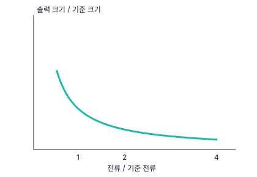

# 전자회로2 복습 0916 문제설명

주어진 조건을 읽고, 첫 줄을 쓰고, 이유를 따라가며 답을 확인해요.

문제의 첫 줄부터 검산까지 설명해요.

**목차**

- [문항별 설명](#problems)
  - [기생 저항 R_P가 생긴 MOS 캐스코드의 출력 저항](#p1)
  - [CMOS 캐스코드 이득 식 9.72를 소자 파라미터와 I_D로 표현](#p2)
  - [입력을 위쪽 트랜지스터 Q2의 베이스에 넣은 회로](#p3)
  - [PMOS 캐스코드 부하를 단 CMOS 캐스코드 증폭기의 전압 이득](#p4)
  - [MOS 캐스코드 증폭기에서 폭을 N배로 늘릴 때의 전압 이득](#p5)
  - [이상적 전류원 부하 바이폴라 캐스코드 증폭기의 전압 이득](#p6)
  - [이득 500을 위한 바이폴라 캐스코드의 최소 Early 전압](#p7)
  - [pnp 캐스코드 부하 바이폴라 캐스코드 이득의 바이어스 전류 의존성](#p8)
  - [pnp 캐스코드 부하를 단 바이폴라 캐스코드 증폭기의 전압 이득](#p9)
  - [저항 분배기 MOS 전류원의 V_TH 감도](#p10)

## 문항별 설명

### 기생 저항 R_P가 생긴 MOS 캐스코드의 출력 저항

E9.06 · 예제 9.6 · [원 문제 보기](../%EB%B3%B5%EC%8A%B5%EB%AC%B8%EC%A0%9C_0916_Cascode_Amplifier-%EB%AC%B8%EC%A0%9C.pdf)

#### 주어진 조건

- 제조 중 큰 기생 저항 $R_P$가 MOS 캐스코드에 생김, 위치는 Fig 9.11 ($M_1$의 드레인과 소스 사이)
- 소자 값은 주어지지 않음 (답은 $g_m$, $r_O$, $R_P$ 기호로)

#### 구할 것

- 출력 저항 $R_{out}$

원문 보기

제조하는 동안 큰 기생 저항 $R_P$가 그림 9.11과 같이 캐스코드에 나타났다. 출력 저항을 결정하라.

#### 문제를 이렇게 읽어요

기생 저항은 출력과 중간 노드 사이에 있어요. 위 소자의 드레인–소스 저항과 먼저 합쳐야 해요.

#### 이 문제를 봤을 때 떠올릴 개념과 공식

같은 두 노드 사이 연결이라는 단서에서 병렬(parallel) 저항 $q=r_{O1}\parallel R_P$를 골라요. $g_{m1}$은 위 소자의 트랜스컨덕턴스, $r_{O2}$는 아래 소자의 출력 저항이에요. 근사는 $g_{m1}q r_{O2}\gg q+r_{O2}$일 때만 적용해요.

#### 종이에 쓰는 실제 첫 줄

먼저 다음 식을 적어요.

$$
q=r_{O1}\parallel R_P,\qquad i_t=\frac{v_t-v_x}{q}-g_{m1}v_x
$$

#### 왜 이렇게 푸는지 함께 따라가요

#### 풀이

출력에 시험 전압 $v_t$를 걸고 DC 전압원을 AC 접지로 보내요. 아래 소자는 $v_{gs2}=0$이라 $r_{O2}$예요. 게이트 전류가 없으므로

$$
v_x=i_t r_{O2}
$$

위의 $v_{gs1}=-v_x$를 출력 KCL에 넣어요.

$$
i_t=\frac{v_t-i_tr_{O2}}q-g_{m1}i_tr_{O2}
$$

양변에 $q$를 곱하고 $v_t/i_t$를 정리하면

$$
R_{out}=q+r_{O2}+g_{m1}q r_{O2}
$$

지배항 근사는

$$
R_{out}\approx g_{m1}(r_{O1}\parallel R_P)r_{O2}
$$

예요.

#### 완성 답과 검산

#### 답과 검산

**$R_{out}=(1+g_{m1}r_{O2})(r_{O1}\parallel R_P)+r_{O2}$예요.** $R_P\to\infty$이면 원래 식으로 돌아가요. $R_P\to0$이면 정확식은 $r_{O2}$예요. 이때 근사식이 0으로 가는 것은 근사 조건이 깨지기 때문이에요.

#### 이 문제에서 조심할 점

전체 출력 저항에 $R_P$를 병렬로 붙이지 않아요. 같은 날 칠판의 중간 노드–접지 저항 문제와 연결 위치가 달라요.

#### 설명을 닫고 다시 풀어요

1. 그림에서 입력·출력·고정 바이어스와 전류 경로를 구별해요.
2. 위 첫 식을 쓰고 같은 조건에서 답까지 직접 계산해요.
3. 검산 구역의 경계값 또는 수치 대입을 직접 확인해요.

**페이지 요약**

#### 떠올릴 개념·공식

같은 두 노드 사이 연결이라는 단서에서 병렬(parallel) 저항 $q=r_{O1}\parallel R_P$를 골라요. $g_{m1}$은 위 소자의 트랜스컨덕턴스, $r_{O2}$는 아래 소자의 출력 저항이에요. 근사는 $g_{m1}q r_{O2}\gg q+r_{O2}$일 때만 적용해요.

#### 첫 줄

$q=r_{O1}\parallel R_P,\qquad i_t=\frac{v_t-v_x}{q}-g_{m1}v_x$

#### 핵심 판단

전체 출력 저항에 $R_P$를 병렬로 붙이지 않아요. 같은 날 칠판의 중간 노드–접지 저항 문제와 연결 위치가 달라요.

#### 검산

**$R_{out}=(1+g_{m1}r_{O2})(r_{O1}\parallel R_P)+r_{O2}$예요.** $R_P\to\infty$이면 원래 식으로 돌아가요. $R_P\to0$이면 정확식은 $r_{O2}$예요. 이때 근사식이 0으로 가는 것은 근사 조건이 깨지기 때문이에요.

---

### CMOS 캐스코드 이득 식 9.72를 소자 파라미터와 I_D로 표현

P9.28 · 장말문제 9.28 · [원 문제 보기](../%EB%B3%B5%EC%8A%B5%EB%AC%B8%EC%A0%9C_0916_Cascode_Amplifier-%EB%AC%B8%EC%A0%9C.pdf)

#### 주어진 조건

- $g_m = \sqrt{2 \mu_n C_{ox} (W/L) I_D}$, $r_O = 1/(\lambda I_D)$로 씀
- PMOS $M_3$, $M_4$의 $g_m$에는 $\mu_p C_{ox}$가 들어감
- 네 트랜지스터는 같은 드레인 전류 $I_D$를 흘림

#### 구할 것

- 식 (9.72)를 소자 파라미터로 표현
- 그 결과를 $I_D$의 함수로 그림

원문 보기

Writing $g_m = \sqrt{2 \mu_n C_{ox} (W/L) I_D}$ and $r_O = 1/(\lambda I_D)$, express Eq. (9.72) in terms of the device parameters and plot the result as a function of $I_D$.

#### 문제를 이렇게 읽어요

위 PMOS와 아래 NMOS 모두 캐스코드인 증폭기예요. 같은 전류가 네 소자를 흐르므로 전류가 변할 때 트랜스컨덕턴스와 두 출력 저항을 함께 바꿔야 해요.

#### 이 문제를 봤을 때 떠올릴 개념과 공식

식 (9.72)와 전류 함수라는 단서에서 $A_v\approx-g_{m1}(R_{on}\parallel R_{op})$를 출발점으로 골라요. $g_{m1}$은 입력 소자의 트랜스컨덕턴스, $R_{on},R_{op}$는 출력에서 아래·위를 본 저항이에요. 네 $r_O=1/(\lambda I_D)$는 같지만 PMOS의 $g_m$에는 $\mu_p$가 들어가요. 각 캐스코드의 $g_mr_O\gg1$과 강반전 제곱 법칙을 가정해요.

#### 종이에 쓰는 실제 첫 줄

먼저 다음 식을 적어요.

$$
a_k=\sqrt{2\mu_kC_{ox}(W/L)_k},\quad g_{mk}=a_k\sqrt{I_D},\quad r_O=\frac1{\lambda I_D}
$$

#### 왜 이렇게 푸는지 함께 따라가요

#### 풀이

$k=1,2$에는 $\mu_n$, $k=3$에는 $\mu_p$를 넣어요. 아래 저항은

$$
R_{on}\approx g_{m2}r_O^2=\frac{a_2}{\lambda^2I_D^{3/2}}
$$

위 저항은

$$
R_{op}\approx g_{m3}r_O^2=\frac{a_3}{\lambda^2I_D^{3/2}}
$$

공통 인수를 병렬 밖으로 꺼내면

$$
R_{on}\parallel R_{op}=\frac1{\lambda^2I_D^{3/2}}\frac{a_2a_3}{a_2+a_3}
$$

따라서

$$
A_v\approx-\frac{a_1a_2a_3}{\lambda^2(a_2+a_3)I_D}
$$

예요. 여기서 $a_1=\sqrt{2\mu_nC_{ox}(W/L)_1}$, $a_2=\sqrt{2\mu_nC_{ox}(W/L)_2}$, $a_3=\sqrt{2\mu_pC_{ox}(W/L)_3}$예요. 양수 $K=a_1a_2a_3/[\lambda^2(a_2+a_3)]$를 쓰면 $|A_v|=K/I_D$예요. 정규화 그래프의 점은 $(I_D/I_0,|A_v|/|A_{v0}|)=(1/2,2),(1,1),(2,1/2),(4,1/4)$이며 양의 축에서 감소하는 쌍곡선이에요.

*적용 가능한 제곱 법칙 범위에서의 정규화 곡선이에요.*

#### 완성 답과 검산

#### 답과 검산

**$A_v\approx-K/I_D$이고 $|A_v|$는 전류에 반비례해요.** 전류를 두 배로 하면 $g_m$은 $\sqrt2$배, 두 저항은 $2^{-3/2}$배라 곱은 1/2배예요. $R_{op}\to\infty$이면 $a_3\gg a_2$ 극한에서 $A_v\to-a_1a_2/(\lambda^2I_D)$로 이상적 부하 식을 복원해요. 낮은 전류에서 모델 밖까지 무한 이득으로 해석하지 않아요.

#### 이 문제에서 조심할 점

네 소자의 전류가 같아도 NMOS와 PMOS 이동도가 같지는 않아요. 또한 병렬 부하는 저항의 합보다 작아요.

#### 설명을 닫고 다시 풀어요

1. 그림에서 입력·출력·고정 바이어스와 전류 경로를 구별해요.
2. 위 첫 식을 쓰고 같은 조건에서 답까지 직접 계산해요.
3. 검산 구역의 경계값 또는 수치 대입을 직접 확인해요.

**페이지 요약**

#### 떠올릴 개념·공식

식 (9.72)와 전류 함수라는 단서에서 $A_v\approx-g_{m1}(R_{on}\parallel R_{op})$를 출발점으로 골라요. $g_{m1}$은 입력 소자의 트랜스컨덕턴스, $R_{on},R_{op}$는 출력에서 아래·위를 본 저항이에요. 네 $r_O=1/(\lambda I_D)$는 같지만 PMOS의 $g_m$에는 $\mu_p$가 들어가요. 각 캐스코드의 $g_mr_O\gg1$과 강반전 제곱 법칙을 가정해요.

#### 첫 줄

$a_k=\sqrt{2\mu_kC_{ox}(W/L)_k},\quad g_{mk}=a_k\sqrt{I_D},\quad r_O=\frac1{\lambda I_D}$

#### 핵심 판단

네 소자의 전류가 같아도 NMOS와 PMOS 이동도가 같지는 않아요. 또한 병렬 부하는 저항의 합보다 작아요.

#### 검산

**$A_v\approx-K/I_D$이고 $|A_v|$는 전류에 반비례해요.** 전류를 두 배로 하면 $g_m$은 $\sqrt2$배, 두 저항은 $2^{-3/2}$배라 곱은 1/2배예요. $R_{op}\to\infty$이면 $a_3\gg a_2$ 극한에서 $A_v\to-a_1a_2/(\lambda^2I_D)$로 이상적 부하 식을 복원해요. 낮은 전류에서 모델 밖까지 무한 이득으로 해석하지 않아요.

---

### 입력을 위쪽 트랜지스터 Q2의 베이스에 넣은 회로

P9.23 · 장말문제 9.23 · [원 문제 보기](../%EB%B3%B5%EC%8A%B5%EB%AC%B8%EC%A0%9C_0916_Cascode_Amplifier-%EB%AC%B8%EC%A0%9C.pdf)

#### 주어진 조건

- 캐스코드 단의 높은 전압 이득을 배운 학생이 Fig 9.56 회로를 만듦
- 입력을 $Q_1$의 베이스가 아니라 $Q_2$의 베이스에 인가
- (b)에서: $g_m r_O \gg 1$
- 부하 $I_1$은 이상적인 전류원

#### 구할 것

- (a) $Q_1$을 $r_{O1}$으로 바꿔 놓고, 이 단의 전압 이득이 캐스코드만큼 높을 수 없는 이유를 직관적으로 설명
- (b) $g_m r_O \gg 1$로 가정하고 단락 회로 트랜스컨덕턴스와 전압 이득 계산

원문 보기

Having learned about the high voltage gain of the cascode stage, a student adventurously constructs the circuit depicted in Fig. 9.56, where the input is applied to the base of $Q_2$ rather than to the base of $Q_1$.

(a) Replacing $Q_1$ with $r_{O1}$, explain intuitively why the voltage gain of this stage cannot be as high as that of the cascode.

(b) Assuming $g_m r_O \gg 1$, compute the short-circuit transconductance and the voltage gain.

#### 문제를 이렇게 읽어요

입력이 위 $Q_2$의 베이스로 들어가고 아래 $Q_1$은 고정 바이어스예요. 아래 소자가 신호 전류를 만들지 못하고 큰 이미터 축퇴 저항으로 작용하므로 보통 캐스코드와 다른 회로예요.

#### 이 문제를 봤을 때 떠올릴 개념과 공식

입력 위치가 바뀌었다는 단서는 이미터 축퇴된 CE(emitter-degenerated common-emitter)를 부르며 $Q_1$을 $r_{O1}$로 바꿔요. $g_m,r_\pi,r_O$는 $Q_2$의 트랜스컨덕턴스·베이스 저항·Early 저항이에요. $g_mr_O\gg1$에서 교재의 주항 근사를 구하되, $G_m$은 반드시 출력 단락에서 정의하므로 유한한 $r_{O2}$ 전류도 조심해요.

#### 종이에 쓰는 실제 첫 줄

먼저 다음 식을 적어요.

$$
(G_1+g_o+g_\pi+g_m)v_e=(g_m+g_\pi)v_{in}+g_ov_{out}
$$

#### 왜 이렇게 푸는지 함께 따라가요

#### (a) 풀이

$Q_1$의 베이스와 이미터는 AC 접지이므로 $v_{be1}=0$이고 컬렉터에서는 $r_{O1}$만 보여요. 따라서 $Q_2$의 이미터는 큰 저항 $r_{O1}$을 통해 접지에 연결돼요. 베이스 전압을 올리면 이미터도 따라 올라가 $v_{be2}$ 변화가 작아져요. 보통 캐스코드의 $g_mv_{in}$ 대신 대략 $v_{in}/r_{O1}$만 신호 전류가 되므로 높은 출력 저항만으로 큰 이득을 얻을 수 없어요.

#### (b) 풀이

$G_1=1/r_{O1}$, $g_o=1/r_{O2}$, $g_\pi=1/r_{\pi2}$로 놓았어요. 출력 단락 $v_{out}=0$에서

$$
v_e=\frac{g_m+g_\pi}{G_1+g_o+g_\pi+g_m}v_{in}
$$

단락선이 공급하는 컬렉터 전류는

$$
i_{out}=g_m(v_{in}-v_e)-g_ov_e
$$

따라서

$$
G_m=\frac{g_mG_1-g_og_\pi}{G_1+g_o+g_\pi+g_m}
$$

예요. 큰 $g_m$ 및 작은 베이스 전류의 주항을 남기면 $G_m\approx G_1=1/r_{O1}$이에요. 전압 이득은 출력 전류 0 조건을 직접 풀면

$$
A_v=-\frac{g_mr_{O2}r_{\pi2}-r_{O1}}{r_{O1}+r_{\pi2}}
$$

주항 근사로

$$
A_v\approx-\frac{g_mr_{O2}(r_{O1}\parallel r_{\pi2})}{r_{O1}}=-\frac{\beta r_{O2}}{r_{O1}+r_{\pi2}}
$$

같고 같은 전류·Early 전압이면 $A_v\approx-\beta V_A/(V_A+\beta V_T)$예요.

#### 완성 답과 검산

#### (a) 답과 검산

**큰 이미터 축퇴 때문에 $G_m$이 $g_m$보다 훨씬 작아져요.** $g_mr_{O1}\gg1$이면 $(1/r_{O1})/g_m\ll1$이므로 직관과 주항 계산이 맞아요.

#### (b) 답과 검산

**교재 주항은 $G_m\approx1/r_{O1}$, $A_v\approx-\beta r_{O2}/(r_{O1}+r_{\pi2})$예요.** 정확식에서 $\beta\to\infty$이면 $G_m=g_m/(1+g_mr_{O1}+r_{O1}/r_{O2})$, $A_v=-g_mr_{O2}$예요. 같은 $r_O$라면 교재 $G_m$ 근사와의 상대 오차는 대략 $2/(g_mr_O)$예요. $G_m$ 단위는 S, 이득은 무차원이에요.

#### 이 문제에서 조심할 점

이미터 전류와 컬렉터 전류를 같다고 놓으면서 동시에 유한한 $r_\pi$ 효과를 정확히 계산했다고 쓰지 않아요. 위 정확식처럼 $r_{O2}$ 경로와 베이스 전류를 모두 보존한 뒤 주항을 골라요.

#### 설명을 닫고 다시 풀어요

1. 그림에서 입력·출력·고정 바이어스와 전류 경로를 구별해요.
2. 위 첫 식을 쓰고 같은 조건에서 답까지 직접 계산해요.
3. 검산 구역의 경계값 또는 수치 대입을 직접 확인해요.

**페이지 요약**

#### 떠올릴 개념·공식

입력 위치가 바뀌었다는 단서는 이미터 축퇴된 CE(emitter-degenerated common-emitter)를 부르며 $Q_1$을 $r_{O1}$로 바꿔요. $g_m,r_\pi,r_O$는 $Q_2$의 트랜스컨덕턴스·베이스 저항·Early 저항이에요. $g_mr_O\gg1$에서 교재의 주항 근사를 구하되, $G_m$은 반드시 출력 단락에서 정의하므로 유한한 $r_{O2}$ 전류도 조심해요.

#### 첫 줄

$(G_1+g_o+g_\pi+g_m)v_e=(g_m+g_\pi)v_{in}+g_ov_{out}$

#### 핵심 판단

이미터 전류와 컬렉터 전류를 같다고 놓으면서 동시에 유한한 $r_\pi$ 효과를 정확히 계산했다고 쓰지 않아요. 위 정확식처럼 $r_{O2}$ 경로와 베이스 전류를 모두 보존한 뒤 주항을 골라요.

#### 검산

**큰 이미터 축퇴 때문에 $G_m$이 $g_m$보다 훨씬 작아져요.** $g_mr_{O1}\gg1$이면 $(1/r_{O1})/g_m\ll1$이므로 직관과 주항 계산이 맞아요.

**교재 주항은 $G_m\approx1/r_{O1}$, $A_v\approx-\beta r_{O2}/(r_{O1}+r_{\pi2})$예요.** 정확식에서 $\beta\to\infty$이면 $G_m=g_m/(1+g_mr_{O1}+r_{O1}/r_{O2})$, $A_v=-g_mr_{O2}$예요. 같은 $r_O$라면 교재 $G_m$ 근사와의 상대 오차는 대략 $2/(g_mr_O)$예요. $G_m$ 단위는 S, 이득은 무차원이에요.

---

### PMOS 캐스코드 부하를 단 CMOS 캐스코드 증폭기의 전압 이득

E9.11 · 예제 9.11 · [원 문제 보기](../%EB%B3%B5%EC%8A%B5%EB%AC%B8%EC%A0%9C_0916_Cascode_Amplifier-%EB%AC%B8%EC%A0%9C.pdf)

#### 주어진 조건

- $(W/L)_{1,2} = 30$, $(W/L)_{3,4} = 40$
- $I_{D1} = \cdots = I_{D4} = 0.5\ \text{mA}$
- $\mu_n C_{ox} = 100\ \mu\text{A}/\text{V}^2$, $\mu_p C_{ox} = 50\ \mu\text{A}/\text{V}^2$
- $\lambda_n = 0.1\ \text{V}^{-1}$, $\lambda_p = 0.15\ \text{V}^{-1}$

#### 구할 것

- 전압 이득 $A_v$

원문 보기

그림 9.20(b)의 캐스코드 증폭기가 다음과 같은 소자 파라미터를 갖는다: $(W/L)_{1,2} = 30$, $(W/L)_{3,4} = 40$, $I_{D1} = \cdots = I_{D4} = 0.5\ \text{mA}$. $\mu_n C_{ox} = 100\ \mu\text{A}/\text{V}^2$, $\mu_p C_{ox} = 50\ \mu\text{A}/\text{V}^2$, $\lambda_n = 0.1\ \text{V}^{-1}$, $\lambda_p = 0.15\ \text{V}^{-1}$일 때 전압 이득을 결정하라.

#### 문제를 이렇게 읽어요

입력은 NMOS $M_1$에 들어가고 출력은 NMOS·PMOS 캐스코드가 만나는 노드예요. 아래 저항과 위 저항을 각각 구한 뒤 병렬로 합쳐요.

#### 이 문제를 봤을 때 떠올릴 개념과 공식

PMOS 캐스코드 부하라는 단서는 $A_v=-G_m(R_{on}\parallel R_{op})$를 부르며 $G_m\approx g_{m1}$이에요. $g_{mk}=\sqrt{2\mu C_{ox}(W/L)_kI_D}$, $r_{Ok}=1/(\lambda I_D)$예요. NMOS와 PMOS의 이동도·$\lambda$가 다르므로 나누어 계산해요. 두 가지 모두 $g_mr_O\gg1$의 곱 항 근사를 적용해요.

#### 종이에 쓰는 실제 첫 줄

먼저 다음 식을 적어요.

$$
A_v\approx-g_{m1}(g_{m2}r_{O2}r_{O1}\parallel g_{m3}r_{O3}r_{O4})
$$

#### 왜 이렇게 푸는지 함께 따라가요

#### 풀이

NMOS 파라미터는

$$
g_{m1,2}=\sqrt{2(100\mathrm{\mu A/V^2})(30)(0.5\mathrm{mA})}=1.73205\mathrm{mS}
$$

$$
r_{O1,2}=1/[0.1(0.5\mathrm{mA})]=20.0\mathrm{k\Omega}
$$

PMOS는

$$
g_{m3,4}=1.41421\mathrm{mS},\qquad r_{O3,4}=13.3333\mathrm{k\Omega}
$$

이에요. 입력을 0으로 두면 $M_1,M_4$는 각각 저항만 남아 캐스코드 소자의 소스 축퇴가 돼요.

$$
R_{on}\approx692.820\mathrm{k\Omega}
$$

$$
R_{op}\approx251.416\mathrm{k\Omega}
$$

$$
R_{out}\approx\frac{692.820(251.416)}{692.820+251.416}\mathrm{k\Omega}=184.469\mathrm{k\Omega}
$$

$$
A_v\approx-(1.73205\mathrm{mS})(184.469\mathrm{k\Omega})=-319.5
$$

교재의 중간값 13.3 kΩ, 250 kΩ를 쓰면 약 -318이에요.

#### 완성 답과 검산

#### 답과 검산

**반올림을 마지막에 하면 $A_v\approx-320$이에요.** $g_{m2}r_{O1}=34.64$, $g_{m3}r_{O4}=18.86$이므로 큰 저항 증대가 있어요. 병렬값 184.5 kΩ는 251.4 kΩ보다 작아요. PMOS 부하를 이상적으로 만들면 이득 크기는 약 1200으로 올라가므로 실제 부하가 이득을 제한한다는 방향도 맞아요.

#### 이 문제에서 조심할 점

NMOS의 $\lambda=0.1$을 PMOS에도 넣으면 부하 저항과 이득을 과대평가해요. 출력에서는 두 캐스코드가 직렬이 아니라 AC 접지로 향하는 병렬이에요.

#### 설명을 닫고 다시 풀어요

1. 그림에서 입력·출력·고정 바이어스와 전류 경로를 구별해요.
2. 위 첫 식을 쓰고 같은 조건에서 답까지 직접 계산해요.
3. 검산 구역의 경계값 또는 수치 대입을 직접 확인해요.

**페이지 요약**

#### 떠올릴 개념·공식

PMOS 캐스코드 부하라는 단서는 $A_v=-G_m(R_{on}\parallel R_{op})$를 부르며 $G_m\approx g_{m1}$이에요. $g_{mk}=\sqrt{2\mu C_{ox}(W/L)_kI_D}$, $r_{Ok}=1/(\lambda I_D)$예요. NMOS와 PMOS의 이동도·$\lambda$가 다르므로 나누어 계산해요. 두 가지 모두 $g_mr_O\gg1$의 곱 항 근사를 적용해요.

#### 첫 줄

$A_v\approx-g_{m1}(g_{m2}r_{O2}r_{O1}\parallel g_{m3}r_{O3}r_{O4})$

#### 핵심 판단

NMOS의 $\lambda=0.1$을 PMOS에도 넣으면 부하 저항과 이득을 과대평가해요. 출력에서는 두 캐스코드가 직렬이 아니라 AC 접지로 향하는 병렬이에요.

#### 검산

**반올림을 마지막에 하면 $A_v\approx-320$이에요.** $g_{m2}r_{O1}=34.64$, $g_{m3}r_{O4}=18.86$이므로 큰 저항 증대가 있어요. 병렬값 184.5 kΩ는 251.4 kΩ보다 작아요. PMOS 부하를 이상적으로 만들면 이득 크기는 약 1200으로 올라가므로 실제 부하가 이득을 제한한다는 방향도 맞아요.

---

### MOS 캐스코드 증폭기에서 폭을 N배로 늘릴 때의 전압 이득

P9.30 · 장말문제 9.30 · [원 문제 보기](../%EB%B3%B5%EC%8A%B5%EB%AC%B8%EC%A0%9C_0916_Cascode_Amplifier-%EB%AC%B8%EC%A0%9C.pdf)

#### 주어진 조건

- 두 트랜지스터의 폭을 모두 $N$배로 늘림
- 트랜지스터 길이와 바이어스 전류는 그대로
- 식 (9.79)와 문제 9.28의 결과를 이용
- 원문의 식 (9.79)는 오식으로 보고 Fig 9.20(a)의 이득 식 $A_v \approx -g_{m1} r_{O1} g_{m2} r_{O2}$ (교재 식 (9.69))로 봄

#### 구할 것

- 이득 $A_v$가 어떻게 되는지 설명

원문 보기

The MOS cascode of Fig. 9.20(a) is designed for a given voltage gain, $A_v$. Using Eq. (9.79) and the result obtained in Problem 9.28, explain what happens if the widths of the transistors are increased by a factor of $N$ while the transistor lengths and bias currents remain unchanged.

#### 문제를 이렇게 읽어요

이상적 전류원 부하 MOS 캐스코드에서 두 소자의 폭을 동시에 $N$배 키워요. 길이와 전류는 같아서 두 $g_m$만 변해요.

원문의 식 (9.79)는 이득 일반식이 아니라 예제의 출력 저항 수치여서, 그림 9.20(a)가 가리키는 이득 식 (9.69)로 해석해요. 그 해석과 $g_mr_O\gg1$의 지배항 근사 아래에서 폭 변화의 이득 배율을 구해요.

#### 이 문제를 봤을 때 떠올릴 개념과 공식

폭 스케일링(scaling)에서는 $g_m\propto\sqrt W$, $r_O=1/(\lambda I_D)$를 먼저 분리해요. 식 번호 9.79는 이득 일반식이 아니라 예제 저항 수치라 원문 오식으로 보고 Fig 9.20(a)의 식 (9.69)을 사용해요. $g_mr_O\gg1$과 길이 고정에 따른 $\lambda$ 고정을 가정해요.

#### 종이에 쓰는 실제 첫 줄

먼저 다음 식을 적어요.

$$
A_v\approx-(g_{m1}r_{O1})(g_{m2}r_{O2})
$$

#### 왜 이렇게 푸는지 함께 따라가요

#### 풀이

각 소자에서

$$
g_{mk}\prime=\sqrt N g_{mk}
$$

$$
r_{Ok}\prime=r_{Ok}
$$

이므로

$$
A_v\prime\approx-(\sqrt N g_{m1}r_{O1})(\sqrt N g_{m2}r_{O2})=N A_v
$$

예요. 동일 형상비일 때 직접 대입하면

$$
|A_v|\approx\frac{2\mu_nC_{ox}(W/L)}{\lambda^2I_D}
$$

여서 폭에 선형 비례함이 보여요. 과구동 전압은 $1/\sqrt N$배로 줄어 헤드룸은 좋아지지만 게이트 면적과 기생 용량은 커져 속도까지 같은 비율로 좋아지는 것은 아니에요.

여기의 $N$배 결론은 원문 식 번호 (9.79)를 그림에 맞는 식 (9.69)로 읽은 결과예요. 식 (9.79)의 특정 예제 저항 수치 자체를 일반 이득식으로 대입한 것은 아니에요.

#### 완성 답과 검산

#### 답과 검산

**이득은 부호를 유지하며 약 $N$배예요.** $N=1$이면 변화 없고 $N=4$이면 각 $g_m$은 두 배, 이득은 네 배예요. 정확식에 남는 낮은 차수 항 때문에 이 비율은 곱 항이 지배할 때의 결과예요.

식 번호의 오식을 (9.69)로 해석하고 곱 항이 지배할 때의 검산이에요. 따라서 $N=4$의 네 배 이득은 그 해석 범위의 결과이며, 원문 (9.79)가 별도의 일반 이득식이라는 주장은 하지 않아요.

#### 이 문제에서 조심할 점

전류원 출력저항만 묻는 P9.18의 $\sqrt N$ 결과를 이득에 그대로 적용하지 않아요. 여기서는 입력 $g_m$도 한 번 더 곱해져요.

원문의 (9.79)를 그대로 일반 이득식으로 쓰면 예제의 특정 저항값과 이득을 혼동해요. 그림 9.20(a)의 식 (9.69)로 읽는다는 해석을 유지해요.

#### 설명을 닫고 다시 풀어요

1. 그림에서 입력·출력·고정 바이어스와 전류 경로를 구별해요.
2. 위 첫 식을 쓰고 같은 조건에서 답까지 직접 계산해요.
3. 검산 구역의 경계값 또는 수치 대입을 직접 확인해요.

**페이지 요약**

#### 떠올릴 개념·공식

폭 스케일링(scaling)에서는 $g_m\propto\sqrt W$, $r_O=1/(\lambda I_D)$를 먼저 분리해요. 식 번호 9.79는 이득 일반식이 아니라 예제 저항 수치라 원문 오식으로 보고 Fig 9.20(a)의 식 (9.69)을 사용해요. $g_mr_O\gg1$과 길이 고정에 따른 $\lambda$ 고정을 가정해요.

#### 첫 줄

$A_v\approx-(g_{m1}r_{O1})(g_{m2}r_{O2})$

#### 핵심 판단

전류원 출력저항만 묻는 P9.18의 $\sqrt N$ 결과를 이득에 그대로 적용하지 않아요. 여기서는 입력 $g_m$도 한 번 더 곱해져요.

#### 검산

**이득은 부호를 유지하며 약 $N$배예요.** $N=1$이면 변화 없고 $N=4$이면 각 $g_m$은 두 배, 이득은 네 배예요. 정확식에 남는 낮은 차수 항 때문에 이 비율은 곱 항이 지배할 때의 결과예요.

#### 해석과 모델 범위

원문 (9.79)는 식 번호 오식으로 보고 (9.69)를 사용해요. 그 이득 지배항 근사에서 폭 $N$배 → 이득 약 $N$배예요.

---

### 이상적 전류원 부하 바이폴라 캐스코드 증폭기의 전압 이득

E9.09 · 예제 9.9 · [원 문제 보기](../%EB%B3%B5%EC%8A%B5%EB%AC%B8%EC%A0%9C_0916_Cascode_Amplifier-%EB%AC%B8%EC%A0%9C.pdf)

#### 주어진 조건

- 바이어스 전류 $1\ \text{mA}$
- 두 트랜지스터 모두 $V_A = 5\ \text{V}$, $\beta = 100$
- 부하 $I_1$은 이상적인 전류원

#### 구할 것

- 전압 이득 $A_v$

원문 보기

그림 9.16(b)의 바이폴라 캐스코드는 $1\ \text{mA}$의 전류로 바이어스되어 있다. 두 트랜지스터 모두 $V_A = 5\ \text{V}$이고 $\beta = 100$일 때 전압 이득을 결정하라. 부하는 이상적인 전류원이라고 가정하라.

#### 문제를 이렇게 읽어요

아래 BJT가 입력 전압을 전류로 만들고 위 BJT가 출력으로 전달해요. 이상적 전류원 부하는 AC에서 개방이므로 캐스코드 자체의 큰 출력 저항이 이득으로 이어져요.

#### 이 문제를 봤을 때 떠올릴 개념과 공식

이상적 부하 바이폴라 캐스코드(bipolar cascode)에서는 $A_v=-G_mR_{out}$를 써요. $G_m\approx g_{m1}$, $R_{out}\approx g_{m2}r_{O2}(r_{O1}\parallel r_{\pi2})$예요. $r_\pi=\beta/g_m$는 베이스 전류 경로라 무시하지 않아요. $V_T=26\mathrm{mV}$와 큰 $g_m(r_O\parallel r_\pi)$ 근사를 사용해요.

#### 종이에 쓰는 실제 첫 줄

먼저 다음 식을 적어요.

$$
g_m=\frac{1\mathrm{mA}}{26\mathrm{mV}}=38.4615\mathrm{mS},\quad A_v=-G_mR_{out}
$$

#### 왜 이렇게 푸는지 함께 따라가요

#### 풀이

$r_\pi=100/g_m=2.60\mathrm{k\Omega}$, $r_O=5\mathrm V/(1\mathrm{mA})=5.00\mathrm{k\Omega}$예요. 출력 단락 시 위 소자의 이미터 입력 저항은 약 $1/g_m=26\Omega$로 아래 $r_O$보다 작아 입력 소자의 전류 대부분이 출력으로 전달돼요.

$$
G_m\approx g_m
$$

입력을 0으로 두고 출력 저항을 구하면 아래 $Q_1$은 $r_O$로 남아요.

$$
R_E=r_O\parallel r_\pi=1.71053\mathrm{k\Omega}
$$

$$
R_{out}\approx g_mr_OR_E=328.947\mathrm{k\Omega}
$$

따라서

$$
A_v\approx-(38.4615\mathrm{mS})(328.947\mathrm{k\Omega})=-12651.8
$$

예요.

비지배 항을 남긴 동일 소신호 모델에서는 출력 KCL과 중간 노드 KCL로 $A_v=-g_{m1}(1+g_{m2}r_{O2})(r_{O1}\parallel r_{\pi2})$예요. 이 식은 약 $-12717.6$이며, 주항과의 비는 $1+1/(g_{m2}r_{O2})$라 $g_{m2}r_{O2}\to\infty$에서 1로 가요.

#### 완성 답과 검산

#### 답과 검산

**$A_v\approx-1.27\times10^4$예요.** $g_mR_E=65.79$이며 단순 CE의 이득 크기 $g_mr_O=192.31$보다 약 65.79배 커요. $\mathrm S\cdot\Omega$라 무차원이고 부호는 입력 증가 시 출력 하강을 나타내요.

#### 이 문제에서 조심할 점

위 베이스의 DC 전압을 입력으로 넣지 않아요. 실제 신호 입력은 아래 베이스이고 위 베이스는 AC 접지예요.

#### 설명을 닫고 다시 풀어요

1. 그림에서 입력·출력·고정 바이어스와 전류 경로를 구별해요.
2. 위 첫 식을 쓰고 같은 조건에서 답까지 직접 계산해요.
3. 검산 구역의 경계값 또는 수치 대입을 직접 확인해요.

**페이지 요약**

#### 떠올릴 개념·공식

이상적 부하 바이폴라 캐스코드(bipolar cascode)에서는 $A_v=-G_mR_{out}$를 써요. $G_m\approx g_{m1}$, $R_{out}\approx g_{m2}r_{O2}(r_{O1}\parallel r_{\pi2})$예요. $r_\pi=\beta/g_m$는 베이스 전류 경로라 무시하지 않아요. $V_T=26\mathrm{mV}$와 큰 $g_m(r_O\parallel r_\pi)$ 근사를 사용해요.

#### 첫 줄

$g_m=\frac{1\mathrm{mA}}{26\mathrm{mV}}=38.4615\mathrm{mS},\quad A_v=-G_mR_{out}$

#### 핵심 판단

위 베이스의 DC 전압을 입력으로 넣지 않아요. 실제 신호 입력은 아래 베이스이고 위 베이스는 AC 접지예요.

#### 검산

**$A_v\approx-1.27\times10^4$예요.** $g_mR_E=65.79$이며 단순 CE의 이득 크기 $g_mr_O=192.31$보다 약 65.79배 커요. $\mathrm S\cdot\Omega$라 무차원이고 부호는 입력 증가 시 출력 하강을 나타내요.

---

### 이득 500을 위한 바이폴라 캐스코드의 최소 Early 전압

P9.22 · 장말문제 9.22 · [원 문제 보기](../%EB%B3%B5%EC%8A%B5%EB%AC%B8%EC%A0%9C_0916_Cascode_Amplifier-%EB%AC%B8%EC%A0%9C.pdf)

#### 주어진 조건

- 목표 전압 이득 500
- $\beta_1 = \beta_2 = 100$
- $V_{A1} = V_{A2}$
- $I_1 = 1\ \text{mA}$
- 부하 $I_1$은 이상적인 전류원
- 상온 $V_T \approx 26\ \text{mV}$

#### 구할 것

- 필요한 $V_{A1} = V_{A2}$의 최솟값

원문 보기

The cascode stage of Fig. 9.16(b) must be designed for a voltage gain of 500. If $\beta_1 = \beta_2 = 100$, determine the minimum required value of $V_{A1} = V_{A2}$. Assume $I_1 = 1\ \text{mA}$.

#### 문제를 이렇게 읽어요

목표 이득의 크기 500을 만족할 최소 공통 Early 전압을 찾아요. 두 소자의 전류와 $\beta$가 같아서 먼저 전류를 식에서 약분할 수 있어요.

여기서 0.650 V는 교재의 지배항 근사에 따른 최소값이에요. 같은 소신호 회로에서 작은 항까지 남기면 이득 500의 실제 모델 경계는 약 0.6357 V이므로, 0.650 V는 그보다 보수적인 설계값으로 구별해요.

#### 이 문제를 봤을 때 떠올릴 개념과 공식

최소 Early 전압이라는 단서에서 바이폴라 캐스코드(bipolar cascode)의 이득 식과 단조성(monotonicity)을 함께 사용해요. $g_m=I_C/V_T$, $r_O=V_A/I_C$, $r_\pi=\beta V_T/I_C$이고 $V_T=26\mathrm{mV}$예요. $G_m\approx g_m$와 큰 출력 저항 근사를 사용해 교재 설계값을 구해요.

#### 종이에 쓰는 실제 첫 줄

먼저 다음 식을 적어요.

$$
|A_v|\approx g_m^2r_O(r_O\parallel r_\pi)=\frac{\beta V_A^2}{V_T(V_A+\beta V_T)}
$$

#### 왜 이렇게 푸는지 함께 따라가요

#### 풀이

이득 경계에 500을 넣어요.

$$
100V_A^2=500(0.026)(V_A+2.6)
$$

$$
100V_A^2-13V_A-33.8=0
$$

양의 근만 물리적으로 가능하므로

$$
V_A=\frac{13+\sqrt{13^2+4(100)(33.8)}}{200}=0.650\mathrm V
$$

예요. 함수 $f(x)=x^2/(x+c)$의 미분은

$$
f\prime(x)=\frac{x(x+2c)}{(x+c)^2}>0\quad(x,c>0)
$$

이므로 이 경계를 넘는 Early 전압이면 이득이 더 커져요. 따라서 교재 근사에서 $V_{A1}=V_{A2}\ge0.650\mathrm V$예요.

비지배 항까지 남기면 $x=V_A/V_T$에 대해 $|A_v|=100x(x+1)/(x+100)$이에요. 이 식을 500에 맞춘 소신호 경계는 $V_A\approx0.6357$ V예요. 교재 근사 0.650 V는 이 경계보다 보수적이에요. 정확식/주항 비 $1+1/x$는 큰 x에서 1로 가요.

#### 완성 답과 검산

#### 답과 검산

**교재 근사 최소값은 $V_A=0.650\mathrm V$예요.** 1 mA에서 $r_O=650\Omega$, $r_\pi=2600\Omega$, 병렬값은 520 Ω예요. $(0.001/0.026)^2(650)(520)=500$으로 검산해요. $g_mR_E=20$이므로 근사는 유한한 오차가 있고 정확 전체 모델의 경계와 동일하다는 주장은 하지 않아요.

작은 항을 남긴 식에서 $V_A=0.650$ V이면 $x=25$이고 $|A_v|=100(25)(26)/(25+100)=520$이에요. 정확 소신호 식의 경계 약 0.6357 V에서 500이 되므로 0.650 V의 보수적 여유가 확인돼요.

#### 이 문제에서 조심할 점

1 mA가 식에서 사라지는 것은 누락이 아니에요. 같은 전류가 $g_m$과 저항 인수에서 약분되기 때문이에요. 음의 이차방정식 근은 버려요.

교재 근사 최소값 0.650 V와 작은 항을 유지한 경계 약 0.6357 V를 같은 모델의 동일한 답이라고 쓰지 않아요. 전자는 보수적 근사 설계이며, 그 전압의 정확 모델 이득은 520이에요.

#### 설명을 닫고 다시 풀어요

1. 그림에서 입력·출력·고정 바이어스와 전류 경로를 구별해요.
2. 위 첫 식을 쓰고 같은 조건에서 답까지 직접 계산해요.
3. 검산 구역의 경계값 또는 수치 대입을 직접 확인해요.

**페이지 요약**

#### 떠올릴 개념·공식

최소 Early 전압이라는 단서에서 바이폴라 캐스코드(bipolar cascode)의 이득 식과 단조성(monotonicity)을 함께 사용해요. $g_m=I_C/V_T$, $r_O=V_A/I_C$, $r_\pi=\beta V_T/I_C$이고 $V_T=26\mathrm{mV}$예요. $G_m\approx g_m$와 큰 출력 저항 근사를 사용해 교재 설계값을 구해요.

#### 첫 줄

$|A_v|\approx g_m^2r_O(r_O\parallel r_\pi)=\frac{\beta V_A^2}{V_T(V_A+\beta V_T)}$

#### 핵심 판단

1 mA가 식에서 사라지는 것은 누락이 아니에요. 같은 전류가 $g_m$과 저항 인수에서 약분되기 때문이에요. 음의 이차방정식 근은 버려요.

#### 검산

**교재 근사 최소값은 $V_A=0.650\mathrm V$예요.** 1 mA에서 $r_O=650\Omega$, $r_\pi=2600\Omega$, 병렬값은 520 Ω예요. $(0.001/0.026)^2(650)(520)=500$으로 검산해요. $g_mR_E=20$이므로 근사는 유한한 오차가 있고 정확 전체 모델의 경계와 동일하다는 주장은 하지 않아요.

#### 해석과 모델 범위

이득 500의 경계: 교재 지배항 최소 0.650 V; 작은 항까지 남긴 소신호 식 약 0.6357 V. 0.650 V의 정확 모델 이득은 520이에요.

---

### pnp 캐스코드 부하 바이폴라 캐스코드 이득의 바이어스 전류 의존성

P9.26 · 장말문제 9.26 · [원 문제 보기](../%EB%B3%B5%EC%8A%B5%EB%AC%B8%EC%A0%9C_0916_Cascode_Amplifier-%EB%AC%B8%EC%A0%9C.pdf)

#### 주어진 조건

- $\beta_1 = \beta_2 = \beta_N$, $V_{A1} = V_{A2} = V_{A,N}$
- $\beta_3 = \beta_4 = \beta_P$, $V_{A3} = V_{A4} = V_{A,P}$
- 원문에는 "$V_{31} = V_{A4}$"로 인쇄되어 있음. $V_{A3}$의 오식으로 봄
- 네 트랜지스터는 같은 바이어스 전류를 흘림

#### 구할 것

- 식 (9.61)을 이 양들($\beta_N$, $\beta_P$, $V_{A,N}$, $V_{A,P}$)로 표현
- 그 결과가 바이어스 전류에 의존하는가?

원문 보기

Consider the cascode amplifier of Fig. 9.19 and assume $\beta_1 = \beta_2 = \beta_N$, $V_{A1} = V_{A2} = V_{A,N}$, $\beta_3 = \beta_4 = \beta_P$, $V_{31} = V_{A4} = V_{A,P}$. Express Eq. (9.61) in terms of these quantities. Does the result depend on the bias current?

#### 문제를 이렇게 읽어요

위 pnp와 아래 npn 캐스코드가 같은 출력 노드에 붙어 있어요. 각 소자군의 Early 전압과 $\beta$를 남겨 이득을 쓰고 전류 의존성이 남는지 확인해요.

원문의 $V_{31}=V_{A4}$ 표기는 문맥과 pnp 소자군 조건에 따라 $V_{A3}=V_{A4}=V_{A,P}$의 오식으로 읽어요. 이 해석 아래에서 npn·pnp의 Early 전압을 각각 유지해요.

#### 이 문제를 봤을 때 떠올릴 개념과 공식

동일 바이어스 전류라는 단서에서 $g_m\propto I_C$, $r_O,r_\pi\propto1/I_C$를 연결해요. $V_{A,N/P}$는 Early 전압, $\beta_{N/P}$는 전류 이득, $V_T$는 열전압이에요. $A_v\approx-g_{m1}(R_{on}\parallel R_{op})$와 각 이미터 축퇴(emitter degeneration)의 곱 항 근사를 사용해요. 원문의 $V_{31}$은 문맥상 $V_{A3}$로 읽어요.

#### 종이에 쓰는 실제 첫 줄

먼저 다음 식을 적어요.

$$
R_{on}\approx g_mr_{ON}(r_{ON}\parallel r_{\pi N}),\quad R_{op}\approx g_mr_{OP}(r_{OP}\parallel r_{\pi P})
$$

#### 왜 이렇게 푸는지 함께 따라가요

#### 풀이

npn 쪽은

$$
r_{ON}=\frac{V_{A,N}}{I_C},\quad r_{\pi N}=\frac{\beta_NV_T}{I_C}
$$

따라서

$$
r_{ON}\parallel r_{\pi N}=\frac{\beta_NV_{A,N}V_T}{I_C(V_{A,N}+\beta_NV_T)}
$$

$$
R_{on}\approx\frac1{I_C}\frac{\beta_NV_{A,N}^2}{V_{A,N}+\beta_NV_T}
$$

pnp도 같은 계산으로

$$
R_{op}\approx\frac1{I_C}\frac{\beta_PV_{A,P}^2}{V_{A,P}+\beta_PV_T}
$$

예요. $B_N=\beta_NV_{A,N}^2/(V_{A,N}+\beta_NV_T)$, $B_P=\beta_PV_{A,P}^2/(V_{A,P}+\beta_PV_T)$로 쓰면

$$
A_v\approx-\frac{I_C}{V_T}\frac{B_N\parallel B_P}{I_C}=-\frac{B_NB_P}{V_T(B_N+B_P)}
$$

예요. 전류가 완전히 약분되므로 이 모델에서는 전류에 의존하지 않아요.

pnp 쪽에 $V_{A,P}$ 하나를 쓴 것은 원문의 $V_{31}$을 $V_{A3}$로 읽어 $V_{A3}=V_{A4}$라고 해석했기 때문이에요. 오식 표기를 새 독립 파라미터로 간주하지 않아요.

#### 완성 답과 검산

#### 답과 검산

**$A_v\approx-(B_N\parallel B_P)/V_T$이며 전류에 무관해요.** $B_N,B_P$의 단위는 V라 이득은 무차원이에요. 대칭 $B_N=B_P=B$이면 이득은 $-B/(2V_T)$로 이상적 부하의 절반이에요. $B_P\to\infty$이면 $-B_N/V_T$로 돌아가요.

위 대칭·이상적 부하 검산도 $V_{31}$을 $V_{A3}$로 읽은 조건 아래에서 성립해요. 원문 오식을 별개 전압으로 두면 여기서 사용한 pnp 공통 $V_{A,P}$ 모델을 바로 적용할 수 없어요.

#### 이 문제에서 조심할 점

$B_N\parallel B_P$는 두 양수의 곱/합을 나타내는 대수 표기예요. 이 두 상수 자체를 Ω 단위 저항이라고 부르면 안 돼요. 실제 저항은 각각 $B/I_C$예요.

$V_{31}$을 새 소자 전압이나 새 Early 전압으로 만들지 않아요. 원문의 pnp 조건은 $V_{A3}=V_{A4}$로 해석했다는 점을 유지해야 npn·pnp 인수를 일관되게 정리할 수 있어요.

#### 설명을 닫고 다시 풀어요

1. 그림에서 입력·출력·고정 바이어스와 전류 경로를 구별해요.
2. 위 첫 식을 쓰고 같은 조건에서 답까지 직접 계산해요.
3. 검산 구역의 경계값 또는 수치 대입을 직접 확인해요.

**페이지 요약**

#### 떠올릴 개념·공식

동일 바이어스 전류라는 단서에서 $g_m\propto I_C$, $r_O,r_\pi\propto1/I_C$를 연결해요. $V_{A,N/P}$는 Early 전압, $\beta_{N/P}$는 전류 이득, $V_T$는 열전압이에요. $A_v\approx-g_{m1}(R_{on}\parallel R_{op})$와 각 이미터 축퇴(emitter degeneration)의 곱 항 근사를 사용해요. 원문의 $V_{31}$은 문맥상 $V_{A3}$로 읽어요.

#### 첫 줄

$R_{on}\approx g_mr_{ON}(r_{ON}\parallel r_{\pi N}),\quad R_{op}\approx g_mr_{OP}(r_{OP}\parallel r_{\pi P})$

#### 핵심 판단

$B_N\parallel B_P$는 두 양수의 곱/합을 나타내는 대수 표기예요. 이 두 상수 자체를 Ω 단위 저항이라고 부르면 안 돼요. 실제 저항은 각각 $B/I_C$예요.

#### 검산

**$A_v\approx-(B_N\parallel B_P)/V_T$이며 전류에 무관해요.** $B_N,B_P$의 단위는 V라 이득은 무차원이에요. 대칭 $B_N=B_P=B$이면 이득은 $-B/(2V_T)$로 이상적 부하의 절반이에요. $B_P\to\infty$이면 $-B_N/V_T$로 돌아가요.

#### 해석과 모델 범위

원문의 $V_{31}$은 $V_{A3}$의 오식으로 읽고 $V_{A3}=V_{A4}=V_{A,P}$를 사용해요. 그 조건에서 전류가 약분돼요.

---

### pnp 캐스코드 부하를 단 바이폴라 캐스코드 증폭기의 전압 이득

E9.10 · 예제 9.10 · [원 문제 보기](../%EB%B3%B5%EC%8A%B5%EB%AC%B8%EC%A0%9C_0916_Cascode_Amplifier-%EB%AC%B8%EC%A0%9C.pdf)

#### 주어진 조건

- 예제 9.9의 회로(Fig 9.16(b) 바이폴라 캐스코드, npn $Q_1$, $Q_2$, 바이어스 전류 $1\ \text{mA}$, $V_A = 5\ \text{V}$, $\beta = 100$)에서 이상적 전류원 부하 대신 pnp 트랜지스터로 만든 캐스코드 부하를 사용
- pnp 트랜지스터: $V_A = 4\ \text{V}$, $\beta = 50$
- 회로 그림: Fig 9.19(b)
- 부하 트랜지스터 $Q_3$, $Q_4$도 약 $1\ \text{mA}$의 컬렉터 전류를 흘림

#### 구할 것

- 전압 이득 $A_v$

원문 보기

예제 9.9의 회로가 $V_A = 4\ \text{V}$이고 $\beta = 50$인 pnp 트랜지스터를 사용한 캐스코드 부하를 사용했다고 가정하자. 전압 이득은 얼마인가?

#### 문제를 이렇게 읽어요

이상적 전류원 부하를 유한한 출력 저항을 갖는 pnp 캐스코드로 바꿔요. 입력 npn 쪽뿐 아니라 pnp 부하 쪽도 계산해야 해요.

#### 이 문제를 봤을 때 떠올릴 개념과 공식

pnp 캐스코드 부하라는 단서에서는 출력의 병렬 저항(parallel resistance)을 구해요. $g_m=I_C/V_T$, $r_O=V_A/I_C$, $r_\pi=\beta/g_m$예요. 전류는 같아 $g_m$은 같지만 npn과 pnp의 $V_A,\beta$가 달라 $r_O,r_\pi$는 달라요. $g_m(r_O\parallel r_\pi)\gg1$과 $G_m\approx g_{m1}$ 근사를 사용해요.

#### 종이에 쓰는 실제 첫 줄

먼저 다음 식을 적어요.

$$
A_v\approx-g_{m1}(R_{on}\parallel R_{op})
$$

#### 왜 이렇게 푸는지 함께 따라가요

#### 풀이

모두 1 mA이므로 $g_m=38.4615\mathrm{mS}$예요. npn은 $r_{ON}=5.00\mathrm{k\Omega}$, $r_{\pi N}=2.60\mathrm{k\Omega}$이므로

$$
R_{on}\approx g_m(5\mathrm{k\Omega})(5\mathrm{k\Omega}\parallel2.6\mathrm{k\Omega})=328.947\mathrm{k\Omega}
$$

pnp는 $r_{OP}=4.00\mathrm{k\Omega}$, $r_{\pi P}=1.30\mathrm{k\Omega}$이므로

$$
4\mathrm{k\Omega}\parallel1.3\mathrm{k\Omega}=0.981132\mathrm{k\Omega}
$$

$$
R_{op}\approx(38.4615\mathrm{mS})(4\mathrm{k\Omega})(0.981132\mathrm{k\Omega})=150.943\mathrm{k\Omega}
$$

출력에서는 위아래가 모두 AC 접지로 향하는 길이라 병렬이에요.

$$
R_{out}\approx328.947\parallel150.943=103.466\mathrm{k\Omega}
$$

$$
A_v\approx-(38.4615\mathrm{mS})(103.466\mathrm{k\Omega})=-3979.47
$$

예요.

#### 완성 답과 검산

#### 답과 검산

**$A_v\approx-3.98\times10^3$예요.** 병렬값 103.46 kΩ는 작은 쪽 150.94 kΩ보다 작아요. 이상적 부하 예제의 12651.8과 비교하면 이득 크기가 약 31.5%로 줄어요. npn·pnp 증대 인수는 각각 65.79와 37.74라 근사 범위도 확인돼요.

#### 이 문제에서 조심할 점

pnp의 $\beta=50$을 npn에도 적용하지 않아요. 또 부하를 캐스코드로 만들었다고 이상적인 무한 저항으로 놓지는 않아요.

#### 설명을 닫고 다시 풀어요

1. 그림에서 입력·출력·고정 바이어스와 전류 경로를 구별해요.
2. 위 첫 식을 쓰고 같은 조건에서 답까지 직접 계산해요.
3. 검산 구역의 경계값 또는 수치 대입을 직접 확인해요.

**페이지 요약**

#### 떠올릴 개념·공식

pnp 캐스코드 부하라는 단서에서는 출력의 병렬 저항(parallel resistance)을 구해요. $g_m=I_C/V_T$, $r_O=V_A/I_C$, $r_\pi=\beta/g_m$예요. 전류는 같아 $g_m$은 같지만 npn과 pnp의 $V_A,\beta$가 달라 $r_O,r_\pi$는 달라요. $g_m(r_O\parallel r_\pi)\gg1$과 $G_m\approx g_{m1}$ 근사를 사용해요.

#### 첫 줄

$A_v\approx-g_{m1}(R_{on}\parallel R_{op})$

#### 핵심 판단

pnp의 $\beta=50$을 npn에도 적용하지 않아요. 또 부하를 캐스코드로 만들었다고 이상적인 무한 저항으로 놓지는 않아요.

#### 검산

**$A_v\approx-3.98\times10^3$예요.** 병렬값 103.46 kΩ는 작은 쪽 150.94 kΩ보다 작아요. 이상적 부하 예제의 12651.8과 비교하면 이득 크기가 약 31.5%로 줄어요. npn·pnp 증대 인수는 각각 65.79와 37.74라 근사 범위도 확인돼요.

---

### 저항 분배기 MOS 전류원의 V_TH 감도

P9.37 · 장말문제 9.37 · [원 문제 보기](../%EB%B3%B5%EC%8A%B5%EB%AC%B8%EC%A0%9C_0916_Cascode_Amplifier-%EB%AC%B8%EC%A0%9C.pdf)

#### 주어진 조건

- 식 (9.85)의 $\mu_n C_{ox}$와 $V_{TH}$도 제조 공정에 따라 변함 (다른 배치(batch)에서 만든 집적 회로는 파라미터가 조금씩 다름)

#### 구할 것

- $I_1$의 $V_{TH}$에 대한 감도 ($\partial I_1 / \partial V_{TH}$)
- 이 문제가 낮은 전원 전압에서 더 심각해지는 이유 설명

원문 보기

The parameters $\mu_n C_{ox}$ and $V_{TH}$ in Eq. (9.85) also vary with the fabrication process. (Integrated circuits fabricated in different batches exhibit slightly different parameters.) Determine the sensitivity of $I_1$ to $V_{TH}$ and explain why this issue becomes more serious at low supply voltages.

#### 문제를 이렇게 읽어요

저항 분배기로 게이트 전압을 고정했어도 공정에서 문턱전압이 바뀌면 전류가 바뀌어요. 다른 조건을 고정하고 $V_{TH}$에 대한 미분과 상대 전류 오차를 구해요.

#### 이 문제를 봤을 때 떠올릴 개념과 공식

감도(sensitivity)라는 단서에서는 편미분을 써요. $a=R_2/(R_1+R_2)$는 분배비, $K=\mu_nC_{ox}(W/L)$, $V_{ov}=aV_{DD}-V_{TH}$예요. $g_m=KV_{ov}$는 트랜스컨덕턴스예요. 저항·전원·이동도를 고정하고 포화 강반전 제곱 법칙을 미분해요. 작은 상대 오차의 선형 근사는 $|\Delta V_{TH}|\ll V_{ov}$에서만 써요.

#### 종이에 쓰는 실제 첫 줄

먼저 다음 식을 적어요.

$$
I_1=\frac12K(aV_{DD}-V_{TH})^2
$$

#### 왜 이렇게 푸는지 함께 따라가요

#### 풀이

괄호를 미분하면 $V_{TH}$ 앞 계수가 -1이므로

$$
\frac{\partial I_1}{\partial V_{TH}}=\frac12K\cdot2(aV_{DD}-V_{TH})(-1)=-KV_{ov}=-g_m
$$

전류 자체로 나누면

$$
\frac1{I_1}\frac{\partial I_1}{\partial V_{TH}}=-\frac2{V_{ov}}
$$

따라서 작은 변화는

$$
\frac{\Delta I_1}{I_1}\approx-\frac{2\Delta V_{TH}}{V_{ov}}
$$

예요. 문턱전압이 올라가면 과구동이 줄어 전류가 감소해요. 낮은 전원에서는 같은 분배비에서 $V_{ov}$가 작아져 같은 문턱 오차의 상대 영향이 커져요. 무차원 정규화 감도를 원하면 $S_{V_{TH}}^{I_1}=(V_{TH}/I_1)(\partial I_1/\partial V_{TH})=-2V_{TH}/V_{ov}$예요.

#### 완성 답과 검산

#### 답과 검산

**절대 감도는 $-g_m$, 상대 변화율은 $-2\Delta V_{TH}/V_{ov}$예요.** $\Delta V_{TH}=+10\mathrm{mV}$일 때 $V_{ov}=0.5\mathrm V$면 약 -4%, 0.2 V면 약 -10%예요. 정확 비율 $(1-\Delta V_{TH}/V_{ov})^2-1$은 각각 -3.96%, -9.75%로 선형 근사와 가까워요. 절대 감도 단위 A/V, 전류당 감도 단위 $\mathrm{V^{-1}}$도 맞아요.

#### 이 문제에서 조심할 점

낮은 전원에서 절대 감도 $g_m$ 자체가 반드시 커진다는 말은 아니에요. 문제가 심각해지는 것은 주로 전류에 대한 상대 오차예요. 차단 경계를 넘어가면 제곱 법칙을 그대로 연장하지 않아요.

#### 설명을 닫고 다시 풀어요

1. 그림에서 입력·출력·고정 바이어스와 전류 경로를 구별해요.
2. 위 첫 식을 쓰고 같은 조건에서 답까지 직접 계산해요.
3. 검산 구역의 경계값 또는 수치 대입을 직접 확인해요.

**페이지 요약**

#### 떠올릴 개념·공식

감도(sensitivity)라는 단서에서는 편미분을 써요. $a=R_2/(R_1+R_2)$는 분배비, $K=\mu_nC_{ox}(W/L)$, $V_{ov}=aV_{DD}-V_{TH}$예요. $g_m=KV_{ov}$는 트랜스컨덕턴스예요. 저항·전원·이동도를 고정하고 포화 강반전 제곱 법칙을 미분해요. 작은 상대 오차의 선형 근사는 $|\Delta V_{TH}|\ll V_{ov}$에서만 써요.

#### 첫 줄

$I_1=\frac12K(aV_{DD}-V_{TH})^2$

#### 핵심 판단

낮은 전원에서 절대 감도 $g_m$ 자체가 반드시 커진다는 말은 아니에요. 문제가 심각해지는 것은 주로 전류에 대한 상대 오차예요. 차단 경계를 넘어가면 제곱 법칙을 그대로 연장하지 않아요.

#### 검산

**절대 감도는 $-g_m$, 상대 변화율은 $-2\Delta V_{TH}/V_{ov}$예요.** $\Delta V_{TH}=+10\mathrm{mV}$일 때 $V_{ov}=0.5\mathrm V$면 약 -4%, 0.2 V면 약 -10%예요. 정확 비율 $(1-\Delta V_{TH}/V_{ov})^2-1$은 각각 -3.96%, -9.75%로 선형 근사와 가까워요. 절대 감도 단위 A/V, 전류당 감도 단위 $\mathrm{V^{-1}}$도 맞아요.

---

원 문제·정리노트·PDF는 보존해요.
