# 캐스코드 증폭기 — 5살도 이해하는 정리노트

권익진 교수님 전자회로2 · 0916 수업 (Lec3, Razavi 9장)

> `정리노트_0916_Cascode_Amplifier.html`를 마크다운으로 옮겼어요. 그림은 `figures_0916/` 폴더의 SVG, 위젯은 대표 설정의 정적 그림으로 바꿨어요. 수식은 `$…$` / `$$…$$`라서 GitHub, Obsidian, Typora에서 보여요.

**목차**

- [들어가며: 왜 이런 회로를 쓸까](#why)
  - [왜 이런 회로를 쓸까](#why-circuit)
- [0. 캐스코드 복습: 전류는 어디로 갈까](#s0)
  - [소스 쪽은 1/g_m, 드레인 쪽은 r_O](#s0-split)
  - [가운데 노드에 R_P가 달리면](#s0-rp)
- [1. 개선된 MOS 캐스코드 증폭기](#s1)
  - [부하도 캐스코드로 만들어야 하는 이유](#s1-load)
  - [DC 바이어스: 전류는 M1과 M4가 정한다](#s1-bias)
  - [쌓을수록 필요한 전원 전압](#s1-headroom)
  - [출력저항, G_m, 이득](#s1-gain)
  - [입력을 다른 게이트에 넣으면](#s1-input)
  - [예제: MOS 캐스코드 증폭기의 이득](#s1-example)
- [2. 바이폴라 캐스코드 증폭기](#s2)
  - [MOS와 다른 점은 r_π2 하나](#s2-bjt)
  - [다른 관점: CE 단 + CB 단](#s2-cecb)
  - [PNP 캐스코드 부하](#s2-improved)
  - [예제: 바이폴라 캐스코드 증폭기의 이득](#s2-example)
- [3. 전류 거울로 가는 길](#s3)
  - [저항 분배기 바이어스는 왜 안 될까](#s3-divider)
- [4. 요약 · 예고](#s4)
  - [한 장 요약](#s4-cheatsheet)
  - [다음 시간 예고](#s4-next)
  - [함께 보면 좋은 자료](#s4-links)

## 들어가며: 왜 이런 회로를 쓸까

### 왜 이런 회로를 쓸까

*0916 수업 · L03 s15–s23*

**쉽게 말하면**

물통에 물을 많이 모으려면 아래 구멍과 위 구멍을 둘 다 막아야 해요.

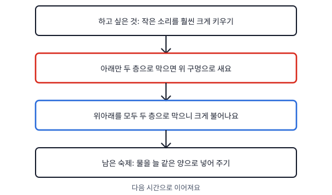

*다 막은 뒤에는 날씨나 배터리가 바뀌어도 물을 같은 양으로 넣어 줄 방법이 필요해요.*

**정확히 말하면**

이번 수업은 두 이야기예요. 앞부분은 캐스코드 증폭기의 이득을 실제로 키우는 법이고, 뒷부분은 그 증폭기에 정확한 바이어스 전류를 주는 법이에요.

**캐스코드 증폭기: 부하까지 캐스코드로**

**1. 풀고 싶은 문제.** 이득을 키우고 싶어요. 캐스코드 증폭기의 이득은 $A_v=-G_mR_{out}$이고, 입력 소자 전류는 거의 다 출력으로 가서 $G_m\approx g_{m1}$로 CS 단과 같아요([소스 쪽은 1/g_m, 드레인 쪽은 r_O](#s0-split)). 그래서 이득을 키우는 길은 $R_{out}$을 키우는 것뿐이에요([출력저항, G_m, 이득](#s1-gain)).

**2. 단순한 해법과 그 한계.** 아래쪽만 캐스코드로 쌓고 부하는 PMOS 한 개로 달면 출력에서 두 저항이 병렬이 돼요.

$$
R_{out}=(g_{m2}r_{O2}r_{O1})\parallel r_{O3}\approx r_{O3}
$$

병렬은 작은 쪽이 정하므로 아래를 $g_{m2}r_{O2}$배 키운 효과가 사라지고, 이득 크기는 예제 값으로 약 23에 그쳐요([부하도 캐스코드로 만들어야 하는 이유](#s1-load)). 바이폴라도 PNP 한 개 부하면 $R_{out}$이 $r_{O3}$ 근처로 떨어져요([PNP 캐스코드 부하](#s2-improved)).

**3. 핵심 아이디어.** 부하 전류원도 두 개를 쌓은 캐스코드 부하(cascode load)로 만들어 위아래 저항을 모두 키워요.

$$
A_v\approx-g_{m1}(R_{on}\parallel R_{op})
$$

MOS 예제에서 이득이 약 23에서 약 318로 커져요([예제: MOS 캐스코드 증폭기의 이득](#s1-example)). 바이폴라도 원리가 같고, 노드 X에 $r_{\pi2}$가 $r_{O1}$과 병렬로 붙는 것만 달라요([MOS와 다른 점은 r_π2 하나](#s2-bjt), [예제: 바이폴라 캐스코드 증폭기의 이득](#s2-example)).

**4. 대가와 쓰이는 곳.** 트랜지스터 네 개를 쌓으니 소자마다 오버드라이브 전압이 필요해서 헤드룸(headroom)이 줄어요.

$$
V_{DD}\ge4(V_{GS}-V_{TH})
$$

캐스코드 소자의 바이어스 $V_{b1}$, $V_{b2}$도 모든 소자가 포화에 있도록 따로 잡아야 해요([DC 바이어스: 전류는 M1과 M4가 정한다](#s1-bias)). 전원 전압이 1 V 근처로 낮아진 모바일 회로에서는 이 헤드룸이 한계가 돼요([쌓을수록 필요한 전원 전압](#s1-headroom)).

**전류원을 어떻게 정확히 만들까: 전류 거울로 가는 길**

**1. 풀고 싶은 문제.** 증폭기의 전류원은 정해진 DC 바이어스 전류를 흘려야 해요. $g_m$과 $r_O$가 모두 이 전류로 정해지므로 전류가 바뀌면 이득도 바뀌어요([DC 바이어스: 전류는 M1과 M4가 정한다](#s1-bias)).

**2. 단순한 해법과 그 한계.** 전원 전압을 저항 분배기(resistive divider)로 나눠 게이트에 걸어요.

$$
V_{GS}=\frac{R_2}{R_1+R_2}V_{DD}
$$

그런데 전류에 들어가는 $\mu_n$과 $V_{TH}$는 온도에 따라 변하고, $V_{DD}$는 배터리가 닳으며 떨어져요. 그래서 $V_{GS}$를 정해도 전류는 정해지지 않아요([저항 분배기 바이어스는 왜 안 될까](#s3-divider)).

**3. 핵심 아이디어.** 온도와 전원 전압이 바뀌어도 일정한 정확한 전류를 공급하는 바이어스 회로가 필요하고, 그 답이 다음 시간의 전류 거울(current mirror)이에요([다음 시간 예고](#s4-next)).

**4. 대가와 쓰이는 곳.** 쓰이는 곳은 이번 수업의 모든 전류원이에요. 캐스코드 부하의 $M_4$, $Q_4$처럼 게이트나 베이스에 DC 바이어스를 거는 소자가 정확한 전류를 받아야 증폭기가 설계대로 동작해요([PNP 캐스코드 부하](#s2-improved)). 이 회로가 무엇을 내주는지는 수업에서 다루지 않았어요.

**교수님 말씀**

아래를 캐스코드로 만들면 위 전류원도 캐스코드여야 한다고 하셨어요.

> "하나만 달면 … 아래쪽에 캐스코드 구조는 장점이 없어지게 되는 거죠." (0916 11:12–11:20)

> "Gm은 동일한데 Rout이 커진 만큼 이득이 대폭 증가하게 되겠습니다." (0916 24:08)

> "저항이 증가하는 효과를 그대로 얻으려면 아랫쪽도 캐스코드, 위쪽도 캐스코드" (0916 54:34)

대가로는 전원 전압을 들었어요.

> "캐스코드 구조에는 이제 전압을 낮추는 데 한계가 있어요." (0916 19:56)

저항 분배기 바이어스는 실험에서는 쓰지만 제품에서는 쓰지 않는다고 하셨어요.

> "상용 제품에는 이렇게 쓰지 않습니다. 이렇게 쓰면 문제가 생기니까." (0916 70:31)

> "어떻게 하면 정확한 전류를 내가 회로에 공급해 줄 것인가?" (0916 70:41)

**보충 · 수업에서 유도하진 않았어요**

수업은 밴드갭 기준(bandgap reference)의 이름만 말했어요. 교과서는 이것이 전류 거울의 대가와 쓰임새로 이어진다고 설명해요(Razavi 9.2.1, 468–469쪽).

온도와 전원에 거의 무관한 전류는 밴드갭 기준 회로로 만들 수 있지만, 소자가 수십 개 필요해요. 집적회로에는 전류원이 수백 개라서 전류원마다 밴드갭 회로를 둘 수 없어요.

그래서 밴드갭 회로로 정확한 기준 전류 $I_{REF}$ 하나만 만들고, 그 전류를 여러 곳에 복사해요. 이 복사기가 전류 거울이에요(예: $I_{copy}=I_{REF}$, $I_{copy}=2I_{REF}$).

**페이지 요약**

부하까지 캐스코드로 만들어야 $R_{out}$과 이득이 커지고, 그 증폭기에 줄 정확한 바이어스 전류는 저항 분배기가 아니라 전류 거울로 만들어요.

*핵심 식*

- PMOS 한 개 부하

  $$
  R_{out}=(g_{m2}r_{O2}r_{O1})\parallel r_{O3}
  $$

  $$
  \approx r_{O3}
  $$
- 캐스코드 부하일 때 이득

  $$
  A_v\approx-g_{m1}(R_{on}\parallel R_{op})
  $$
- 분배기 게이트 전압

  $$
  V_{GS}=\frac{R_2}{R_1+R_2}V_{DD}
  $$

*용어*

- **캐스코드 부하(cascode load)** — 두 개를 쌓아 만든, 이상적 전류원에 가까운 부하
- **헤드룸(headroom)** — 전원과 접지 사이에서 신호가 쓸 수 있는 전압 여유
- **전류 거울(current mirror)** — 온도·전원 전압과 무관하게 정확한 바이어스 전류를 공급하려는 회로

---

## 0. 캐스코드 복습: 전류는 어디로 갈까

### 소스 쪽은 1/g_m, 드레인 쪽은 r_O

*0916 수업 · L03 s14*

**쉽게 말하면**

물이 갈림길을 만나면 지나가기 쉬운 길로 거의 다 흘러가요.

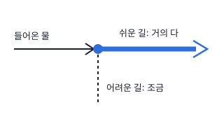

*색칠된 점이 갈림길이고, 굵은 선이 쉬운 길, 가는 점선이 어려운 길이에요.*

**정확히 말하면**

0911 수업(L03 s1–s14)에서 본 캐스코드(cascode)를 다시 봐요. 아래 M1이 입력을 받는 트랜지스터, 위 M2가 게이트에 DC 바이어스가 걸린 캐스코드 소자예요. M1 드레인과 M2 소스가 만나는 노드를 X라고 불러요.

복습하면, 캐스코드 전류원은 출력저항이 약 $g_m r_O$배 커져 이상적 전류원에 가까워지고, 증폭기로 쓰면 그만큼 이득이 커져요(0916 00:00).

지금까지는 M1의 소신호 드레인 전류 $i_{D1}$이 모두 M2로 흘러 출력 전류가 된다고 가정했어요. 그래서 $G_m\approx g_{m1}$이고 $A_v=-G_mR_{out}\approx-g_{m1}g_{m2}r_{O2}r_{O1}$이었어요(L03 s14).

엄밀히는 노드 X에서 $i_{D1}$이 두 갈래로 나뉘어요. 한 갈래는 M1 자신의 출력저항(output resistance) $r_{O1}$, 다른 갈래는 M2 소스 쪽으로 들여다본 저항이에요.

**1. 소스 쪽으로 들여다본 저항 (칠판 유도)**

게이트를 소신호 접지로 두고, 소스에 시험 전압 $V_x$를 걸어 흘러드는 전류 $I_x$를 재요($r_O$는 무시).

1. 게이트 전압이 0이므로 $V_{GS}=0-V_x=-V_x$
2. $I_D=g_mV_{GS}=-g_mV_x$
3. $I_x$는 $I_D$와 방향이 반대예요: $I_x=-I_D=g_mV_x$
4. $R=\frac{V_x}{I_x}=\frac{1}{g_m}$

**2. 드레인 쪽과 소스 쪽은 대칭이 아니에요**

| 들여다보는 곳 | 전압을 바꾸면 | 저항 |
|---|---|---|
| 드레인 | $V_{GS}$가 그대로예요. 채널 길이 변조(channel-length modulation)로만 전류가 조금 변해요. | $r_O$ 큼 |
| 소스 | $V_{GS}$가 함께 변해요. 전류가 크게 변해요. | $\frac{1}{g_m}$ |
| 다이오드 연결(diode-connected) 소자의 드레인 | 게이트와 드레인이 묶여 있어 게이트도 함께 변해요. 그래서 $V_{GS}$가 변해요. | $\approx\frac{1}{g_m}$ |

다이오드 연결은 게이트와 드레인을 묶은 연결이에요. 드레인 전압을 바꾸는 것이 소스 전압을 바꾸는 것과 같은 효과를 내요.

**3. 노드 X에서의 전류 분배**

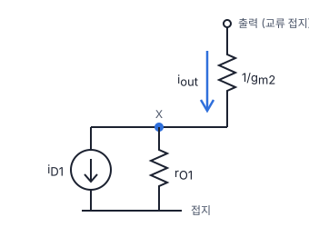

*$G_m$을 구할 때처럼 출력을 교류 접지로 두면, $i_{D1}$은 $r_{O1}$과 $\frac{1}{g_m}$ 꼴 저항($1/g_{m2}$) 사이에서 나뉘어요.*

1. 노드 X에서 M1이 끌어가는 전류: $i_{D1}=g_{m1}v_{in}$
2. X에서 본 두 갈래: 접지 쪽 $r_{O1}$, 출력 쪽 $1/g_{m2}$
3. 전류 분배(저항이 작은 쪽으로 많이 가요):

   $$
   i_{out}=i_{D1}\frac{r_{O1}}{r_{O1}+1/g_{m2}}\approx i_{D1}
   $$
4. 근사는 $g_{m2}r_{O1}\gg 1$일 때 성립해요. 보통 $g_mr_O\gg1$이므로 $G_m\approx g_{m1}$로 둬도 돼요.

MOS 슬라이드에는 이 설명이 없어요. 바이폴라 캐스코드 슬라이드(L03 s18)의 "Since $r_O$ is much larger than $1/g_m$, most of $I_{C,Q1}$ flows into …"가 같은 내용이에요.

**교수님 말씀**

교수님이 "M2 소스 쪽으로 바라보는 임피던스가 얼마라고 그랬죠?"(0916 02:06)라고 물었는데 대답이 없어서, 칠판에서 $V_x$를 걸고 $I_x$를 재는 방법으로 직접 유도했어요.

게이트와 드레인을 묶은 경우도 물었어요. 드레인이 바뀌면 게이트도 바뀌니 "소스 쪽이 바뀌는 거랑 … 똑같죠"(0916 04:52)라고 정리했어요.

**꼭 기억해요**

> "소스 쪽으로 바라보는 거는 gm분의 1이죠 … 어마어마한 차이죠." (0916 03:41)

> "대부분의 전류가 M2의 소스로 흐른다고 가정해도 무리가 없습니다. 사실 무리가 전혀 없어요." (0916 05:53)

**페이지 요약**

소스 쪽 저항은 작고 드레인 쪽 저항은 커서, M1 전류는 거의 다 M2로 흘러요.

*핵심 식*

- 소스 쪽에서 본 저항

  $$
  R=\frac{V_x}{I_x}=\frac{1}{g_m}
  $$
- 노드 X 전류 분배

  $$
  i_{out}=i_{D1}\frac{r_{O1}}{r_{O1}+1/g_{m2}}\approx i_{D1}
  $$

*용어*

- **다이오드 연결(diode-connected)** — 게이트와 드레인을 묶은 연결, 약 $\frac{1}{g_m}$으로 보여요.
- **출력저항(output resistance)** — 드레인 쪽에서 본 $r_O$, 채널 길이 변조로 생겨요.

---

### 가운데 노드에 R_P가 달리면

*0916 수업 · L03 s14*

**쉽게 말하면**

갈림길에 샛길이 하나 더 뚫리면 물이 그쪽으로도 새서, 앞으로 가는 양이 줄어요.

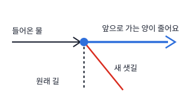

*비스듬한 선이 새로 생긴 샛길이고, 그래서 오른쪽 선이 가늘어졌어요.*

**정확히 말하면**

슬라이드 밖 칠판 변형 문제예요. 슬라이드 태그는 이어지는 내용이라 L03 s14로 두었어요. 교수님이 [소스 쪽은 1/g_m, 드레인 쪽은 r_O](#s0-split)의 캐스코드에서 노드 X와 접지 사이에 저항 $R_P$를 단 경우를 칠판에 그렸어요. 일부러 다는 저항이 아니라 문제를 변형한 경우예요.

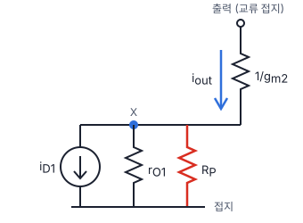

*$R_P$는 $r_{O1}$과 같은 두 노드(X와 접지) 사이에 있어 병렬이에요.*

1. $R_P$와 $r_{O1}$은 둘 다 X와 접지 사이: 접지 쪽 갈래는 $r_{O1}\parallel R_P$
2. 출력 쪽 갈래는 그대로 $1/g_{m2}$
3. 전류 분배:

   $$
   i_{out}=i_{D1}\frac{r_{O1}\parallel R_P}{(r_{O1}\parallel R_P)+1/g_{m2}}
   $$
4. $i_{D1}=g_{m1}v_{in}$이므로

   $$
   G_m=\frac{i_{out}}{v_{in}}=g_{m1}\frac{r_{O1}\parallel R_P}{(r_{O1}\parallel R_P)+1/g_{m2}}
   $$
5. $R_P\ll r_{O1}$이면 $r_{O1}\parallel R_P\approx R_P$예요. 이때 $R_P$가 $1/g_{m2}$에 비해 충분히 크지 않으면 $R_P$로 새는 전류를 무시할 수 없어요.
6. 출력으로 가는 전류가 줄어드니 $G_m$이 $g_{m1}$보다 작아지고, 이득 $A_v=-G_mR_{out}$도 떨어져요.

요점은 회로의 $G_m$이 트랜지스터의 $g_m$과 늘 같지는 않다는 거예요. 원래 식에서 저항이 어느 자리에 더해지는지만 보면 돼요.

교과서 Example 9.6(Fig. 9.11)에도 기생 저항 $R_P$가 나와요. 다만 거기서는 $R_P$가 위쪽 캐스코드 소자의 드레인–소스 사이에 걸려 있고, 묻는 것도 출력저항 $R_{out}$이라 이 칠판 문제와는 달라요.

**교수님 말씀**

교수님은 이 저항을 일부러 다는 게 아니라 문제를 변형한 경우라고 했어요(0916 06:36). $R_P$가 $r_O$보다 충분히 작으면 이 전류가 줄어들고, "그럼 이득이 떨어지는 거"(0916 07:34)라고 설명했어요.

> "상대적으로 작은 Rp가 달린다면 … 이 전류가 출력 쪽으로 다 흘러가지 않을 수도 있다" (0916 08:05)

**꼭 기억해요**

> "그래서 문제가 이렇게 주어질 수도 있죠." (0916 08:20)

노드 X에 저항이 더해지면 $r_{O1}$ 자리를 $r_{O1}\parallel R_P$로 바꿔 전류 분배를 다시 계산해요.

**페이지 요약**

X 노드에 $R_P$가 달리면 전류 일부가 새서 $G_m$과 이득이 줄어요.

*핵심 식*

- $R_P$가 있을 때 전류 분배

  $$
  i_{out}=i_{D1}
  $$

  $$
  \times\frac{r_{O1}\parallel R_P}{(r_{O1}\parallel R_P)+1/g_{m2}}
  $$
- 접지 쪽 갈래

  $$
  r_{O1}\parallel R_P
  $$

---

## 1. 개선된 MOS 캐스코드 증폭기

### 부하도 캐스코드로 만들어야 하는 이유

*0916 수업 · L03 s15*

**쉽게 말하면**

아래쪽을 아무리 튼튼하게 막아도 위쪽이 헐거우면 그쪽으로 다 새어 버려요.

*둘이 함께 막으면 약한 쪽보다도 조금 더 약해져요.*

**정확히 말하면**

지난 시간 캐스코드 증폭기는 위쪽 부하를 이상적 전류원(저항 $\infty$)으로 두었어요. 실제로는 이 전류원도 트랜지스터로 만들어야 해요.

전원에서 출력 노드로 전류를 흘리는 가장 쉬운 방법은 PMOS 한 개($M_3$)를 다는 거예요. 게이트에 DC 전압을 걸어 두면 출력에서 위를 본 저항은 $r_{O3}$ 정도예요.

1. 아래쪽 NMOS 캐스코드: $R_{on}\approx g_{m2}r_{O2}r_{O1}$ (매우 큼)
2. 위쪽 PMOS 한 개: $r_{O3}$
3. 출력에서는 둘이 병렬: $R_{out}=(g_{m2}r_{O2}r_{O1})\parallel r_{O3}$
4. 병렬 저항은 작은 쪽보다 작으므로 $R_{out}\lt r_{O3}$, 즉 $R_{out}\approx r_{O3}$

아래를 캐스코드로 $g_{m2}r_{O2}$배 키운 효과가 사라지고, 이득은 CS 단 수준으로 돌아가요. [예제: MOS 캐스코드 증폭기의 이득](#s1-example)의 값으로 계산하면 $693\ \text{k}\Omega\parallel13.3\ \text{k}\Omega\approx13.1\ \text{k}\Omega$라서 이득 크기는 약 23에 그쳐요.

그래서 부하 전류원도 PMOS 두 개($M_3$, $M_4$)를 쌓은 **캐스코드 부하**로 만들어요. 그러면 위쪽 저항도 $r_{O4}$가 $g_{m3}r_{O3}$배 커져 이상적 전류원에 가까워져요(L03 s15). 식은 [출력저항, G_m, 이득](#s1-gain)에서 구해요.

**교수님 말씀**

아래쪽을 캐스코드로 만들 거라면 위쪽 전류원도 캐스코드여야 한다고 하셨어요. 위에 하나만 달면 아래를 캐스코드로 만든 의미가 없다는 뜻이에요 (0916 10:45–11:38).

**꼭 기억해요**

> "이 커런트 소스도 … 하나는 달면 안 되고 캐스코드 구조로" (0916 10:45)

병렬 저항은 작은 쪽이 정해요. 위아래 중 한쪽만 키우면 소용없어요.

**페이지 요약**

부하를 PMOS 한 개로 달면 출력저항이 $r_{O3}$ 근처로 떨어져서, 부하도 캐스코드로 만들어요.

*핵심 식*

- PMOS 한 개 부하

  $$
  R_{out}=(g_{m2}r_{O2}r_{O1})\parallel r_{O3}
  $$

  $$
  \approx r_{O3}
  $$

*용어*

- **캐스코드 부하(cascode load)** — PMOS 두 개를 쌓아 만든, 이상적 전류원에 가까운 부하

---

### DC 바이어스: 전류는 M1과 M4가 정한다

*0916 수업 · L03 s15*

**쉽게 말하면**

흐르는 양은 맨 위와 맨 아래가 정하고, 가운데 둘은 모두가 제대로 일하게 자리만 잡아 줘요.

*가운데 둘에게 주는 값을 바꿔도 흐르는 양은 그대로예요.*

**정확히 말하면**

s15 그림의 게이트 전압 중 입력을 뺀 나머지는 모두 DC 바이어스예요. 위쪽 PMOS 두 개는 DC 바이어스 전류만 흘리는 전류원이에요.

**DC 전류를 정하는 것은 $M_1$과 $M_4$**예요. 둘 다 소스가 레일(접지, $V_{DD}$)에 붙어 있어서 $V_{GS}$가 게이트 전압만으로 정해지기 때문이에요.

$$
I_{D1}=\tfrac12\mu_nC_{ox}\left(\tfrac WL\right)_1(V_{GS1}-V_{THN})^2
$$

$$
I_{D4}=\tfrac12\mu_pC_{ox}\left(\tfrac WL\right)_4(V_{SG4}-|V_{THP}|)^2
$$

직렬로 이어져 있으니 두 전류가 같아지도록 맞춰야 해요.

캐스코드 소자($M_2$, $M_3$)의 게이트 전압 $V_{b1}$, $V_{b2}$는 **전류를 정하지 않아요**. $M_2$의 소스(노드 X)는 접지가 아니라서, 흐르는 전류에 맞는 $V_{GS2}$가 되도록 X의 DC 전압이 스스로 정해져요.

- $M_1$과 $M_2$의 크기가 같으면 전류도 같으므로 $V_{GS2}=V_{GS1}$이에요.
- $V_X=V_{b1}-V_{GS2}$라서 $V_{b1}$을 바꾸면 X 전압만 함께 움직여요.

대신 $V_{b1}$, $V_{b2}$는 **모든 MOSFET이 포화(saturation) 영역에 있도록** 잡아야 해요. $M_1$의 조건을 한 줄씩 쓰면 이래요.

1. 포화 조건: $V_{DS1}\ge V_{GS1}-V_{TH}$
2. $M_1$의 드레인이 X이므로 $V_{DS1}=V_X=V_{b1}-V_{GS2}$
3. 대입: $V_{b1}-V_{GS2}\ge V_{GS1}-V_{TH}$
4. $V_{b1}\ge V_{GS2}+(V_{GS1}-V_{TH})$

- $V_{b1}$이 너무 작으면 X가 내려가 $M_1$이 포화를 벗어나요.
- $V_{b1}$이 너무 크면 X가 올라가 $M_2$의 $V_{DS2}$가 줄어서 $M_2$가 포화를 벗어나요.
- 위쪽 $V_{b2}$도 같은 방식으로 $M_3$, $M_4$가 모두 포화에 있게 잡아요.

**교수님 말씀**

칠판에서 $V_{b1}$을 바꾸면 X 전압이 따라 움직일 뿐 전류는 그대로라고 설명하셨어요. 캐스코드 게이트 전압의 역할은 포화 영역 유지라고 정리하셨어요 (0916 11:38–16:12).

**꼭 기억해요**

> "모든 트랜지스터가 saturation 영역에서 동작하도록 바이어스 전압을 설정해 줘야" (0916 16:12)

전류는 $M_1$, $M_4$가 정하고, $V_{b1}$, $V_{b2}$는 포화 조건으로 정해요.

**페이지 요약**

DC 전류는 소스가 레일에 붙은 $M_1$, $M_4$가 정하고, $V_{b1}$, $V_{b2}$는 모든 소자를 포화에 두도록 잡아요.

*핵심 식*

- M1 포화 조건

  $$
  V_{b1}\ge V_{GS2}+(V_{GS1}-V_{TH})
  $$
- 노드 X 전압

  $$
  V_X=V_{b1}-V_{GS2}
  $$

*용어*

- **포화(saturation)** — $V_{DS}\ge V_{GS}-V_{TH}$라서 전류원처럼 동작하는 영역

---

### 쌓을수록 필요한 전원 전압

*0916 수업 · L03 s15*

**쉽게 말하면**

블록을 높이 쌓을수록 받침대도 더 높아야 해요.

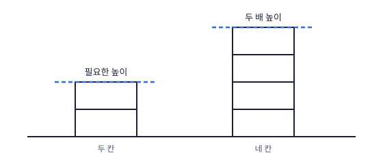

*칸마다 꼭 필요한 몫이 있어서, 네 칸을 쌓으면 두 칸일 때의 두 배가 필요해요.*

**정확히 말하면**

캐스코드의 단점은 두 가지예요. 바이어스 설정이 복잡해지고, 트랜지스터를 쌓는 만큼 전원 전압이 더 높아야 해요. 전원과 접지 사이에서 신호가 쓸 수 있는 전압 여유를 **헤드룸**(headroom)이라고 해요.

포화를 유지하려면 소자마다 $V_{DS}\ge V_{GS}-V_{TH}$가 필요해요. 이 최소 전압이 **오버드라이브**(overdrive) 전압 $V_{GS}-V_{TH}$예요.

- CS 단(입력 NMOS + PMOS 부하, 2개): $V_{DD}\ge2(V_{GS}-V_{TH})$
- 위아래 캐스코드(4개): $V_{DD}\ge4(V_{GS}-V_{TH})$
- 예: 소자마다 0.2 V이면 CS 단은 0.4 V, 캐스코드는 0.8 V가 필요해요.

오버드라이브 전압은 설계로 정해요. 포화 전류식을 $V_{GS}-V_{TH}$에 대해 풀면 이래요.

$$
V_{GS}-V_{TH}=\sqrt{\frac{2I_D}{\mu C_{ox}(W/L)}}
$$

전류를 키우면 커지고, 크기 $W/L$을 키우면 줄어요. 보통 0.1–0.2 V까지 줄일 수 있어요.

전원 전압은 계속 낮아졌어요. 예전 실험용 OP 앰프는 ±15 V 수준이었고, 5 V, 3 V를 거쳐 지금은 1.2 V, 1 V 이하예요. 소모 전력 $P=V_{DD}I$를 줄이기 위해서예요. 특히 배터리로 동작하는 모바일 시스템에서 전력이 중요해요.

전원이 이만큼 낮아지면 소자를 네 개 쌓는 캐스코드는 헤드룸이 모자라서 다른 구조를 써야 해요.

**교수님 말씀**

교수님이 "서플라이 전압을 낮춰요. 왜 낮춰요?"라고 물으셨고 (0916 19:16), 학생이 "전력을 낮추려고요"라고 답했어요 (0916 19:22). 교수님은 파워 소모가 $V_{DD}$ 곱하기 전류라고 받으셨어요.

**꼭 기억해요**

> "모바일 시스템에서는 … 전압을 계속 낮추는데 … 캐스코드 구조에는 … 한계가 있어요." (0916 19:37–19:56)

캐스코드는 이득을 얻는 대신 헤드룸을 잃어요. 쌓은 소자 수만큼 오버드라이브 전압이 필요해요.

**페이지 요약**

소자마다 오버드라이브 전압이 필요해서, 네 개를 쌓는 캐스코드는 전원 전압(헤드룸)이 더 필요해요.

*핵심 식*

- 캐스코드 최소 전원

  $$
  V_{DD}\ge4(V_{GS}-V_{TH})
  $$
- 소모 전력

  $$
  P=V_{DD}I
  $$

*용어*

- **오버드라이브(overdrive) 전압** — 포화 유지에 필요한 최소 $V_{DS}$, $V_{GS}-V_{TH}$
- **헤드룸(headroom)** — 전원과 접지 사이에서 신호가 쓸 수 있는 전압 여유

---

### 출력저항, G_m, 이득

*0916 수업 · L03 s15*

**쉽게 말하면**

위아래를 모두 튼튼하게 막으니, 작은 입력이 만든 흐름 변화가 새지 않고 큰 출렁임이 돼요.

*흐름을 바꾸는 쪽은 그대로이고, 새는 곳만 막아서 크게 불어나요.*

**정확히 말하면**

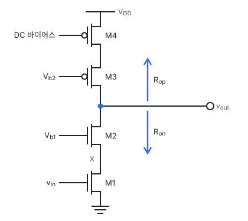

*개선된 MOS 캐스코드 증폭기(L03 s15, Razavi Fig. 9.20(b)). 출력에서 아래를 본 저항이 $R_{on}$, 위를 본 저항이 $R_{op}$예요.*

**출력저항**: 입력을 0으로 두면 $v_{in}$과 바이어스 노드가 모두 소신호 접지예요. $M_1$, $M_4$는 각각 $r_{O1}$, $r_{O4}$로만 보여요.

1. 아래쪽 정확식: 소스에 $r_{O1}$이 달린 $M_2$를 보면 $R_{on}=(1+g_{m2}r_{O2})r_{O1}+r_{O2}$
2. $g_mr_O\gg1$일 때 근사: $R_{on}\approx g_{m2}r_{O2}r_{O1}$ ($r_{O1}$이 $g_{m2}r_{O2}$배 커져요)
3. 위쪽도 같은 모양($R_{op}=(1+g_{m3}r_{O3})r_{O4}+r_{O3}$)이라, $g_mr_O\gg1$일 때 $R_{op}\approx g_{m3}r_{O3}r_{O4}$
4. 출력 노드에서 둘은 병렬: $R_{out}=R_{on}\parallel R_{op}$

**트랜스컨덕턴스**: 출력을 교류 접지로 두고 입력 전압당 출력 전류를 구해요.

$$
G_m=\frac{i_{out}}{v_{in}}\bigg|_{v_{out}=0}
$$

1. $M_4$의 게이트는 교류 접지라서 $v_{gs4}=0$이에요. 위쪽에서는 전류 변화가 없어요.
2. 전류 변화는 모두 $M_1$에서 와요: $i_{D1}=g_{m1}v_{in}$
3. 노드 X에서 $i_{D1}$이 $r_{O1}$과 $M_2$ 소스 쪽($1/g_{m2}$)으로 나뉘어요: $i_{out}=i_{D1}\dfrac{r_{O1}}{r_{O1}+1/g_{m2}}$
4. $g_{m2}r_{O1}\gg1$이면 $i_{out}\approx i_{D1}$이므로 $G_m=g_{m1}$

전류 분배의 근거는 [소스 쪽은 1/g_m, 드레인 쪽은 r_O](#s0-split)에서 다뤘어요.

**전압 이득**: 출력 노드에서 $v_{out}=-i_{out}R_{out}$이므로 이래요.

$$
A_v=-G_mR_{out}
$$

$$
A_v\approx-g_{m1}\big[(g_{m2}r_{O2}r_{O1})\parallel(g_{m3}r_{O3}r_{O4})\big]
$$

$G_m$은 CS 단과 같고, $R_{out}$이 커진 만큼 이득이 커져요. 위쪽 PMOS 두 개는 신호를 만들지 않고 부하로만 동작해요.

**교수님 말씀**

$G_m$은 CS 단과 같은데 출력 임피던스가 커져서 이득이 "대폭" 커진다고 하셨어요. 위쪽 PMOS는 DC 바이어스 전류만 흘리는 부하라고 강조하셨어요 (0916 20:12–24:19).

**페이지 요약**

$G_m$은 CS 단과 같은 $g_{m1}$이고, 위아래 캐스코드로 $R_{out}$이 커진 만큼 이득이 커져요.

*핵심 식*

- 아래쪽·위쪽 출력저항

  $$
  R_{on}\approx g_{m2}r_{O2}r_{O1}
  $$

  $$
  R_{op}\approx g_{m3}r_{O3}r_{O4}
  $$
- 출력저항

  $$
  R_{out}=R_{on}\parallel R_{op}
  $$
- 이득

  $$
  G_m=g_{m1}
  $$

  $$
  A_v=-G_mR_{out}
  $$

*용어*

- **트랜스컨덕턴스 $G_m$(transconductance)** — 출력을 교류 접지로 두었을 때 $i_{out}/v_{in}$

---

### 입력을 다른 게이트에 넣으면

*0916 수업 · L03 s15*

**쉽게 말하면**

막는 벽은 그대로인데, 신호를 넣는 문에 따라 흐름을 미는 힘이 달라져요.

*가운데 문은 미는 힘이 너무 약해서 일부러 쓰지 않아요.*

**정확히 말하면**

$R_{out}$은 입력을 0으로 두고 구하므로 입력을 어느 게이트에 넣어도 **변하지 않아요**. 달라지는 것은 $G_m$뿐이에요(수업에서 칠판으로 덧붙인 내용).

**입력을 PMOS $M_4$의 게이트에 넣으면** ($M_1$ 게이트는 DC 바이어스)

1. $M_1$의 게이트가 교류 접지라서 아래쪽 전류 변화가 0이에요.
2. $i_{D4}=g_{m4}v_{in}$이 $M_3$를 거쳐 출력으로 가요.
3. $G_m=g_{m4}$, $R_{out}$은 그대로예요.

보통 NMOS의 이동도가 PMOS보다 커서 같은 크기·전류이면 $g_m$도 커요. 그래서 $g_m$ 측면에서는 NMOS에 입력을 넣는 쪽이 유리해요. 예제 값으로는 $g_{m1}=1.73$ mS, $g_{m4}=1.41$ mS예요.

**입력을 캐스코드 소자 $M_2$의 게이트에 넣으면** ($M_1$ 게이트는 DC 바이어스)

1. $M_1$은 게이트와 소스가 교류 접지라서 저항 $r_{O1}$로 보여요.
2. 이 $r_{O1}$이 $M_2$의 소스에 달린 **소스 축퇴(source degeneration)** 저항 $R_S$가 돼요.
3. 전류가 늘면 소스 전압이 $i_Dr_{O1}$만큼 올라 $V_{GS}$가 줄고, 전류 증가를 되돌려요.
4. 결과: $G_m=\frac{g_m}{1+g_mR_S}$
5. $R_S=0$이면 $G_m=g_m$이고, $R_S$가 커지면 $G_m\to1/R_S$예요.

여기서는 $R_S=r_{O1}$이고 $g_{m2}r_{O1}\gg1$이라 $G_m\approx1/r_{O1}$이에요. 예제 값으로 $1/20\ \text{k}\Omega=0.05$ mS라서 $g_{m1}$보다 약 35배 작아요. 이 회로는 캐스코드가 아니라 소스 축퇴된 CS 단이라서 일부러 이렇게 쓰지 않아요.

바이폴라에서도 같아요. 입력을 PNP 베이스에 넣는 경우는 [PNP 캐스코드 부하](#s2-improved)에서 다뤄요.

**교수님 말씀**

입력을 $M_4$ 게이트에 넣으면 어떻게 되느냐는 질문이 나왔고 (0916 24:42), 교수님은 이때는 아래쪽 전류 변화가 0이라고 정리하셨어요.

$M_2$ 게이트 입력에 대해 "뭐가 달라져요?"라고 물으시자 (0916 26:52), 한 학생이 "Gm이 줄어들 것 같습니다", "소스 축퇴된…"이라고 답했어요 (0916 26:54–26:59). 교수님은 이를 소스 degeneration으로 정리하셨어요.

> "식으로도 … 계산해 볼 수 있는데 … 여기서 다 하진 않고" (0916 27:42)

**보충 · 수업에서 유도하진 않았어요**

수업에서는 결과식만 적었어요 (0916 28:48). 소스에 $R_S$가 달린 NMOS의 $G_m$을 $r_O$를 무시하고 구하면 이래요.

1. 등가회로: 게이트에 $v_{in}$, 소스와 접지 사이에 $R_S$, 드레인은 교류 접지, 종속 전류원 $g_mv_{gs}$
2. 소스 전압: $v_s=i_dR_S$
3. KVL: $v_{gs}=v_{in}-i_dR_S$
4. 소자 식: $i_d=g_mv_{gs}=g_m(v_{in}-i_dR_S)$
5. 정리: $i_d(1+g_mR_S)=g_mv_{in}$
6. $G_m=\dfrac{i_d}{v_{in}}=\dfrac{g_m}{1+g_mR_S}$

$R_S=r_{O1}$처럼 $R_S$가 $r_O$ 수준으로 크면 $r_{O2}$로 새는 전류까지 따져야 정확하지만, $g_mr_O\gg1$이면 결과는 $G_m\approx1/r_{O1}$로 같아요(Razavi P9.23이 바이폴라판 같은 문제예요).

**페이지 요약**

입력 위치를 바꿔도 $R_{out}$은 그대로이고, $M_2$ 게이트에 넣으면 $r_{O1}$이 소스 축퇴 저항이 되어 $G_m$이 크게 줄어요.

*핵심 식*

- PMOS 입력

  $$
  G_m=g_{m4}
  $$
- 소스 축퇴

  $$
  G_m=\frac{g_m}{1+g_mR_S}
  $$

*용어*

- **소스 축퇴(source degeneration)** — 소스에 달린 저항이 전류 변화를 되돌려 $G_m$을 줄이는 것

---

### 예제: MOS 캐스코드 증폭기의 이득

*0916 수업 · L03 s16*

**쉽게 말하면**

흐름을 세게 늘리면 미는 힘은 조금 세지지만 막는 벽이 훨씬 약해져서, 오히려 덜 불어나요.

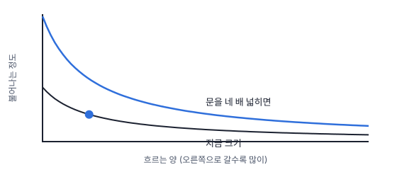

*더 크게 불리고 싶으면 흐름 대신 문을 넓혀요.*

**정확히 말하면**

**문제**(L03 s16, Razavi Example 9.11): 개선된 캐스코드 증폭기에서 $(W/L)_{1,2}=30$, $(W/L)_{3,4}=40$, $I_{D1}=\dots=I_{D4}=0.5$ mA, $\mu_nC_{ox}=100\ \mu\text{A/V}^2$, $\mu_pC_{ox}=50\ \mu\text{A/V}^2$, $\lambda_n=0.1\ \text{V}^{-1}$, $\lambda_p=0.15\ \text{V}^{-1}$일 때 전압 이득을 구해요. $W/L$은 aspect ratio라고도 불러요.

먼저 DC 동작점을 정해요. 전류를 정하는 $M_1$, $M_4$의 $V_{GS}$는 전류식에서 나오고, $V_{b1}$, $V_{b2}$는 포화 조건에 맞게 잡아요([DC 바이어스: 전류는 M1과 M4가 정한다](#s1-bias)). 이득식 $A_v=-g_{m1}(R_{on}\parallel R_{op})$에 필요한 것은 $g_m$과 $r_O$예요.

**$g_m$의 두 가지 형태**: 포화 전류식을 $V_{GS}$로 미분해요.

1. $I_D=\tfrac12\mu C_{ox}\frac{W}{L}(V_{GS}-V_{TH})^2$
2. $g_m=\dfrac{\partial I_D}{\partial V_{GS}}=\mu C_{ox}\frac{W}{L}(V_{GS}-V_{TH})$
3. 1번 식에서 $V_{GS}-V_{TH}=\sqrt{2I_D/(\mu C_{ox}W/L)}$를 넣으면 $g_m=\sqrt{2\mu C_{ox}\frac{W}{L}I_D}$

오버드라이브 전압이 주어지면 2번 식, 전류가 주어지면 3번 식이 편해요. 이번에는 전류가 주어졌어요. 유도는 [0904 정리노트: 트랜스컨덕턴스 g_m](../../0904/정리노트_0904_MOS_Small_Signal_Model.html#s1-gm)에도 있어요.

**$r_O$**: 채널 길이 변조를 넣은 전류식을 $V_{DS}$로 미분해요.

1. $I_D=\tfrac12\mu C_{ox}\frac{W}{L}(V_{GS}-V_{TH})^2(1+\lambda V_{DS})$
2. $\dfrac{\partial I_D}{\partial V_{DS}}\approx\lambda I_D$
3. 역수가 저항: $r_O=\frac{1}{\lambda I_D}$

**대입**

1. $g_{m1,2}=\sqrt{2\cdot100\ \mu\text{A/V}^2\cdot30\cdot0.5\ \text{mA}}=1.73\ \text{mS}=(577\ \Omega)^{-1}$
2. $g_{m3,4}=\sqrt{2\cdot50\ \mu\text{A/V}^2\cdot40\cdot0.5\ \text{mA}}=1.41\ \text{mS}=(707\ \Omega)^{-1}$
3. $r_{O1,2}=\dfrac{1}{0.1\cdot0.5\ \text{mA}}=20\ \text{k}\Omega$
4. $r_{O3,4}=\dfrac{1}{0.15\cdot0.5\ \text{mA}}=13.3\ \text{k}\Omega$
5. $R_{on}\approx g_{m2}r_{O2}r_{O1}\approx693\ \text{k}\Omega$
6. $R_{op}\approx g_{m3}r_{O3}r_{O4}\approx250\ \text{k}\Omega$
7. $A_v=-g_{m1}(R_{on}\parallel R_{op})$, 즉 $A_v\approx-318$

슬라이드 값은 $r_{O3}=13.3\ \text{k}\Omega$로 반올림해서 계산한 거예요. 반올림 없이 계산하면 $R_{op}\approx251\ \text{k}\Omega$, $A_v\approx-320$이에요(복습문제 답안의 값). 교과서(E9.11, 식 (9.79)–(9.82))는 슬라이드처럼 $R_{op}\approx250\ \text{k}\Omega$, $A_v\approx-318$이에요.

보통 PMOS는 $\lambda$가 커서 $r_O$가 조금 작아요. 또 이동도가 작아서, $g_m$을 NMOS와 비슷하게 하려면 PMOS를 더 크게 만들어요. 이 예제도 $(W/L)_{3,4}=40$이 $(W/L)_{1,2}=30$보다 커요.

**이득을 2배로 하려면**: 다시 설계하지 않고 식을 보고 조절해요.

1. $g_m\propto\sqrt{(W/L)I_D}$라서, $g_m$을 2배로 하는 방법은 전류 4배 또는 크기 4배예요.
2. 그런데 전류를 키우면 $r_O=\frac{1}{\lambda I_D}$가 줄어요: $R_{on},R_{op}\propto g_mr_O^2\propto I_D^{-3/2}$
3. 그래서 $A_v\propto g_{m1}R_{out}\propto I_D^{1/2}\cdot I_D^{-3/2}=1/I_D$예요. 전류를 4배로 하면 이득은 1/4로 줄어요.
4. $(W/L)_1$만 4배로 하면 $g_{m1}$만 2배가 되고 $R_{out}$은 그대로라서 이득이 정확히 2배가 돼요.
5. $(W/L)_2$까지 함께 4배로 하면 $R_{on}$도 2배가 되어 이득이 2배보다 조금 더(약 2.3배) 커져요.

(수업 중 '전류 4배'도 이득을 2배로 만드는 방법으로 말했으나, $r_O$가 함께 줄어 이득은 오히려 줄어요)

#### 직접 해 보기: 전류와 크기에 따른 캐스코드 이득 *(정적 스냅샷 — 직접 조작은 HTML 버전)*

네 소자에 공통인 드레인 전류와 $(W/L)_1=(W/L)_2$의 배수를 움직이면 $g_{m1}$, $r_{O1}$, $R_{on}$, $R_{op}$, $A_v$가 바뀌어요. 전류를 키우면 점이 곡선을 따라 내려가고, 배수를 4로 하면 $g_{m1}$이 2배가 되며 곡선 전체가 올라가요. 나머지 값은 예제와 같고, 반올림 없이 계산해서 예제 설정에서 $A_v\approx-320$이 나와요.

지금 값: **gm1 = 1.73 mS, rO1 = 20.0 kΩ, Ron = 693 kΩ, Rop = 251 kΩ, Av = −320**

예제 설정(0.5 mA, 1배)과 비교: **gm1 ×1.00, |Av| ×1.00**

범례: 1배(예제 크기) 곡선 · 지금 배수 곡선 · 지금 설정

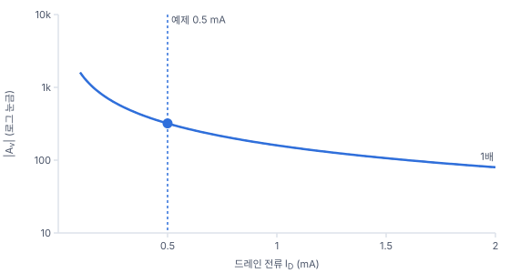

*대표 설정 1: 예제 그대로 (0.5 mA, 1배)*

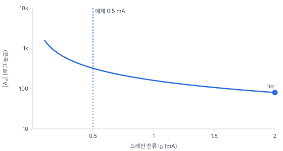

*대표 설정 2: 전류만 4배 (2 mA, 1배)*

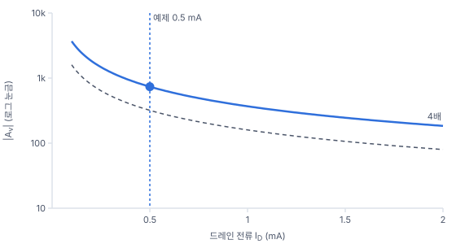

*대표 설정 3: M1·M2 크기 4배 (0.5 mA, 4배)*

| 설정 | $g_{m1}$ | $r_{O1}$ | $R_{on}$ | $R_{op}$ | $A_v$ | $g_{m1}$ 배율 | $\vert A_v\vert $ 배율 |
|---|---|---|---|---|---|---|---|
| 예제 그대로 (0.5 mA, 1배) | 1.73 mS | 20.0 kΩ | 693 kΩ | 251 kΩ | −320 | ×1.00 | ×1.00 |
| 전류만 4배 (2 mA, 1배) | 3.46 mS | 5.0 kΩ | 86.6 kΩ | 31.4 kΩ | −80 | ×2.00 | ×0.25 |
| M1·M2 크기 4배 (0.5 mA, 4배) | 3.46 mS | 20.0 kΩ | 1.39 MΩ | 251 kΩ | −737 | ×2.00 | ×2.31 |

**교수님 말씀**

> "설계는 아니고 설계된 거에서 이득을 구하시오." (0916 29:29)

PMOS를 더 크게 쓰는 것에 대해서는 꼭 그래야 하는 건 아니지만 $g_m$을 비슷하게 맞추려면 그렇게 한다고 하셨어요 (0916 34:47).

이득을 2배로 바꾸고 싶으면 처음부터 다시 설계하지 말고 식을 보고 조절하라고 하셨어요 (0916 36:42).

**꼭 기억해요**

> "여러분들이 식을 이해하면 … 식을 이용하면 되겠습니다." (0916 37:38)

$W/L$을 고정하고 전류를 키우면 $g_m$은 $\sqrt{I_D}$로 늘지만 $r_O$는 $1/I_D$로 줄어서, MOS 캐스코드 이득은 $1/I_D$로 줄어요. 이득을 2배로 하려면 $(W/L)_1$을 4배로 해요.

**페이지 요약**

$g_m$과 $r_O$를 전류로 구해 대입하면 $A_v\approx-318$이고, 이득을 키우려면 전류가 아니라 $W/L$을 키워요.

*핵심 식*

- 트랜스컨덕턴스

  $$
  g_m=\sqrt{2\mu C_{ox}\frac{W}{L}I_D}
  $$
- 출력저항

  $$
  r_O=\frac{1}{\lambda I_D}
  $$
- 예제 결과

  $$
  A_v=-g_{m1}(R_{on}\parallel R_{op})
  $$

  $$
  A_v\approx-318
  $$

*용어*

- **aspect ratio** — 트랜지스터의 폭과 길이의 비 $W/L$

---

## 2. 바이폴라 캐스코드 증폭기

### MOS와 다른 점은 r_π2 하나

*0916 수업 · L03 s17–s18*

**쉽게 말하면**

이번에도 두 칸을 쌓는 원리는 같고, 가운데 이음새에 새는 옆길이 하나 더 생길 뿐이에요.

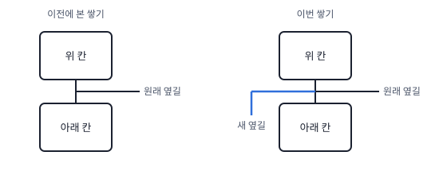

*오른쪽 그림에 강조색 선으로 그린 옆길이 새로 생긴 길이에요.*

**정확히 말하면**

바이폴라 캐스코드 증폭기(bipolar cascode amplifier)는 입력 트랜지스터 $Q_1$ 위에 베이스가 DC 바이어스 $V_{b1}$에 묶인 $Q_2$를 쌓은 회로예요. 원리는 MOS 캐스코드와 같아요.

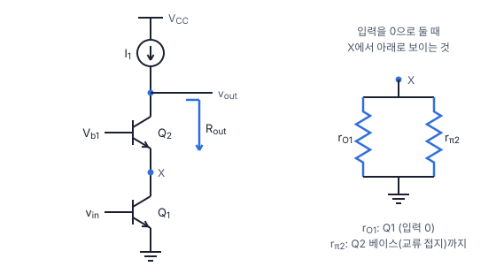

*부하가 이상적 전류원 $I_1$인 바이폴라 캐스코드와, 입력을 0으로 둘 때 노드 X에서 아래로 보이는 두 저항이에요.*

**CE 단과 비교.** 이상적 전류원 부하 CE 단(common-emitter stage)은 $A_v=-g_{m1}r_{O1}$이에요. 캐스코드도 전류 변화를 만드는 소자는 $Q_1$뿐이라 $G_m$은 CE 단과 같아요. $Q_2$는 $Q_1$의 전류 변화를 출력으로 전달만 해요. 그래서 출력저항(output resistance)이 커진 만큼 이득이 커져요 (L03 s17).

**단락 회로 트랜스컨덕턴스 $G_m$.** 출력을 교류 접지에 묶고 출력 전류를 구해요.

1. $Q_1$의 소신호 컬렉터 전류: $i_{c1}=g_{m1}v_{in}$
2. 노드 X에서 $i_{c1}$은 $r_{O1}$과, $Q_2$ 이미터로 들여다본 약 $1/g_{m2}$ 사이에서 나뉘어요:

   $$
   i_{out}=i_{c1}\,\frac{r_{O1}}{r_{O1}+1/g_{m2}}
   $$
3. $r_O\gg 1/g_m$이라 거의 전부 $Q_2$로 가요: $i_{out}\approx i_{c1}$
4. $$
   G_m\approx g_{m1}
   $$

이 분배는 MOS에서 본 것과 같아요([소스 쪽은 1/g_m, 드레인 쪽은 r_O](#s0-split)).

**출력저항 $R_{out}$.** 입력을 0으로 두면 $Q_1$은 저항 $r_{O1}$만 남아요.

1. $Q_2$의 베이스는 교류 접지예요. 그래서 $Q_2$의 $r_{\pi2}$가 노드 X와 접지 사이에 걸려요.
2. X에서 접지로 보이는 저항: $r_{O1}\parallel r_{\pi2}$. 이것이 $Q_2$의 이미터 축퇴 저항이 돼요.
3. $$
   R_{out}=\big[1+g_{m2}(r_{O1}\parallel r_{\pi2})\big]r_{O2}+(r_{O1}\parallel r_{\pi2})
   $$
4. $g_{m2}(r_{O1}\parallel r_{\pi2})\gg1$일 때:

   $$
   R_{out}\approx g_{m2}r_{O2}(r_{O1}\parallel r_{\pi2})
   $$

MOS 캐스코드는 $R_{out}\approx g_{m2}r_{O2}r_{O1}$이었어요. 게이트로 들어가는 저항이 무한대라서 $r_{\pi2}$ 항이 없었던 거예요. 차이는 이 $r_{\pi2}$ 하나예요. $r_{\pi1}$은 입력 쪽(베이스와 접지 사이)에 있어서 출력저항에는 나타나지 않아요.

**전압 이득.** $A_v=-G_mR_{out}$에 넣어요.

$$
A_v\approx-g_{m1}\big[g_{m2}r_{O2}(r_{O1}\parallel r_{\pi2})\big]
$$

CE 단의 $-g_{m1}r_{O1}$과 비교하면 이득이 약 $g_{m2}(r_{O1}\parallel r_{\pi2})$배 커져요($r_{O1}=r_{O2}$일 때).

**수업에서 던진 변형.** 노드 X와 접지 사이에 저항 $R_P$가 더 달린 회로를 물었어요. $R_{out}$ 식에서는 $r_{O1}\parallel r_{\pi2}$ 자리에 $R_P$가 병렬로 함께 들어가요. $R_P$가 $r_{O1}$보다 작은지 큰지 가정을 적고 근사해야 해요. $G_m$도 전류가 $R_P$ 쪽으로 새어서 $g_{m1}$보다 작아져요. 요지는 회로의 $G_m$이 트랜지스터의 $g_m$과 다를 수 있고, 기존 식에서 저항이 어디에 더해지는지만 보면 된다는 거예요(MOS 버전: [가운데 노드에 R_P가 달리면](#s0-rp)).

**교수님 말씀**

칠판에 식을 쓴 뒤 학생들에게 틀린 곳이 있으면 말해 달라고 했어요. MOS와 BJT가 헷갈릴 때가 있다는 이유였어요.

> "틀린 부분 있을까요? … 얘기를 해 주시면 고맙겠습니다." (0916 46:33)

CE 단보다 이득이 얼마나 커지는지는 캐스코드의 이득 식을 세운 뒤 다시 본다고 예고했어요 (0916 41:06).

**꼭 기억해요**

> "BJT와 모스의 차이점은 … r_π2 정도, 나머지는 … 비슷하죠." (0916 45:01)

바이폴라 캐스코드의 $R_{out}$에는 $r_{O1}$ 대신 $r_{O1}\parallel r_{\pi2}$가 들어가요. $G_m\approx g_{m1}$은 MOS와 같아요.

**페이지 요약**

바이폴라 캐스코드는 MOS와 같고, 노드 X에 $r_{\pi2}$가 $r_{O1}$과 병렬로 붙는 것만 달라요.

*핵심 식*

- 트랜스컨덕턴스

  $$
  G_m\approx g_{m1}
  $$
- 출력저항

  $$
  R_{out}\approx g_{m2}r_{O2}(r_{O1}\parallel r_{\pi2})
  $$
- 전압 이득

  $$
  A_v\approx-g_{m1}
  $$

  $$
  \times\big[g_{m2}r_{O2}(r_{O1}\parallel r_{\pi2})\big]
  $$

*용어*

- **CE 단(common-emitter stage)** — 이미터가 접지, 베이스 입력, 컬렉터 출력인 단
- **$r_{\pi2}$** — 캐스코드 소자 $Q_2$의 베이스-이미터 소신호 저항, 노드 X에 $r_{O1}$과 병렬로 보여요

---

### 다른 관점: CE 단 + CB 단

*0916 수업 · L03 s19*

**쉽게 말하면**

두 칸을 이어 붙인 것으로 봐도 답은 같지만, 한 덩어리로 보면 계산이 더 쉬워요.

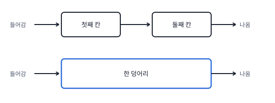

*위는 두 칸으로 나눠 본 모습, 아래는 한 덩어리로 본 모습이에요.*

**정확히 말하면**

바이폴라 캐스코드 증폭기는 CE 단 뒤에 CB 단(common-base stage)을 직렬로 이은 것으로도 볼 수 있어요 (L03 s19). 가운데 노드 전압을 $v_X$라 해요.

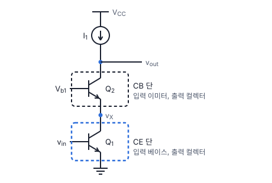

*$v_{in}\to v_X$는 이미터가 접지인 CE 단, $v_X\to v_{out}$은 베이스가 교류 접지인 CB 단이에요.*

1. CE 단 $Q_1$: 이미터 접지, 베이스로 입력, 컬렉터(X)로 출력해요. 전류는 $g_{m1}v_{in}$이에요.
2. CE 단의 부하는 $Q_2$ 이미터로 들여다본 저항이에요. 이 값은 $Q_2$ 컬렉터 부하를 $R_L$이라 하면 약 $(r_{O2}+R_L)/(g_{m2}r_{O2})$이고, $R_L$이 $r_{O2}$보다 훨씬 작을 때(예: 저항 부하) 약 $1/g_{m2}$예요($r_{O1}$은 훨씬 커서 무시).
3. $$
   \frac{v_X}{v_{in}}\approx-g_{m1}\cdot\frac{1}{g_{m2}}
   $$
4. $$
   \frac{v_X}{v_{in}}\approx-\frac{g_{m1}}{g_{m2}}
   $$
5. CB 단 $Q_2$: 베이스 교류 접지, 이미터로 입력, 컬렉터로 출력해요. 위상이 반전되지 않고, 이득은 대략 $g_{m2}R_{out}$이에요:

   $$
   \frac{v_{out}}{v_X}\approx g_{m2}R_{out}
   $$
6. 두 이득을 곱하면 $g_{m2}$가 약분돼요:

   $$
   \frac{v_{out}}{v_{in}}\approx-\frac{g_{m1}}{g_{m2}}\cdot g_{m2}R_{out}=-g_{m1}R_{out}
   $$

결과는 $A_v=-G_mR_{out}$(단, $G_m\approx g_{m1}$)과 같아요. 이 약분은 $Q_2$ 이미터 쪽 저항을 $1/g_{m2}$로 근사할 때의 계산이에요. 부하가 이상적 전류원이면 X에서 본 저항이 훨씬 커서 $v_X/v_{in}\approx-g_{m1}(r_{O1}\parallel r_{\pi2})$로 수십 배가 되지만, 전체 이득 $-G_mR_{out}$은 그대로예요.

그래도 캐스코드 단은 CE와 CB로 쪼개기보다 한 덩어리로 보고 $G_m$과 $R_{out}$을 구하는 편이 쉬워요.

**교수님 말씀**

CE 단과 CB 단으로 나눠 이득을 곱해 보인 뒤, 두 방법의 답이 같다는 것을 확인하고 한 덩어리 해석을 권했어요 (0916 49:57–53:04).

**꼭 기억해요**

> "캐스코드 스테이지는 그냥 한 덩어리로 보는 게 조금 더 해석해서 편합니다." (0916 52:51)

**페이지 요약**

캐스코드는 CE 단 + CB 단으로 봐도 같은 이득이 나오지만, 한 덩어리로 $G_m$과 $R_{out}$을 구하는 편이 쉬워요.

*핵심 식*

- CE 단 이득

  $$
  \frac{v_X}{v_{in}}\approx-\frac{g_{m1}}{g_{m2}}
  $$
- 두 단의 곱

  $$
  \frac{v_{out}}{v_{in}}\approx-\frac{g_{m1}}{g_{m2}}\cdot g_{m2}R_{out}
  $$

  $$
  =-g_{m1}R_{out}
  $$

*용어*

- **CB 단(common-base stage)** — 베이스가 교류 접지, 이미터 입력, 컬렉터 출력인 단(위상 반전 없음)

---

### PNP 캐스코드 부하

*0916 수업 · L03 s20*

**쉽게 말하면**

아래를 두 층으로 튼튼하게 쌓았다면 위도 두 층으로 쌓아야 해요.

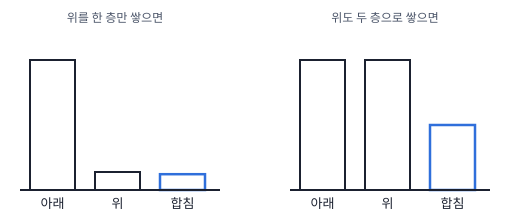

*둘을 합친 힘은 약한 쪽에 끌려가서, 위가 한 층이면 강조색 테두리의 합친 막대도 낮아져요.*

**정확히 말하면**

**PNP 한 개로 만든 부하.** 이상적 전류원 대신 가장 간단한 부하는 PNP 트랜지스터 $Q_3$ 한 개예요. 출력에서 위로는 $r_{O3}$ 정도만 보여요. 이것이 아래쪽 $g_{m2}r_{O2}(r_{O1}\parallel r_{\pi2})$와 병렬이 되므로 $R_{out}\approx r_{O3}$ 근처로 떨어져요. 아래를 캐스코드로 키운 이점이 사라져요 (0916 54:02).

**PNP 캐스코드 부하.** 높은 출력저항을 지키려면 위쪽 전류원도 캐스코드로 만들어요 (L03 s20). $Q_4$ 아래에 베이스가 DC 바이어스인 PNP $Q_3$를 쌓아요.

캐스코드 그림에서는 이름이 바뀌어요. 전원 쪽 위에 있는 소자가 $Q_4$, 그 아래 출력 쪽 소자가 $Q_3$예요.

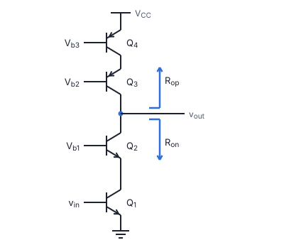

*아래는 NPN 캐스코드($Q_1$, $Q_2$), 위는 PNP 캐스코드($Q_4$, $Q_3$)예요. $V_{b1}$, $V_{b2}$, $V_{b3}$는 DC 바이어스예요.*

1. 입력을 0으로 두면 모든 바이어스 노드는 소신호 접지예요.
2. 아래쪽:

   $$
   R_{on}\approx g_{m2}r_{O2}(r_{O1}\parallel r_{\pi2})
   $$
3. 위쪽: $Q_4$는 $r_{O4}$로 보여요. $Q_3$의 베이스가 교류 접지라서 $Q_3$ 이미터 노드에는 $r_{\pi3}$가 $r_{O4}$와 병렬로 보여요.
4. $Q_3$가 이 저항을 약 $g_{m3}r_{O3}$배 키워요:

   $$
   R_{op}\approx g_{m3}r_{O3}(r_{O4}\parallel r_{\pi3})
   $$
5. 출력 노드에서 둘은 병렬이에요:

   $$
   R_{out}=R_{on}\parallel R_{op}
   $$

$G_m\approx g_{m1}$은 그대로예요. $Q_4$의 베이스가 교류 접지라 위쪽 전류는 변하지 않기 때문이에요.

$$
A_v\approx-g_{m1}(R_{on}\parallel R_{op})
$$

**입력을 $Q_4$의 베이스에 넣으면.** 이번에는 $Q_1$의 베이스가 DC 바이어스라 $v_{be1}=0$이고, 아래쪽 전류 변화가 없어요. $Q_4$의 전류 변화 $g_{m4}v_{in}$이 $Q_3$를 거쳐 출력으로 가요. 그래서 $G_m=g_{m4}$가 되고, $R_{out}$은 입력을 0으로 두고 구하므로 그대로예요. MOS에서 입력을 PMOS 게이트에 넣은 경우와 같아요([입력을 다른 게이트에 넣으면](#s1-input)).

MOS 버전의 식은 [출력저항, G_m, 이득](#s1-gain)에 있어요. 차이는 $r_{O1}$, $r_{O4}$ 자리에 $r_{\pi2}$, $r_{\pi3}$가 병렬로 붙는 것뿐이에요.

**교수님 말씀**

MOS 캐스코드 증폭기를 자세히 설명한 뒤라, 바이폴라 버전은 식만 대응시키고 넘어갔어요.

> "사실은 뭐 [MOS]랑 [BJT]랑 같기 때문에 두 번 설명 안 해요." (0916 57:08)

**꼭 기억해요**

아래가 캐스코드면 위 부하도 캐스코드여야 해요. 병렬에서는 작은 쪽이 $R_{out}$을 정하기 때문이에요.

> "저항이 증가하는 효과를 그대로 얻으려면 아랫쪽도 캐스코드, 위쪽도 캐스코드" (0916 54:34)

**페이지 요약**

위쪽 부하도 PNP 캐스코드로 만들어야 캐스코드의 큰 출력저항이 살아남아요.

*핵심 식*

- 위쪽 저항

  $$
  R_{op}\approx g_{m3}r_{O3}(r_{O4}\parallel r_{\pi3})
  $$
- 출력저항

  $$
  R_{out}=R_{on}\parallel R_{op}
  $$
- 이득

  $$
  A_v\approx-g_{m1}(R_{on}\parallel R_{op})
  $$

*용어*

- **PNP 캐스코드 부하(PNP cascode load)** — $Q_4$ 위에 $Q_3$를 쌓아 만든 위쪽 전류원
- **$G_m=g_{m4}$** — 입력을 $Q_4$ 베이스에 넣을 때의 트랜스컨덕턴스

---

### 예제: 바이폴라 캐스코드 증폭기의 이득

*0916 수업 · L03 s21*

**쉽게 말하면**

소리를 똑같이 키워 준다면, 전기를 덜 쓰는 장치가 더 잘 만든 장치예요.

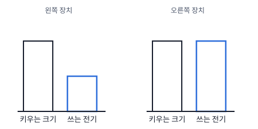

*두 장치가 키우는 크기는 같아도, 전기를 반만 쓰는 왼쪽 장치가 더 좋아요.*

**정확히 말하면**

**문제** (L03 s21, Razavi 예제 9.10). PNP 캐스코드 부하를 단 바이폴라 캐스코드 증폭기가 1 mA로 바이어스되어 있어요. NPN은 $V_A=5$ V, $\beta=100$, PNP는 $V_A=4$ V, $\beta=50$일 때 전압 이득을 구해요. 회로는 [PNP 캐스코드 부하](#s2-improved)의 그림과 같아요.

**소신호 파라미터 유도.** 외우지 말고 대신호 식을 미분해서 얻어요.

1. $I_C=I_S\exp(V_{BE}/V_T)$를 $V_{BE}$로 미분해요:

   $$
   g_m=\frac{\partial I_C}{\partial V_{BE}}=\frac{I_C}{V_T}
   $$

   즉 $g_m=I_C/V_T$예요.
2. 베이스 전류는 $I_B=I_C/\beta$예요. $V_{BE}$로 미분하면 $\partial I_B/\partial V_{BE}=g_m/\beta$예요:

   $$
   r_\pi=\beta/g_m
   $$
3. Early 효과를 넣은 $I_C=I_S\exp(V_{BE}/V_T)(1+V_{CE}/V_A)$를 $V_{CE}$로 미분하면 약 $I_C/V_A$예요:

   $$
   r_O=V_A/I_C
   $$

**값 대입** ($V_T\approx26$ mV, 네 트랜지스터 모두 1 mA)

| 트랜지스터 | $g_m$ | $r_\pi$ | $r_O$ |
|---|---|---|---|
| NPN $Q_{1,2}$ | $(26\ \Omega)^{-1}\approx38.5$ mS | 2.6 kΩ | 5 kΩ |
| PNP $Q_{3,4}$ | $(26\ \Omega)^{-1}\approx38.5$ mS | 1.3 kΩ | 4 kΩ |

1. $r_{O1}\parallel r_{\pi2}=5\ \text{k}\Omega\parallel2.6\ \text{k}\Omega\approx1.71\ \text{k}\Omega$, $g_{m2}(r_{O1}\parallel r_{\pi2})\approx65.8$
2. $$
   R_{on}\approx g_{m2}r_{O2}(r_{O1}\parallel r_{\pi2})\approx329\ \text{k}\Omega
   $$
3. $r_{O4}\parallel r_{\pi3}=4\ \text{k}\Omega\parallel1.3\ \text{k}\Omega\approx981\ \Omega$, $g_{m3}(r_{O4}\parallel r_{\pi3})\approx37.7$
4. $$
   R_{op}=g_{m3}r_{O3}(r_{O4}\parallel r_{\pi3})\approx151\ \text{k}\Omega
   $$
5. $R_{on}\parallel R_{op}\approx103.5\ \text{k}\Omega$
6. $$
   A_v=-g_{m1}(R_{on}\parallel R_{op})
   $$
7. $$
   A_v\approx-3981
   $$

PNP는 $\beta$와 $V_A$가 작아서 $R_{op}$가 $R_{on}$보다 작고, 병렬 결과를 $R_{op}$ 쪽이 끌어내려요. 부하가 이상적 전류원이었다면 $A_v\approx-g_{m1}R_{on}\approx-1.27\times10^4$라서, PNP 캐스코드 부하 때문에 이득이 약 1/3이 돼요(Razavi 예제 9.9와 비교).

**설계 관점.** 실제 설계는 거꾸로예요. 원하는 이득이 주어지고 소자값을 정해요. 조건은 하나인데 변수는 훨씬 많아서 답이 여러 개예요. 좋은 설계는 이득만 맞추는 게 아니라 전류(전력 $P=V_{CC}I$)를 최소로 하면서 이득, 동작 속도 같은 여러 사양을 함께 만족해야 해요.

**이득은 바이어스 전류와 무관해요.** 네 트랜지스터가 같은 전류 $I_C$를 흘린다고 해요.

1. $g_m\propto I_C$, $r_O, r_\pi\propto 1/I_C$
2. $g_{m2}r_{O2}=V_A/V_T$ ($I_C$가 없음)
3. $r_{O1}\parallel r_{\pi2}\propto 1/I_C$이므로 $R_{on}\propto1/I_C$, 같은 이유로 $R_{op}\propto1/I_C$
4. $A_v=-g_{m1}(R_{on}\parallel R_{op})$에서 $g_{m1}$의 $I_C$와 $1/I_C$가 약분돼요.

그래서 1 mA로 설계하든 2 mA로 설계하든 이득은 같고, 전류가 적은 쪽이 전력만 덜 써요(Razavi P9.21, P9.26).

**교수님 말씀**

$g_m$이 $I_C/V_T$인지 $V_T/I_C$인지 외우면 헷갈리니, 전류식을 미분해서 구해 보라고 했어요.

설계 문제는 사람마다 답이 달라요. 100명이 설계하면 100개의 답이 나온다고 했어요 (0916 63:01–65:18).

스마트폰에 들어가는 앰프를 예로 들었어요. 같은 이득을 한 사람은 1 mA로, 다른 사람은 2 mA로 맞췄다면 전류가 적은 1 mA 쪽이 좋은 설계예요 (0916 64:33–64:48).

**꼭 기억해요**

> "계산이 중요한 게 아니라 … 대입하면 되겠죠." (0916 62:49)

숫자보다 $g_m=I_C/V_T$, $r_\pi=\beta/g_m$, $r_O=V_A/I_C$를 유도하고 이득 식에 대입하는 흐름이 중요해요.

**페이지 요약**

소신호 파라미터를 미분으로 구해 대입하면 $A_v\approx-3981$이고, 이 이득은 바이어스 전류와 무관해요.

*핵심 식*

- 소신호 파라미터

  $$
  g_m=I_C/V_T
  $$

  $$
  r_\pi=\beta/g_m
  $$

  $$
  r_O=V_A/I_C
  $$
- 이득

  $$
  A_v=-g_{m1}(R_{on}\parallel R_{op})
  $$

  $$
  A_v\approx-3981
  $$

*용어*

- **얼리 전압(Early voltage) $V_A$** — 컬렉터 전류가 $V_{CE}$에 따라 늘어나는 정도, $r_O=V_A/I_C$를 정해요

---

## 3. 전류 거울로 가는 길

### 저항 분배기 바이어스는 왜 안 될까

*0916 수업 · L03 s22–s23*

**쉽게 말하면**

전지의 힘을 나눠서 흐름의 양을 정하면, 덥거나 춥거나 배터리가 줄 때마다 흐름이 바뀌어요.

흐름이 바뀌면 소리를 키우는 부분이 제대로 일하지 못해요.

*그래서 날씨와 배터리에 흔들리지 않는 새 방법이 필요해요.*

**정확히 말하면**

캐스코드 단(cascode stage)을 마치고 두 번째 파트인 전류 거울(current mirror)로 넘어가요. 이 파트에서는 바이폴라와 MOS 전류 거울을 다뤄요(L03 s22).

지금까지 전류원(current source)은 게이트에 전압을 걸어 바이어스했어요. 포화(saturation) 영역에서 원하는 전류(예: 1 mA)가 나오도록 $W/L$이나 $V_{GS}$를 골라요.

회로마다 따로 전압원을 둘 수 없으니, 전원 전압 $V_{DD}$를 저항 분배기(resistive divider)로 나눠 게이트에 걸어요(L03 s23, Razavi Fig. 9.22(b)).

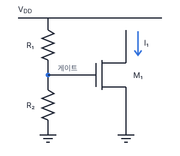

*저항 분배기로 게이트 전압을 정하는 MOS 전류원*

1. 게이트로는 DC 전류가 흐르지 않고 소스는 접지이므로:

   $$
   V_{GS}=\frac{R_2}{R_1+R_2}V_{DD}
   $$
2. 포화 영역 전류식($\lambda$ 무시):

   $$
   I_D=\tfrac12\mu_nC_{ox}\tfrac WL(V_{GS}-V_{TH})^2
   $$
3. 대입하면:

   $$
   I_1=\tfrac12\mu_nC_{ox}\tfrac WL\left(\frac{R_2}{R_1+R_2}V_{DD}-V_{TH}\right)^2
   $$

상용 제품에서 이 방식을 쓰지 않는 이유는 두 가지예요.

1. **온도**: 이동도(mobility) $\mu_n$과 문턱 전압(threshold voltage) $V_{TH}$가 온도에 따라 변해요. 그래서 $V_{GS}$가 그대로여도 $I_1$이 변하고, $g_m$과 이득(gain)도 달라져요.
2. **전원 전압**: $V_{DD}$가 변하면 $V_{GS}=\frac{R_2}{R_1+R_2}V_{DD}$가 따라 변하고, $I_1$은 그 오버드라이브의 제곱으로 변해요. 배터리 전압은 쓰는 동안 계속 떨어져요.

슬라이드의 말로 정리하면 "If $V_{GS}$ are well-defined, then $I_D$ are not"이에요. $V_{GS}$를 잘 정해도 $I_D$는 잘 정해지지 않아요.

목표는 온도와 전원 전압이 바뀌어도 일정하고 정확한 바이어스 전류(bias current)를 공급하는 거예요. 다음 시간에 이것을 해결하는 회로가 전류 거울(current mirror)이에요.

앞 파트는 소신호(small-signal) 해석이었지만, 이 파트는 증폭기도 소신호도 아닌 DC 바이어스 회로 이야기예요. 정확한 전압을 만드는 회로로는 밴드갭 기준(bandgap reference)이 있다고 이름만 언급했어요.

**교수님 말씀**

실험에서는 오피 앰프를 쓸 때처럼 전압을 분배해 바이어스하지만, 실제 제품에서 그렇게 쓰면 문제가 생긴다고 하셨어요.

> "여러분들 근데 실험할 때 이렇게 쓰죠." (0916 67:41)

같은 휴대폰이 우리나라, 적도, 극지방에서 모두 동작해야 해요. 온도 차가 크니 전류가 달라지면 안 돼요.

> "온도가 다르고요. 크게 차이 나죠. 전류가 달라요." (0916 68:54)

배터리 전압은 일정하지 않아요. 아침에 100% 충전했을 때와 50%일 때 전압이 달라서 전류도 달라져요. 0%는 전압이 0 V가 된다는 뜻이 아니라, 어떤 전압 아래로 떨어지지 않게 막은 지점이에요.

> "시간에 따라서 배터리 전압은 계속 떨어지는 거예요." (0916 69:51)

심장이 피를 보내 주지 않으면 몸이 움직이지 않듯, 앰프도 바이어스 전류를 정확히 받아야 원하는 대로 동작해요.

> "전류를 제대로 공급 안 해 주면 앰프가 제대로 동작 안 하거든요." (0916 72:11)

**꼭 기억해요**

> "상용 제품에는 이렇게 쓰지 않습니다. 이렇게 쓰면 문제가 생기니까." (0916 70:31)

저항 분배기 바이어스의 전류는 온도($\mu_n$, $V_{TH}$)와 전원 전압($V_{DD}$)에 따라 변해요. 이 두 가지가 이유예요.

> "정확하다는 말은 온도가 바뀌어도 서플라이가 바뀌어도 … 일정한 정확한 전류" (0916 71:02)

**페이지 요약**

저항 분배기로 게이트 전압을 정하면 전류가 온도와 전원 전압에 따라 변해서, 전류 거울이 필요해요.

*핵심 식*

- 분배기 게이트 전압

  $$
  V_{GS}=\frac{R_2}{R_1+R_2}V_{DD}
  $$
- 바이어스 전류

  $$
  I_1=\tfrac12\mu_nC_{ox}\tfrac WL
  $$

  $$
  \times\left(\frac{R_2}{R_1+R_2}V_{DD}-V_{TH}\right)^2
  $$

*용어*

- **저항 분배기(resistive divider)** — $V_{DD}$를 두 저항으로 나눠 게이트에 거는 바이어스 방식
- **바이어스 전류(bias current)** — 회로가 동작하도록 흘려 주는 DC 전류
- **전류 거울(current mirror)** — 온도·전원 전압과 무관하게 정확한 바이어스 전류를 공급하려는 회로

---

## 4. 요약 · 예고

### 한 장 요약

*0916 수업 · L03 s15–s23*

이번 수업의 핵심 식을 한 표에 모았어요. 캐스코드 증폭기는 어떤 회로든 $A_v=-G_mR_{out}$ 하나로 풀어요.

| 항목 | 식 | 메모 |
|---|---|---|
| 전류 분배 | $i_{out}=i_{D1}\frac{r_{O1}}{r_{O1}+1/g_{m2}}\approx i_{D1}$ | 소스 쪽은 $\frac{1}{g_m}$, 드레인 쪽은 $r_O$로 보여요. [전류 분배](#s0-split) |
| $R_P$ 추가 | $i_{out}=i_{D1}\frac{r_{O1}\parallel R_P}{(r_{O1}\parallel R_P)+1/g_{m2}}$ | $R_P$가 작으면 $G_m$과 이득이 줄어요. [$R_P$ 변형](#s0-rp) |
| 아래 저항 | $R_{on}\approx g_{m2}r_{O2}r_{O1}$ | NMOS 캐스코드 |
| 위 저항 | $R_{op}\approx g_{m3}r_{O3}r_{O4}$ | PMOS 캐스코드 부하 |
| 출력저항 | $R_{out}=R_{on}\parallel R_{op}$ | 부하가 PMOS 하나면 $r_{O3}$ 근처로 떨어져요. |
| $G_m$ | $G_m=g_{m1}$ | 입력이 M1 게이트일 때 |
| 이득 | $A_v=-G_mR_{out}$ | $A_v\approx-g_{m1}(R_{on}\parallel R_{op})$ |
| M4 입력 | $G_m=g_{m4}$ | $R_{out}$은 그대로예요. [입력 위치](#s1-input) |
| M2 입력 | $G_m=\frac{g_m}{1+g_mR_S}$ | $r_{O1}$이 소스 축퇴 저항 $R_S$가 되어 $G_m$이 줄어요. |
| BJT 아래 | $R_{out}\approx g_{m2}r_{O2}(r_{O1}\parallel r_{\pi2})$ | MOS와 다른 점은 $r_{\pi2}$ 하나예요. |
| PNP 부하 | $R_{op}\approx g_{m3}r_{O3}(r_{O4}\parallel r_{\pi3})$ | 바이폴라도 $R_{out}=R_{on}\parallel R_{op}$ |
| CE+CB | $\frac{v_X}{v_{in}}\approx-\frac{g_{m1}}{g_{m2}}$ | 한 덩어리로 보고 $G_m$, $R_{out}$으로 푸는 편이 쉬워요. |
| MOS $g_m$ | $g_m=\sqrt{2\mu C_{ox}\frac{W}{L}I_D}$ | $g_m=\mu C_{ox}\frac{W}{L}(V_{GS}-V_{TH})$와 같아요. |
| MOS $r_O$ | $r_O=\frac{1}{\lambda I_D}$ | PMOS는 $\lambda$가 커서 $r_O$가 작아요. |
| BJT $g_m$ | $g_m=I_C/V_T$ | $I_C=I_S\exp(V_{BE}/V_T)$를 미분해요. |
| BJT $r_\pi$ | $r_\pi=\beta/g_m$ | 베이스 전류 $I_C/\beta$에서 나와요. |
| BJT $r_O$ | $r_O=V_A/I_C$ | Early 전압 $V_A$ |
| MOS 예제 | $A_v\approx-318$ | $R_{on}\approx693\ \text{k}\Omega$, $R_{op}\approx250\ \text{k}\Omega$. [MOS 예제](#s1-example) |
| BJT 예제 | $A_v\approx-3981$ | $R_{on}\approx329\ \text{k}\Omega$, $R_{op}\approx151\ \text{k}\Omega$. [바이폴라 예제](#s2-example) |
| 바이어스 | $V_{b1}\ge V_{GS2}+(V_{GS1}-V_{TH})$ | 전류는 M1과 M4가 정하고, $V_{b1}$, $V_{b2}$는 포화만 지켜요. |
| 헤드룸 | $V_{DD}\approx4(V_{GS}-V_{TH})$ 이상 | CS 단은 $2(V_{GS}-V_{TH})$예요. 전력은 $P=V_{DD}I$ |
| 분배기 | $\frac{R_2}{R_1+R_2}V_{DD}$ | 온도와 전원 전압이 바뀌면 전류가 흔들려요. [분배기 바이어스](#s3-divider) |

---

### 다음 시간 예고

*0918 수업 · L03 s26–s32*

- 바이폴라 전류원의 비실용적 바이어싱 (L03 s24, 이번 수업에서 넘어감)
- 전류 거울의 개념: 기준 전류로 $I_{copy}$ 만들기 (L03 s25, 이번 수업 끝에 말로만 예고)
- 0918은 s26부터 이어져요: MOS 전류 거울과 전류 스케일링 (L03 s26–s27)
- CMOS 전류 거울 (L03 s28)
- 바이폴라 전류 거울, 정수배·분수배 스케일링 (L03 s29–s31)
- PNP 전류 거울용 기준 전류 만들기 (L03 s32)

---

### 함께 보면 좋은 자료

*0916 수업*

- [복습문제 10개 (PDF)](../복습문제_0916_Cascode_Amplifier-문제.pdf)
- [답안 (PDF)](../복습문제_0916_Cascode_Amplifier-답안.pdf)
- [0904 정리노트: 채널 길이 변조와 출력저항 $r_O$](../../0904/정리노트_0904_MOS_Small_Signal_Model.html#s1-ro)
- [9장 문제집 전체](../../../workbook/pdf/ch09-문제.pdf)

---

출처: 권익진 교수님 강의자료(Lec3) · 수업 녹음 전사(0916) · B. Razavi, *Microelectronics*, 2nd ed. (Wiley) 9장.
