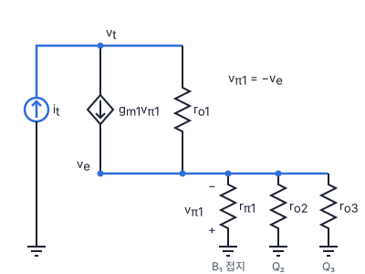

# 전자회로2 복습 0918 문제설명

주어진 조건을 읽고, 첫 줄을 쓰고, 이유를 따라가며 답을 확인해요.

문제의 첫 줄부터 검산까지 설명해요.

**목차**

- [문항별 설명](#problems)
  - [축퇴 저항 R_P로 복사 전류비를 정하는 MOS·바이폴라 전류 거울](#p1)
  - [λ ≠ 0인 MOS 전류 거울에서 V_DS1 선택과 복사 오차](#p2)
  - [0.3 mA 기준으로 소스 폴로어와 CS 단의 바이어스 전류 I1, I2 만들기](#p3)
  - [기호 크기 W/L로 주어진 MOS 전류 거울의 복사 전류](#p4)
  - [베이스 전류를 고려한 면적비 전류 거울의 I_copy와 오차](#p5)
  - [npn·pnp 두 단 전류 거울의 베이스 전류 오차](#p6)
  - [130 μA 기준으로 50 μA와 230 μA를 만드는 npn 전류 거울 설계](#p7)
  - [npn·pnp 거울을 이어 25 μA로 1 mA 만들기, 트랜지스터 수 최소화](#p8)
  - [이미터 면적비 전류 거울로 바이어스한 CE 단과 전류를 빼는 Q3가 붙은 바이폴라 캐스코드](#p9)
  - [차동 입력 CE 단 쌍의 출력 공통 모드 레벨](#p10)

## 문항별 설명

### 축퇴 저항 R_P로 복사 전류비를 정하는 MOS·바이폴라 전류 거울

2021-1_중간-Q5 · 기출 5 · [원 문제 보기](../%EB%B3%B5%EC%8A%B5%EB%AC%B8%EC%A0%9C_0918_Current_Mirrors-%EB%AC%B8%EC%A0%9C.pdf)

#### 주어진 조건

- $V_{TH}$는 모두 같음
- $\lambda = 0$, $V_A = \infty$로 가정
- (1) 전용 (회로 (a)): $M_{REF} = M_1 = W/L$ (두 트랜지스터의 크기가 같음)
- (2) 전용 (회로 (b)): $Q_{REF} = Q_1$ (두 트랜지스터가 같음), 베이스 전류는 무시
- $I_{REF}$, $V_{DD}$, $V_{CC}$의 값은 주어지지 않음. 답은 기호로 나타냄

#### 구할 것

- (1) 회로 (a)에서 $I_1 = I_{REF}/2$가 되는 $R_P$ 값 (식으로)
- (2) 회로 (b)에서 $I_1 = 2 I_{REF}$가 되는 $R_P$ 값 (식으로)

원문 보기

다음 회로에 대해 질문에 답하시오. $V_{TH}$는 동일하고, $\lambda = 0$, $V_A = \infty$로 가정한다.

(1) 회로 (a)에서 $I_1 = I_{REF}/2$가 되는 $R_P$ 값을 식으로 구하시오. 단, $M_{REF} = M_1 = W/L$이다.

(2) 회로 (b)에서 $I_1 = 2I_{REF}$가 되는 $R_P$ 값을 식으로 구하시오. 단, $Q_{REF} = Q_1$이고, 베이스 전류는 무시한다.

#### 문제를 내 말로 읽어요

두 그림은 저항의 위치가 달라요. MOS에서는 복사 소자의 소스가 올라가 전류를 줄이고, BJT에서는 기준 소자의 이미터를 올려 상대적으로 출력 전류를 키워요. 전원값을 찾는 문제가 아니라 두 소자의 제어 전압 차이를 저항 전압으로 바꾸는 문제예요.

#### 이 문제를 봤을 때 떠올릴 개념과 공식

“같은 크기인데 다른 전류”라는 단서에서는 단순 면적비 대신 축퇴(degeneration)를 떠올려요. MOS는 $I_D=K(V_{GS}-V_{TH})^2/2$, $K=\mu_nC_{ox}(W/L)$이며 $K$의 단위는 $\mathrm{A/V^2}$예요. BJT는 $I_C=I_S e^{V_{BE}/V_T}$이고 $V_T$는 열전압이에요.

$\lambda=0$, $V_A=\infty$라 출력 단자 전압의 영향은 없어요. 게이트·베이스가 공통이어도 소스·이미터 높이가 다르면 $V_{GS}$·$V_{BE}$는 달라요. 따라서 각 소자 전압을 전류로 표현한 뒤 KVL을 쓰는 것이 첫 도구예요.

#### 종이에 적는 실제 첫 줄

그림 (a)의 공통 게이트에서 접지까지 두 경로를 적어요: $V_{GS,REF}=V_{GS1}+I_1R_P$. 그림 (b)는 저항이 기준 쪽에 있으므로 $V_{BE1}=V_{BE,REF}+I_{REF}R_P$로 시작해요.

#### 왜 이렇게 푸는지 함께 따라가요

#### (1)

$I_1=I_{REF}/2$를 제곱 법칙의 역함수에 넣어요.

$$
V_{GS,REF}=V_{TH}+\sqrt{2I_{REF}/K}
$$

$$
V_{GS1}=V_{TH}+\sqrt{I_{REF}/K}
$$

두 문턱 전압이 같으므로 빼면 지워져요. 남은 전압이 소스 저항의 전압이에요.

$$
\frac{I_{REF}}2R_P=(\sqrt2-1)\sqrt{I_{REF}/K}
$$

$$
R_P=\frac{2(\sqrt2-1)}{\sqrt{K I_{REF}}}
$$

출력 전류가 더 작아야 하므로 양의 소스 전압을 만드는 양의 저항이 나와요.

#### (2)

동일 BJT의 두 지수식을 나누면 알려지지 않은 $I_S$가 없어져요.

$$
\frac{I_1}{I_{REF}}=\exp\!\left(\frac{V_{BE1}-V_{BE,REF}}{V_T}\right)
$$

목표 비가 2이므로 전압 차이는 $V_T\ln2$예요. 베이스 전류를 무시하면 기준 이미터 저항에도 $I_{REF}$가 흘러요.

$$
I_{REF}R_P=V_T\ln2
$$

$$
R_P=\frac{V_T\ln2}{I_{REF}}
$$

여기에서 저항 전류를 출력의 $2I_{REF}$로 놓지 않아요. 저항이 기준 가지에 있기 때문이에요.

#### 완성 답과 검산

#### (1)

**$R_P=2(\sqrt2-1)/\sqrt{\mu_nC_{ox}(W/L)I_{REF}}$**예요. $\sqrt{K I_{REF}}$의 단위는 A/V이므로 역수는 Ω예요. 결과를 첫 KVL에 다시 넣으면 소스 상승분이 두 과구동 차이와 정확히 같아요. $R_P=0$인 경우에는 두 $V_{GS}$가 같아져 전류비가 1이 되어야 하며, 목표 1/2에는 0이 아닌 저항이 필요해요.

#### (2)

**$R_P=V_T\ln2/I_{REF}$**예요. 역으로 전류비를 계산하면 $e^{I_{REF}R_P/V_T}=e^{\ln2}=2$가 돼요. V/A라 Ω이고, 기준 전류를 두 배로 하면 같은 전압 차이를 얻는 저항은 절반이에요. 두 소자가 활성 영역에 있고 기준 전류원의 전압 여유가 남는 조건에서 성립해요.

#### 이 문제의 함정

두 그림에서 저항이 서로 반대 가지에 있어요. 게이트 공통을 $V_{GS}$ 공통으로 착각하거나, BJT 기준 저항에 출력 전류를 흘리면 답이 달라져요. MOS에 로그식을, BJT에 제곱 법칙을 쓰지 않도록 먼저 소자 종류를 확인해요.

#### 설명을 닫고 다시 풀어요

1. (1) 회로 (a)에서 $M_{REF}=M_1=W/L$, $\lambda=0$은 그대로 두고 목표만 $I_1=I_{REF}/4$로 바꾸면 $R_P$는 어떤 식이 되고, 1/2일 때보다 커지나요 작아지나요?
2. (2) 회로 (b)처럼 $R_P$를 $Q_{REF}$ 이미터에 둔 채로 목표를 $I_1=I_{REF}/2$로 바꾸면 $R_P\ge0$으로 만들 수 있나요? 안 된다면 저항을 어느 이미터로 옮기고 값은 얼마인가요? ($Q_{REF}=Q_1$, 베이스 전류 무시)

**페이지 요약**

MOS는 $V_{GS,REF}=V_{GS1}+I_1R_P$, BJT는 $V_{BE1}=V_{BE,REF}+I_{REF}R_P$로 시작해요. MOS 답은 $2(\sqrt2-1)/\sqrt{KI_{REF}}$, BJT 답은 $V_T\ln2/I_{REF}$예요.

게이트·베이스가 공통이어도 소스·이미터 전압이 다르면 제어 전압은 달라요. $K=\mu_nC_{ox}(W/L)$이고, $\lambda=0$, $V_A=\infty$, BJT 베이스 전류 무시 조건이에요. BJT 저항에는 출력의 $2I_{REF}$가 아니라 기준 전류가 흘러요.

#### 떠올릴 개념·공식

축퇴 저항과 제어 전압 차이

#### 첫 줄

공통 제어단의 KVL

#### 핵심 판단

MOS는 제곱근, BJT는 로그

#### 검산

전류비를 역대입해 1/2와 2 확인

---

### λ ≠ 0인 MOS 전류 거울에서 V_DS1 선택과 복사 오차

P9.53 · 장말문제 9.53 · [원 문제 보기](../%EB%B3%B5%EC%8A%B5%EB%AC%B8%EC%A0%9C_0918_Current_Mirrors-%EB%AC%B8%EC%A0%9C.pdf)

#### 주어진 조건

- 문제 글: "$M_1$과 $M_2$는 동일, 단 $\lambda \neq 0$" — 그림의 트랜지스터 라벨은 $M_{REF}$와 $M_1$이고 $M_2$는 없음, 복사 전류 라벨도 문제 글은 $I_{copy1}$, 그림은 "I_copy" (인쇄된 대로 적음)
- 해석: 두 트랜지스터($M_{REF}$, $M_1$)가 동일하고, $V_{DS1}$은 복사 트랜지스터 $M_1$의 드레인–소스 전압, $I_{copy1}$은 그림의 $I_{copy}$
- 포화 영역 동작

#### 구할 것

- (a) $I_{copy1}$이 $I_{REF}$와 정확히 같으려면 $V_{DS1}$을 어떻게 정해야 하는가?
- (b) $V_{DS1} = V_{GS} - V_{TH}$일 때 ($M_1$이 포화 경계에 있을 때) $I_{REF}$에 대한 $I_{copy1}$의 오차

원문 보기

Consider the MOS current mirror shown in Fig. 9.36(c) and assume $M_1$ and $M_2$ are identical but $\lambda \neq 0$.

(a) How should $V_{DS1}$ be chosen so that $I_{copy1}$ is exactly equal to $I_{REF}$?

(b) Determine the error in $I_{copy1}$ with respect to $I_{REF}$ if $V_{DS1}$ is equal to $V_{GS} - V_{TH}$ (so that $M_1$ resides at the edge of saturation).

#### 문제를 내 말로 읽어요

기준과 출력 소자는 같지만 드레인 전압이 달라질 수 있어요. 같은 게이트 전압만으로 전류 복사가 완벽하지 않은 이유를 채널 길이 변조로 계산해요. 출력 드레인을 어디에 둘지와 포화 경계에서 얼마나 덜 흐르는지를 나눠 구해요.

본문 $M_1$은 그림의 복사 소자 $M_1$, 본문 $M_2$는 그림의 기준 소자 $M_{REF}$이고, 본문 $I_{copy1}$은 그림의 $I_{copy}$예요. 아래 답은 소자 이름에 그림의 라벨을 사용해요.

#### 이 문제를 봤을 때 떠올릴 개념과 공식

“동일한 소자, $\lambda\ne0$”는 채널 길이 변조(channel-length modulation)의 단서예요. 포화식 $I_D=K V_{ov}^2(1+\lambda V_{DS})/2$에서 $V_{ov}=V_{GS}-V_{TH}$, $\lambda$는 $\mathrm{V^{-1}}$예요.

다이오드 연결 기준 소자는 $V_{DS,REF}=V_{GS}$예요. 두 소자는 $K$와 과구동을 공유하므로 전류를 나누면 드레인 전압에 의존하는 부분만 남아요. $\lambda$를 지우는 근사는 (a)의 정확한 조건을 구할 때 쓰면 안 돼요.

#### 종이에 적는 실제 첫 줄

두 전류의 비부터 써요.

$$
\frac{I_{copy1}}{I_{REF}}=\frac{1+\lambda V_{DS1}}{1+\lambda V_{GS}}
$$

본문 $M_1$은 그림의 복사 소자 $M_1$, 본문 $M_2$는 그림의 기준 소자 $M_{REF}$이고, 본문 $I_{copy1}$은 그림의 $I_{copy}$예요.

#### 왜 이렇게 푸는지 함께 따라가요

#### (a)

정확히 같은 전류가 되려면 비가 1이어야 하므로 분자와 분모가 같아요.

$$
1+\lambda V_{DS1}=1+\lambda V_{GS}
$$

$\lambda\ne0$를 이용해 양변을 정리해요.

$$
V_{DS1}=V_{GS}=V_{DS,REF}
$$

출력 드레인과 기준 드레인의 DC 전압을 맞추면 두 소자의 제어 전압과 출력 전압이 모두 같아져요. 출력 게이트까지 묶는 배선을 추가하라는 뜻은 아니에요.

#### (b)

경계 전압 $V_{DS1}=V_{GS}-V_{TH}$를 비에 넣어요.

$$
\frac{I_{copy1}}{I_{REF}}=1-\frac{\lambda V_{TH}}{1+\lambda V_{GS}}
$$

오차의 정의를 먼저 정해요: $\epsilon=(I_{copy1}-I_{REF})/I_{REF}$예요.

$$
\epsilon=-\frac{\lambda V_{TH}}{1+\lambda V_{GS}}
$$

$$
I_{copy1}-I_{REF}=-\frac{\lambda V_{TH}}{1+\lambda V_{GS}}I_{REF}
$$

$|\lambda V_{GS}|\ll1$일 때만 분모를 1로 근사해 $\epsilon\approx-\lambda V_{TH}$라고 해요. 퍼센트 오차는 이 값에 100을 곱해요.

본문의 소자 이름 불일치는 기준 $M_{REF}$와 복사 $M_1$의 두 동일 소자로 해석해요. 이 해석에서 위 전류비와 결과를 얻어요.

#### 완성 답과 검산

#### (a)

**$V_{DS1}=V_{GS}$**예요. 이를 원래 비에 넣으면 정확히 1이에요. 양의 문턱 전압에서는 $V_{GS}>V_{GS}-V_{TH}$라 이 전압은 포화 조건도 만족해요. $\lambda\to0$이면 어느 포화 드레인 전압에서도 비가 1이 되는 이상적 거울로 돌아와요.

#### (b)

**$\epsilon=-\lambda V_{TH}/(1+\lambda V_{GS})$**예요. $\lambda>0$, $V_{TH}>0$이면 음수여서 출력 전류가 작아요. 경계의 드레인 전압이 기준보다 $V_{TH}$만큼 낮다는 물리적 판단과 같아요. $\lambda\to0$ 또는 $V_{TH}\to0$이면 오차가 0이 되고 $\lambda V_{TH}$는 무차원이에요.

이 검산의 기준 소자는 그림의 $M_{REF}$, 복사 소자는 그림의 $M_1$이에요. 본문의 $M_2$를 별도 세 번째 소자로 추가하지 않아요.

#### 이 문제의 함정

“포화니까 전류 일정”은 $\lambda=0$일 때의 말이에요. 절대 전류 오차(A)와 상대 오차(무차원)를 구별하고, 분모를 생략한 근사식을 정확식으로 부르지 않아요.

인쇄 라벨의 불일치를 회로에 소자가 하나 더 있다는 뜻으로 읽지 않아요. 그림의 두 소자 $M_{REF}$·$M_1$ 기준으로 전류와 전압을 대응해요.

#### 설명을 닫고 다시 풀어요

- (a)를 바꿔서 복사 소자 $M_1$만 $2(W/L)$로 키우고 목표를 $I_{copy}=2I_{REF}$로 정하면 $V_{DS1}$ 조건은 달라지나요? ($\lambda\ne0$, 같은 $V_{TH}$, 포화)
- (b)를 바꿔서 $V_{DS1}=V_{GS}+0.5\ \mathrm{V}$이면 정규화 오차 $\epsilon=(I_{copy1}-I_{REF})/I_{REF}$의 부호와 크기는 어떻게 되나요? $\lambda=0.1\ \mathrm{V^{-1}}$, $V_{GS}=1\ \mathrm{V}$이면 몇 %인가요?

**페이지 요약**

$I_{copy1}/I_{REF}=(1+\lambda V_{DS1})/(1+\lambda V_{GS})$예요. $V_{DS1}=V_{GS}=V_{DS,REF}$로 맞추되 출력 게이트까지 묶는다는 뜻은 아니에요.

포화 경계의 상대 오차는 $\epsilon=-\lambda V_{TH}/(1+\lambda V_{GS})$예요. $|\lambda V_{GS}|\ll1$에서만 $-\lambda V_{TH}$로 근사하고, 전류 오차는 $\epsilon I_{REF}$예요.

#### 떠올릴 개념·공식

채널 길이 변조

#### 첫 줄

두 포화 전류의 비

#### 핵심 판단

두 VDS를 맞춰 정확히 복사

#### 검산

λ→0에서 오차 0

#### 해석 조건

본문 $M_1$은 그림의 복사 소자 $M_1$, 본문 $M_2$는 그림의 기준 소자 $M_{REF}$이고, 본문 $I_{copy1}$은 그림의 $I_{copy}$예요.

---

### 0.3 mA 기준으로 소스 폴로어와 CS 단의 바이어스 전류 I1, I2 만들기

E9.21 · 예제 9.21 · [원 문제 보기](../%EB%B3%B5%EC%8A%B5%EB%AC%B8%EC%A0%9C_0918_Current_Mirrors-%EB%AC%B8%EC%A0%9C.pdf)

#### 주어진 조건

- 집적 회로가 Fig 9.38(a)의 소스 폴로어($M_1$)와 공통 소스 단($M_2$)을 사용
- 필요한 바이어스 전류(그림 표기): $I_1 = 0.2\ \text{mA}$, $I_2 = 0.5\ \text{mA}$
- 기준 전류 $0.3\ \text{mA}$

#### 구할 것

- $0.3\ \text{mA}$ 기준으로부터 $I_1$과 $I_2$를 만드는 전류 거울 설계

원문 보기

집적 회로가 그림 9.38(a)에 나와 있는 소스 폴로어와 공통 소스 단을 사용한다. $0.3\ \text{mA}$의 기준으로부터 $I_1$과 $I_2$를 만드는 전류 거울을 설계하라.

#### 문제를 내 말로 읽어요

두 증폭기 아래에서 각각 0.2 mA, 0.5 mA를 접지로 끌어가는 전류원을 만들어요. 입력 신호의 이득을 구하는 문제가 아니라 0.3 mA 하나로 DC 동작점을 두 군데에 공급하는 설계예요.

#### 이 문제를 봤을 때 떠올릴 개념과 공식

“하나의 기준으로 여러 바이어스 전류”는 MOS 전류 거울(current mirror)의 크기 스케일링 단서예요. 같은 소스 전압과 게이트 전압을 가진 포화 NMOS는 $I_i/I_{REF}=(W/L)_i/(W/L)_{REF}$가 돼요. $W/L$은 종횡비(aspect ratio)예요.

문턱 전압이 같고 채널 길이 변조를 무시하는 이상적 설계를 사용해요. 각 가지는 접지로 전류를 빼므로 NMOS 싱크(current sink)가 맞아요. 위 증폭 소자가 PMOS여도 아래 거울 소자는 NMOS예요.

#### 종이에 적는 실제 첫 줄

다이오드 연결 NMOS 기준 소자의 소스를 접지에 놓고 0.3 mA를 드레인으로 넣어요. 그 게이트를 두 출력 NMOS 게이트에 연결한 다음 필요한 비를 써요.

$$
(W/L)_{I1} : (W/L)_{REF} = 0.2 : 0.3,\qquad (W/L)_{I2} : (W/L)_{REF} = 0.5 : 0.3
$$

#### 왜 이렇게 푸는지 함께 따라가요

#### 풀이

분수 비는 $2/3$과 $5/3$이에요. 같은 길이의 단위 소자 종횡비를 $S$라 놓으면 정수 개수로 구현하기 쉬워요.

$$
(W/L)_{REF}=3S
$$

$$
(W/L)_{I1}=2S,\qquad(W/L)_{I2}=5S
$$

기준은 게이트와 드레인을 묶고, 세 NMOS의 소스를 모두 접지에 이어요. 2단위 출력 소자의 드레인을 소스 폴로어 출력 아래에, 5단위 출력 소자의 드레인을 PMOS CS 출력 아래에 달아요. 각 단위 소자가 기준에서 0.1 mA를 흘리도록 공통 게이트 전압이 정해져요.

절대 $S$는 주어지지 않았으므로 수치로 결정할 수 없어요. 원하는 과구동과 출력 전압 여유에 따라 $S$를 고르는 설계 자유도가 남아요.

#### 완성 답과 검산

#### 풀이

**기준:출력1:출력2의 종횡비는 $3:2:5$**예요.

$$
I_1=\frac23(0.3)=0.200\ \mathrm{mA}
$$

$$
I_2=\frac53(0.3)=0.500\ \mathrm{mA}
$$

두 출력 합 0.7 mA가 기준 0.3 mA보다 커도 괜찮아요. 거울은 기준 전류를 쪼개 보내는 배선이 아니라 전원에서 각 가지 전류를 따로 끌어오기 때문이에요. 각 출력 NMOS가 $V_{DS}\ge V_{ov}$를 만족해야 이 비가 유지돼요.

#### 이 문제의 함정

기준 전류를 0.2+0.5 mA로 나눠야 한다고 생각하지 않아요. 출력 소자를 다이오드 연결하면 증폭기의 출력 신호까지 게이트에 전달되므로 기준 소자만 다이오드 연결해요.

#### 설명을 닫고 다시 풀어요

1. 기준 전류를 $0.3\ \mathrm{mA}$ 대신 $0.1\ \mathrm{mA}$로 바꾸고 $I_1=0.2\ \mathrm{mA}$, $I_2=0.5\ \mathrm{mA}$는 그대로 두면 기준:출력1:출력2의 단위 소자 개수는 어떻게 되나요?
2. 두 단이 바이어스 전류를 접지로 내보내는 대신 $V_{DD}$ 쪽에서 0.2 mA, 0.5 mA를 공급받아야 한다면 어떤 극성의 거울을 쓰고, 소스는 어디에 연결하나요? 기준 0.3 mA일 때 크기비는 어떻게 되나요?

**페이지 요약**

기준 소자만 다이오드 연결하고, 세 NMOS의 소스를 접지·게이트를 공통으로 연결해요. 출력 합이 기준보다 커도 각 가지는 전원에서 전류를 따로 받아요.

문턱전압이 같고 채널 길이 변조를 무시하며 각 출력이 $V_{DS}\ge V_{ov}$를 지켜야 해요. 정해지는 것은 비율 $3:2:5$이고 절대 단위 크기는 설계 자유도예요.

#### 떠올릴 개념·공식

MOS 크기비 전류 복사

#### 첫 줄

필요 전류/기준 전류

#### 핵심 판단

3:2:5 NMOS 싱크

#### 검산

0.200 mA, 0.500 mA와 포화 확인

---

### 기호 크기 W/L로 주어진 MOS 전류 거울의 복사 전류

P9.52 · 장말문제 9.52 · [원 문제 보기](../%EB%B3%B5%EC%8A%B5%EB%AC%B8%EC%A0%9C_0918_Current_Mirrors-%EB%AC%B8%EC%A0%9C.pdf)

#### 주어진 조건

- 모든 트랜지스터가 포화 영역에서 동작한다고 가정
- $I_{REF}$ 값은 주어지지 않음. 트랜지스터 크기는 그림에 $(W/L)_n$, $(W/L)_p$의 배수로만 표시됨
- 답은 $I_{REF}$로 나타냄

#### 구할 것

- (a), (b) 각 회로의 $I_{copy}$

원문 보기

Calculate $I_{copy}$ in each of the circuits shown in Fig. 9.73. Assume all of the transistors operate in saturation.

#### 문제를 내 말로 읽어요

두 회로 모두 NMOS가 만든 전류를 PMOS로 다시 복사해요. (a)는 단계별 비를 곱하고, (b)는 마지막 출력 노드에서 들어오는 전류와 빠져나가는 전류를 빼야 해요.

#### 이 문제를 봤을 때 떠올릴 개념과 공식

“모두 포화”와 같은 게이트로 묶인 소자 크기가 전류 거울(current mirror)의 단서예요. 동일 극성 소자끼리 $I_{out}/I_{ref}=S_{out}/S_{ref}$를 쓰며 $S=W/L$이에요. NMOS와 PMOS의 이동도는 달라도 각 거울 안에서만 비를 취하므로 지워져요.

채널 길이 변조와 불일치를 무시하는 이상적 거울 근사를 써요. 여러 거울이 직렬로 전류를 전달하면 비를 곱하지만, 같은 출력 노드에 싱크와 소스가 함께 연결되면 KCL을 먼저 써야 해요.

#### 종이에 적는 실제 첫 줄

각 다이오드 연결 소자를 기준으로 표시해요. (a)의 첫 비는 $I_M/I_{REF}=2/3$이고, (b)의 출력 노드에서는 $I_P=I_N+I_{copy}$예요.

#### 왜 이렇게 푸는지 함께 따라가요

#### 풀이

그림 (a): 기준 NMOS가 3단위, 중간 NMOS가 2단위이므로 $I_M=(2/3)I_{REF}$예요. 이 중간 전류가 5단위 PMOS 기준 소자를 지나고 3단위 PMOS가 출력 전류를 만들어요.

$$
I_{copy,a}=\frac35 I_M=\frac35\frac23 I_{REF}=\frac25I_{REF}
$$

그림 (b): 기준 1단위 NMOS와 같은 게이트인 5단위 NMOS가 $5I_{REF}$를 끌어가요. 이 전류가 1단위 PMOS의 기준이므로 2단위 PMOS는 $10I_{REF}$를 출력으로 밀어 넣어요. 같은 노드의 3단위 NMOS는 $3I_{REF}$를 빼요.

$$
I_{copy,b}=I_P-I_N=10I_{REF}-3I_{REF}=7I_{REF}
$$

마지막 3단위 NMOS는 앞의 PMOS 거울에 직렬로 붙은 소자가 아니라 출력 전류를 빼는 병렬 가지예요.

#### 완성 답과 검산

#### 풀이

**(a) $I_{copy}=0.4I_{REF}$, (b) $I_{copy}=7I_{REF}$**예요. (a)는 중간 전류의 3/5만 복사하므로 $0.4<2/3$이어야 한다는 크기 검산을 통과해요. (b)는 들어오는 $10I_{REF}$와 나가는 $(3+7)I_{REF}$가 같아 KCL을 만족해요. 수치 없는 문제라 A 단위 값을 지어내지 않고 기준 전류에 대한 비로 마쳐요.

#### 이 문제의 함정

서로 다른 극성의 $W/L$을 직접 나누면 안 돼요. 각 NMOS 거울·PMOS 거울 안에서 비를 구해 연결해요. (b)의 출력 노드에서 10과 3을 더하면 화살표 방향을 놓친 것이에요.

#### 설명을 닫고 다시 풀어요

1. 그림 (a)에서 다이오드 연결 PMOS를 $3(W/L)_p$로, 출력 PMOS를 $5(W/L)_p$로 서로 바꾸면 $I_{copy}$는 $I_{REF}$의 몇 배인가요? 나머지 NMOS 크기는 그대로예요.
2. 그림 (b)에서 출력 노드의 $3(W/L)_n$ NMOS를 $12(W/L)_n$으로 바꾸면 $I_{copy}$의 크기와 방향은 어떻게 되나요? 다른 소자는 그대로이고 모두 포화라고 가정해요.

**페이지 요약**

(a)는 $(2/3)(3/5)I_{REF}=(2/5)I_{REF}$, (b)는 들어오는 $10I_{REF}$에서 나가는 $3I_{REF}$를 빼 $7I_{REF}$예요.

모두 포화이고 채널 길이 변조·불일치를 무시해요. 같은 극성 미러 안에서만 크기비를 구하며 NMOS와 PMOS 크기를 직접 나누지 않아요.

#### 떠올릴 개념·공식

NMOS·PMOS 연속 거울

#### 첫 줄

각 거울의 출력/기준 크기비

#### 핵심 판단

단계는 곱, 출력 노드는 차

#### 검산

2/5와 7, KCL 검산

---

### 베이스 전류를 고려한 면적비 전류 거울의 I_copy와 오차

P9.46 · 장말문제 9.46 · [원 문제 보기](../%EB%B3%B5%EC%8A%B5%EB%AC%B8%EC%A0%9C_0918_Current_Mirrors-%EB%AC%B8%EC%A0%9C.pdf)

#### 주어진 조건

- 베이스 전류를 고려함
- $I_{REF}$, $\beta$ 값은 주어지지 않음. 답은 $I_{REF}$, $\beta$로 나타냄

#### 구할 것

- (a)–(c) 각 회로의 $I_{copy}$
- 오차를 $I_{copy}$의 공칭값으로 정규화

원문 보기

Taking base currents into account, determine the value of $I_{copy}$ in each circuit depicted in Fig. 9.68. Normalize the error to the nominal value of $I_{copy}$.

#### 문제를 내 말로 읽어요

같은 베이스 전압을 가진 BJT는 면적당 같은 컬렉터 전류를 흘려요. 하지만 기준 전류의 일부가 모든 BJT의 베이스로 빠지므로 실제 복사 전류는 이상적 면적비보다 작아요. 오차를 각 회로의 이상적 출력 전류로 나눠요.

#### 이 문제를 봤을 때 떠올릴 개념과 공식

“베이스 전류 고려”는 기준 노드 KCL의 단서예요. $\beta=I_C/I_B$는 전류 이득, $I_u$는 단위 이미터 면적당 컬렉터 전류예요. 기준 면적 $nA_E$, 출력 면적 $mA_E$, 공통 베이스에 연결된 전체 면적 $NA_E$라면 $I_{REF}=nI_u+NI_u/\beta$예요.

Early 효과와 소자별 $\beta$ 차이는 무시해요. 같은 $V_{BE}$에 의한 면적비는 유지되지만 $I_{REF}$를 기준 컬렉터 전류와 같다고 둘 수 없어요. 모든 베이스의 전류를 세기 위해 단위 전류 하나로 표현해요.

#### 종이에 적는 실제 첫 줄

공통 베이스·기준 컬렉터 노드에서 유입과 유출을 같게 써요.

$$
I_{REF}=nI_u+\frac{N I_u}{\beta}
$$

$$
I_{copy}=mI_u
$$

베이스가 같은 노드에 붙은 출력이 여러 개라면 목표 출력이 아닌 소자도 $N$에 포함해요.

#### 왜 이렇게 푸는지 함께 따라가요

#### 풀이

두 식에서 $I_u$를 제거하면 일반식이 나와요.

$$
I_{copy}=\frac{m\beta}{n\beta+N}I_{REF}
$$

공칭 출력은 $I_{nom}=(m/n)I_{REF}$이고 부호 있는 정규화 오차는 다음과 같아요.

$$
\epsilon=\frac{I_{copy}-I_{nom}}{I_{nom}}=-\frac{N}{n\beta+N}
$$

그림 (a)는 기준 1단위와 출력 5단위여서 $(n,m,N)=(1,5,6)$이에요.

$$
I_a=\frac{5\beta}{\beta+6}I_{REF},\quad\epsilon_a=-\frac6{\beta+6}
$$

그림 (b)는 $(n,m,N)=(5,1,6)$이에요.

$$
I_b=\frac{\beta}{5\beta+6}I_{REF},\quad\epsilon_b=-\frac6{5\beta+6}
$$

그림 (c)는 기준 2단위, 목표 출력 3단위 외의 베이스까지 합쳐 10단위예요. 목표 출력이 아닌 $Q_2$의 베이스도 기준 노드에서 공급돼요.

$$
I_c=\frac{3\beta}{2\beta+10}I_{REF},\quad\epsilon_c=-\frac{10}{2\beta+10}
$$

$\beta$가 각각의 면적합 비보다 클 때 오차는 차례로 $-6/\beta$, $-1.2/\beta$, $-5/\beta$예요.

#### 완성 답과 검산

#### 풀이

**실제 출력은 $(5\beta/(\beta+6),\ \beta/(5\beta+6),\ 3\beta/(2\beta+10))I_{REF}$**예요. $\beta\to\infty$에서 $(5,1/5,3/2)I_{REF}$로 돌아와요. 예를 들어 검산용 $\beta=100$이면 공칭 대비 실제 비는 $100/106$, $500/506$, $200/210$으로 모두 1보다 작아요. 따라서 정규화 오차의 부호가 모두 음수인 것이 맞아요. 오차는 기준 전류가 아닌 각 공칭 출력으로 나눴어요.

#### 이 문제의 함정

기준 BJT 자신의 베이스 전류를 빠뜨리기 쉬워요. (c)에서는 다른 출력의 베이스 전류도 포함해요. 실제 출력으로 나누거나 세 회로 모두 $I_{REF}$로 나누면 문제의 정규화 기준과 달라져요.

#### 설명을 닫고 다시 풀어요

1. 그림 (c)에서 $Q_2$(5단위)를 떼어 내고 기준 2단위와 출력 3단위만 남기면 $I_{copy}$와 정규화 오차는 어떻게 되나요? 오차는 $-5/\beta$보다 커지나요 작아지나요?
2. $\beta=100$일 때 그림 (a)(기준 1단위, 출력 5단위)와 그림 (b)(기준 5단위, 출력 1단위) 중 정규화 오차가 더 큰 쪽은 어디이고, 첫 식으로 무엇을 써야 그 차이가 보이나요?

**페이지 요약**

$I_{copy}=m\beta I_{REF}/(n\beta+N)$, 공칭값은 $(m/n)I_{REF}$예요. 실제 출력과 공칭 출력의 차를 공칭 출력으로 나누면 $\epsilon=-N/(n\beta+N)$이에요.

Early 효과와 소자별 $\beta$ 차이는 무시해요. 기준 자신의 베이스와 목표 밖 출력의 베이스도 $N$에 포함하고, 오차를 실제 출력이나 무조건 $I_{REF}$로 나누지 않아요.

#### 떠올릴 개념·공식

베이스 전류를 포함한 KCL

#### 첫 줄

IREF=(n+N/β)Iu

#### 핵심 판단

목표 밖 베이스도 N에 포함

#### 검산

β→∞에서 이상적 면적비

---

### npn·pnp 두 단 전류 거울의 베이스 전류 오차

P9.48 · 장말문제 9.48 · [원 문제 보기](../%EB%B3%B5%EC%8A%B5%EB%AC%B8%EC%A0%9C_0918_Current_Mirrors-%EB%AC%B8%EC%A0%9C.pdf)

#### 주어진 조건

- 베이스 전류를 고려함
- 답은 $I_{REF}$, $\beta$로 나타냄

#### 구할 것

- (a), (b) 각 회로의 $I_{copy}$ 오차

원문 보기

Taking base currents into account, compute the error in $I_{copy}$ for each of the circuits illustrated in Fig. 9.70.

#### 문제를 내 말로 읽어요

첫 npn 거울이 복사한 전류를 두 번째 pnp 거울이 받아요. 첫 단계에서 줄어든 전류가 두 번째의 기준이 되므로 두 단계 오차가 이어져요. 전류 크기를 먼저 구하고 마지막에 전체 공칭값과 비교해요.

#### 이 문제를 봤을 때 떠올릴 개념과 공식

“npn·pnp 두 단, 베이스 전류 고려”는 연속 전류 거울(cascaded mirrors)과 KCL의 단서예요. 기준 면적 $n$, 출력 면적 $m$인 단일 거울은 $I_o=m\beta I_i/(n\beta+n+m)$예요. $\beta$는 두 극성에서 같다고 놓고 Early 효과는 무시해요.

각 단계의 면적비는 이상적 이득이고 분모의 추가항은 베이스 전류 손실이에요. 첫 출력이 다음 입력이므로 실제 전달비를 곱해야 하며, 정규화는 두 이상적 면적비의 곱으로 해요.

#### 종이에 적는 실제 첫 줄

한 단계의 기준 노드에 $I_i=I_{C,ref}+I_{B,ref}+I_{B,out}$를 적고 $I_{C,out}/I_{C,ref}=m/n$을 대입해요.

$$
\frac{I_o}{I_i}=\frac{m\beta}{n\beta+n+m}
$$

#### 왜 이렇게 푸는지 함께 따라가요

#### 풀이

그림 (a)는 1:1 거울 두 개예요. 각 단계가 $\beta/(\beta+2)$만 전달해요.

$$
I_{copy,a}=\frac{\beta^2}{(\beta+2)^2}I_{REF}
$$

공칭값은 $I_{REF}$예요. 비에서 1을 빼요.

$$
\epsilon_a=-\frac{4\beta+4}{(\beta+2)^2}\approx-\frac4\beta
$$

그림 (b)의 첫 기준·출력 면적은 3:2, 두 번째는 5:9예요.

$$
I_{C1}=\frac{2\beta}{3\beta+5}I_{REF}
$$

$$
I_{copy,b}=\frac{9\beta}{5\beta+14}I_{C1}=\frac{18\beta^2}{(3\beta+5)(5\beta+14)}I_{REF}
$$

공칭 출력은 $(2/3)(9/5)I_{REF}=1.2I_{REF}$예요. 분모를 전개하면 $15\beta^2+67\beta+70$이므로

$$
\epsilon_b=\frac{15\beta^2}{15\beta^2+67\beta+70}-1=-\frac{67\beta+70}{(3\beta+5)(5\beta+14)}
$$

$\beta\gg1$에서는 $-67/(15\beta)\approx-4.47/\beta$예요. 두 오차를 단순히 더한 값은 큰 $\beta$의 1차 근사로만 맞아요.

#### 완성 답과 검산

#### 풀이

**(a) $\epsilon_a=-(4\beta+4)/(\beta+2)^2$, (b) $\epsilon_b=-(67\beta+70)/[(3\beta+5)(5\beta+14)]$**예요. $\beta\to\infty$이면 두 오차가 0이고 출력이 각각 $I_{REF}$, $1.2I_{REF}$가 돼요. (b)의 1차 손실 계수는 첫 단 $5/3$와 둘째 단 $14/5$의 합 $67/15$여서 정확식의 큰 $\beta$ 전개와 일치해요.

#### 이 문제의 함정

pnp라는 이유만으로 전류 크기에 마이너스를 넣지 않아요. 여기서는 그림의 화살표 방향을 따른 크기로 전달비를 계산해요. (b)를 $I_{REF}$로 정규화하면 이상적 배율 1.2까지 오차로 세게 돼요.

#### 설명을 닫고 다시 풀어요

- (a)와 (b)에서 $\beta=100$이면 정규화 오차는 각각 몇 %인지 계산해 보세요. 어느 회로의 오차가 더 큰지도 1차 계수 $4$와 $67/15$로 먼저 예측해 보세요.
- (b)의 첫 npn 단(3:2)은 그대로 두고 pnp 단의 면적만 바꿔 기준을 $9A_E$, 출력을 $5A_E$로 만들면 큰 $\beta$에서 정규화 오차가 커질지 작아질지 예측해 보세요. pnp 기준 노드 KCL에서 1차 손실 계수부터 써 보세요.

**페이지 요약**

한 단의 실제 전달비는 $m\beta/(n\beta+n+m)$예요. (a)의 공칭값은 $I_{REF}$, (b)는 $1.2I_{REF}$이며 각각으로 정규화해요.

두 극성의 $\beta$가 같고 Early 효과를 무시해요. 전류는 화살표 방향의 크기로 계산하며, 두 오차를 더하는 것은 큰 $\beta$에서의 1차 근사뿐이에요.

#### 떠올릴 개념·공식

두 단 전류 거울과 베이스 손실

#### 첫 줄

한 단계 KCL

#### 핵심 판단

실제 비의 곱 뒤 정규화

#### 검산

1차 오차 계수 4와 67/15

---

### 130 μA 기준으로 50 μA와 230 μA를 만드는 npn 전류 거울 설계

P9.42 · 장말문제 9.42 · [원 문제 보기](../%EB%B3%B5%EC%8A%B5%EB%AC%B8%EC%A0%9C_0918_Current_Mirrors-%EB%AC%B8%EC%A0%9C.pdf)

#### 주어진 조건

- 기준 전류 $130\ \mu\text{A}$
- 만들 전류 두 개: $50\ \mu\text{A}$, $230\ \mu\text{A}$
- npn 전류 거울로 설계
- 베이스 전류 무시

#### 구할 것

- 위 두 전류를 만드는 npn 전류 거울 설계

원문 보기

We wish to generate two currents equal to $50\ \mu\text{A}$ and $230\ \mu\text{A}$ from a reference of $130\ \mu\text{A}$. Design an npn current mirror for this purpose. Neglect the base currents.

#### 문제를 내 말로 읽어요

130 μA로부터 독립적인 50 μA와 230 μA 싱크를 만들어요. 같은 베이스 전압을 공유하는 npn의 이미터 면적을 정하면 두 출력 전류가 정해져요.

#### 이 문제를 봤을 때 떠올릴 개념과 공식

“npn 거울 설계, 베이스 전류 무시”는 면적 스케일링(area scaling)의 단서예요. $I_C=I_Se^{V_{BE}/V_T}$에서 $I_S$가 이미터 면적에 비례하므로 같은 $V_{BE}$이면 $I_i/I_{REF}=A_i/A_{REF}$예요. $A_E$는 단위 이미터 면적이에요.

소자가 활성 영역에 있고 Early 효과와 불일치를 무시해요. 베이스로 빠지는 전류가 없으므로 기준 컬렉터 전류를 130 μA로 놓을 수 있어요. 정수 단위 소자를 병렬로 쓰면 원하는 분수 비를 구현하기 쉬워요.

#### 종이에 적는 실제 첫 줄

목표 비를 먼저 써요.

$$
\frac{A_1}{A_{REF}}=\frac{50}{130}=\frac5{13}
$$

$$
\frac{A_2}{A_{REF}}=\frac{230}{130}=\frac{23}{13}
$$

#### 왜 이렇게 푸는지 함께 따라가요

#### 풀이

세 전류를 모두 10 μA 단위로 나타내면 13, 5, 23이에요. 기준 트랜지스터는 $13A_E$, 두 출력은 $5A_E$, $23A_E$로 만들어요.

기준 소자의 컬렉터와 베이스를 묶고 130 μA를 넣어요. 이 공통 베이스 노드에 두 출력 베이스를 잇고, 모든 이미터를 접지로 내려 같은 $V_{BE}$를 만들어요. 두 출력 컬렉터가 각기 전류를 끌어가는 단자예요.

$$
I_1=\frac5{13}(130\ \mu\mathrm A)=50.0\ \mu\mathrm A
$$

$$
I_2=\frac{23}{13}(130\ \mu\mathrm A)=230\ \mu\mathrm A
$$

단위 소자를 병렬로 구현한다면 각각 13개, 5개, 23개예요. 절대 면적은 전류밀도와 공정에 따라 골라도 이 비가 같으면 이상적 출력은 같아요.

#### 완성 답과 검산

#### 풀이

**$A_{REF}:A_1:A_2=13:5:23$**예요. $I_{REF}/A_{REF}=I_1/A_1=I_2/A_2=10\ \mu\mathrm A/A_E$로 전류밀도가 같아요. 출력 합 280 μA가 기준보다 커도 각 컬렉터가 별도의 전원 경로에서 전류를 받으므로 모순이 없어요. 이 수치는 베이스 전류 무시의 결과이며 실제 유한 $\beta$에서는 기준 노드의 공급 손실을 다시 계산해야 해요.

#### 이 문제의 함정

출력 둘을 130 μA 안에서 나눠야 한다고 제한하지 않아요. 출력 컬렉터를 서로 묶으면 별도 두 바이어스 단자를 만들 수 없으므로 각기 꺼내요.

#### 설명을 닫고 다시 풀어요

1. 기준 전류가 $120\ \mu\mathrm A$로 바뀌고 목표는 그대로 $50\ \mu\mathrm A$, $230\ \mu\mathrm A$라면 $A_{REF}:A_1:A_2$를 어떻게 정할지 단위 전류부터 골라 보세요.
2. 원래 설계(13:5:23, $I_{REF}=130\ \mu\mathrm A$)에서 베이스 전류를 무시하지 않고 모든 npn의 $\beta=100$이라 하면 두 출력 전류는 목표에서 어느 방향으로, 같은 비율로 벗어나는지 다른 비율로 벗어나는지 예측해 보세요.

**페이지 요약**

기준 컬렉터·베이스를 묶고 모든 베이스를 공유하며 이미터는 접지해요. 출력 두 컬렉터는 별도로 꺼내므로 출력 합을 기준 전류 안에 제한하지 않아요.

활성 영역에서 Early 효과·불일치·베이스 전류를 무시한 설계예요. 유한한 $\beta$를 고려하면 기준 노드의 베이스 전류 손실을 다시 계산해요.

#### 떠올릴 개념·공식

BJT 면적비 복사

#### 첫 줄

50/130, 230/130

#### 핵심 판단

면적 13:5:23

#### 검산

단위 면적 전류가 모두 10 μA

---

### npn·pnp 거울을 이어 25 μA로 1 mA 만들기, 트랜지스터 수 최소화

E9.18 · 예제 9.18 · [원 문제 보기](../%EB%B3%B5%EC%8A%B5%EB%AC%B8%EC%A0%9C_0918_Current_Mirrors-%EB%AC%B8%EC%A0%9C.pdf)

#### 주어진 조건

- $I_{REF} = 25\ \mu\text{A}$
- 목표: $Q_1$과 $Q_2$의 컬렉터 전류 $1\ \text{mA}$
- 트랜지스터(단위 소자) 수가 최소가 되도록 함

#### 구할 것

- 회로의 스케일링 인수 ($I_{C,M}/I_{REF}$, $|I_{C2}|/I_{C,M}$) 선택

원문 보기

그림 9.35에서 $I_{REF} = 25\ \mu\text{A}$일 때 컬렉터 전류가 $1\ \text{mA}$가 되게 $Q_1$과 $Q_2$를 바이어스시키고자 한다. 트랜지스터의 수가 최소가 되도록 회로에서의 스케일링 인수를 선택하라.

#### 문제를 내 말로 읽어요

25 μA를 40배로 키우되 한 거울에 40단위를 몰지 않고 npn과 pnp 두 단계에 나눠요. 물리적인 네 소자의 개수가 아니라 병렬로 구성하는 단위 트랜지스터 총수를 줄이는 문제예요.

#### 이 문제를 봤을 때 떠올릴 개념과 공식

“트랜지스터 수 최소”는 면적비 스케일링과 정수 최적화의 단서예요. 첫 거울 배율을 $a$, 두 번째를 $b$라 하면 $I_{C,M}=aI_{REF}$, $|I_{C2}|=bI_{C,M}$예요. 베이스 전류를 무시하고 각 기준을 한 단위로 구현하는 조건에서 총 단위 수는 $N=2+a+b$예요.

목표 전류는 직렬의 $Q_1$, $Q_2$에 같게 흐르므로 출력 증폭용 $Q_1$의 고정 개수는 배율 비교에 영향을 주지 않아요. 각 거울의 면적비 곱이 40이 되어야 한다는 점부터 잡아요.

#### 종이에 적는 실제 첫 줄

단위를 맞춰 목표 비를 써요.

$$
ab=\frac{1000\ \mu\mathrm A}{25\ \mu\mathrm A}=40,\qquad N=2+a+b
$$

#### 왜 이렇게 푸는지 함께 따라가요

#### 풀이

한쪽 배율만 키우면 합이 커져요. 양의 실수라면 $a+b\ge2\sqrt{ab}=2\sqrt{40}$이라 두 배율이 가까울수록 유리해요. 단위 소자 개수는 정수이므로 정확히 곱 40이 되는 인수쌍을 모두 비교해요.

$$
(a,b)=(1,40),(2,20),(4,10),(5,8)
$$

$$
N=43,24,16,15
$$

따라서 8배와 5배를 선택해요. 기준 소자 두 개는 각각 한 단위, 첫 출력 $Q_M$은 8단위, 두 번째 출력 $Q_2$는 5단위예요.

$$
I_{C,M}=8(25\ \mu\mathrm A)=200\ \mu\mathrm A
$$

$$
|I_{C2}|=5(200\ \mu\mathrm A)=1.00\ \mathrm{mA}
$$

$Q_1$은 $Q_2$와 직렬이라 같은 1 mA예요. 두 배율을 5, 8 순으로 바꿔도 총 단위 수와 최종 전류는 같아요.

#### 완성 답과 검산

#### 풀이

**배율 $(a,b)=(8,5)$ 또는 $(5,8)$, 거울 부분 총 15단위**예요. 연속값 하한은 $2+2\sqrt{40}\approx14.65$이므로 정수 총수가 15보다 작을 수 없어요. 15단위의 실제 구현을 찾았으므로 전역 최소임이 증명돼요. $25\times8\times5=1000$ μA로 목표 전류도 맞아요.

#### 이 문제의 함정

4개의 회로 기호만 세면 배율에 따른 비용 차이가 사라져요. 실제 면적을 단위 소자 수로 세는 조건이에요. $a=b=\sqrt{40}$는 연속 최적값이지만 정수 단위의 정확한 구현은 아니에요.

#### 설명을 닫고 다시 풀어요

1. 같은 그림 9.35에서 $I_{REF}=25\ \mu\mathrm A$로 목표 전류만 $1.2\ \mathrm{mA}$로 바꾸면 어떤 배율 쌍이 단위 수를 최소로 만드는지, 총 단위 수는 몇인지 구해 보세요.
2. 목표는 $1\ \mathrm{mA}$로 두고 기준 전류를 $20\ \mu\mathrm A$로 바꾸면 $\sqrt{ab}\approx7.07$에 가장 가까운 정수 배율 쌍을 그대로 쓸 수 있는지, 최소 단위 수는 얼마인지 판단해 보세요.

**페이지 요약**

베이스 전류를 무시하고 각 기준을 한 단위로 구현할 때 거울 부분의 단위 소자 수가 $N=2+a+b$예요. 회로 기호 네 개를 세는 것이 아니며 고정된 증폭용 $Q_1$ 개수는 비교에 영향을 주지 않아요.

#### 떠올릴 개념·공식

면적비 곱과 정수 최소화

#### 첫 줄

ab=40, N=2+a+b

#### 핵심 판단

5와 8에 배율 분산

#### 검산

연속 하한 14.65, 실현 15

---

### 이미터 면적비 전류 거울로 바이어스한 CE 단과 전류를 빼는 Q3가 붙은 바이폴라 캐스코드

2023-1_중간-Q2 · 기출 2 · [원 문제 보기](../%EB%B3%B5%EC%8A%B5%EB%AC%B8%EC%A0%9C_0918_Current_Mirrors-%EB%AC%B8%EC%A0%9C.pdf)

#### 주어진 조건

- $V_{CC} = 2.5\ \text{V}$, $I_{REF} = 100\ \mu\text{A}$
- $V_T = 25\ \text{mV}$, $\beta = 200$
- $V_{A,n} = V_{A,p} = 5\ \text{V}$
- 이미터 면적: $Q_{REF1} = A_E$, $Q_M = 2A_E$, $Q_{REF2} = 2A_E$, $Q_2 = 5A_E$
- $g_m r_o \gg 1$로 가정
- 베이스 전류는 무시
- (2) 전용 (회로 (b)): $I_1 = I_{c3} = 0.5\ \text{mA}$, $I_{c2} = 1\ \text{mA}$
- 바이어스 전압 $V_{b1}$, $V_{b3}$ 값은 주어지지 않음

#### 구할 것

- (1) 회로 (a)의 $Q_1$ 바이어스 전류와 전압 이득
- (2) 회로 (b)의 출력 저항과 전압 이득

원문 보기

다음 회로에 대해 주어진 조건을 이용하여 질문에 답하시오.

: $V_{CC} = 2.5\ \text{V}$, $I_{REF} = 100\ \mu\text{A}$, $V_T = 25\ \text{mV}$, $\beta = 200$, $V_{A,n} = V_{A,p} = 5\ \text{V}$, $Q_{REF1} = A_E$, $Q_M = 2A_E$, $Q_{REF2} = 2A_E$, $Q_2 = 5A_E$, 단, $g_m r_o \gg 1$로 가정하고, 베이스 전류는 무시한다.

(1) 회로 (a)의 $Q_1$ 바이어스 전류와 전압 이득을 각각 구하시오.

(2) 회로 (b)의 출력저항과 전압이득을 각각 구하시오. 단, $I_1 = I_{c3} = 0.5\ \text{mA}$, $I_{c2} = 1\ \text{mA}$이다.

#### 문제를 내 말로 읽어요

(1)은 두 전류 거울로 CE 증폭기의 DC 전류를 정한 뒤 이득을 구해요. (2)의 $Q_3$는 pnp로 중간 노드에 0.5 mA를 공급해요. 아래 $Q_2$가 1 mA를 빼가므로 위 $Q_1$이 나머지 0.5 mA를 공급하는 캐스코드예요. 문항 제목의 “전류를 빼는 Q3”라는 표현은 그림의 전류 방향과 반대이므로, 여기서는 원 그림의 공급 방향으로 읽어요. 아래 입력 소자 $Q_2$에는 1 mA, 위 공통 베이스 소자 $Q_1$에는 0.5 mA가 흘러 서로 다른 $g_m$, $r_o$를 사용해요.

(2)의 주 답은 “베이스 전류 무시”를 DC 전류 분배에 적용하고, AC에서는 주어진 유한 $\beta=200$의 $r_{\pi1}$ 부하는 남기는 원문 풀이 관례를 사용해요. 이때 $R_{out}\approx500$ kΩ예요. AC 베이스 전류까지 모두 0으로 해석하면 $r_\pi\to\infty$가 되어 약 667 kΩ라는 다른 모델의 값이므로 주 답과 섞지 않아요.

#### 이 문제를 봤을 때 떠올릴 개념과 공식

면적 표시는 전류 거울(current mirror), $g_mr_o\gg1$은 캐스코드(cascode) 저항 증대의 단서예요. BJT에서 $g_m=I_C/V_T$, $r_o=V_A/I_C$, $r_\pi=\beta/g_m$이에요. $g_m$은 전압당 전류 변화(S), $r_o$는 Early 효과의 출력 저항이에요.

기준 베이스 전류는 DC 바이어스 계산에서 무시해요. 주어진 유한 $\beta$는 (2)의 소신호 $r_\pi$ 부하에는 남기는 관례로 계산해요. “베이스 전류 무시”를 소신호까지 문자 그대로 적용해 $r_\pi\to\infty$로 해석하면 다른 근사값이 나올 수 있어 이 해석 범위를 명시해요.

#### 종이에 적는 실제 첫 줄

(1)에서는 $I_{C,M}=2I_{REF}$, $|I_{C2}|=(5/2)I_{C,M}$부터 써요. (2)는 독립 DC 전원을 교류 접지시키고, 입력을 0으로 한 시험 출력에서 $Q_1$ 이미터가 보는 저항을 써요.

$$
R_e'=r_{o2}\parallel r_{o3}\parallel r_{\pi1}
$$

*$V_{CC}$, $V_{b1}$, $V_{b3}$와 $v_{in}=0$을 AC 접지로, 이상 전류원 $I_1$은 개방으로 보내고 $Q_1$은 $g_{m1}v_{\pi1}$·$r_{o1}$·$r_{\pi1}$, $Q_2$·$Q_3$는 $r_{o2}$·$r_{o3}$로 바꿨어요.*

그림의 $v_t$ 노드에서 들어온 $i_t$는 $r_{o1}$과 제어 전류원으로 나뉘어 내려가고, $v_{\pi1}=-v_e$, $v_e=i_tR_e'$예요.

$$
i_t=\frac{v_t-v_e}{r_{o1}}-g_{m1}v_e
$$

#### 왜 이렇게 푸는지 함께 따라가요

#### (1)

두 거울 배율을 곱해 CE 전류를 정해요.

$$
I_{C1}=|I_{C2}|=\frac52\,2(100\ \mu\mathrm A)=0.500\ \mathrm{mA}
$$

이 전류로 소신호 파라미터를 계산해요.

$$
g_{m1}=\frac{0.500\ \mathrm{mA}}{25\ \mathrm{mV}}=20.0\ \mathrm{mS}
$$

$$
r_{o1}=r_{o2}=\frac{5\ \mathrm V}{0.500\ \mathrm{mA}}=10.0\ \mathrm{k}\Omega
$$

상부 pnp의 베이스는 신호가 없는 바이어스 노드라 부하 $r_{o2}$로 보여요. 출력 노드에는 $r_{o1}$과 $r_{o2}$가 병렬로 걸리므로 CE 블록 공식 $A_v=-g_{m1}(r_{o1}\parallel r_{o2})$를 바로 써요.

$$
A_v=-g_{m1}(r_{o1}\parallel r_{o2})=-0.020(5000)=-100
$$

#### (2)

**출력저항 증대식을 만드는 순서.** 입력을 0으로 하고 출력으로 시험전류 $i_t$를 넣어요. 이미터 전압을 $v_e$, 출력 전압을 $v_t$라 해요. 외부로 나갈 다른 경로가 없어 $i_t$는 아래의 합성 저항 $R_e'$로 나가고, $v_e=i_tR_e'$예요. 위 베이스는 AC 접지이므로 제어 전류는 $-g_{m1}v_e$예요. start의 그림에서 세운 $v_t$ 노드 KCL을 다시 써요.

$$
i_t=\frac{v_t-v_e}{r_{o1}}-g_{m1}v_e
$$

저항 전류를 오른쪽으로 남기면 $(v_t-v_e)/r_{o1}=i_t+g_{m1}v_e$예요. 따라서 $v_t=i_tr_{o1}+(1+g_{m1}r_{o1})v_e$이고

$$
\frac{v_t}{i_t}=r_{o1}+(1+g_{m1}r_{o1})R_e'
$$

원 그림의 중간 노드 KCL은 $I_{C1}+|I_{C3}|=I_{C2}$, 즉 $0.5+0.5=1$ mA예요. 입력 $Q_2$와 위 $Q_1$의 전류를 혼동하지 않아요.

$$
g_{m1}=20\ \mathrm{mS},\quad r_{o1}=10\ \mathrm{k}\Omega,\quad r_{\pi1}=10\ \mathrm{k}\Omega
$$

$$
g_{m2}=40\ \mathrm{mS},\quad r_{o2}=5\ \mathrm{k}\Omega,\quad r_{o3}=10\ \mathrm{k}\Omega
$$

공통 베이스 $Q_1$ 아래 노드에서 세 저항은 모두 AC 접지로 가요.

$$
R_e'=5\ \mathrm{k}\Omega\parallel10\ \mathrm{k}\Omega\parallel10\ \mathrm{k}\Omega=2.50\ \mathrm{k}\Omega
$$

위에서 구한 $R_e'=2.50$ kΩ와 $g_{m1}=20$ mS, $r_{o1}=10$ kΩ를 넣어 확인하면, 10 nA 주입 → $v_e=25$ μV → $v_t=5.125$ mV → 512.5 kΩ예요. 주항 500 kΩ는 여기서 작은 저항 항들을 생략한 값이에요.

출력 시험전압으로 구한 저항은 $R_{out}=r_{o1}+(1+g_{m1}r_{o1})R_e'$예요. $g_{m1}R_e'=50\gg1$이므로 가장 큰 항을 남겨요.

$$
R_{out}\approx g_{m1}r_{o1}R_e'=500\ \mathrm{k}\Omega
$$

입력에서 주입된 전류는 낮은 이미터 입력저항 $1/g_{m1}=50\ \Omega$ 경로로 주로 올라가므로 $G_m\approx g_{m2}$예요.

$$
A_v\approx-g_{m2}R_{out}=-2.00\times10^4
$$

유한한 작은 항까지 남기면 $R_{out}=512.5$ kΩ이고, 출력을 단락하면 $Q_2$ 전류가 $Q_1$ 입력 컨덕턴스 $g_{m1}+1/r_{o1}$과 $1/R_e'$로 나뉘는 전류 분배라 $G_m=g_{m2}(g_{m1}+1/r_{o1})/(g_{m1}+1/r_{o1}+1/R_e')$여서 $A_v=-20100$이에요. 요청한 큰 $g_mr_o$ 근사는 앞의 값이에요.

위 계산은 understand에서 밝힌 DC 베이스 전류 무시·유한 $\beta$ AC 관례를 유지해 $r_{\pi1}=10$ kΩ을 포함한 결과예요. AC에서도 베이스 전류를 없애는 대안은 verify에서 별도로 비교해요.

#### 완성 답과 검산

#### (1)

**$I_{C1}=0.500$ mA, $A_v=-100$ V/V**예요. $g_mr_o=200$으로 큰 intrinsic gain 조건을 만족해요. 양의 입력은 아래 npn 전류를 늘려 출력을 낮추므로 이득이 음수예요. 두 10 kΩ의 병렬 5 kΩ를 쓰는 것이므로 한 저항만 넣어 -200으로 계산하면 부하를 빠뜨린 것이에요.

#### (2)

**$R_{out}\approx500$ kΩ, $A_v\approx-2.00\times10^4$ V/V**예요. 원 그림에서 $Q_3$는 중간 노드에 공급하는 가지이며 $0.5+0.5=1$ mA의 DC KCL을 만족해요. 작은 항을 보존한 결과와 차이는 수% 이내예요. $Q_3$의 저항이 추가되어 중간 노드를 더 세게 접지하므로 없는 경우보다 캐스코드 증대가 약해져야 해요. 만약 소신호 베이스 전류까지 무시하면 $r_{\pi1}$을 제거하여 $R_e'=3.33$ kΩ, $R_{out}\approx667$ kΩ, $A_v\approx-2.67\times10^4$가 돼요. 주 답은 유한 $\beta$의 소신호 모델을 남긴 해석이에요.

#### 이 문제의 함정

(2)의 위 소자를 $Q_2$라고 잘못 읽으면 $g_m$을 두 배로 써요. 전류를 공급하는 $Q_3$의 $r_o$와 공통 베이스 소자의 $r_\pi$도 중간 노드의 병렬 부하예요. DC 베이스 전류 근사와 소신호 입력저항 근사를 구별해요.

#### 설명을 닫고 다시 풀어요

1. (1)에서 $Q_M$만 $4A_E$로 바꾸면 $Q_1$ 바이어스 전류와 전압 이득은 각각 어떻게 될지 예측해 보세요. 이득이 전류에 따라 바뀌는지 먼저 판단해 보세요.
2. (2)에서 바이어스 전류는 그대로 두고 $Q_3$를 같은 $0.5\ \mathrm{mA}$를 공급하는 이상적인 전류원($r_o\to\infty$)으로 바꾸면 $R_{out}$은 커질지 작아질지, 대략 몇 kΩ인지 예측해 보세요.

**페이지 요약**

(2)는 $Q_3$가 중간 노드에 공급하며 $I_{C1}+|I_{C3}|=I_{C2}$예요. 아래 입력 $Q_2$는 1 mA, 위 $Q_1$은 0.5 mA라 $G_m\approx g_{m2}$를 써요.

주 답은 DC 베이스 전류만 무시하고 AC $r_{\pi1}$을 남기는 관례예요. AC까지 무시해 $r_\pi\to\infty$로 두면 약 667 kΩ·−26700이라는 다른 모델의 값이 나와요.

#### 떠올릴 개념·공식

면적비 바이어스·캐스코드

#### 첫 줄

Re′=ro2∥ro3∥rπ1

#### 핵심 판단

Q3는 중간 노드에 0.5 mA를 공급해요.

DC 베이스전류 무시, 유한 소신호 β

#### 검산

-100; 500 kΩ와 -20000

#### 규칙을 적용하는 순서

$v_e=i_tR_e'$와 출력 KCL을 연결해 $v_t/i_t$를 구해요.

정확식 512.5 kΩ → 큰 항 근사 500 kΩ

---

### 차동 입력 CE 단 쌍의 출력 공통 모드 레벨

E10.03 · 예제 10.3 · [원 문제 보기](../%EB%B3%B5%EC%8A%B5%EB%AC%B8%EC%A0%9C_0918_Current_Mirrors-%EB%AC%B8%EC%A0%9C.pdf)

#### 주어진 조건

- 소자 값은 주어지지 않음 (답은 기호로)

#### 구할 것

- 출력($X$, $Y$)의 공통 모드 레벨

원문 보기

그림 10.3(b)에 나타난 회로의 출력에서 공통 모드 레벨을 결정하라.

#### 문제를 내 말로 읽어요

출력 공통 모드 레벨은 두 출력의 평균 DC 높이예요. 입력 차동 신호가 없어도 각 CE 단에는 바이어스 전류가 흘러 컬렉터 저항에서 전압을 떨어뜨려요. 그 결과 두 출력이 함께 머무는 전압을 구해요.

#### 이 문제를 봤을 때 떠올릴 개념과 공식

“출력 공통 모드(common-mode, CM) 레벨”이라는 말에서 $V_{CM,out}=(V_X+V_Y)/2$를 떠올려요. 대칭인 두 CE(common-emitter) 단에서는 $R_{C1}=R_{C2}=R_C$, 바이어스 전류도 $I_{C1}=I_{C2}=I_C$예요.

여기서 구하는 것은 전압 이득이나 차동 출력 $V_X-V_Y$가 아니에요. DC 동작점을 구하므로 트랜지스터를 소신호 $g_m$으로 바꾸기보다 저항의 DC 전압강하를 사용하는 것이 바로 맞아요. 작은 반대 위상 성분은 평균에서 사라져요.

#### 종이에 적는 실제 첫 줄

차동 신호를 0으로 놓고 각 컬렉터의 KVL을 적어요.

$$
V_X=V_{CC}-R_{C1}I_{C1},\qquad V_Y=V_{CC}-R_{C2}I_{C2}
$$

#### 왜 이렇게 푸는지 함께 따라가요

#### 풀이

대칭 조건을 각각 넣으면 두 출력이 같아요.

$$
V_X=V_Y=V_{CC}-R_C I_C
$$

따라서 평균을 구해요.

$$
V_{CM,out}=\frac{V_X+V_Y}{2}=V_{CC}-R_C I_C
$$

작은 차동 입력이 있으면 출력을 $V_X=V_{CM,out}+v_x$, $V_Y=V_{CM,out}-v_x$로 쓸 수 있어요. 합에서 $v_x$가 지워지므로 일차 소신호 수준의 공통 모드는 그대로예요. 큰 비선형 신호에까지 평균이 고정된다는 뜻은 아니에요. 이 그림은 독립 CE 두 단이라 큰 입력에서 각 전류 합이 달라질 수 있어요.

#### 완성 답과 검산

#### 풀이

**$V_{CM,out}=V_{CC}-R_C I_C$**예요. $R_CI_C$는 Ω·A=V여서 전압끼리 빼는 식이에요. $R_C\to0$이면 출력은 전원에 붙어 $V_{CC}$가 돼요. 대칭이므로 $V_X-V_Y=0$이지만 평균까지 0인 것은 아니에요. 활성 영역을 지키려면 계산된 컬렉터 전압이 베이스보다 낮아지지 않아야 해요.

#### 이 문제의 함정

공통 모드의 평균과 차동 모드의 차를 바꾸지 않아요. 이 회로에 공통 테일 전류 $I_{EE}$가 주어지지 않았으므로 근거 없이 $I_C=I_{EE}/2$라는 숫자를 끌어오지 않아요.

#### 설명을 닫고 다시 풀어요

1. $I_{C1}=I_{C2}=I_C$는 그대로이고 저항만 $R_{C1}=1.1R_C$, $R_{C2}=R_C$로 어긋나면 출력 공통 모드 레벨과 $V_X-V_Y$는 각각 어떻게 될지 예측해 보세요. $V_{CC}=2.5\ \mathrm V$, $R_C=1\ \mathrm{k}\Omega$, $I_C=1\ \mathrm{mA}$로 숫자도 넣어 보세요.
2. 대칭 회로($R_{C1}=R_{C2}$, $I_{C1}=I_{C2}$)에서 $V_{CC}$에 리플 $\Delta V$가 실리면 그 리플은 출력 공통 모드와 $V_X-V_Y$ 중 어디에 나타날지 판단해 보세요.

**페이지 요약**

$V_{CM,out}=(V_X+V_Y)/2=V_{CC}-R_CI_C$예요. 대칭이라 차가 0이어도 평균이 0은 아니며, 공통 테일 전류가 주어지지 않아 $I_C=I_{EE}/2$를 도입하지 않아요.

작은 반대 위상 성분은 평균에서 지워지지만 큰 비선형 신호까지 평균 고정을 보장하지 않아요. 계산된 컬렉터 전압이 베이스보다 낮아지지 않는 활성 조건을 확인해요.

#### 떠올릴 개념·공식

출력 CM은 두 전압의 평균

#### 첫 줄

VX=VCC−RCIC

#### 핵심 판단

대칭이면 VX=VY

#### 검산

RC→0에서 VCC

---

원 문제·정리노트·PDF는 보존해요.
